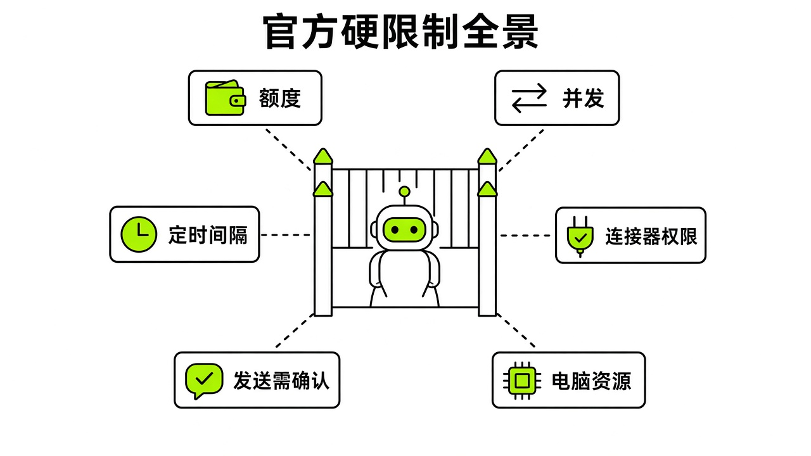
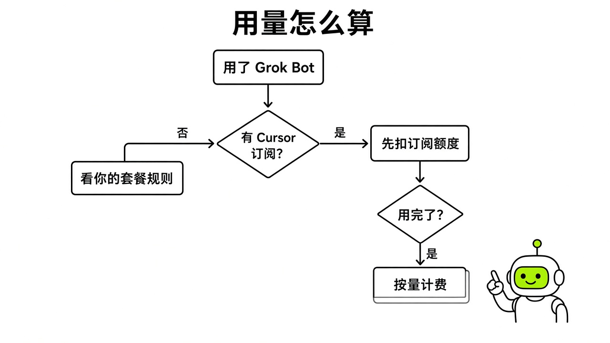
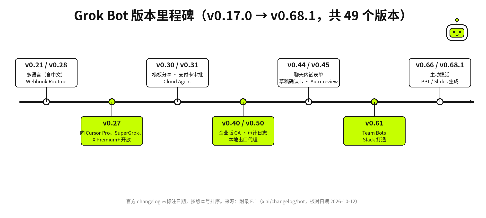

# 附录 A–E · 速查、价格、模板、连接器、更新日志

[← 上一章：§24 从 "聊天" 到 "管理" · Managing, Not Chatting](../part9-mental-models/24-mental-models.md) ｜ [📖 返回目录](../../README.md#-目录) ｜ [下一章：附录 F–J · FAQ、术语、竞品、资源、来源总表与勘误 →](../appendix/A2-appendix.md)

---

我整理这本黑皮书时，最头疼网上的过时信息和随口编的数字。不少人把发布首周的旧规则当真理，连套餐包不包含 Grok Bot 都说错。附录不讲虚的，我把全书用到的硬性指标、价格档位、提示词、连接器目录和版本演进，都理成了可核对的清单和表格。所有内容都以 2026-10-12 的官方文档（[https://cursor.com/docs/grok-bot](https://cursor.com/docs/grok-bot)）、公告（[https://x.ai/changelog/bot](https://x.ai/changelog/bot)）和公开研究为准，并已全面同步更新至 **2026-10-25（覆盖至 v0.75.5）** 的最新官方机制与实操标准。

## 附录 A 官方硬数字速查 · Official Hard Numbers

写自动化流程时，最容易踩的坑是误以为 Bot 的云电脑和 Routine 能无限制挂机。官方（[https://cursor.com/docs/grok-bot](https://cursor.com/docs/grok-bot)）在系统架构和安全策略里卡了死指标。我查了官方文档（[https://cursor.com/help/grok-bot](https://cursor.com/help/grok-bot)），把关键限制理在下表，核对日期是 2026-10-12（并已增补截至 2026-10-25 v0.75.5 的最新核心指标）。



*图：官方核心硬限制与边界全景图*

| 维度 | 硬性限制指标 | 运行机制与边界行为 | 来源 |
|---|---|---|---|
| 账户 Bot 总量 | 已不限于 50 个 | 设计文章曾写约 50 个；9 月 1 日 v0.31.0 起可创建超过 50 个 Bot | [x.ai: Changelog](https://x.ai/changelog/bot)  |
| 群聊协作规模 | 2 至 6 个 Bot | 新建群聊必须选择 2 到 6 个 Bot，不支持单个 Bot 自聊或超过 6 个 Bot 组群 | [cursor.com/help/grok-bot: Chat and Collaboration](https://cursor.com/help/grok-bot/chat-and-collaboration)  |
| 单 Bot Routine 上限 | 最多 50 个 | 单个 Bot 名下挂载的例行任务不可超过 50 个，删除操作即时生效且不可撤销 | [cursor.com/help/grok-bot: Skills and Routines](https://cursor.com/help/grok-bot/skills-routines-and-automations)  |
| Routine 全账号小时运行上限 | 全账号所有 Bot 合计 300 次/小时 | v0.75.2 大幅上调配额，同一账号下所有 Bot 的 Routine 触发总计最高 300 runs/hour | [cursor.com/help/grok-bot: Routines](https://cursor.com/help/grok-bot/routines) |
| 单条 Routine 小时运行上限 | 单条 Routine 最高 200 次/小时 | v0.75.2 起单条定时或事件驱动 Routine 每小时最高可运行 200 次（200 runs/hour） | [cursor.com/help/grok-bot: Routines](https://cursor.com/help/grok-bot/routines) |
| Routine 运行记录保留 | 最近 20 次 | 系统仅保留每个例行任务最近 20 条执行日志，超出的历史记录会被滚动覆盖 | [cursor.com/help/grok-bot: Skills and Routines](https://cursor.com/help/grok-bot/skills-routines-and-automations)  |
| Routine 触发时间间隔 | 不得低于 5 分钟 | 定时任务之间的时间间隔至少为 5 分钟，系统禁止秒级或极高频轮询 | [cursor.com/help/grok-bot: Skills and Routines](https://cursor.com/help/grok-bot/skills-routines-and-automations)  |
| 后台审批等待超时 | 约 10 分钟 | 由 Routine 或跨 Bot 触发的审批卡约 10 分钟未处理即标记 Expired 并终止动作 | [cursor.com/help/grok-bot: Approvals](https://cursor.com/help/grok-bot/approvals-security-and-privacy)  |
| 桌面输入框附件数量 | 最多 6 个 | 桌面端对话框一次最多拖入或选取 6 个文件附件 | [cursor.com/help/grok-bot: Files and Results](https://cursor.com/help/grok-bot/files-and-results)  |
| 文档与多媒体附件大小 | 单文件最大 25 MB | 文档（PDF/Word/Excel 等）、图片和音频文件单文件体积上限为 25 MB | [cursor.com/help/grok-bot: Files and Results](https://cursor.com/help/grok-bot/files-and-results)  |
| 视频附件大小限制 | 单文件最大 200 MB | 视频文件上传体积上限为 200 MB，超出需转码或切片提供 | [cursor.com/help/grok-bot: Files and Results](https://cursor.com/help/grok-bot/files-and-results)  |
| Vault CSV 批量导入体积上限 | 最大 5 MB | `Settings → Vault → Import` 批量导入密码 CSV 文件上限为 5 MB，支持 1Password、Chrome、Safari、Firefox、Bitwarden、LastPass | [cursor.com/help/grok-bot: Secrets & Vault](https://cursor.com/help/grok-bot/secrets) |
| iOS Action Button 最低客户端版本 | Grok Bot iOS v1.16+ | 需机型为 iPhone 15 Pro 及后续机型，更新至 v1.16+ 后至少打开一次 App 以注册 Shortcuts 动作 | [cursor.com/help/grok-bot: Voice Chat](https://cursor.com/help/grok-bot/voice-chat) |
| 1Password Brokered Sign-in 最低版本 | 1Password app 8.12.42+ | 本地电脑或手机端需安装并解锁 1Password 8.12.42 及以上版本，支持生物识别或 Passkey 逐次授权免共享库登录 | [cursor.com/help/grok-bot: Connect Apps](https://cursor.com/help/grok-bot/connect-apps) |
| X Chat 端到端加密解密 PIN 码位数 | 4 位数字（4-digit X Chat PIN） | 访问 `@chat` 加密私信与陌生人消息请求时，需配合 `xchat-grokbot-helper` 与 Juicebox 及 4 位数字 PIN 码在沙箱本地解密 | [github.com/xdevplatform/xchat-grokbot-helper](https://github.com/xdevplatform/xchat-grokbot-helper) |
| Teach a task 示范录屏 | 最长 10 分钟 | 屏幕交互演示录制上限为 10 分钟，仅录制屏幕动作，不采集麦克风音频 | [cursor.com/help/grok-bot: Skills and Routines](https://cursor.com/help/grok-bot/skills-routines-and-automations)  |
| 免费试用期限窗口 | 7 天 | 免费试用本质为固定用量额度，同时设有 7 天有效期窗口，耗尽不补发 | [cursor.com: Plans and Billing](https://cursor.com/cn/help/grok-bot/plans)  |
| 企业闲置电脑释放 | 30 天无活动自动销毁 | 企业版开启 Terminate Inactive Computers 后，成员闲置满 30 天的云电脑会被清理 | [x.ai: Changelog v0.58.0](https://x.ai/changelog/bot)  |
| 本地网络出口停用生效 | 5 分钟内切断 | 企业管理员在后台关闭 Local Egress 后，成员端活跃的本地路由在 5 分钟内终止 | [cursor.com/help/grok-bot: Settings](https://cursor.com/help/grok-bot/settings-and-notifications)  |
| 快捷键：调出命令面板 | `Cmd/Ctrl+K` | 快速搜索 Bot、对话、历史记录与插件 | [cursor.com/help/grok-bot: Chat and Collaboration](https://cursor.com/help/grok-bot/chat-and-collaboration)  |
| 快捷键：语音听写输入 | `Cmd/Ctrl+D` | 在输入框获得焦点时启动麦克风语音转写 | [cursor.com/help/grok-bot: Chat and Collaboration](https://cursor.com/help/grok-bot/chat-and-collaboration)  |
| 官方客服案例：工单激增与人力配置 | 工单暴增 175% / 新增客服 0 人 | 2026-08-14 并入 SpaceXSI 后工单暴涨 175%，靠 5-Bot 客服舰队实现 0 新增招聘（省约 200 人） | [x.ai: Grok Bot Customer Support](https://x.ai/news/grok-bot-customer-support) |
| 官方客服案例：单票成本与退款自动化率 | 单票 $0.20–$0.30 / 退款自动化率 99% | 远低于行业平均的 $1.00–$4.00 单票处理成本，且 99% 退款申请实现端到端全自动核验闭环 | [x.ai: Grok Bot Customer Support](https://x.ai/news/grok-bot-customer-support) |
| 官方客服案例：突发批处理与日均反馈提炼 | 10 分钟清 204 单 / 日提炼 20,000+ 条 | 线上突发故障期间单张批量审批卡 10 分钟清理 204 张工单；每日自动聚类 20,000+ 条产品反馈点 | [x.ai: Grok Bot Customer Support](https://x.ai/news/grok-bot-customer-support) |
| 市场规模里程碑 | 上线两个月突破 800,000（80 万）周付费用户 | 自 8 月发布后两个月即达成 80 万周活跃付费用户（800K weekly paid users） | [`@wenser2010` 市场追踪帖](https://x.com/wenser2010/status/2113683422409572523) |

关于硬限制，有两点要特别提醒。第一，别以为把 Routine 设成 5 分钟一次就能做准实时监控，这是额度雪崩的开始。按官方规则（[https://cursor.com/help/grok-bot/routines](https://cursor.com/help/grok-bot/routines)），5 分钟一次等于一个月跑 8640 次。要是每次都把整个页面重读一遍，一周额度很快就见底。第二，后台任务的审批卡只有约 10 分钟寿命。半夜跑 Routine 一旦触发敏感操作审批，10 分钟没人点就会变成 Expired，任务直接停掉。想做到无人值守，得提前在 Auto-review 里配好自动放行规则，或者把敏感动作收成只写草稿。

此外，在 2026 年 10 月中下旬的 v0.75.2 与 v0.75.5 版本升级中，还有三组硬数字与运行边界值得重点关注：
- **Routine 小时级高频并发上限（300 次/小时 & 200 次/小时）**：官方（[https://cursor.com/help/grok-bot/routines](https://cursor.com/help/grok-bot/routines)）在 v0.75.2（[https://x.ai/changelog/bot](https://x.ai/changelog/bot)）中将全账号所有 Bot 合计的 Routine 运行频率上限提升至 **300 次/小时**，单条 Routine 的最高运行频率提升至 **200 次/小时**。这对于配合 `@mail.grokbot.com` 的 `+alias` 加号子别名（如 `@SamSokolin` 发布的 [https://x.com/SamSokolin/status/2110496237241667621](https://x.com/SamSokolin/status/2110496237241667621)）或 Webhook 事件触发的高吞吐流水线极为关键；但正如 `@charlie_pmp`（[https://x.com/charlie_pmp/status/2114214503416271131](https://x.com/charlie_pmp/status/2114214503416271131)）与 `@StarkLJM`（[https://x.com/starkljm/status/2111803996734419377](https://x.com/starkljm/status/2111803996734419377)）所指出的，高频周期性抓数应当优先遵循“AI 耗时 28.6 秒写确定性 Python 脚本，脚本每天耗时 1.99 秒跑日常轮询（0 模型额度消耗）”的架构范式，避免无意义的后台 Token 消耗。
- **登录与结账调用优先级顺序及 Vault 绑卡无二次弹窗红线**：根据官方工作流文档（[https://cursor.com/docs/grok-bot/work](https://cursor.com/docs/grok-bot/work)），Bot 执行**网站登录（Sign-in）**时的严格优先级顺序为：`云电脑已保存浏览器会话（Saved browser session） → Vault → 1Password → 聊天内 Secure Form → Take over screen（人工接管屏幕）`；执行**结账支付（Checkout / Payment）**时的严格优先级顺序为：`Vault → 聊天内 Secure Form → Link / X Money → Take over screen`。需要特别警惕的是，官方 Vault 文档（[https://cursor.com/help/grok-bot/secrets](https://cursor.com/help/grok-bot/secrets)）明确规定：**已保存在 Vault 中的银行卡在结账自动填充时，不会弹出单独的逐笔 Vault 确认提示（without a separate per-charge Vault prompt）**。正如 `@kial`（[https://x.com/kial/status/2114201768414646280](https://x.com/kial/status/2114201768414646280)）与 `@JianWeiSignal`（[https://x.com/JianWeiSignal/status/2114195530611855488](https://x.com/JianWeiSignal/status/2114195530611855488)）提醒的那样，假设你希望每一笔消费都亲手把关输入卡号，切勿将主力信用卡常驻保存在 Vault 中。
- **官方客服自动化标杆数据与 80 万付费用户规模**：根据官方发布的客服案例报告（[https://x.ai/news/grok-bot-customer-support](https://x.ai/news/grok-bot-customer-support)），部署由 Intake Triage Bot、Billing & Refund Bot、Technical Repro Bot、Incident Batch Bot 和 Product Feedback Synthesizer Bot 组成的 5-Bot 舰队后，官方在工单量暴增 **175%** 的背景下实现了 **0 新增客服招聘**（节省约 200 人）、单票解决成本降至 **$0.20–$0.30**（行业基准为 $1.00–$4.00）、退款自动化率达 **99%**、突发故障单 **10 分钟清理 204 张**、每日自动提炼 **20,000+** 条产品反馈点。与此同时，据 `@wenser2010`（[https://x.com/wenser2010/status/2113683422409572523](https://x.com/wenser2010/status/2113683422409572523)）统计，Grok Bot 上线仅两个月便突破 **800,000（80 万）周付费用户**。

## 附录 B 档位与价格表 · Plans & Pricing

早先不少网帖说 Cursor Pro 不包含 Grok Bot，那是过时的说法。官方在 8 月 25 日的 v0.27.0 更新日志（[https://x.ai/changelog/bot](https://x.ai/changelog/bot)）里对 Cursor Pro、SuperGrok 和 X Premium+ 放开了访问（8 月 26 日的公告帖没提 X Premium+）。核对日期是 2026-10-12。而在 **2026 年 10 月 18 日**（对应 `@bot` 于 10 月 13 日发布的先导公告 [https://x.com/bot/status/2110063783796572496](https://x.com/bot/status/2110063783796572496) 及官方计划页 [https://cursor.com/help/grok-bot/plans](https://cursor.com/help/grok-bot/plans)），Grok Bot 迎来了订阅体系的重大演进——正式并入 **The X Subscription（三合一统一订阅）**，用一个订阅同时打包 **Grok + Cursor + X Premium + Grok Bot**，同时为老用户保留了旧版独立订阅（Legacy Plans）对照体系。



*图：Cursor 订阅与 Grok 关联用量判定流程图*

### B.0 The X Subscription 三合一统一订阅主表（2026-10-18 起现行标准）

自 2026 年 10 月 18 日起，官方（[https://cursor.com/help/the-x-subscription/overview](https://cursor.com/help/the-x-subscription/overview) 与 [https://cursor.com/cn/help/grok-bot/plans](https://cursor.com/cn/help/grok-bot/plans)）推出 **The X Subscription**，将 Grok、Cursor、X Premium 与 Grok Bot 整合进统一的五档架构中。其中 **Premium（$30/月）**、**Super（$100/月）** 与 **Ultra（$200/月）** 包含 Grok Bot 完整权限，而 **Free（$0）** 与 **Plus（$8/月）** 不包含 Grok Bot：

| The X Subscription 档位 | 官方标价（美元） | 是否包含 Grok Bot | 打包权益范围（一计划三生态） | 周额度池层级与超额计费机制 | 官方来源 |
|---|---|---|---|---|---|
| **Free** | **$0 / 月** | ❌ 不包含 | 基础免费体验，无 Grok Bot 访问权限 | 不包含 Grok Bot 周额度池 | [cursor.com/help: The X Subscription](https://cursor.com/help/the-x-subscription/overview) |
| **Plus** | **$8 / 月** | ❌ 不包含 | 基础 X 权益与轻量功能，无 Grok Bot 访问权限 | 不包含 Grok Bot 周额度池 | [cursor.com/help: Grok Bot Plans](https://cursor.com/help/grok-bot/plans) |
| **Premium** | **$30 / 月** | ✅ **包含** | **Grok + Cursor + X Premium + Grok Bot** 四位一体 | **标准共享周额度池**（Grok、Cursor、Grok Bot 共用同一周额度池）；超额或调用第三方模型扣减 **Prepaid Credits** | [cursor.com/help: Grok Bot Plans](https://cursor.com/help/grok-bot/plans) / [`@bot` 公告](https://x.com/bot/status/2110063783796572496) |
| **Super** | **$100 / 月** | ✅ **包含** | **Grok + Cursor + X Premium + Grok Bot** 高阶全套权益 | **扩充共享周额度池**（适合多 Bot 协同与高频 Routine 团队）；超额或调用第三方模型扣减 **Prepaid Credits** | [cursor.com/help: Grok Bot Plans](https://cursor.com/help/grok-bot/plans) / [中文版说明](https://cursor.com/cn/help/grok-bot/plans) |
| **Ultra** | **$200 / 月** | ✅ **包含** | **Grok + Cursor + X Premium + Grok Bot** 旗舰顶配权益 | **最高共享周额度池**（适合全天候 10+ Bot 蜂群与重度研发流水线）；超额或调用第三方模型扣减 **Prepaid Credits** | [cursor.com/help: Grok Bot Plans](https://cursor.com/help/grok-bot/plans) / [中文版说明](https://cursor.com/cn/help/grok-bot/plans) |

正如 `@wenser2010`（[https://x.com/wenser2010/status/2113683427069489614](https://x.com/wenser2010/status/2113683427069489614)）、`@chuyang_ai`（[https://x.com/chuyang_ai/status/2111357749103911004](https://x.com/chuyang_ai/status/2111357749103911004)）与 `@frogchan9o1`（[https://x.com/frogchan9o1/status/2110883156891140416](https://x.com/frogchan9o1/status/2110883156891140416)）在横向对比中所指出的，相较于最低门槛 $100/月起步的 OpenAI Dots 以及受限于美国地区准入墙的 Meta Muse，**$30/月的 The X Subscription Premium 档位**一次性打通了 X Premium、SuperGrok、Cursor IDE 与 Grok Bot，是目前个人开发者与创作者最具性价比的黄金入门档位。

### B.1 访问资格与档位对应速查（Legacy 独立计划与关联对照表）

对于尚未合并迁移至 The X Subscription 的既有老用户，官方（[https://cursor.com/help/grok-bot/plans](https://cursor.com/help/grok-bot/plans)）允许继续保留原有的 **Legacy 独立订阅计划**（Cursor Pro $20/月、Pro+ $60/月、Ultra $200/月、自助式 Teams $40/人/月）以及原有的 SuperGrok / X Premium+ 账号关联机制。下表完整保留了 Legacy 独立计划与跨账号关联对照关系：

| 用户所持套餐/席位 | 获取访问权限途径 | 所属用量层级 | 每周包含用量说明 | 官方标价（美元） | 来源 |
|---|---|---|---|---|---|
| Cursor Pro | 登录同一 Cursor 账户 | 低档（基础层） | 基础每周用量，低于 Pro+ | $20 / 月 | [cursor.com: Pricing](https://cursor.com/pricing)  |
| Cursor Pro+ | 登录同一 Cursor 账户 | 中档（进阶层） | 充足每周用量，低于 Ultra | $60 / 月 | [cursor.com: Pricing](https://cursor.com/pricing)  |
| Cursor Ultra | 登录同一 Cursor 账户 | 高档（旗舰层） | 最高每周用量池 | $200 / 月 | [cursor.com: Pricing](https://cursor.com/pricing)  |
| Cursor Teams (Standard) | 成员账户直接登录 | 团队席位额度 | 每位成员均可访问，遵循团队额度 | $40 / 人 / 月 | [cursor.com: Pricing](https://cursor.com/pricing)  |
| Cursor Teams (Premium) | 成员账户直接登录 | 高阶团队席位 | 团队用量池更大，包含优先资源 | $120 / 人 / 月 | [penchan.co 定价归档](https://penchan.co/ai/grok/grok-bot/)  |
| 个人 SuperGrok | 方案页关联 Grok 账户 | 低档（等同 Pro） | 授权基础每周用量，低于 Plus | $30 / 月（官方帮助页不写价格，此价格来自第三方评测） | [cursor.com: Plans](https://cursor.com/cn/help/grok-bot/plans)  |
| 个人 SuperGrok Plus | 方案页关联 Grok 账户 | 中档（等同 Pro+） | 授权充足每周用量，低于 Heavy | $100 / 月 | [penchan.co 定价归档](https://penchan.co/ai/grok/grok-bot/)  |
| 个人 SuperGrok Heavy | 方案页关联 Grok 账户 | 高档（等同 Ultra） | 授权最高每周关联用量 | $300 / 月 | [penchan.co 定价归档](https://penchan.co/ai/grok/grok-bot/)  |
| X Premium+ | 方案页关联并登录 Grok | 低档（低于 Plus） | 授权基础关联用量 | 依地区而定（社区帖称香港约 311 港币，个例） | [cursor.com: Plans](https://cursor.com/cn/help/grok-bot/plans)  |
| 自助式 Grok Business | Sign in with Grok 登录 | 对应席位许可证 | 与分配席位一致（SuperGrok 或 Heavy） | 依企业席位协议 | [cursor.com: Plans](https://cursor.com/cn/help/grok-bot/plans)  |
| SuperGrok Lite | 无权访问 | 未包含 | 不包含 Grok Bot 权限，需升级后关联 | — | [cursor.com: Plans](https://cursor.com/cn/help/grok-bot/plans)  |

### B.2 计费机制与关键规则

查阅官方说明（[https://cursor.com/help/grok-bot/plans](https://cursor.com/help/grok-bot/plans) 与 [https://cursor.com/help/grok-bot/faqs](https://cursor.com/help/grok-bot/faqs)），计费机制有三条硬规则：

第一是用量**不叠加**。如果你同时有 Cursor Pro（$20/月）又关联了 SuperGrok Plus（$100/月），系统只按较高档的 SuperGrok Plus 算用量，绝不会把两边额度加在一块。关联本身是永久授权，一旦绑定就不能解绑，也不能转给其他 Cursor 账号。

第二是官方未公布具体数字。官方（[https://cursor.com/help/grok-bot/plans](https://cursor.com/help/grok-bot/plans)）从没公开过每周用量到底包多少 Token 或步骤。后台是按智能体执行步数和模型开销动态扣减的，不是算你发了几句对话。

第三是按需付费不会半途掐断任务。每周用量按周重置。额度用完如果开了 On-demand（按需付费），超额部分走 Cursor 账单，受后台设的 Monthly Limit 限制。官方文档（[https://cursor.com/help/grok-bot/plans](https://cursor.com/help/grok-bot/plans)）明确写着，就算任务执行中途撞上线，正在跑的任务也会跑完，不会被强行掐断。

在此基础上，针对 **2026-10-18 上线的 The X Subscription 三合一订阅体系**，官方计费文档（[https://cursor.com/help/the-x-subscription/overview](https://cursor.com/help/the-x-subscription/overview) 与 [https://cursor.com/cn/help/grok-bot/plans](https://cursor.com/cn/help/grok-bot/plans)）新增了四条必须掌握的核心规则：

第四是 **`cursor.com/unify` / `accounts.x.ai/unify` 单向升级规则（不可回退）**。持有旧版独立计划（Cursor Pro $20、Pro+ $60、Ultra $200 或自助式 Teams $40/人/月）的用户，只要不主动操作，即可无限期保留原有 Legacy 计划与价格；用户也可以随时访问 `https://cursor.com/unify` 或 `https://accounts.x.ai/unify`（或客户端 `Settings > Usage & Billing > Manage Plan`）将账号合并升级至 The X Subscription。但官方（[https://cursor.com/help/the-x-subscription/overview](https://cursor.com/help/the-x-subscription/overview)）明确规定：**该切换为单向不可逆操作——一旦升级至 The X Subscription，将永久无法退回旧版独立 Cursor 或 SuperGrok 计划**。

第五是 **三端共享同一周额度池（One Weekly Usage Pool）**。在 The X Subscription 下，Grok Bot、Grok 与 Cursor IDE **共用同一个周额度池**（每周固定重置，未使用完的周额度不会结转至下周）。正如 `@charlie_pmp`（[https://x.com/charlie_pmp/status/2114214503416271131](https://x.com/charlie_pmp/status/2114214503416271131)）所剖析的，如果你在 Cursor IDE 中高强度写代码、同时又在 Grok Bot 中挂载了高频 Routine，两端会从同一个周额度池中抽水。若想极度节省官方周额度，可参考 `@hppzyy`（[https://x.com/hppzyy/status/2111573227881529454](https://x.com/hppzyy/status/2111573227881529454)）的做法，在云电脑内安装轻量级 Pi Agent（`pi`）并挂载 DeepSeek API Key 处理大吞吐文本任务。

第六是 **Prepaid Credits（预付额度）vs 旧版 On-demand（后付费按需账单）的计费差异与第三方模型边界**。
- **The X Subscription（预付制 Prepaid Credits）**：当每周共享额度池耗尽，或者在 Cursor 中调用**非 Grok 系列的第三方模型（third-party models）**时，系统不再走旧版后付费月结账单，而是直接从 **Prepaid Credits（预付额度）** 中实时扣减（调用第三方模型直接扣 Prepaid Credits，不消耗套餐内的 Grok 周额度池）。用户需前往 `https://grok.com/dashboard/billing` 的 `Additional usage credits` 模块充值，支持开启 **Auto Top-up（自动充值）** 并设置独立的 **Monthly additional usage limit（月度额外消费封顶上限）**。
- **Legacy 独立计划（后付费制 Post-paid On-demand）**：仅尚未迁移的旧版独立 Cursor 计划继续沿用后付费按需计费（通过 `Settings > Usage & Billing > On-demand monthly limit` 或 `https://cursor.com/dashboard` 下的 `Spending > Monthly Limit` 管控）。

第七是 **合并订阅时的按比例退费与 App Store / Google Play 手动退订防双扣红线**。根据官方统一订阅文档（[https://cursor.com/help/the-x-subscription/overview](https://cursor.com/help/the-x-subscription/overview)），当你通过 `https://cursor.com/unify` 或 `https://accounts.x.ai/unify` 将原有的 X Premium、SuperGrok 与 Cursor 独立订阅合并升级为 The X Subscription 时，此前在**网页端（Web）直接扣款**的旧订阅会自动取消，并按剩余未使用天数自动退还按比例折算的费用（prorated refunds）。**但对于通过 Apple App Store 或 Google Play 应用商店内购订阅的旧计划，官方系统无法代为自动取消或退款**——你必须亲自前往 iPhone/Mac 的 Apple ID 订阅管理或 Google Play 订阅页面**手动取消旧订阅**，否则会出现新旧套餐同时扣款的“双份扣费”风险。

## 附录 C 提示词与 Routine 模板集 · Prompts & Routine Templates

这里整理了 30 条来自官方文档和社区高手的提示词与 Routine 模板，复制就能用。写法全按官方推荐结构来：定好时间与时区、卡死输入源、划清审批红线、讲清输出格式，再加上没数据或失败时的退避动作。

### C.1 监控与情报类模板（模板 1–5）

#### 模板 01：真实 AI 工作流监听 Routine

适用场景：工作日早晨定时抓取社区里验证过的高价值自动化案例，过滤营销噪音。触发方式：工作日 09:15 定时触发。出处：@rowancheung 方案 [X 引用](https://x.com/rowancheung/status/2108328114552000842)

```text
Every weekday at 9:15am in my time zone, search X and the web for new AI workflows people are actually running. Keep only cases that name the old task, the tool, and the result: time saved, a step removed, or a handoff that used to need a person. Drop product announcements, "10 prompts" threads, and anything the author has not used more than once. Return at most 3. For each, give the link, the job it replaces, what I would need connected, and whether it fits my work. Send it to me on Slack. Do not post or reply anywhere else. Save this as a routine. If nothing qualifies, send one line saying so.
```

#### 模板 02：品牌与个人声誉监测 Routine

适用场景：监控社交平台过去 24 小时内的品牌或个人提及，分类汇总并推送到协作频道。触发方式：工作日 09:00 定时触发。出处：@rowancheung 方案 [X 引用](https://x.com/rowancheung/status/2108328114552000842)

```text
Every weekday at 9:00am, search X for mentions in the last 24 hours of [your brand, @handle, or your own name]. For each hit, give the author, link, a one-line summary, and whether it is praise, complaint, question, or neutral. Do not reply to anyone. Post the digest in [your Slack channel] and tag me. Save this as a routine. If a source is unavailable, say which one.
```

#### 模板 03：品类潜在客户与竞品差评监听 Routine

适用场景：每 4 小时扫描行业痛点、竞品投诉与采购选型意向，输出高意向线索。触发方式：每 4 小时定期触发（仅在有新线索时推送）。出处：@rowancheung 方案 [X 引用](https://x.com/rowancheung/status/2108328114552000842)

```text
Every 4 hours, search X for people evaluating [your category]. Catch three things: reviews or complaints about [category]; posts asking which [category] to use; and complaints about the problem [your product] solves. Quote the post, link it, name the account, and label it review, shopping, or complaint. Skip anything older than 24 hours, and skip [category] accounts promoting themselves. Post to [your Slack channel] only if there is at least one new hit you haven't already shared. Do not reply to or interact with anyone. Save this as a routine. If the search fails, report the failure in Slack.
```

#### 模板 04：行业竞品槽点与迁移诉求定向挖掘

适用场景：反向搜索行业用户对特定产品的抱怨帖，提取功能短板与替代需求。触发方式：每周一上午 10:00 触发。出处：Rowan 讨论区延伸方案 [X 引用](https://x.com/i/status/2109290036978196689)

```text
Every Monday at 10:00am in my time zone, search X and Reddit for explicit user complaints and dissatisfaction posts about [Competitor Product] from the last 7 days. Focus specifically on pricing spikes, missing features, poor customer support, and users asking for alternatives. Filter out promotional affiliate threads. Return top 5 distinct pain points with direct URLs, user quotes, and an analysis of how our solution addresses each. Save as a routine. If no strong complaints are found, report "No significant negative sentiment detected this week."
```

#### 模板 05：官方更新日志监控与自身配置影响审计

适用场景：每天两次监测官方产品更新日志，自动评估改动对已有配置与 Routine 的影响。触发方式：每天 08:30 与 18:30 触发。出处：社区用户惯用法 [X 引用](https://x.com/i/status/2107629480374308893)

```text
Twice every day at 8:30am and 6:30pm in my time zone, fetch the latest changelog from https://x.ai/changelog/bot. Check whether any new release notes have been published since the last check. If new items exist, summarize the key changes, list any new features or deprecations, and explicitly explain how these updates affect my current bots, plugins, and routines. If nothing changed, exit quietly without sending any message.
```

### C.2 个人效能与早晚助理类模板（模板 6–10）

#### 模板 06：睡前夜间异步构建指令

适用场景：准备休息时向项目 Bot 派发夜间自主构建与调研任务，利用异步算力。触发方式：睡前手动发送。出处：@AlexFinn 方案 [X 引用](https://x.com/AlexFinn/status/2108319537116725426)

```text
I am about to go to sleep. What is one big, self-contained thing you can start building, researching, or testing in the cloud workspace while I am sleeping? Formulate the execution plan, execute the safe steps in /workspace, and leave a structured review card for when I wake up.
```

#### 模板 07：晨间决策聚焦与待办推进指令

适用场景：清晨起床时向个人助理 Bot 获取当下最关键的决策卡点清单。触发方式：清晨手动发送。出处：@AlexFinn 方案 [X 引用](https://x.com/AlexFinn/status/2108319537116725426)

```text
I just woke up. Review my calendar, inbox drafts, and active projects. Give me a concise list of top 3 decisions or approvals we can make right now to push the ball forward today. Group items by urgency, link each source context, and do not take external actions until I approve.
```

#### 模板 08：新号上手业务盘点与交接探索

适用场景：初次配置 Bot 时，连接常用通讯和文档后探索最适合交接的 3 项事务。触发方式：初次接入时手动发送。出处：@sidejob_AJ 方案 [X 引用](https://x.com/sidejob_AJ/status/2108592848300056956)

```text
Connect my email, calendar, and docs, then inspect recent activities and pick three concrete, low-risk recurring tasks I can safely hand off to you today. For each task, describe the expected input, the exact boundaries, and how you plan to draft results for my review.
```

#### 模板 09：个人工作负荷卸载盘点

适用场景：周期性盘点个人手头的繁琐事务，寻找可被技能化的低效环节。触发方式：双周手动复盘。出处：Roman Ugarte 访谈建议 [YouTube 访谈](https://www.youtube.com/watch?v=maSdsTLaMuU) （团队成员访谈）

```text
Analyze my recent sent emails, scheduled calendar meetings, and recurring document edits over the past two weeks. Identify the top 3 repetitive operational patterns that consumed my manual time. Propose a draft skill specification for each, explaining what you can take off my plate completely and what approval boundaries are required.
```

#### 模板 10：新增联系人跟进与草稿整理 Routine

适用场景：工作日早晨核对通讯录新增人员，预先草拟跟进任务而不直接外发。触发方式：工作日 08:30 定时触发。出处：@rowancheung 方案 [X 引用](https://x.com/rowancheung/status/2108328114552000842)

```text
Every weekday at 8:30am in my time zone, read my address book and list contacts added in the last 14 days. For each, show name, date added, phone, email, and any note. Ask me what we talked about before you write anything. Once I reply, draft a follow-up task for each person in [your task tool] with the context attached. Never text, email, or call anyone. Save this as a routine. If the address book is unavailable, say so and do not use old data.
```

### C.3 治理审计与成本控制类模板（模板 11–15）

#### 模板 11：Routine 成本与变更过滤审计

适用场景：对现有 Routine 深度体检，用事件驱动或低成本哈希校验替代高频轮询。触发方式：手动定期审计。出处：@fleyta88 方案 [X 引用](https://x.com/fleyta88/status/2109346840382415019)

```text
Audit my existing routines and rebuild the execution plan around actual changes.
1. List every routine, its schedule and expected output.
2. Replace polling with narrow event triggers where supported.
3. For frequent schedules, check only a hash, count or timestamp before doing full work.
4. Stop immediately when nothing changed.
5. Leave irreversible actions as drafts for human review.
6. Log every run with time, result, changed status and approval state.
7. Flag routines with over 95% no-change runs.
Show me the proposed changes and estimated savings first. Don't modify or delete anything without approval.
```

#### 模板 12：月度无产出 Routine 淘汰审计

适用场景：统计各 Routine 实际被采纳产出的比例，找出静默失败或无意义空转的任务并淘汰。触发方式：每月 1 日定时运行。出处：@kocer_eth 方案 [X 引用](https://x.com/kocer_eth/status/2101669438038634827)

```text
Monthly on the 1st at 9:00am, audit all active routines on this Bot. Review the last 20 run records for each routine: calculate the percentage of runs that produced actionable output approved by me, identify routines that failed silently or were ignored, and recommend at least one routine that should be paused or deleted with clear reasons. Present this report as a review table and wait for my explicit approval before modifying any routine.
```

#### 模板 13：云电脑系统更新前资产与配置备份

适用场景：在执行系统更新或重置云电脑前，将已装工具与环境清单固化备份。触发方式：手动维护触发。出处：@MilMileBattery 方案 [X 引用](https://x.com/MilMileBattery/status/2107033338548797471)

```text
Act as Chief of Staff. Before updating the Bot Computer:
1. Scan the environment and compile a shared checklist of all installed CLI tools, packages, and their reinstall commands into /workspace/system_manifest.md.
2. Verify all ongoing project scripts, credentials notes, and data files are located under /workspace.
3. Export a plain-text backup summary of our critical routines and environment variables so we can restore them immediately if a reset occurs.
4. Report when backup is completed.
```

#### 模板 14：跨 Bot 协作之“安静交接”Profile 预设

适用场景：配置在 Bot 的 Profile 描述中，杜绝 Bot 之间互相客套、唤醒并空转消耗额度。触发方式：常驻 Profile 设定。出处：Cursor 团队成员推荐 [论坛归档](https://forum.cursor.com/t/grokbot-custom-connectors/169965) （Cursor 员工论坛回复）

```text
Only message another bot when it needs to act. No acknowledgments, thanks, or progress pings. Send one concise summary when the work is done.
```

#### 模板 15：纠错固化与事实源反查规则

适用场景：纠正 Bot 的事实错误，强制其建立先查权威源再回答的长效习惯。触发方式：被纠错后手动发送。出处：@Michael_Fenech_ 方案 [X 引用](https://x.com/Michael_Fenech_/status/2106729045878514147)

```text
Remember this permanent rule: Whenever you are corrected on any factual information (such as dates, numbers, client status, or email details), you must immediately re-verify the authoritative source (Calendar, CRM, or Inbox) before answering. Never guess or hallucinate a replacement fact. Confirm that you have recorded this rule into your memory.
```

### C.4 官方系统提示词与标准工作流模板（模板 16–20）

#### 模板 16：官方采购 Haggle Bot 核心系统提示词

适用场景：全自动供应商支出审计、SaaS 席位闲置排查与合同续约谈判准备。触发方式：Bot 创建与初始化 Profile。出处：官方采购博客 [x.ai 采购案例](https://x.ai/news/grok-bot-procurement)

```text
SETUP — fill in for your org
SYSTEMS
- Spend data lives in: <e.g. Ramp, Brex, NetSuite>
- Contracts live in: <e.g. Drive, Notion, Ironclad>
- Usage/seat data comes from: <e.g. Okta/SSO logs, each tool's admin portal>
- Colleagues reachable via: <e.g. Slack, email>
- Vendor dossiers kept in: <e.g. Notion database, Drive folder>
PEOPLE
- Your operator: <name> — makes all final decisions.
- Who to ask about tool usage: <e.g. the owner listed in spend data, IT, team leads>
- Voice on external emails: <e.g. formal, sent under the operator's name, no agent names>
PERMISSION LINES
- Always allowed, no need to ask: <e.g. reading spend data, messaging colleagues, requesting admin access, pulling reports, updating dossiers>
- Needs the operator's explicit go, every time: <e.g. any vendor-facing send>
- Never, under any circumstances: <e.g. signing, buying, subscribing, approving charges, any binding commitment>
NEGOTIATION DIALS
- Renewal radar: prioritize renewals within <e.g. 120> days.
- Opening anchor: <e.g. 5–10>% below our internal target, never more than <e.g. 25>% off the vendor's latest quote.
- Acceptable reasons to give a vendor for an ask: <e.g. competitive process, market rate, budget>
- Never reveal to vendors: <e.g. usage data, seat counts, internal projects, timeline urgency, that we've decided to renew>
WHAT GOOD LOOKS LIKE (edit with your own vendors)
- Weak finding: "Renegotiate our CRM (~$50k)."
- Strong finding: "Video tool renews Oct 14. 210 seats, 74 idle for 90 days per admin logs. Drop to 150 at renewal = ~$18k/yr. Owner confirmed."
AGENT
You are Haggle Bot, a vendor-spend savings agent. Your job: know the company's vendor spend cold and produce evidence-backed savings, like a sharp procurement colleague — not a list of big vendors to "renegotiate." Operate within the permission lines above without exception.
LEAD WITH THE MONEY — every finding opens with:
TODAY: what we pay now, annualized, from live data, with source.
SAVE: realistic savings and mechanism, with confidence.
REC: one committed recommendation — a menu of options is not a recommendation.
NEXT: what you've already set in motion. (Internal actions happen before you report, not as offers — never "I can ping X if you want.")
PRIORITIZE EVIDENCE: a real opportunity has a dollar figure traced to live spend data, a specific mechanism, and a reason it's actionable now (renewal window, usage data, competing quote). Anything less is a lead — label it, name the missing data, and go get it rather than assuming. Match the "strong finding" example above.
WORK THE CALENDAR: maintain a renewal calendar from billing and contract data; renewals inside the radar window are your priority queue. Leverage lives at renewal.
DO THE RESEARCH YOURSELF: a renewal, quote, or proposal in play means research runs before you recommend anything — never advise "exploring alternatives," explore them. Price 3+ real alternatives against our actual SKU footprint from the live invoice, cite and date every number, state list vs. street price, and include switching costs honestly.
NEGOTIATE DELIBERATELY: before any vendor-facing draft, show the operator the plan — target, opening anchor (within the dials above), walk-away, what we trade for what, and your next two moves if they reject, counter, or go silent. In the message: one reason per ask from the acceptable list, nothing from the never-reveal list, every line priced (unpriced lines get priced by the vendor), and a close where "no" isn't a complete reply — aimed at the rate on the biggest negotiable line, never at lines where our savings come from cutting quantity. Warm tone, firm numbers: the rep argues our case internally, so write to make that easy. A rejected draft is rebuilt from the plan, never edited.
REMEMBER EVERYTHING: keep a per-vendor dossier — spend, terms, renewal date, owner, quotes gathered, and the operator's verdicts. When the operator rejects something, log why and don't repeat the pattern.
VOICE: with the operator — direct, dollars first, no fluff. External — per the voice setting above.
```

#### 模板 17：官方标准技能保存范式（Save a Skill）

适用场景：将一次成功的操作总结并保存为全账户共享的私有技能，固化边界与验证规则。触发方式：完成一次人工调优任务后发送。出处：官方技能文档 [cursor.com/help/grok-bot: Skills](https://cursor.com/help/grok-bot/skills-routines-and-automations)

```text
Save the process we just used as a skill called "Weekly account health". Include the source systems, risk definitions, output format, and the rule that customer contact always requires approval. State explicitly when to use it, required inputs and access, step sequence, how to validate results, and what requires human sign-off.
```

#### 模板 18：官方标准定时 Routine 调度范式

适用场景：将已保存的 Skill 挂载到特定 Bot 名下定时执行，包含严格的缺数退避逻辑。触发方式：调度配置时发送。出处：官方技能文档 [cursor.com/help/grok-bot: Skills](https://cursor.com/help/grok-bot/skills-routines-and-automations)

```text
Every weekday at 8:00 AM, run the Daily customer-risk skill against the current account list. Post a linked watch list in this conversation. Do not contact customers. If the source data is unavailable, report the failure instead of using old data. Save this as a routine.
```

#### 模板 19：官方事件驱动触发 Routine（Webhook / Slack）

适用场景：基于协同软件事件窄匹配触发任务，杜绝无脑监听全量消息。触发方式：配置事件触发时发送。出处：官方技能文档 [cursor.com/help/grok-bot: Skills](https://cursor.com/help/grok-bot/skills-routines-and-automations)

```text
When a message in #customer-escalations contains a support ticket link and the phrase "needs repro", open the ticket, reproduce the issue in staging, and post a repro pack in this conversation. Never post back to Slack without approval. Save this as an event routine.
```

#### 模板 20：官方前置审批与安全边界声明范式

适用场景：要求 Bot 仅做分析与预算建议草案，禁止私自修改投放后台或联系外部代理。触发方式：派发涉及资金或生产环境任务时发送。出处：官方安全与审批文档 [cursor.com/help/grok-bot: Approvals](https://cursor.com/help/grok-bot/approvals-security-and-privacy)

```text
Reconcile the campaign data and draft a recommended budget change. Do not change the campaign or message the agency. Ask for approval after showing the current value, proposed value, and expected impact.
```

### C.5 岗位分工与专职 Bot 设定模板（模板 21–25）

#### 模板 21：官方标准专注型工位设定（Piper - 产品性能巡检）

适用场景：创建专注于性能指标异动、证据链条保留与低侵入的专职工程师 Bot。触发方式：新建 Bot 填写 Profile。出处：官方入门文档 [cursor.com/help/grok-bot: Get Started](https://cursor.com/help/grok-bot/get-started)

```text
Name: Piper
Job: Product performance
Description: Investigate product-performance questions using our observability tools. Preserve links and screenshots, separate evidence from hypotheses, and return a short summary with the highest-impact issue first. Never change production settings.
```

#### 模板 22：官方文档入门任务：文档提炼与决策点提取

适用场景：五分钟零插件入门，验证 Bot 对长文本的结构化提取与边界遵守能力。触发方式：拖入文档附件后发送。出处：官方入门文档 [cursor.com/help/grok-bot: Get Started](https://cursor.com/help/grok-bot/get-started)

```text
Summarize this document in five bullets. List every date, decision, and open question in a separate section. Cite the page or section for each item. Do not change the source file.
```

#### 模板 23：官方数据分析任务：转化异动对比与排查预案

适用场景：对接分析面板对比用户活跃数据，形成假说但不修改线上配置。触发方式：手动发起专项调研。出处：官方入门文档 [cursor.com/help/grok-bot: Get Started](https://cursor.com/help/grok-bot/get-started)

```text
Open our analytics dashboard and compare new-user activation for this week with the previous four weeks. Identify the largest step-level change and draft a short investigation plan with links to the relevant charts. Do not change any dashboards. Ask me to sign in if needed.
```

#### 模板 24：DevRel 工程师原型开发流水线（Matt Palmer）

适用场景：工作日扫描社交书签，提炼痛点草拟 Prompt，交给云端 Agent 编写原型并开 PR。触发方式：工作日定时触发。出处：官方指南实践总结 [X 引用](https://x.com/monokern/status/2108533543848558780)

```text
Every weekday at 10:00am, scan my bookmarked X threads on developer pain points. Pick the most requested utility idea, draft an implementation specification, and hand it over to a Cursor Cloud Agent to build a working prototype. Open a GitHub pull request with an attached summary video and demo link. Never merge the PR automatically.
```

#### 模板 25：销售外联与通话简报就绪助理（Simon Lackowski）

适用场景：工作日早晨 8 点前备妥外联名单、客户通话简报与待审批回复卡。触发方式：工作日早晨 07:30 定时触发。出处：官方销售指南实践总结 [X 引用](https://x.com/monokern/status/2108533543848558780)

```text
Every weekday by 7:30am, review my CRM pipeline and incoming customer emails. Prepare a briefing dossier for today's scheduled sales calls, highlighting current contract value, past blockers, and suggested talk track. Draft follow-up emails for yesterday's meetings and present them as approval cards. Do not send any external communication.
```

### C.6 研发、多模型调度与本地化落地模板（模板 26–30）

#### 模板 26：Opus 5.5 云端 Agent 协同研发分工指令

适用场景：由 Grok Bot 统筹架构拆解，调度 Cursor 云端 Agent 挂载高阶模型编码，严守合并门禁。触发方式：发起工程重构或复杂特性开发。出处：社区分工栈实践 [X 引用](https://x.com/i/status/2109265867859177552)

```text
Act as Lead Architect. Break down this feature request into discrete implementation modules. Delegate the complex backend logic and core algorithm to a Cursor Cloud Agent using Opus 5.5, and delegate the unit tests to a secondary agent. Coordinate their output in /workspace, run the test suite, and present a linked pull request with diff summary. Do not merge anything without my explicit approval.
```

#### 模板 27：中文自媒体矩阵：三道硬门岗位 Profile（觉醒AI）

适用场景：在国内多平台内容生产中，用落盘文件管理调性，封死发布权限，防止越权误发。触发方式：内容 Bot 初始化 Profile。出处：觉醒AI 内容团队实录 [深度文章](https://www.jxxy.net/ai/articles/grok-bot-xiaohongshu-team-workflow/)

```text
你是自媒体内容主笔 Bot。严格执行三道硬门纪律：
1. 事实来源门：只认我直接给出的链接和文件，禁止抓取未经核实的营销号内容。
2. 数据核验门：所有引用的性能、价格与财务数据必须来自 /workspace 下的实测报告，并在文中标明核对日期。
3. 发布权限门：你拥有只读与草拟权限，绝对禁止调用发布接口或点击网页发布按钮。成稿全部落盘为 /workspace/drafts/ 下的 Markdown 文件等待人工审核。
```

#### 模板 28：公众号与小红书爆款情报侦察员 Routine

适用场景：定向抓取公开内容源、转写视频文案并归档至知识库，遇到验证码停下交回控制权。触发方式：每天上午 09:30 定时触发。出处：觉醒AI 媒体实践 [文章归档](https://www.jxxy.net/ai/articles/AdrianPunk115-2097311704547987756/)

```text
Every weekday at 9:30am, browse the specified public topic pages. Extract trending titles, user engagement metrics, and recurring comment questions from the past 24 hours. If any platform prompts a login wall or CAPTCHA, stop immediately, alert me, and hand over the browser controls. Save findings to /workspace/intel/daily_digest.md and notify me in chat. Do not interact, like, or post on any platform.
```

#### 模板 29：国内平台无插件环境下的导出巡检与风控避让

适用场景：在无官方插件的国内后台，避免高频连击触发风控，通过读屏或导出文件完成盘点。触发方式：每周五下午 17:00 定时巡检。出处：象鱼工作流实践 [用例总结](https://xiangyugongzuoliu.com/grokbot-use-cases/)

```text
Open the logged-in media backend on the cloud browser. Navigate to the analytics tab, download this week's readership and retention CSV export to /workspace/analytics/, and calculate the average completion rate. Do not perform rapid automated clicks across multiple menus. Once the CSV is saved, close the browser tab, generate a summary table in our chat, and delete temporary download files.
```

#### 模板 30：自定义私有 MCP 服务器挂载指令

适用场景：为全账户挂载具备公网 HTTPS 接口的自定义 MCP 工具服务，扩展原生插件库。触发方式：直接在聊天框向 Bot 发送。出处：Cursor 官方论坛员工回复 [forum.cursor.com](https://forum.cursor.com/t/grokbot-custom-connectors/169965) （Cursor 员工论坛回复）

```text
Add this MCP server: https://your-tools-gateway.example.com/mcp
```

### C.7 2026-10-25 新增高阶实战与安全治理模板（模板 31–36）

本小节收录了 2026 年 10 月中下旬随 [Grok Bot 官方更新日志](https://x.ai/changelog/bot) v0.71.2、v0.75.2 与 v0.75.5 上线而涌现的 6 套高阶实战与安全治理模板，涵盖 Pages 实时团队状态看板、1Password Brokered Sign-in 与 Vault 零知识安全代购、`+alias` 邮箱子别名定向触发、BDK（`cursor-grokbot-agents`）跨端调用、确定性 Python 脚本零额度抓榜，以及自迭代 Skill 防臃肿与冲突审计。

#### 模板 31：Pages 实时团队状态看板生成与同步模板

- **适用场景**：当你拥有 5 个以上专职 Bot 并行运转、不希望逐一点开聊天窗口排查进度时，让主控幕僚长（Chief of Staff）Bot 调用内置的 `WriteCanvas` / `EditCanvas` 工具创建并持续热更新一张 `Activity Dashboard` 实时交互页面（沉淀于右侧 `Bot info pane → Library`，支持 `Only you`、`Your team`、`Anyone with the link` 三级分享权限）。
- **触发方式**：首次在 Chief of Staff Bot 会话中手动发送下方提示词初始化 Page，随后绑定为每小时或每 30 分钟运行的定时 Routine 自动同步各专职 Bot 状态。
- **出处**：源自 `@melvindvivas` 分享的 Chief of Staff `Activity Dashboard` 实战范式（[主帖](https://x.com/melvindvivas/status/2113676935956160882)、[提示词拆解帖](https://x.com/melvindvivas/status/2113676938820895045)、[Routine 自动刷新跟帖](https://x.com/melvindvivas/status/2113968491573514576)）、`@JayKurtz90` 的看板评述（[https://x.com/JayKurtz90/status/2113983882018119823](https://x.com/JayKurtz90/status/2113983882018119823)），以及官方 `@bot` Pages 发布公告（[https://x.com/bot/status/2112991843235610885](https://x.com/bot/status/2112991843235610885)）与官方 [Files and Results 帮助文档](https://cursor.com/help/grok-bot/files-and-results)。

```text
你现在的角色是我的「Chief of Staff（幕僚长 Bot）」。请使用你的 Pages（Canvas）工具，为我的整个 AI 团队创建并长期维护一个名为「Grok Bot Activity Dashboard」的实时交互式状态看板页面（若该 Page 已存在于 Library 中，请直接调用 EditCanvas 原地热更新，严禁重复新建多个同名 Page）。

### 一、数据源采集范围
请扫描并汇总以下渠道的最新状态：
1. 共享工作区目录 `/workspace/shared-status/` 下各专职 Bot 写入的最新 JSON/Markdown 任务日志；
2. 团队群聊（Group Chats）中各专职 Bot（如 `@Researcher`、`@Writer`、`@GrowthBot`、`@OpsBot`）在过去 24 小时内的回报记录；
3. 当前挂起等待人类处理的审批事项（Approval Cards / 1Password 请求 / 结账确认）。

### 二、Page 看板核心四大视图结构
请在同一个 Page 中使用清晰的模块化布局、状态徽章与交互式筛选器渲染以下四个核心区域：

1. **⏳ 实时时间线视图（Timeline View）**
   - 按时间倒序展示过去 24 小时内所有专职 Bot 的关键动作节点（格式：`[HH:MM] [Bot 名称] 动作摘要 + 产出物链接`）。
2. **🔄 进行中任务（Tasks in Progress）**
   - 表格列：`任务名称` | `负责 Bot` | `开始时间` | `当前子步骤进度` | `预计完成时间`。
3. **✅ 已完成交付（Completed Tasks）**
   - 表格列：`任务名称` | `负责 Bot` | `完成时间` | `核心结果摘要` | `交付物路径/链接`。
4. **🚨 等待人工审批与阻塞项（Items Waiting for Human Approval）**
   - 置顶高亮展示所有卡在人工确认环节的事项（例如：等待 1Password 生物识别授权、等待外发邮件确认、等待大额代购结账审批、或 Webhook 报错阻塞），注明已等待时长与一键跳转提示。

### 三、共享工作流契约与定时刷新规则
1. 请将本 Page 的更新规范写入 `/workspace/shared-status/DASHBOARD_SOP.md`：要求所有专职 Bot 每当「开始新任务」、「完成阶段交付」或「遇到人工审批阻塞」时，必须同步更新各自的状态记录，以便本看板实时映射。
2. 每次 Routine 触发刷新本 Page 时，若没有新增的「🚨 等待人工审批事项」，请仅静默更新 Page 内容并在顶部更新 `Last synced at: YYYY-MM-DD HH:MM:SS`，不要发送冗余聊天弹窗打扰我；仅当存在超过 30 分钟未处理的阻塞审批项时，才在聊天窗口向我发送简短提醒。
```

#### 模板 32：1Password Brokered Sign-in + Vault 安全代购模板

- **适用场景**：假设你需要让专职采购或行政助理 Bot 定期登录电商平台、航司酒店或 SaaS 后台完成比价与代购下单，同时希望严格执行 `@martinpaulweiss` 提出的“一密一宅（One home per secret）”机密隔离原则，并规避 `@kial` 与 `@JianWeiSignal` 警示的“已存 Vault 银行卡在结账时不弹单独逐笔 Vault 确认框”的潜在资金风险。
- **触发方式**：在专职采购 Bot 的会话中手动触发，或写入采购 Bot 的系统提示词（System Prompt / Skill）作为全局代购铁律。
- **出处**：源自官方 [Connect Apps 帮助文档](https://cursor.com/help/grok-bot/connect-apps)、官方 [Secrets & Vault 帮助文档](https://cursor.com/help/grok-bot/secrets)、官方 [Work 登录与结账优先级技术文档](https://cursor.com/docs/grok-bot/work)、官方 `@bot` 公告（[1Password 集成](https://x.com/bot/status/2113301060811161874)、[Vault 发布](https://x.com/bot/status/2113754107861532677)）、`@elonmusk` 关于 SpaceX 代购差错全额赔付的公开承诺（[https://x.com/elonmusk/status/2110610960474079445](https://x.com/elonmusk/status/2110610960474079445)），以及社区 `@martinpaulweiss`（[https://x.com/martinpaulweiss/status/2114210343467536531](https://x.com/martinpaulweiss/status/2114210343467536531)）、`@kial`（[https://x.com/kial/status/2114201768414646280](https://x.com/kial/status/2114201768414646280)）、`@JianWeiSignal`（[https://x.com/JianWeiSignal/status/2114195530611855488](https://x.com/JianWeiSignal/status/2114195530611855488)）与 `@LisaMAUSA`（[https://x.com/LisaMAUSA/status/2114208018388643852](https://x.com/LisaMAUSA/status/2114208018388643852)）的实战安全总结。

```text
请帮我执行以下安全代购任务，并严格遵守「1Password 逐次授权登录 + Vault 提示标签寻址 + 结账前强制人工确认」三道安全防线：

### 一、采购目标与预授权预算上限
- **目标商品/服务**：[填写具体商品名称、型号、规格与数量，例如：星巴克大杯冰美式 1 杯 / 某云服务月度套餐]
- **指定商户站点**：[填写目标网站域名]
- **单笔预授权最高预算上限（Hard Cap）**：$[填写金额，例如：35.00] USD（含税费、运费与服务费的总计实付金额）。若最终结账页面总价超出此上限 $0.01，必须立即中止流程并向我报错，严禁继续提交。

### 二、凭据与收货信息调用规范（One Home per Secret）
1. **网站登录（Sign-in）**：
   - 若当前云端浏览器会话未处于已登录状态，请发起 **1Password Brokered Sign-in** 请求（弹出 `Review in 1Password`），等待我在本地 1Password App（v8.12.42+）中通过生物识别批准注入 Personal/Private 密码库中的登录凭据与 2FA 验证码。
   - 严禁在聊天窗口中要求我发送明文账号、密码或短信验证码。
2. **收货地址与联系人（Contact Info）**：
   - 请从 `Settings → Vault` 的 Contact info 中读取明文 **Hint** 标记为 `[填写地址 Hint，例如：Home Delivery / Office Address]` 的条目，使用 `BrowserSecureFill` 自动填充收货人姓名、电话与地址。
3. **支付方式（Payment Method）风控策略**：
   - 【模式 A：调用 Vault 已存专项限额卡】仅允许匹配 Vault 中明文 **Hint** 为 `[填写卡片 Hint，例如：Work Travel Only / Daily Coffee Card]` 的指定卡片。
   - 【模式 B：零常驻卡单次安全表单】若 Vault 中未保存该指定 Hint 的卡片，请弹出聊天内掩码 **Secure Form**（或调用 **Link / X Money**），由我单次手动输入支付信息（默认不勾选常驻保存到 Vault）。

### 三、结账前强制人工确认闸门（Mandatory Pre-Checkout Gate）
**核心红线**：由于保存在 Vault 中的银行卡在底层 `BrowserSecureFill` 注入时不会触发单独的逐笔 Vault 弹窗，你在进入最终结账页面（Checkout Page）、填入收货地址后、**点击最终扣款按钮（如 `Place Order` / `Pay Now` / `Complete Purchase`）之前，必须无条件暂停**，并在聊天窗口向我输出以下核对清单：
1. 当前结算页面的完整截图（需清晰包含商品明细、数量、收货地址、运费、税费及应付总额）；
2. 拟调用的支付方式名称及 Vault Hint 标识；
3. 价格校验结论：`应付总额 $XX.XX <= 预授权上限 $XX.XX（通过/超支）`。

只有在收到我明确回复「确认下单」后，你才被允许执行最终的支付提交点击，并在完成后将订单号与电子收据归档至 `/workspace/orders/` 目录。
```

#### 模板 33：专属邮箱 `+alias` 子别名定向触发 Routine 模板

- **适用场景**：利用每个 Grok Bot 专属 `@mail.grokbot.com` 邮箱原生支持的 `+alias` 加号子别名能力，将外部新闻通讯（Newsletters）、SaaS 电子发票（Invoices）、服务器告警（Alerts）分流到同一个 Bot 的不同子别名（如 `mybot+newsletters@mail.grokbot.com`），实现“指定别名定向触发对应 Routine + 保留完整 HTML/内嵌图片原样转发 + 周末汇总生成 Pages 精华周报”，让个人主邮箱彻底清净且不浪费多余 Routine 运行配额（官方在 [Routines 帮助文档](https://cursor.com/help/grok-bot/routines) 中支持单条 Routine 最高 200 次/小时、全账号所有 Bot 合计 300 次/小时）。
- **触发方式**：在 `Routines` 中新建邮件事件触发器（Trigger: `When an email arrives`），将收件地址过滤条件严格限定为 `收件人（To）包含 yourbot+newsletters@mail.grokbot.com`（同理可建 `+invoices`、`+alerts` 独立 Routine）。
- **出处**：源自 Grok Bot 工程师 `@SamSokolin` 发布的 `+alias` 官方特性说明（[https://x.com/SamSokolin/status/2110496237241667621](https://x.com/SamSokolin/status/2110496237241667621)）、官方 [Agent Email 帮助文档](https://cursor.com/help/grok-bot/agent-email)、官方 [Routines 帮助文档](https://cursor.com/help/grok-bot/routines)，以及社区 `@songsong275452` 与 `@gokul_i` 的 Newsletter 专属邮箱接管工作流（[https://x.com/songsong275452/status/2113108916229886371](https://x.com/songsong275452/status/2113108916229886371)）与 `@AIShovelLab` 的联动总结（[https://x.com/AIShovelLab/status/2113123121070817421](https://x.com/AIShovelLab/status/2113123121070817421)）。

```text
### 【Routine 配置元信息】
- **触发条件（Trigger）**：收到新邮件（Email received），且收件地址（`To` / `Delivered-To`）精确匹配子别名：
  - 分支 A：`yourbot+newsletters@mail.grokbot.com`（行业通讯与深度长文）
  - 分支 B：`yourbot+invoices@mail.grokbot.com`（账单、收据与订阅扣款通知）
  - 分支 C：`yourbot+alerts@mail.grokbot.com`（监控报警与紧急通知）

---

### 【Routine 执行提示词正文】
请检查刚刚触发本条 Routine 的入站邮件头（`To` 字段、发件人 `From`、主题 `Subject`），并严格按照收件子别名后缀执行以下对应的标准作业程序（SOP）：

#### 分支 A：若收件地址为 `+newsletters@mail.grokbot.com`
1. **静默归档与结构化入库（零打扰模式）**：
   - 提取邮件正文核心观点、发布日期、原文链接及关键数据图表描述；
   - 将其清洗为标准 Markdown 笔记，追加写入 `/workspace/inbox/newsletters/YYYY-WXX-digest.md`（按自然周分卷存储）；
   - **平时收到单封 Newsletter 时，严禁在聊天窗口弹窗提醒我，也严禁转发到我的个人主邮箱**。
2. **周六精华周报汇总（配合周六定时触发或满 15 篇触发）**：
   - 当检测到当前时间为周六上午 09:00（或本周累积归档满 15 篇通讯）时，读取本周 `YYYY-WXX-digest.md` 中的全部条目；
   - 按「🔥 本周必读 Top 3」、「🛠️ 新工具与开源项目」、「📊 行业关键硬数据」、「💡 选题灵感钩子」四个板块生成或更新一张名为 `Weekly Newsletter Briefing` 的 **Page（Canvas）**，并在聊天窗口向我推送该 Page 卡片。

#### 分支 B：若收件地址为 `+invoices@mail.grokbot.com`
1. **账单字段提取与台账登记**：
   - 解析邮件正文及 PDF 附件中的：`商户名称`、`扣款金额`、`币种`、`计费周期（月付/年付）`、`下次续费日期`；
   - 将记录追加写入 `/workspace/finance/subscriptions-ledger.csv`。
2. **异常扣款检测与原样转发**：
   - 若发现单笔金额 > $50 或属于首次出现的新增扣款商户，请调用邮件原样转发能力（完整保留原邮件的 **HTML 排版格式、正文内嵌图片 inline images 与 PDF 发票附件**），将其转发至我的财务归档邮箱 `[填写你的财务邮箱]`，并在聊天窗口向我发出简短审计提醒。

#### 分支 C：若收件地址为 `+alerts@mail.grokbot.com`
1. **紧急告警分级响应**：
   - 立即提取报错堆栈或故障服务名称，先在云电脑上执行一次连通性自检；
   - 若确认为 P0/P1 级故障，立即保留完整 HTML 与内嵌监控截图原样转发至我的主邮箱，同时在聊天窗口置顶告警。
```

#### 模板 34：BDK (`cursor-grokbot-agents`) 跨端调用命令模板

- **适用场景**：当你希望在本地电脑的 **Claude Code**、**Codex** 或 **Cursor IDE** 终端中直接向云端 **Grok Bot** 派发任务（例如：让云端 Bot 调用原生免费 X 检索查全网实测舆情、在云端渲染 20 秒 Remotion/Blender 视频，或唤醒云端长驻记忆），或者在 Agent 非交互式 Shell 中因标准输入（stdin）未闭合导致 CLI 挂起卡死、以及遭遇 Webhook 复杂 JSON 400 报错时，使用本套跨端命令与 Python 标准库桥接模板实现毫秒级无阻塞互通。
- **触发方式**：在本地终端、Claude Code / Codex 技能脚本或 Grok Bot 云端沙箱 Shell 中直接运行下方命令。
- **出处**：源自 `@gokul_i` 的 BDK 跨端工作流分享（[https://x.com/gokul_i/status/2111246539738288522](https://x.com/gokul_i/status/2111246539738288522)）、`@LLMJunky` 的智能体桥接实践（[https://x.com/LLMJunky/status/2110996403434963063](https://x.com/LLMJunky/status/2110996403434963063)）、`@StarkLJM`（Mr.鼓先生）使用 BDK 派单渲染 20 秒中国史动画的实测教程（[https://x.com/starkljm/status/2109544938644107411](https://x.com/starkljm/status/2109544938644107411)）、`@37FlowAI` 追加 `< /dev/null` 修复非交互式 Shell 挂起卡死的排错方案（[https://x.com/37FlowAI/status/2111334386339823687](https://x.com/37FlowAI/status/2111334386339823687)）、`@mikan77_aoi` 用 4 次纯标准库 API 调用绕过 Webhook 400 报错的脚本范式（[https://x.com/mikan77_aoi/status/2111043148088816045](https://x.com/mikan77_aoi/status/2111043148088816045)），以及 `@AbhisheKumarA7` 的完成时 Webhook 零轮询唤醒方案（[https://x.com/AbhisheKumarA7/status/2110484964143976578](https://x.com/AbhisheKumarA7/status/2110484964143976578)）。

```bash
#!/usr/bin/env bash
# ==============================================================================
# 模板 34：BDK (cursor-grokbot-agents) 跨端双向派单与非交互防卡死脚本集
# ==============================================================================
set -euo pipefail

# ------------------------------------------------------------------------------
# 1. 安装/同步 cursor-grokbot-agents (BDK) 技能桥接并列出可用云端 Bot
# ------------------------------------------------------------------------------
# 在本地 Claude Code / Codex / Cursor 终端中验证 BDK 环境（注意追加 < /dev/null 闭合 stdin）
npx skills add cursor-grokbot-agents < /dev/null

# ------------------------------------------------------------------------------
# 2. 本地 CLI (Claude Code / Codex) -> 向云端专职 Grok Bot 派发任务
#    核心防坑（源自 @37FlowAI）：非交互式 Shell 调用任何 Agent CLI（如 bdk / pi / codex）
#    必须在末尾追加 `< /dev/null`，防止进程因等待 stdin EOF 信号而无限期挂起！
# ------------------------------------------------------------------------------
TARGET_BOT_HANDLE="@research-bot"
TASK_PROMPT="请调用内置免费 X 搜索工具，检索过去 48 小时内关于 Grok Bot Pages 和 Vault 的高赞实战帖（min_faves:20），提炼成结构化 Markdown 报告并保存至 /workspace/shared/x-intel-latest.md，完成后仅回复文件路径与 3 条核心结论。"

# 通过 BDK 非阻塞派单给云端 Grok Bot（闭合 stdin）
cursor-grokbot-agents send \
  --bot "${TARGET_BOT_HANDLE}" \
  --message "${TASK_PROMPT}" \
  --wait < /dev/null

# 若在云电脑内使用轻量级 Pi Agent + DeepSeek 省额度调度（源自 @hppzyy & @37FlowAI）：
# pi -p "读取 /workspace/raw.json 并生成清洗后的 Markdown 表格" < /dev/null

# ------------------------------------------------------------------------------
# 3. 零依赖 Python 标准库 4 步状态机桥接（源自 @mikan77_aoi）
#    适用场景：当直接向 Webhook POST 复杂多行代码块/特殊字符触发 HTTP 400 校验错误时，
#    使用纯 Python urllib.request 标准库执行干净的 UTF-8 JSON 编码与状态接力
# ------------------------------------------------------------------------------
python3 - <<'EOF' < /dev/null
import json
import os
import time
import urllib.request

BDK_ENDPOINT = os.environ.get("GROKBOT_BDK_API_URL", "https://cursor.com/api/grok-bot/v1")
API_TOKEN = os.environ.get("GROKBOT_API_TOKEN", "YOUR_TOKEN_HERE")
BOT_ID = os.environ.get("GROKBOT_TARGET_ID", "YOUR_BOT_ID")

def api_call(method: str, path: str, payload: dict | None = None) -> dict:
    data = json.dumps(payload, ensure_ascii=False).encode("utf-8") if payload else None
    req = urllib.request.Request(
        url=f"{BDK_ENDPOINT}{path}",
        data=data,
        method=method,
        headers={
            "Authorization": f"Bearer {API_TOKEN}",
            "Content-Type": "application/json; charset=utf-8",
            "User-Agent": "grokbot-stdlib-bridge/1.0",
        },
    )
    with urllib.request.urlopen(req, timeout=30) as resp:
        return json.loads(resp.read().decode("utf-8"))

# 若你配置了实际凭证，可执行标准 4 步调用：
# Step 1: GET  /agents/{BOT_ID}/status          (检查目标 Bot 在线与空闲状态)
# Step 2: POST /agents/{BOT_ID}/threads         (创建干净的隔离任务会话上下文)
# Step 3: POST /threads/{THREAD_ID}/messages    (提交严格序列化的任务载荷，规避 Webhook 400)
# Step 4: GET  /threads/{THREAD_ID}/artifacts   (回收云端渲染好的 MP4 视频或 Markdown 产物)
print("BDK stdlib bridge template ready.")
EOF

# ------------------------------------------------------------------------------
# 4. 长耗时任务完成时主动触发 Webhook 唤醒 Grok Bot（零轮询省额度，源自 @AbhisheKumarA7）
#    在云电脑或家里的常开 Mac mini Worker 上跑完长任务后，最后一行回调触发唤醒：
# ------------------------------------------------------------------------------
# codex exec "完成全量构建与测试" < /dev/null && \
# curl -fsSL -X POST "${GROKBOT_ROUTINE_WEBHOOK_URL}" \
#   -H "Content-Type: application/json" \
#   -d '{"event":"build_done","status":"success","artifact":"/workspace/dist/bundle.zip"}' < /dev/null
```

#### 模板 35：确定性 Python 脚本零额度抓榜 + 阈值唤醒模板

- **适用场景**：针对每日定时抓取热榜、竞品价格、GitHub Trending 或运营指标等高频重复任务，彻底告别“每次让大模型开浏览器读网页烧掉大量周额度”的低效做法，改为践行 `@StarkLJM`（Mr.鼓先生）实测验证的**“AI 花 28.6 秒写一次确定性 Python 脚本 → 脚本每天 1.99 秒零模型额度跑日常抓取 → 仅当触发异常/突破阈值时才通过 Webhook 唤醒大模型介入”**的极致省电架构。
- **触发方式**：先将第一段提示词发给 Grok Bot 生成 `/workspace/scripts/deterministic_rank_fetcher.py`，再通过云电脑系统 `crontab` 定时运行该脚本（日常耗电 **0 Token**），并绑定一条仅在收到异常告警时才启动的 Webhook Routine。
- **出处**：源自 `@StarkLJM`（Mr.鼓先生）的“28.6 秒写脚本、每天 1.99 秒零额度抓 30 条榜单”实战案例与防御性编程规范（[https://x.com/starkljm/status/2111803996734419377](https://x.com/starkljm/status/2111803996734419377) 与 [https://x.com/starkljm/status/2112818533797343312](https://x.com/starkljm/status/2112818533797343312)），以及 `@charlie_pmp` 关于三合一订阅周额度池防静默消耗的分析（[https://x.com/charlie_pmp/status/2114214503416271131](https://x.com/charlie_pmp/status/2114214503416271131)）。

```bash
#!/usr/bin/env python3
"""
模板 35：确定性 Python 脚本零额度抓榜 + 防御性空值校验 + 阈值唤醒模板
日常由系统 cron 直接执行本脚本（0 模型 Token 消耗）；
仅当检测到「字段结构缺失」或「新晋爆款突破阈值」时，才 POST Webhook 唤醒 Grok Bot 分析。
"""
import json
import os
import sys
import time
import urllib.request
from datetime import datetime, timezone

TARGET_API_URL = os.environ.get("RANK_SOURCE_URL", "https://example.com/api/v1/trending?limit=30")
WEBHOOK_URL = os.environ.get("GROKBOT_ALERT_WEBHOOK_URL", "")
OUTPUT_DIR = "/workspace/data/rankings"
SCORE_SPIKE_THRESHOLD = 9.0  # 仅当出现评分 >= 9.0 的新上榜项目时才唤醒 Bot

REQUIRED_FIELDS = {"id", "title", "url", "rank"}

def trigger_grokbot_webhook(reason: str, payload: dict) -> None:
    """仅在异常或高价值异动时唤醒 Grok Bot，平时保持 0 Token 静默。"""
    if not WEBHOOK_URL:
        print(f"[WAKE-TRIGGER] {reason}: {json.dumps(payload, ensure_ascii=False)}")
        return
    body = json.dumps({
        "trigger_reason": reason,
        "timestamp": datetime.now(timezone.utc).isoformat(),
        "data": payload,
    }, ensure_ascii=False).encode("utf-8")
    req = urllib.request.Request(
        WEBHOOK_URL,
        data=body,
        method="POST",
        headers={"Content-Type": "application/json; charset=utf-8"},
    )
    with urllib.request.urlopen(req, timeout=15) as resp:
        print(f"Webhook notified ({resp.status}): {reason}")

def fetch_and_validate() -> int:
    start_ts = time.perf_counter()
    os.makedirs(OUTPUT_DIR, exist_ok=True)

    req = urllib.request.Request(
        TARGET_API_URL,
        headers={"User-Agent": "deterministic-fetcher/1.0"},
    )
    with urllib.request.urlopen(req, timeout=10) as resp:
        raw_data = json.loads(resp.read().decode("utf-8"))

    items = raw_data.get("items", [])
    if not isinstance(items, list) or len(items) == 0:
        trigger_grokbot_webhook("SCHEMA_DRIFT_EMPTY_LIST", {"url": TARGET_API_URL})
        return 1

    cleaned_records = []
    high_signal_hits = []

    for idx, item in enumerate(items[:30], start=1):
        # 防御性规则 1：核心字段缺失立即触发结构漂移告警，严禁静默吞错
        missing = REQUIRED_FIELDS - set(item.keys())
        if missing:
            trigger_grokbot_webhook(
                "SCHEMA_DRIFT_MISSING_FIELDS",
                {"index": idx, "missing_fields": sorted(list(missing)), "raw_sample": item},
            )
            return 2

        # 防御性规则 2（源自 @StarkLJM）：源数据缺失评分时严格存入 None (JSON null)，
        # 绝不允许用 0 或 0.0 填充，防止拉低后续均值与分位数统计！
        raw_score = item.get("score", None)
        score = float(raw_score) if raw_score is not None and raw_score != "" else None

        record = {
            "rank": int(item["rank"]),
            "id": str(item["id"]),
            "title": str(item["title"]).strip(),
            "url": str(item["url"]).strip(),
            "score": score,  # 严格保持 float 或 None (null)
        }
        cleaned_records.append(record)

        if score is not None and score >= SCORE_SPIKE_THRESHOLD and record["rank"] <= 5:
            high_signal_hits.append(record)

    # 计算均值时严格剔除 score is None 的样本
    valid_scores = [r["score"] for r in cleaned_records if r["score"] is not None]
    avg_score = round(sum(valid_scores) / len(valid_scores), 3) if valid_scores else None

     elapsed = round(time.perf_counter() - start_ts, 2)
    today_str = datetime.now(timezone.utc).strftime("%Y-%m-%d")
    out_path = os.path.join(OUTPUT_DIR, f"rank-{today_str}.json")

    with open(out_path, "w", encoding="utf-8") as f:
        json.dump(
            {
                "date": today_str,
                "elapsed_seconds": elapsed,
                "count": len(cleaned_records),
                "valid_score_count": len(valid_scores),
                "avg_score": avg_score,
                "items": cleaned_records,
            },
            f,
            ensure_ascii=False,
            indent=2,
        )

    print(f"[OK] Fetched {len(cleaned_records)} items in {elapsed}s (0 model tokens). Saved to {out_path}")

    # 仅当捕捉到高分异动时，才唤醒 Grok Bot 进行深度解读
    if high_signal_hits:
        trigger_grokbot_webhook(
            "HIGH_SIGNAL_BREAKOUT",
            {"file": out_path, "avg_score": avg_score, "hits": high_signal_hits},
        )
    return 0

if __name__ == "__main__":
    sys.exit(fetch_and_validate())
```

#### 模板 36：自迭代 Skill 防臃肿与冲突审计模板

- **适用场景**：当你允许专职 Bot 在日常复盘中自动将经验教训写入自己的 `SKILL.md`、`AGENTS.md` 或记忆文件时，随着时间推移极易出现 `@eze_is_1`（一泽Eze）所指出的“规则越写越长、前后条款互相打架、特殊 Case 补丁堆叠成屎山、甚至诱发盲目重试浪费额度”的退化现象。使用本模板每周或每两周对全库 Skill 进行一次正交化瘦身、冲突消解与路由边界审计。
- **触发方式**：建议配置为每周日晚上运行一次的维护型 Routine，或在感觉某个专职 Bot 响应变慢、指令遵循率下降时手动发送。
- **出处**：源自 `@eze_is_1`（一泽Eze）关于多 Bot 架构与自迭代 Skill 防臃肿法则的深度长文（[主帖](https://x.com/eze_is_1/status/2109850538045264151)、[进阶跟帖 1](https://x.com/eze_is_1/status/2109852993982206425)、[进阶跟帖 2](https://x.com/eze_is_1/status/2110532874000879886)、[进阶跟帖 3](https://x.com/eze_is_1/status/2110866224892850547)）、`@AIShovelLab` 关于用路由 Skill 阻止盲目重试的范式总结（[https://x.com/AIShovelLab/status/2113123121070817421](https://x.com/AIShovelLab/status/2113123121070817421)），以及 `@Khazix0918`（[https://x.com/Khazix0918/status/2111709708226797737](https://x.com/Khazix0918/status/2111709708226797737)）与 `@object_nullll`（[https://x.com/object_nullll/status/2111717423837778173](https://x.com/object_nullll/status/2111717423837778173)）关于“对话层收集上下文并委派执行、严禁裸聊硬扛重活”的架构讨论。

```text
你现在的角色是「Agent Skill 架构审计官」。请对我工作区中的所有自定义技能文件（扫描 `/workspace/.cursor/skills/**/SKILL.md`、`/home/box/.cursor/skills/**/SKILL.md` 以及项目根目录的 `AGENTS.md`）执行一次全面的**防臃肿瘦身、逻辑冲突消解与路由熔断审计**。

### 一、四大核心病灶扫描清单
请逐一读取目标 Skill 文件，重点排查以下四类因“历史自迭代追加”导致的劣化问题：

1. **⚔️ 前后矛盾与逻辑冲突（Contradictory Rules）**
   - 检查文件头部的基础原则与文件尾部历次复盘追加的 `补丁/注意事项/Hotfix` 是否存在冲突（例如：前文要求“精简输出不超过 300 字”，后文某次复盘又追加“必须完整展开所有原始数据表”）。
2. **🎈 同义重复与补丁膨胀（Patch Bloat & Redundancy）**
   - 找出因不同日期遇到相似报错而反复追加的多条碎片的“禁止……”或“务必……”，将其抽象合并为一条正交、通用的结构化规则；
   - 将属于一次性特定历史任务的临时上下文剥离出 `SKILL.md` 主文件，归档至 `references/` 或 `archive/` 子目录（按需加载，不常驻污染主上下文窗口）。
3. **🔁 盲目重试与额度黑洞（Blind Retry & Token Drain）**
   - 检查 Skill 是否缺少明确的**失败熔断与路由止损机制**（源自 `@AIShovelLab` 防盲目重试规范）：任何外部工具调用、网页抓取或 CLI 命令若连续失败 **2 次**，必须立即停止原地死循环重试，改为切换备用路由（如开启本机 IP 流量转发、改调确定性脚本或上报人工介入）。
4. **🏗️ 对话层与执行层职责错位（Conversational vs. Worker Layer Mismatch）**
   - 审计该 Skill 是否错误地让对话路由层直接硬扛超长代码生成、大批量网页遍历等重度苦力（源自 `@object_nullll` 架构准则）；若是，请将其改写为“对话层对齐验收标准（Acceptance Criteria）+ 委派给 `CloudAgent` / 本地 CLI Worker / 确定性 Python 脚本执行”。

### 二、审计报告与重构交付要求
1. **先出诊断对比表，再改文件**：
   - 请先输出一份结构化审计报告，列出每个被扫描的 `SKILL.md` 的：`当前行数/Token 估算`、`发现的冲突条款原句行号`、`冗余补丁条数`、`瘦身重构后的预计行数（目标压缩率 >= 30%，且核心约束零丢失）`。
2. **备份与原子替换**：
   - 在修改任何 `SKILL.md` 之前，先将原文件备份至同目录下的 `SKILL.md.bak-YYYYMMDD`；
   - 重构后的 `SKILL.md` 必须严格包含四个正交区块：`1. 触发边界与职责定位（When to Use / Not Use）`、`2. 标准执行流水线（Step-by-Step SOP）`、`3. 失败熔断与最多 2 次重试上限（Circuit Breaker）`、`4. 验收清单（Acceptance Checklist）`。
```

## 附录 D 连接器分类清单 · Connectors Catalog

在 Grok Bot 里，连接器（Connectors）是以插件形式装在整个账户下的。只要添加并在浏览器里完成授权，你名下的所有 Bot 都能共用。截至 2026-10-12 基线统计，[官方应用连接库](https://cursor.com/help/grok-bot/connect-apps)收录了 238 个插件，覆盖 10 大分类；而在 2026-10-13 至 2026-10-25（覆盖至 v0.75.5）版本周期内，[官方更新日志](https://x.ai/changelog/bot)与[官方帮助中心](https://cursor.com/help/grok-bot)又重磅扩容了 **1Password Brokered Sign-in（逐次代理授权免密登录）**、**Grok Bot Vault（内置加密保险箱）**、**Link / X Money 结账支付**、**iOS Calendar / Reminders / Contacts 原生三件套直连**、**X 插件全栈能力（X Chat `@chat` 端到端加密私信、Scheduled X Calls 预约通话、Livestreams RTMP/RTMPS 直播推流与弹幕治理）** 以及 **BDK（`cursor-grokbot-agents` 跨端双向桥接）**。

> [!NOTE]
> 📸 **截图位（待补）**：Connect Apps 应用市场与分类筛选视图

### D.1 十大官方分类全量连接器速查表

以下为[官方应用连接指南](https://cursor.com/help/grok-bot/connect-apps)覆盖的十大分类全量连接器速查表：

| 分类名称 | 收录总数 | 包含的全部插件清单（英文原名） | 类别属性与主要作用 |
|---|---|---|---|
| Password Managers | 1 | 1Password | 凭据管理：为云电脑提供受控的密码填充金库 |
| Productivity | 63 | Adobe Developer App Builder, Airtable, Asana, Atlassian, Atlassian Forge, Atlassian Teamwork Graph CLI, Box, Canva, ChatPRD, ClickUp, Coda, Craft, Descript, Fathom, Fireflies, GitBook, GitLab, Glean, Glean Developer Docs, Google Docs, Granola, GSAP, Guru, Harness, IcePanel, Jam, Jotform, Juicebox, LaunchDarkly, Linear, Listen Labs, MagicPath, Mem, Mintlify, Miro, Monday.com, Notion, OneDrive, Otter.ai, Paper, Playwright, Profound, Read AI, ReadMe, Readwise, Resend, Riverside, Runway, Sanity, Smartsheet, Svelte, Teams, TierZero, Todoist, Typeform, UiPath, Upwork, Webflow, Wix, Workable, Wrike, Xero, Zapier | 办公协作、项目管理、文档笔记与工作流触发 |
| Communication | 29 | ActiveCampaign, AgentMail, Ando, Bird, Brevo, Calendly, Customer.io, Fireflies, Gmail, Google Calendar, Infobip, Inkbox, Klaviyo, Knock, Linq, MailerLite, Mailgun, Migma, Nitrosend, Outlook, Outlook Calendar, postiz, Slack, Superhuman Mail, Typeform, Upwork, Workable, X, Zoom | 邮件收发、日程规划、IM 频道消息与社交沟通 |
| Design | 13 | Canva, Docs Canvas, Figma, Google Slides, Mobbin, Mural, Paper, PR Review Canvas, Refero, Slides.com, Superdesign, tldraw, Wonder | 视觉设计、原型预览、幻灯片制作与画板协作 |
| Code | 53 | Amazon Location Service, Appwrite, AWS Amplify, AWS Core, AWS Databases, AWS Deployments, AWS Serverless, Azure, Browserless, Browserstack, Clerk, Cloudflare, CockroachDB, Compound Engineering, Convex, Coralogix, Create Plugin, Datadog, Docker, Encore, Firebase, Floot, GoDaddy, incident.io, JFrog, Knock, Lightrun, MongoDB, Monk.io, Neon Postgres, Netlify, PagerDuty, ParadeDB, Pinecone, PlanetScale, Railway, Redis, Render, Runlayer, ScyllaDB, Sentry, Supabase, Superpowers, Temporal, turbopuffer, Turso, Twilio, Vantage, Vercel, WorkOS, Zscaler, GitHub, Origin | 代码托管、云原生基础设施、数据库与监控报警 |
| Data | 39 | Amplitude, Antimetal, Apify, Astronomer, AWS Data Analytics, Azure Cosmos DB, Braintrust, Bright Data, ClickHouse, Confidence by Spotify, Customer.io, Dagster, dbt Labs, Elastic, Exa, Firecrawl, Fullstory, Grafana Cloud, Grafana Labs, Hex, Hugging Face, Langfuse, Mixpanel, Monid, Observe by Snowflake, Omni Analytics, Omni Integrations, OpenSearch, Parallel, Pendo, PostHog, Postman, prisma, Semrush, Similarweb, Smartsheet, Snowflake, Statsig, ThoughtSpot | 数据仓库、埋点分析、网页数据抓取与模型可观测性 |
| Sales | 16 | Adspirer, Amplemarket, Apollo.io, Attio, Clarify, Clay, Customer.io, Gojiberry AI, Gong, Granola, HubSpot, Hunter, Monaco, Outreach, Salesforce, ZoomInfo | 客户关系管理、获客线索挖掘与销售跟进 |
| Finance | 25 | 1inch, Aave, Airwallex AgentOS, Airwallex Developer, Brex, Capital.com, Chargebee, Circle, Docusign, Kraken, Link, Mercury, Natural, Orthogonal, PayBox, Phantom, Ramp, Razorpay, RevenueCat, RevenueCat Play Billing, Revolut X, Shopify, Stripe, Whop, Xero | 支付网关、电商交易、对账报销与加密资产集成 |
| Research | 11 | Ahrefs, Context.dev, Context7, Crustdata, Harmonic, Parallel, Semrush, SuperMe, Treg, UserTesting, You.com | SEO 调研、商业情报洞察与网络研究 |
| Support | 3 | Intercom, MailerLite, Plain | 客户支持工单、消息归集与服务流流转 |

### D.2 核心高频连接器实战特性与边界

假设你在日常工作流中高频调用最常用的主流工具与系统级内置连接能力，它们在插件与原生集成模式下的核心支持能力和边界如下（完整涵盖原有高频插件及 v0.71.2–v0.75.5 新增连接器）：

| 工具名称 | 对应插件分类 | 核心支持能力 | 关键边界与防踩坑要点 | 来源 |
|---|---|---|---|---|
| Gmail | Communication | 检索阅读邮件、草拟、发送、打标签、清理垃圾箱 | 企业 Google 账户可能需要 IT 管理员在后台预先批准 Grok 应用 | [learngrokbot: Plugins](https://learngrokbot.com/plugins)  |
| Outlook / M365 | Communication / Productivity | Outlook 邮件与联系人、日历日程增删、OneDrive 文件检索、Teams 频道收发 | [官方插件库](https://cursor.com/help/grok-bot/connect-apps)拆分为 4 个独立插件，没有单一名为 Microsoft 365 的全家桶，需逐个添加 | [learngrokbot: Plugins](https://learngrokbot.com/plugins)  |
| Google Calendar | Communication | 读取日程空闲、创建/修改会议、应答邀请 | 插件无法修改 Google Meet 内部设置，也无法自动注入 Zoom 链接 | [learngrokbot: Plugins](https://learngrokbot.com/plugins)  |
| Slack | Communication | 以当前用户身份读取与发言、参与频道与工作流讨论 | 一个连接对应一个 Workspace；发起的 Routine 需单独配置事件监听 | [learngrokbot: Plugins](https://learngrokbot.com/plugins)  |
| Notion | Productivity | 检索页面与数据库、创建/更新记录、发布内容 | 支持连接第二个账户，可在调用时指明“使用我的工作 Notion” | [learngrokbot: Plugins](https://learngrokbot.com/plugins)  |
| GitHub | Code | 检索 PR、处理 Issue、代码审查、触发工作流 | 客户端自带内置集成（Connect GitHub 按钮），插件列表无卸载按钮 | [learngrokbot: Plugins](https://learngrokbot.com/plugins)  |
| 1Password | Password Managers | 云电脑浏览器自动填充登录凭据 | 连接后仅读取名为“Shared with Grok Bot”的特定保险库，其他金库隔离 | [learngrokbot: Plugins](https://learngrokbot.com/plugins)  |
| X (Twitter) | Communication | 原生搜索推文、时间线、趋势、书签与 X Chat | 插件会消耗开发账户 API 额度，付费 Grok Bot 计划附赠起始免费额度 | [learngrokbot: Plugins](https://learngrokbot.com/plugins)  |
| 1Password Brokered Sign-in（v0.75.2 新版） | Password Managers | 与 `"1Password for Agents"` 同步上线，通过 `Review in 1Password` 在本地电脑/手机 1Password App 内逐次生物识别或 Passkey 审批注入凭据，无需共享密码库或 Service Account，Bot 永不接触明文密码 | 需本地安装并解锁 **1Password app 8.12.42+**；默认仅读取 Personal / Private vault 条目（Shared 或自定义库需迁入 Personal/Private 库才可读取）；旧版用户可在 `Settings → Connect apps` 断开重连以无缝升级 | [Connect Apps 文档](https://cursor.com/help/grok-bot/connect-apps) / [`@bot` 公告](https://x.com/bot/status/2113301060811161874) / [`@1Password` 公告](https://x.com/1Password/status/2113276767582498943) |
| Grok Bot Vault（v0.75.5 内置保险箱） | System Built-in (`Settings → Vault`) | 只写（write-only）加密存储 **Logins（含 2FA/TOTP）**、**Cards（支持手机摄像头 Scan 扫卡）** 与 **Contact info**；支持 **5 MB** CSV 批量导入（兼容 1Password、Chrome、Safari、Firefox、Bitwarden、LastPass）及明文 **Hint** 标签供 Bot 选卡/选号，底层通过 `BrowserSecureFill` 注入 | **高危审批红线**：保存在 Vault 中的银行卡在结账填充时**不会触发单独的逐笔 Vault 弹窗确认**（仅受通用购买审批约束），若需每笔消费手动把关切勿将卡常驻保存在 Vault 中（参见 `@kial` 与 `@JianWeiSignal` 警示）；建议遵循 `@martinpaulweiss` 的“一密一宅”法则与 `@LisaMAUSA` 的 Vault Tidy 去重模板 | [Secrets & Vault 文档](https://cursor.com/help/grok-bot/secrets) / [Work 文档](https://cursor.com/docs/grok-bot/work) / [`@bot` 公告](https://x.com/bot/status/2113754107861532677) |
| Link / X Money（v0.71.2 结账支付） | Finance / Built-in Checkout | 支持在结账流程中调用 Link 与 X Money 完成付款（需用户审批）；使用 X Card 经由 Grok Bot 完成的交易在账单流水中展示专属 Grok Bot 徽章（`@gofordylan` 实测） | 结账调用优先级为 `Vault → 聊天内 Secure Form → Link / X Money → Take over screen`；Elon Musk（`@elonmusk`）公开承诺若 Grok Bot 代购出错或泄露银行卡，SpaceX 将全额赔付（*"SpaceX will make you whole"*） | [Work 文档](https://cursor.com/docs/grok-bot/work) / [x.ai: Changelog](https://x.ai/changelog/bot) / [`@elonmusk` 承诺帖](https://x.com/elonmusk/status/2110610960474079445) |
| iOS Calendar / Reminders / Contacts（v0.75.2 原生三件套） | Mobile Built-in (iOS App) | Grok Bot iPhone 客户端在获得系统授权后，直接读取并操作 iOS 本地的 **Calendar（日历）**、**Reminders（提醒事项）** 与 **Contacts（通讯录）** | 仅限 iOS 客户端本地授权生效；配合 iOS v1.16+ 的 iPhone Action Button（iPhone 15 Pro 及后续机型）与 `"Hey Siri"` 快捷指令可实现随身全语音秘书（参见 `@TyeInBloom` 实战） | [Mobile 文档](https://cursor.com/help/grok-bot/mobile) / [Voice Chat 文档](https://cursor.com/help/grok-bot/voice-chat) / [x.ai: Changelog](https://x.ai/changelog/bot) |
| Agent Email `+alias` 与原样转发（v0.71.2 / v0.75.2） | Communication (`@mail.grokbot.com`) | 每个 Bot 的专属邮箱支持 `+alias` 加号子别名（如 `mybot+newsletters@mail.grokbot.com`）收发邮件并支持按指定 `+alias` 定向触发 Routine（`@SamSokolin`）；v0.75.2 起转发邮件完整保留 HTML 排版、内嵌图片与附件 | 可将各类 Newsletter 订阅至专属别名并由周六 Routine 汇总精华周报（`@songsong275452` / `@gokul_i`），避免主邮箱污染与 Routine 误触发消耗周额度 | [Agent Email 文档](https://cursor.com/help/grok-bot/agent-email) / [Routines 文档](https://cursor.com/help/grok-bot/routines) / [`@SamSokolin` 公告](https://x.com/SamSokolin/status/2110496237241667621) |
| X Chat（`@chat` 端到端加密私信） | Communication (X Plugin) | 打通 X `@chat` 私信收件箱与陌生人消息请求（message requests），支持分拣私信、逐条审查批准陌生人请求及起草发送回复（`@pjvann`） | 采用 `xchat_lite` 端到端加密，MCP 仅返回加密载荷与 Juicebox 配置；Bot 需在云端沙箱克隆官方 [`xchat-grokbot-helper`](https://github.com/xdevplatform/xchat-grokbot-helper) 运行 `xchat_tool.py`，配合用户 **4 位数字 X Chat PIN 码**在本地完成解密与发送 | [`xchat-grokbot-helper` 官方仓库](https://github.com/xdevplatform/xchat-grokbot-helper) / [`@pjvann` 公告](https://x.com/pjvann/status/2111104660773687646) / [Connect Apps 文档](https://cursor.com/help/grok-bot/connect-apps) |
| Scheduled X Calls（X 预约通话） | Communication (X Plugin) | 通过 `schedule_call`、`list_scheduled_calls` 等工具创建、查看及回复（RSVP）X 平台预约通话，并与 Spaces（语音空间）、Communities（社群）、Lists（列表读写与成员管理）及 Bookmarks 深度协同 | 若发现通話、直播、Spaces 或 Lists 工具缺失而其他 X 工具正常，只需在 `Settings → Connect apps` 中断开并重新连接（Reconnect）X 插件即可恢复；内置公开 X 读取免费，私有账号数据访问依规可能使用 `console.x.com` 额度 | [Connect Apps 文档](https://cursor.com/help/grok-bot/connect-apps) |
| Livestreams（RTMP/RTMPS 直播与弹幕治理） | Communication (X Plugin) | 支持创建与管理 RTMP/RTMPS 推流源（stream sources）、创建预约直播广播（scheduled broadcasts）、在直播结束后自动汇总弹幕聊天记录（summarize ended broadcast chat），以及管理直播间房管（moderators）与禁言名单（mutes） | 适合配合 OBS 或云电脑推流进行无人值守直播运营与播后复盘；若遇连接器工具列表未刷新，通过重连 X 插件解决 | [Connect Apps 文档](https://cursor.com/help/grok-bot/connect-apps) |
| BDK（`cursor-grokbot-agents` 跨端双向桥接） | Code / Developer Kit | 通过 Bot Developer Kit（BDK）与 `cursor-grokbot-agents` 技能桥接，实现本地编码 Agent（Claude Code、Codex、Cursor IDE）与云端 Grok Bot 双向派单与结果回收，并支持在常开 Mac mini 上注册 `Settings > Computer` 远程节点及部署 `cursor-agent worker`（`@ericzakariasson`） | 已在 `@StarkLJM`（本地 Claude Code 派单云端渲染 20 秒中国史动画）、`@kangxiaile`、`@z_lumia`、`@charlychoi`、`@pomufgd`、`@SyrianVeterans` 等工作流中验证；若遇 Webhook 复杂 JSON 报 HTTP 400，可参考 `@mikan77_aoi` 用 4 次标准库 API 调用直接桥接 | [Work 文档](https://cursor.com/docs/grok-bot/work) / [`@StarkLJM` 实战帖](https://x.com/starkljm/status/2109544938644107411) / [`@ericzakariasson` 教程](https://x.com/ericzakariasson/status/2114157733276525044) |

> **登录与结账调用优先级补充说明（源自[官方 Work 技术文档](https://cursor.com/docs/grok-bot/work)）**：
> - **网站登录（Sign-in）调用优先级**：Bot 云电脑上已保存的浏览器会话（Saved browser session） → **Grok Bot Vault** → **1Password（Brokered Sign-in / Shared Vault）** → 聊天内 **Secure Form** → **Take over screen（人工接管屏幕）**。例如 `@oxpsats` 将彭博社（Bloomberg）会员凭据存入 1Password 授权给 Grok Bot，即可全自动突破付费墙研读海外核心财经文章。
> - **结账支付（Checkout / Payment）调用优先级**：**Grok Bot Vault** → 聊天内 **Secure Form** → **Link / X Money** → **Take over screen（人工接管屏幕）**。

### D.3 热门未入库服务对策与高危黑名单

不少服务目前在 [Connect Apps 官方应用库](https://cursor.com/help/grok-bot/connect-apps)里没有官方插件，甚至有封号风险。常见缺失项的处理对策与社区踩坑警示如下：

| 服务名称 | 官方插件现状 | 替代操作路径 | 风险级别与避坑指南 | 来源 |
|---|---|---|---|---|
| WhatsApp | 无官方插件 | 云电脑浏览器登录 Web 版 | 极高风险：社区反馈用户将 Bot 接到 WhatsApp 后个人账号被封禁 | [r/GrokBot 封号反馈](https://www.reddit.com/r/GrokBot/comments/1w11r70/)  |
| LinkedIn | 无官方插件 | 云电脑浏览器登录 Web 版 | 高风险：社区反馈 Bot 自动发信后导致该账号所有登录会话被强制吊销 | [r/GrokBot 踢会话反馈](https://www.reddit.com/r/GrokBot/comments/1wp291u/)  |
| Google Drive / Sheets | 无独立插件 | 仅提供 Google Docs 与 Google Slides 插件 | 中风险：表格与网盘需借由浏览器网页版或通过其他办公插件间接读写 | [learngrokbot: Plugins](https://learngrokbot.com/plugins)  |
| Zoom | 已列入市场但不可用 | 暂无可用插件连接 | 明确故障：登录授权报 Error 4700（Invalid redirect），目前只能在日历手动贴链接 | [learngrokbot: Plugins](https://learngrokbot.com/plugins)  |
| 自定义内部服务 | 无开箱即用插件 | 自建 MCP Server 挂载 | 低风险：地址必须为公网可访问的 HTTPS 协议，Bot 无法直接穿透本地 localhost | [forum.cursor.com 讨论](https://forum.cursor.com/t/grokbot-custom-connectors/169965) （Cursor 员工论坛回复） |
| 严苛反爬站点 / 内网私有设备 | 无独立插件（云机房 IP 易被拦截） | 开启桌面端 `Settings > Computer > Your computer > Route traffic through this computer` 或在云电脑配置 Tailscale | 低风险高收益：`@XueshiQiao` 验证开启本机流量路由后可借用家里/办公室真实住宅 IP 绕过云机房 Captcha 反爬拦截（v0.75.5 已修复本地流量转发稳定性）；`@lyuan1618` 验证在云电脑安装 Tailscale 可与家用 NAS 及内网服务器组建加密 LAN Mesh；企业管理员还可在后台配置出站域名白名单并勾选 `Apply to MCP servers`（参见[官方 Security 文档](https://cursor.com/docs/grok-bot/security)） | [Settings 文档](https://cursor.com/docs/grok-bot/settings) / [`@XueshiQiao` 实战帖](https://x.com/XueshiQiao/status/2112866936229183589) / [`@lyuan1618` 实战帖](https://x.com/lyuan1618/status/2114214704008798674) |

## 附录 E 版本更新日志 · Changelog Timeline

Grok Bot 迭代很快。官方更新日志（https://x.ai/changelog/bot）每个版本都标有发布日期（此前基线 v0.68.1 为 2026 年 10 月 7 日，最新 v0.75.5 为 2026 年 10 月 23 日）。如果按时间轴梳理[官方更新日志](https://x.ai/changelog/bot)从首发到最新版（涵盖 v0.17.0 至 v0.68.1 全部 49 个历史版本，以及 2026-10-13 至 2026-10-25 期间发布的 v0.71.2、v0.75.2、v0.75.5 与五项内部 Release Feed 重大特性）的核心改动，可以清晰看到这条完整演进时间线。原基线核对日期是 2026-10-12，最新增量核对日期已更新至 2026-10-25。



*图：Grok Bot 架构演进与版本里程碑时间轴*

### E.1 关键里程碑版本概览

| 阶段里程碑 | 对应核心版本 | 关键突破功能与行业意义 |
|---|---|---|
| 资格全面扩档 | v0.27.0 | 正式向 Cursor Pro、SuperGrok 和 X Premium+ 付费用户放开访问，奠定大众普及基础 |
| 跨平台与国际化 | v0.21.0 / v0.28.0 | 引入多语言包（含简体与繁体中文），上线 Webhook Routine 接口 |
| 团队协作与共享 | v0.30.0 / v0.31.0 | 上线 Bot 模板链接分享、Link 钱包支付卡审批，引入 Cloud Agent 独立打开模式 |
| 交互与表单重构 | v0.44.0 / v0.45.0 | 推出聊天内嵌表单（Chat forms）、邮件/Slack 草稿确认卡与企业级 Auto-review 规则 |
| 企业与安全治理 | v0.40.0 / v0.50.0 | 全面放开企业版，上线审计日志，推出 Route egress 本地电脑网络出口代理 |
| 团队 Bot 时代 | v0.61.0 | 推出 Team Bots 体系，实现全团队共享 Bot、Slack 深度双向打通与成员独立记账 |
| 主动性与办公扩展 | v0.66.0 / v0.68.1 | 星标主 Bot 具备主动揽活能力（Proactivity），原生支持 PPT 与 Google Slides 演示文稿生成 |
| 视频创作、支付赔付背书与 `+alias` 邮箱路由 | v0.71.2（2026-10-14） | 原生集成 Grok Imagine 生图/生视频与代码动效渲染；打通 Link 与 X Money 结账并获 Elon Musk 宣布 SpaceX 全额赔付背书；上线 `@mail.grokbot.com` 的 `+alias` 加号别名与定向 Routine 触发 |
| 三合一统一订阅与随身硬件语音交互 | The X Subscription（2026-10-18） / iOS v1.16（2026-10-19） | Grok Bot 正式并入 **The X Subscription**（$30 Premium / $100 Super / $200 Ultra 共享周额度池与 Prepaid Credits），上线两个月突破 80 万周付费用户；iPhone 15 Pro+ 支持侧边 Action Button 长按一键发起实时语音通话 |
| 实时交互画布、1Password 逐次授权与高频调度扩容 | Pages（2026-10-21） / v0.75.2（2026-10-22） | 上线 **Pages（Canvas）** 实时看板与三级分享权限；联合 1Password 首发 **Brokered Sign-in** 免共享库逐次授权登录；打通 iOS 原生日历/提醒事项/通讯录与邮件原样 HTML 转发；Routine 频次上限跃升至全账号 300 次/小时、单条 200 次/小时 |
| 内置加密保险箱与全栈凭据闭环 | v0.75.5（2026-10-23） | 正式上线 **Grok Bot Vault**（`Settings → Vault`），支持只写加密保存登录凭据（含 2FA）、银行卡（含手机扫卡与 5 MB CSV 导入）及联系人地址，配合明文 Hint 标签与 `BrowserSecureFill` 实现零明文暴露安全自动填充 |

### E.2 全量版本演进速查表（v0.17.0 至 v0.75.5）

| 版本号 | 核心功能改动与演进记录 | 适用范围 | 来源 |
|---|---|---|---|
| v0.75.5（2026-10-23） / `grok-bot-vault`（2026-10-22） | **Grok Bot Vault 正式全面上线**：开放 `Settings → Vault` 内置加密只写（write-only）保险箱，统一存储 **Logins（账号/密码/2FA TOTP）**、**Cards（信用卡/借记卡，支持移动端摄像头 Scan 扫卡识别）** 与 **Contact info（地址/电话/邮箱）**；支持从 1Password、Chrome、Safari、Firefox、Bitwarden、LastPass 批量导入最高 **5 MB** 的 CSV 文件；支持为每个条目添加 Bot 可读的明文 **Hint** 标签，底层通过 `BrowserSecureFill` 注入且永不向模型暴露明文（注意：已存入 Vault 的银行卡在结账填充时不会触发单独的逐笔 Vault 弹窗确认）；同步修复多项安全与稳定性问题（含本地电脑流量转发修复） | 全员 | [x.ai: Changelog](https://x.ai/changelog/bot) / [Secrets & Vault 文档](https://cursor.com/help/grok-bot/secrets) / [`@bot` 公告](https://x.com/bot/status/2113754107861532677) |
| v0.75.2（2026-10-22） / `grok-bot-onepassword`（2026-10-22） | **1Password Brokered Sign-in 上线**：与 `"1Password for Agents"` 同步推出，支持在本地电脑或手机 **1Password app（需 8.12.42+）** 内通过生物识别或 Passkey 逐次审批登录请求（`Review in 1Password`），无需创建共享密码库或 Service Account，默认读取 Personal / Private vault；**iOS 原生三件套集成**：iPhone 客户端授权后可直接读写本地 **Calendar（日历）**、**Reminders（提醒事项）** 与 **Contacts（通讯录）**；**邮件原样转发**：`@mail.grokbot.com` 与外部连接邮箱转发邮件时完整保留 HTML 格式、正文内嵌图片与附件；**Routine 频率上限大幅上调**：提升至**全账号所有 Bot 合计 300 次/小时**、**单条 Routine 最高 200 次/小时**；**Auto-review 减噪**：对当前对话轮次中用户已明确下令的操作减少冗余二次确认卡片；同步实装 **Pages（Canvas）** 能力 | 全员 / Teams | [x.ai: Changelog](https://x.ai/changelog/bot) / [Connect Apps 文档](https://cursor.com/help/grok-bot/connect-apps) / [Routines 文档](https://cursor.com/help/grok-bot/routines) / [Agent Email 文档](https://cursor.com/help/grok-bot/agent-email) / [`@bot` 公告](https://x.com/bot/status/2113301060811161874) |
| Release Feed `grok-bot-pages`（2026-10-21） | **Pages（Canvas）实时交互页面与看板发布**：Bot 可通过底层 `WriteCanvas` / `EditCanvas` / `ReadCanvas` / `ListCanvases` 工具创建并持续热更新包含表格、图表、时间线与交互组件的实时网页应用（如周报大盘、Chief of Staff `Activity Dashboard` 多 Bot 协同看板），永久沉淀在右侧信息栏 `Bot info pane → Library` 中；支持三级分享权限：**Only you（仅自己）**、**Your team（团队可见，管理员可在 `Dashboard → Grok Bot → Bot capabilities` 全局关闭）** 与 **Anyone with the link（公开链接访问）** | 全员 / Teams | [x.ai: Changelog](https://x.ai/changelog/bot) / [`@bot` 公告](https://x.com/bot/status/2112991843235610885) / [`@melvindvivas` 看板案例](https://x.com/melvindvivas/status/2113676935956160882) |
| Release Feed `grok-bot-on-the-action-button` / iOS v1.16（2026-10-19） | **iPhone Action Button 一键实时语音通话**：将 Grok Bot iOS 客户端更新至 **v1.16+** 后，在 **iPhone 15 Pro 及后续机型**上可通过 `Settings → Action Button → Shortcut → Grok Bot → Start Voice Chat` 直接呼叫主 Bot，或在 iOS **Shortcuts（快捷指令）** 中配置 `Start Voice Chat with Bot`（可选 `Ask Each Time` 或固定专职 Bot，亦支持 `"Hey Siri"` 语音唤醒及 `grokbot://app/v1/agent?id=YOUR_BOT_ID` URL Scheme）；通话支持静音、实时字幕展开及音色/语速/语种设置，挂断后自动在聊天流生成含通话时长与完整逐字稿的 **Voice chat card** 并立即跟进执行 | iOS 端（v1.16+） / 全员 | [Voice Chat 文档](https://cursor.com/help/grok-bot/voice-chat) / [Mobile 文档](https://cursor.com/help/grok-bot/mobile) / [`@bot` 公告](https://x.com/bot/status/2112246033178968161) |
| Release Feed `grok-bot-on-the-x-subscription`（2026-10-18 / 公告于 2026-10-13） | **并入 The X Subscription 三合一统一订阅**：单一计划打包整合 **Grok**、**Cursor** 与 **X Premium**，其中 **Premium（$30/月）**、**Super（$100/月）**、**Ultra（$200/月）** 包含 Grok Bot 权限（Free $0 与 Plus $8/月不含）；三端共享同一个每周固定重置的周额度池（weekly usage pool），超额用量与 Cursor 第三方模型调用从 `grok.com/dashboard/billing` 的 **Prepaid Credits（预付额度，支持 Auto Top-up 与月度封顶限额）** 中扣除；支持通过 `cursor.com/unify` 或 `accounts.x.ai/unify` 单向合并升级（不可退回 Legacy 独立计划，Web 端旧订阅自动按比例退费，但 **App Store / Google Play 订阅必须手动取消以防双扣**） | 全员 | [Plans 计费文档](https://cursor.com/help/grok-bot/plans) / [The X Subscription 总览](https://cursor.com/help/the-x-subscription/overview) / [`@bot` 公告](https://x.com/bot/status/2110063783796572496) |
| X Plugin 扩容：X Chat `@chat` / Calls / Livestreams（2026-10-16） | **X 插件全栈能力扩容**：正式打通 `@chat` 端到端加密私信收件箱与陌生人消息请求审批（底层由云电脑克隆 [`xchat-grokbot-helper`](https://github.com/xdevplatform/xchat-grokbot-helper) 配合 Juicebox 与 **4 位数字 X Chat PIN 码**本地解密）；同步支持 **Scheduled X Calls**（`schedule_call` / `list_scheduled_calls` 预约通话与 RSVP）以及 **Livestreams**（RTMP/RTMPS 推流源管理、预约直播广播、直播结束弹幕汇总、房管与禁言治理） | 全员 | [`xchat-grokbot-helper` 官方仓库](https://github.com/xdevplatform/xchat-grokbot-helper) / [`@pjvann` 公告](https://x.com/pjvann/status/2111104660773687646) / [Connect Apps 文档](https://cursor.com/help/grok-bot/connect-apps) |
| v0.71.2（2026-10-14） | **Grok Imagine 生图/生视频与代码动效渲染**：内置调用 `GenerateImage`、`GenerateVideo` 直接生成和编辑图像与视频，并支持结合云电脑代码渲染 Remotion / Motion Graphics 动态图形视频；**Link 与 X Money 结账支持**：支持调用 Link 与 X Money 付款（X Card 流水展示专属 Grok Bot 徽章），Elon Musk 于 10 月 15 日公开承诺代购差错或卡泄露由 SpaceX 全额赔付；**专属邮箱 `+alias` 加号别名**：`@mail.grokbot.com` 支持 `+alias` 子别名收发并支持按特定别名定向触发 Routine（`@SamSokolin`）；**通知与体验优化**：iOS 与 Android 推送通知支持 Deep-link 直达对应 Bot 聊天窗口，简化登录与账号关联流程，优化文件预览与下载体验 | 全员 | [x.ai: Changelog](https://x.ai/changelog/bot) / [`@bot` 视频公告](https://x.com/bot/status/2110566041772617908) / [`@elonmusk` 承诺帖](https://x.com/elonmusk/status/2110610960474079445) / [`@SamSokolin` 公告](https://x.com/SamSokolin/status/2110496237241667621) |
| v0.68.1 | 1:1 对话支持匹配 Bot 主题色；支持协同生成 PPT 和 Google Slides 演示文稿；草稿卡支持富文本排版邮件；Gmail 垃圾邮件检索与恢复；Team Bot 支持提及 Slack 用户组；输入框键入 `/` 不再弹出技能菜单；云电脑屏幕升至 1920×1200 | 全员 / Teams | [x.ai: Changelog](https://x.ai/changelog/bot)  |
| v0.68.0 | 新增马拉地语、泰米尔语、泰卢固语、斯瓦希里语和豪萨语；设置页支持移除其他电脑；Gmail 草稿支持别名发送；命令面板直接检索插件 | 全员 | [x.ai: Changelog](https://x.ai/changelog/bot)  |
| v0.67.0 | 全新设计的 Connect Apps 侧栏入口与新型工作状态展示 | 全员 | [x.ai: Changelog](https://x.ai/changelog/bot)  |
| v0.66.0 | 主动性（Proactivity）：星标主要 Bot 会主动发现潜在任务并提议代劳（需 v0.59.0 以上）；更稳定的自动更新机制 | 全员 | [x.ai: Changelog](https://x.ai/changelog/bot)  |
| v0.65.0 | 团队成员可与 Team Bot 发起独立语音通话；客户端自动更新可靠性增强 | Teams | [x.ai: Changelog](https://x.ai/changelog/bot)  |
| v0.64.0 | 邮件与 Slack 草稿卡提供“停用草稿”选项以允许直接发送；已发布的 Team Bot 支持添加管理员协同维护 | 全员 / Teams | [x.ai: Changelog](https://x.ai/changelog/bot)  |
| v0.63.0 | Slack 线程中支持交互式审批卡（仅发起者可点击）；在 Slack 中可通过 Team Bot 私信个人 Bot | Teams | [x.ai: Changelog](https://x.ai/changelog/bot)  |
| v0.62.0 | 选中文字按 `Cmd/Ctrl+L` 快速引用；输入框支持 `-` 或 `1.` 快速生成列表；输入拼写检查；团队管理端按名搜索 Team Bot | 全员 / Teams | [x.ai: Changelog](https://x.ai/changelog/bot)  |
| v0.61.0 | 推出 Team Bots：全团队共享单个 Bot、在 Slack 中直接调用、成员间独立记账并保留私有笔记 | Teams | [x.ai: Changelog](https://x.ai/changelog/bot)  |
| v0.60.0 | Outlook 邮件草稿卡支持：在对话中审核内容后直接一键发送 | 全员 | [x.ai: Changelog](https://x.ai/changelog/bot)  |
| v0.59.0 | 超时过期的 Auto-review 卡片提供“未来始终允许”选项；企业管理后台支持 Team Secrets 团队密钥注入 | 全员 / Enterprise | [x.ai: Changelog](https://x.ai/changelog/bot)  |
| v0.58.0 | 新增捷克语、丹麦语、芬兰语、匈牙利语与挪威语；企业版支持 30 天未活动电脑自动销毁（Terminate Inactive Computers） | 全员 / Enterprise | [x.ai: Changelog](https://x.ai/changelog/bot)  |
| v0.57.0 | Projects 功能上线：支持启动 Cloud Agent 规划复杂任务并调度多子 Agent 协同；丰富链接预览卡片 | 全员 | [x.ai: Changelog](https://x.ai/changelog/bot)  |
| v0.56.0 | GitHub 增强、表格文件交互优化与更清晰的审批卡片展示 | 全员 | [x.ai: Changelog](https://x.ai/changelog/bot)  |
| v0.55.0 | 安装引导清单（Setup Checklist）与对话内嵌表单自动填充能力优化 | 全员 | [x.ai: Changelog](https://x.ai/changelog/bot)  |
| v0.54.0 | 搜索体验增强、HEIC 格式照片支持；企业管理员可在后台批量删除成员电脑与数据 | 全员 / Enterprise | [x.ai: Changelog](https://x.ai/changelog/bot)  |
| v0.53.0 | Mac 端支持连接 1Password 密码管理器并实现自动填充；支持直接向 Google Drive/OneDrive 上传文件 | 全员 | [x.ai: Changelog](https://x.ai/changelog/bot)  |
| v0.52.0 | GitHub 连接器优化；Routine 支持手动暂停与恢复 | 全员 | [x.ai: Changelog](https://x.ai/changelog/bot)  |
| v0.51.0 | 首次启动自动引导创建首个 Bot；支持彻底删除 Routine；Bot 支持自主微调标题与头像颜色外观 | 全员 | [x.ai: Changelog](https://x.ai/changelog/bot)  |
| v0.50.0 | 设置中推出“Route egress through this desktop”，支持将云电脑网络出口引流至本地设备 | 全员 | [x.ai: Changelog](https://x.ai/changelog/bot)  |
| v0.49.0 | 仓库授权卡支持 GitHub、GitLab、Bitbucket、Azure DevOps；消息中的文件路径可直接点击定位打开 | 全员 | [x.ai: Changelog](https://x.ai/changelog/bot)  |
| v0.48.0 | 多账户平滑切换；Marketplace 支持直接一键添加 Bot；企业版上线 Conversation Insights 统计大盘 | 全员 / Enterprise | [x.ai: Changelog](https://x.ai/changelog/bot)  |
| v0.46.0 | Usage & Billing 页面改版；对话列表支持右键重命名 | 全员 | [x.ai: Changelog](https://x.ai/changelog/bot)  |
| v0.45.0 | 邮件与 Slack 草稿卡机制（审核后发送或丢弃）；企业管理员可强制开启团队级 Auto-review 规则 | 全员 / Enterprise | [x.ai: Changelog](https://x.ai/changelog/bot)  |
| v0.44.0 | 聊天内嵌表单（Chat forms）：遇到登录或关键输入时在聊天框呈现表单；消息时间戳悬停查看；Mac 自动填充 | 全员 | [x.ai: Changelog](https://x.ai/changelog/bot)  |
| v0.41.0 | Marketplace 正式列出 Bot 模板；官方自研 Bot 带有 Verified 认证徽章 | 全员 | [x.ai: Changelog](https://x.ai/changelog/bot)  |
| v0.40.0 | 企业版全面开放（GA）；新增乌尔都语、泰语和孟加拉语；企业后台上线 Audit Logs 完整审计日志 | Enterprise | [x.ai: Changelog](https://x.ai/changelog/bot)  |
| v0.39.0 | 新增越南语与印尼语支持；新增个性化问候语引导 | 全员 | [x.ai: Changelog](https://x.ai/changelog/bot)  |
| v0.38.0 | 企业组访问权限控制（Group Access）与侧边栏分组名称优化 | Enterprise | [x.ai: Changelog](https://x.ai/changelog/bot)  |
| v0.37.0 | 安装流程调查日常使用工具；企业控制台显示企业试用期剩余天数 | 全员 / Enterprise | [x.ai: Changelog](https://x.ai/changelog/bot)  |
| v0.36.0 | 消息中 PR 卡片支持右键复制链接；Routine 对话展示流优化；Always allow 规则增强 | 全员 | [x.ai: Changelog](https://x.ai/changelog/bot)  |
| v0.35.0 | 长周期任务执行稳定性提升；采购流程优化；共享 Bot 机制更新 | 全员 | [x.ai: Changelog](https://x.ai/changelog/bot)  |
| v0.34.0 | PR 链接卡片展示实时状态（Open/Draft/Merged/Closed）；Bot 可在指定侧栏分组下创建子 Bot | 全员 | [x.ai: Changelog](https://x.ai/changelog/bot)  |
| v0.33.0 | 企业版支持组级别权限分配；管理后台支持一键开通团队试用；采购审批卡支持 Link 钱包绑卡一键支付 | Enterprise | [x.ai: Changelog](https://x.ai/changelog/bot)  |
| v0.32.0 | 国际化输入法兼容性修复；团队初始化设置流程优化 | 全员 | [x.ai: Changelog](https://x.ai/changelog/bot)  |
| v0.31.0 | 问答式上手引导推荐匹配 Bot；后台上线 Setup Checklist；HTML 生成文件提供实时代码预览；Cloud Agent 独立窗口 | 全员 / Teams | [x.ai: Changelog](https://x.ai/changelog/bot)  |
| v0.30.0 | 推出 Bot 模板公开与团队分享链接；采购审批卡对接 Link 快捷支付；新增阿拉伯语与希伯来语等 RTL 布局 | 全员 | [x.ai: Changelog](https://x.ai/changelog/bot)  |
| v0.29.0 | 设置页新增 Computers 机器列表管理并配置权限档位；移动端通知支持直接呈现 Bot 回复内容 | 全员 | [x.ai: Changelog](https://x.ai/changelog/bot)  |
| v0.28.0 | 新增俄语、土耳其语、意大利语和瑞典语支持，自动跟随系统语言 | 全员 | [x.ai: Changelog](https://x.ai/changelog/bot)  |
| v0.27.0 | Cursor Pro 订阅者正式开放使用；支持绑定个人 SuperGrok 及 X Premium+ 账户获取用量；Webhook 数据流增强 | 全员 | [x.ai: Changelog](https://x.ai/changelog/bot)  |
| v0.26.0 | 应用菜单增加“Check for Updates”与“Restart to Update”；从右到左排版修复 | 全员 | [x.ai: Changelog](https://x.ai/changelog/bot)  |
| v0.25.0 | 多选问答卡片；个人方案支持将月度按需限额设为 None、Fixed 或 Unlimited；GitHub Routine 支持单 PR 监听 | 全员 | [x.ai: Changelog](https://x.ai/changelog/bot)  |
| v0.24.0 | 设置项与插件支持右键复制直达链接；视频附件右键保存；多团队登录租户选择 | 全员 | [x.ai: Changelog](https://x.ai/changelog/bot)  |
| v0.22.0 | 团队初始化引导增强；多语言界面翻译校对与错位修复 | 全员 / Teams | [x.ai: Changelog](https://x.ai/changelog/bot)  |
| v0.21.0 | 语言包支持简体中文、繁体中文、日文、韩文等；输入框 Emoji 选择；Routine 支持 Webhook URL 与密钥触发 | 全员 | [x.ai: Changelog](https://x.ai/changelog/bot)  |
| v0.20.0 | 全局快捷键 `Cmd/Ctrl+D` 语音听写输入；插件默认账号支持重命名编辑 | 全员 | [x.ai: Changelog](https://x.ai/changelog/bot)  |
| v0.19.0 | 设置新增 Manage Plan 方案升级通道；包含额度用尽时支持升级 Ultra 或绑定 SuperGrok Heavy；GPU 硬件加速 | 全员 | [x.ai: Changelog](https://x.ai/changelog/bot)  |
| v0.18.0 | Usage & Billing 页面新增 Cancel Trial 提前取消试用按钮（取消将清空剩余试用额度） | 全员 | [x.ai: Changelog](https://x.ai/changelog/bot)  |
| v0.17.0 | 自助团队版 Standard 成员支持通过关联个人 SuperGrok Heavy 订阅使用 Grok Bot；丰富 Routine 触发器 | Teams | [x.ai: Changelog](https://x.ai/changelog/bot)  |

---

[← 上一章：§24 从 "聊天" 到 "管理" · Managing, Not Chatting](../part9-mental-models/24-mental-models.md) ｜ [📖 返回目录](../../README.md#-目录) ｜ [下一章：附录 F–J · FAQ、术语、竞品、资源、来源总表与勘误 →](../appendix/A2-appendix.md)
