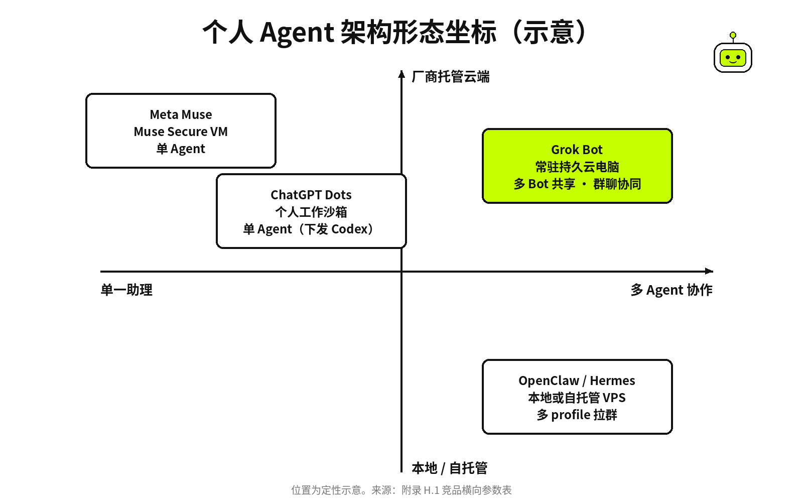

# 附录 F–J · FAQ、术语、竞品、资源、来源总表与勘误

[← 上一章：附录 A–E · 速查、价格、模板、连接器、更新日志](../appendix/A1-appendix.md) ｜ [📖 返回目录](../../README.md#-目录) ｜ [下一章：联系作者 / 加入交流群 →](../appendix/99-contact.md)

---

## 附录 F FAQ（中文高频 20 问） · Frequently Asked Questions

### F.1 国内没有外币信用卡怎么开通 · Payment Without Foreign Card
很多人以为必须绑定海外信用卡。我查了 Cursor 官方计划页，上面明确写着所有付费个人计划都包含 Grok Bot【官方】(https://cursor.com/cn/help/grok-bot/plans)。多位社区用户实测过，关掉代理，用浏览器无痕模式打开 Cursor 官网选 Pro 月付，把计费国家和币种切到 CNY，结账面板就会出现**支付宝付款**选项【社区】(https://x.com/i/status/2109157438226403420)。首次没刷出来的话，在结算页把美元和人民币来回切几次，或者在 App 内订阅时选不使用 Link 支付【社区】(https://www.amz123.com/t/lZiL8LFi)。【实测·TODO待实测】国内无痕环境下支付宝人民币扣费与账号额度实时到账。

### F.2 手机号验证收不到验证码怎么办 · Phone Verification
我翻社区帖子发现，登录 Grok Bot 桌面端时常有强制绑定手机号的拦截，用大陆号码或接码平台容易报错【社区】(https://www.v2ex.com/t/1241829)。LINUX DO 上有用户反馈，把网络出口切到美国干净节点后，直接输 **+86 手机号**能顺利收到短信验证码进控制台【社区】(https://linux.do/t/topic/2743888)。也有用户反馈用 Google Voice 虚拟号能注册【社区】(https://www.v2ex.com/t/1241829)。要是提示号码验证次数过多，换个浏览器会话等冷却就行。

### F.3 境内网络直连官网与文档是否可用 · Network Access
很多人以为必须全局代理才能访问。国内评测文章实测指出，x.ai/bot 产品官网和 docs.x.ai 官方文档在部分国内网络下可以直接直连【社区】(https://www.ai345.info/ai-guide/grok-bot-china-guide)。但客户端鉴权和远程云电脑连接对**网络稳定性**要求高，不同地区和运营商表现不一样【社区】(https://www.ai345.info/ai-guide/grok-bot-china-guide)。要是桌面端白屏或登录中断，先排查本地网络和代理路由规则。

### F.4 哪些订阅档位可以使用 Grok Bot · Eligible Plans
网上套餐很多，官方文档写得很清楚：Cursor 所有个人付费计划和 Teams 计划都内置 Grok Bot【官方】(https://cursor.com/cn/help/grok-bot/plans)。要是你有 X 或 xAI 账号，关联 SuperGrok、SuperGrok Plus、Heavy 或者 X Premium+ 也能拿到额度，但 **SuperGrok Lite 档位不可用**【官方】(https://cursor.com/cn/help/grok-bot/plans)。两边的用量额度各自独立计算，不叠加，关联后也不能转移给其他 Cursor 账号【官方】(https://cursor.com/cn/help/grok-bot/plans)。

### F.5 本地关机后任务还会继续执行吗 · Cloud VM Model
别把它当成跑在本地的桌面软件，它的核心是数据中心里的一台持久云电脑【官方】(https://docs.x.ai/grok-bot)。它有独立的文件系统、终端和无头浏览器。你在本地合上电脑甚至关机，只要云端任务和定时任务还在队列里，后台就会**持续无人值守运行**【官方】(https://docs.x.ai/grok-bot)。重新开机或者在手机 App 上登录，直接看交付文件和日志就行。

### F.6 云电脑的真实硬件配置是多少 · Computer Specs
官方文档没有公开披露具体 CPU 型号和内存，官方未公布具体规格数字【官方】(https://docs.x.ai/grok-bot)。社区帖称通过探针与系统命令测得为 8 核 CPU、16GB 内存、约 128GB 磁盘（个例）【社区】(https://www.v2ex.com/t/1235049)。这是多租户容器，默认没给公网独立 IP，磁盘主要用于常规办公和编译，不能拿来当**高性能持久 VPS**使。

### F.7 同账号下的多个 Bot 彼此隔离吗 · Shared VM Security
这是新手最容易踩的安全坑。官方文档写得很明确，同一个账号下的所有 Bot 共享同一台云电脑，包括文件、终端和浏览器登录态【官方】(https://docs.x.ai/grok-bot/computer-and-apps)。每个 Bot 有自己的工作屏幕，但**屏幕绝不是安全边界**【官方】(https://docs.x.ai/grok-bot/computer-and-apps)。你在 Bot A 登录了网站，Bot B 也能拿到 Cookie 去操作，Bot 之间没有权限沙箱隔离。

### F.8 可以在云电脑里登录网银和核心主邮箱吗 · Sensitive Logins
千万别在云电脑里输入网银账号、主力邮箱或公司财务凭据【推测】。所有 Bot 共享浏览器会话，一旦哪个 Bot 碰到提示词注入或逻辑跑偏，就能顺着登录态乱动。社区就有真实事故，一位用户的财务 Bot 处理报表时，把包含敏感账户审计的数据误发进了公司 Slack 公开频道【社区】(https://cybernews.com/ai-news/grok-bot-leaks-bank-information/)。涉及资金和核心资产，必须守住**草稿优先原则**。

### F.9 微信如何接入以及是否存在封号风险 · WeChat Integration
国内用得最多的是微信接入。目前社区主流方案是用微信官方 ClawBot 或 iLink 插件，配合 Webhook Routine 搭桥【社区】(https://x.com/KinGao476942/status/2108171436213104836)。微信客户端要求 iOS ≥8.0.70 或 Android ≥8.0.69，登录二维码大概 5 分钟有效，要是报错 -14 说明凭证过期，重新扫码就行【社区】(https://xput.app/N4rlhi)。虽然社区帖称走官方接口不会封号，但腾讯官方可没给过免责背书。有用户自述同一个微信号千万别混用其他第三方 Hook 工具，必须留好**人工应急接管机制**【社区】(https://ele.ac.cn/2171/)。

### F.10 飞书如何接入以及有哪些调用频率限制 · Feishu Integration
Grok Bot 插件市场目前还没有官方飞书插件，国内主要是给飞书自定义机器人配 Webhook 来推消息【社区】(https://www.aitoolku.cn/tutorials/grok-feishu)。云电脑跑出结果后，调用 Webhook 往飞书群推富文本。aitoolku 教程提到，飞书自定义机器人在高频发送时有**约 20 条/分钟的频控限制**【社区】(https://www.aitoolku.cn/tutorials/grok-feishu)。要是你的 Routine 短时间内会打大量日志，记得先合并做摘要，再推到群里。

### F.11 国内主流平台没有插件该如何处理数据 · Domestic Platforms Workaround
小红书、微信公众号、抖音在市场里都没有官方连接器。社区跑通的做法有四种：一是把公众号或小红书的公开链接发给 Bot 提取图文样式；二是人工从后台导出 CSV 报表或截图放进工作目录；三是在云电脑自带浏览器里扫码登录创作者后台，让 Bot 定点抓看板；四是让 Bot 产出文章和排版脚本，最后由**人工点击最终发布**【社区】(https://xiangyugongzuoliu.com/grokbot-use-cases/)。

### F.12 复制中文回复出现乱码该怎么解决 · Chinese Character Encoding Bug
很多开发者反馈，在特定客户端版本里复制 Bot 输出的中文，粘出来全是乱码【社区】(https://www.v2ex.com/t/1247756)。在 v1.14.0 桌面端上这问题被集中录屏反馈过，是剪贴板字符编码转换的毛病，英文复制粘贴就没事【社区】(https://www.v2ex.com/t/1247756)。碰上乱码，临时办法是让 Bot 把最终文本直接存成**工作目录中的文本文件**，再去下载或打开文件复制。

### F.13 Grok Bot 到底运行什么模型且能否手动切换 · Model Routing
设置里根本没有切换模型的下拉菜单。2026 年 10 月 7 日马斯克在 X 上宣布 Grok Bot 将改用 Opus 5.5【官方】(https://x.com/elonmusk/status/2107724314451878104)，Grok Bot 团队成员 @poteto 在 X 回复中说"yes, bot itself will run on opus 5.5"【官方·团队成员个人帖】(https://x.com/poteto/status/2107734770990133319)。截至 10 月 13 日官方没有发布正式公告或模型选择器，切换是逐步推送的；10 月 6 日的第三方评测仍写着它跑在 Grok 4.7 上【社区】(https://www.aiformortals.co/blog/grok-bot-vs-meta-muse-vs-chatgpt-dots)。

### F.14 什么是 Skill 和 Routine 且二者有何区别 · Skills vs Routines
官方文档把两者的分工说得很清楚：Skill 是做某项特定任务的操作规程，相当于 SOP；Routine 则是具体的 Bot 在特定时间或事件触发下跑任务的排期计划【官方】(https://docs.x.ai/grok-bot/skills-routines-and-automations)。官方的 Teach a task 允许录制最长 10 分钟无声屏幕演示，但录出来的只是**草稿 Skill**【官方】(https://cursor.com/docs/grok-bot/work)。必须在草稿里补上异常处理和审批断点，测试通过后再放进 Routine 跑。

### F.15 账户下可以创建多少个 Bot 和 Routine · Hard Limits
系统有明确的硬指标。官方设计说明曾写每个账号大约 50 个 Bot，但 9 月 1 日 v0.31.0 已取消这个上限【官方】(https://x.ai/changelog/bot)。多 Bot 群聊里，每个群容纳 2 到 6 个 Bot【官方】(https://docs.x.ai/grok-bot/chat-and-collaboration)。自动化方面，每个 Bot 最多配 50 条 Routine，最小定时运行间隔不低于 5 分钟，系统只留最近 20 次的日志历史，而且**删除 Routine 无法撤销**【官方】(https://docs.x.ai/grok-bot/skills-routines-and-automations)。

### F.16 审批卡机制是如何工作的 · Approvals Mechanism
Bot 准备执行敏感或产生外部影响的操作时，系统会暂停任务并弹出审批卡等人工确认。官方文档规定，要审批的操作包括资金支付、对外发邮件或消息、在外部平台公开发布内容以及删文件等【官方】(https://docs.x.ai/grok-bot/approvals-security-and-privacy)。后台跑自动化触发审批时，卡片如果**大约 10 分钟内未被确认**就会自动过期【官方】(https://docs.x.ai/grok-bot/approvals-security-and-privacy)。关键审批一定要接好通知渠道，省得任务被超时中断。

### F.17 云电脑如果重置或回滚会不会丢失数据 · Computer Reset & Data
官方提供了恢复、更新和重置三种维护操作。官方文档说明，重置云电脑后，持久化到工作磁盘以及 `/workspace` 目录下的个人文件会保留，但在终端里自行安装的系统依赖、全局软件包和临时服务可能会丢【官方】(https://cursor.com/cn/docs/grok-bot)。社区此前反映过，后台由于错误分配了重复实例，导致部分用户的会话和 Bot 被错误路由并产生**历史状态回滚事故**【社区】(https://www.v2ex.com/t/1241225)。重要配置最好在外部做好备份。

### F.18 为什么额度消耗过快以及如何有效省额度 · Quota Burners & Saving
额度几小时跑光，通常是陷入了高频空转。比如高频定时反复抓没变动的网页、让 Bot 不断截屏重试，或者在多 Bot 群聊里没加约束引发互相唤醒与死循环【社区】(https://linux.do/t/topic/2807876)。省额度的核心是调度与执行分离：让 Bot 做统筹调度，脏活累活丢给云电脑轻量脚本或本地子代理跑，只在数据变动时才用 Webhook 唤醒 Bot，还要记得**关闭非必要的按需计费开关**【社区】(https://readcopilot.ionichina.com/articles/53772)。

### F.19 市面上的代充、账号租用和炒币宣传是否安全 · Gray Market & Scams
围绕 Grok Bot 已经有不少黑灰产骗局。一些代充宣称低价代开并索要浏览器 Session JSON 文件，该店称 Session JSON 不含登录令牌，但把账号信息交给第三方仍有风险【社区】(https://claudemax.shop/blog/grok-bot-guide-supergrok)。还有宣传跨低价区订阅套利的，直接面临封号风险【社区】(https://linux.do/t/topic/2848179)。社交平台上晒 Bot 自动炒币从小几十块翻到上万刀的截图，全都是**虚假营销与钓鱼套路**【社区】(https://x.com/i/status/2102291280965640690)。

### F.20 培养一个稳定干活的 Bot 需要经过哪些阶段 · Bot Training Stages
一上来就让 Bot 独立干复杂业务基本都会翻车。社区摸索出来的养 Bot 经验分三个阶段：第一阶段是前几次交互，Bot 完成度通常只有 30% 到 40%，必须人工逐项纠错并让它记牢规则【社区】(https://www.v2ex.com/t/1240012)。第二阶段多轮对齐后，完成度能到 70% 左右，格式和边界基本收敛【社区】(https://www.v2ex.com/t/1240012)。到了第三阶段排除掉边界异常，再把它**固化为 Routine 投入无人值守**。

## 附录 G 术语表 · Glossary

### G.1 身份与环境 · Identity & Environment
先理清底层对象：**Bot 角色实例**拥有独立人格预设、系统指令、记忆和工作屏幕，账号内 Bot 数量自 v0.31.0 起不再限制在约 50 个【官方】(https://x.ai/changelog/bot)。持久云电脑（Cloud Computer）是远端的执行环境，所有 Bot 共享这一套机器、文件目录和浏览器会话【官方】(https://docs.x.ai/grok-bot/computer-and-apps)。社区实测该环境通常提供 8 核 16GB 内存及约 128GB 磁盘【社区】(https://www.v2ex.com/t/1235049)。工作目录（`/workspace`）是用来持久化个人项目和交付成果的挂载空间，云电脑重置后里面的文件依然保留【官方】(https://cursor.com/cn/docs/grok-bot)。

### G.2 任务编排与自动化 · Tasks & Orchestration
技能（Skill）是可复用的操作规程，无论是写提示词还是录制最长 10 分钟的无声屏幕操作（Teach a task），录出来的东西在人工审核补全前都只是草稿【官方】(https://cursor.com/docs/grok-bot/work)。例程（Routine）则是把 Skill 和特定触发条件绑定的排期机制，支持定时或事件触发，每个 Bot 最多 50 条且最小间隔不低于 5 分钟【官方】(https://docs.x.ai/grok-bot/skills-routines-and-automations)。多个 Bot 组队时，通常设一个**总管角色（Chief of Staff）**负责收集需求、排优先级和分发任务【社区】(https://x.com/0xRafy/status/2099278275906265417)。为了防止多 Bot 群聊互相唤醒烧干额度，社区提倡安静交接（Quiet Handoff），也就是在指令里明确要求收到了不用回、没有新信息不发回复【社区】(https://forum.cursor.com/t/1-500-in-one-week-running-a-grok-bot-fleet-expected-or-a-bug/172705)。

### G.3 安全边界与系统治理 · Safety & Governance
审批机制（Approvals / Auto-review）用来拦截涉及支付、发邮件发消息、外部平台发帖或删文件等敏感动作，后台生成的审批卡大约 10 分钟不处理就会自动作废【官方】(https://docs.x.ai/grok-bot/approvals-security-and-privacy)。连接器与市场（Connectors & Marketplace）允许通过 `@` 调外部扩展对接各类 SaaS 平台【官方】(https://x.ai/bot/marketplace)。后端路由（Model Routing）由系统按任务特征分配模型，官方已实装由 **Opus 5.5 驱动执行**【官方】(https://x.com/poteto/status/2107734770990133319，团队成员 X 帖)。团队机器人（Team Bots）支持接入 Slack 开展群聊或私聊协作【官方】(https://x.ai/news/team-bots)。按需用量开关（On-demand Usage）关掉后，能防止额度跑完自动扣信用卡【社区】(https://readcopilot.ionichina.com/articles/53772)。

## 附录 H 竞品对照 · Competitive Landscape

### H.1 竞品横向参数全貌 · Landscape Matrix
现在的通用 Agent 不再只是文本对话框，都带上了沙箱或操作系统执行能力。主流 Agent 产品的关键维度对照如下，数据来自官方公开说明与第三方实测记录。

| 产品维度 | Grok Bot | Meta Muse | ChatGPT Dots | OpenClaw / Hermes |
|---|---|---|---|---|
| 发起机构与发布 | xAI（2026-08-11 早期内测） | Meta（2026-09-08 正式发布） | OpenAI（基于 ChatGPT Pro） | Nous Research 等开源社区 |
| 准入门槛与起步价 | Cursor Pro（$20/月）或 SuperGrok | 免费起步（提供用量计数器） | 需 ChatGPT Pro（$100/月） | 开源免费（需自备算力或 API） |
| 架构形态 | 常驻持久云电脑（多 Bot 共享） | Muse Secure VM（单 Agent） | 个人工作沙箱（单 Agent） | 本地或自托管 VPS（多 profile） |
| 多 Agent 协作 | 支持群聊协同与总管调度 | 单一助理形态（不支持群聊） | 单一助理形态（下发 Codex） | 支持本地多 profile 拉群协作 |
| 核心强项 | 复杂长流程、X 深度整合、多 Bot | 个人生活、免费门槛、社媒连接 | 依托 OpenAI 模型、连本地工程 | 数据私密、无锁区、自由度极高 |
| 主要短板 | 额度消耗快、无法自选模型 | 缺乏深度工作流编排、国内受限 | 资费昂贵、无多 Bot 编排 | 搭建门槛高、需自行维护环境 |

*图：主流个人 Agent 架构形态演进与坐标分布*

### H.2 Meta Muse：个人生活琐事的免费入口 · Meta Muse
Meta 在 2026 年 9 月 8 日推出了个人 AI 智能体 Muse【官方】(https://about.fb.com/news/2026/09/introducing-muse-personal-ai-agent/)。它最大的亮点是**完全免费起步**，进阶档有 20 美元的 Power 和 100 美元的 Maximum【社区】(https://openassistant.us/blog/muse-vs-grok-bot)。Muse 跑在专用的 Muse Secure VM 里，接了 WhatsApp、Instagram、健康和流媒体生态，还能通过 Link by Stripe 做线上预订和支付【社区】(https://openassistant.us/blog/muse-vs-grok-bot)。第三方实测指出，处理餐厅推荐、生活行程时它很顺手；但测到多步骤商业运营时失误不少，比如答应退款却没真扣、客服回复卡壳等【社区】(https://www.aiformortals.co/blog/grok-bot-vs-meta-muse-vs-chatgpt-dots)。

### H.3 ChatGPT Dots：OpenAI 的单体沙箱 · ChatGPT Dots
OpenAI 的 Dots 架构基于 GPT-6 Astra，必须每月至少 100 美元的 ChatGPT Pro 账号，200 美元和 500 美元档位主要是额度更多【社区】(https://www.aiformortals.co/blog/grok-bot-vs-meta-muse-vs-chatgpt-dots)。它是单 Dot 模式，没法像 Grok Bot 那样拉一支分工明确的 Bot 团队。Dots 的优势是能配合 Codex Chrome 插件借用本地浏览器会话绕过反爬，还能把写代码的任务直接丢给本地目录下的 Codex【社区】(https://www.aiformortals.co/blog/grok-bot-vs-meta-muse-vs-chatgpt-dots)。但第三方实测反映，在复杂业务测试里 Dots 的**推进速度偏慢**，做开放内容创作时容易偷工减料【社区】(https://www.aiformortals.co/blog/grok-bot-vs-meta-muse-vs-chatgpt-dots)。

### H.4 OpenClaw 与 Hermes：开源自托管的自由度 · Open Source Agents
社区横评普遍认为，这一代商业 Agent 的沙箱和执行架构受了 OpenClaw 等早期开源项目的启发【社区】(https://x.com/i/status/2105442725919367611)。Nous Research 的 Hermes Agent 在本地实现了类似 Grok Bot 的多 profile 体系，每个 profile 有独立人格、记忆、工具和工作目录，也能拉进一个会话里协作【社区】(https://www.v2ex.com/t/1240012)。开源方案最大的好处是**数据完全不出门**，还能随意换各种大模型，但代价是得自己折腾环境、网络穿透和守护进程，没商业软件那么开箱即用【社区】(https://www.v2ex.com/t/1240012)。

### H.5 选型决策：工作选 Grok Bot，生活选 Muse · Decision Guide
选工具不用比参数，看是工作还是生活。综合实测与社区反馈，要是想搭自动化工作流、盯店铺订单、巡检竞品或者跑多步骤团队任务，Grok Bot 靠持久云电脑和多 Bot 协同是性价比更高的选择【社区】(https://www.aiformortals.co/blog/grok-bot-vs-meta-muse-vs-chatgpt-dots)。要是平时订票、查攻略、问日常问题，免费的 Meta Muse 足够轻快。如果身处境内受限网络且对**数据隐私高度敏感**，在本地部署一套开源的 Hermes 更踏实。

## 附录 I 资源导航 · Resources & Community

### I.1 官方站点与一手文档 · Official Documentation
查一手资料最靠谱。官方文档中心汇总了所有操作指南和 API 说明，边界参数全在里面【官方】(https://docs.x.ai/grok-bot)。桌面端和移动端安装包统一在官网首页下载【官方】(https://x.ai/bot)。要是给具体岗位做 SOP，官方团队写的 **27 篇岗位实战指南库**覆盖了工程、销售、法务、招聘等场景【官方】(https://x.ai/bot/guides)。官方新闻中心能看企业版和团队功能的公告【官方】(https://x.ai/news)，X 上的官方账号会同步版本更新时间线【官方】(https://x.com/bot)。

### I.2 中文开发者社区 · Chinese Developer Communities
国内开发者在网络、支付和本土集成上攒了不少经验。V2EX 的 AI 节点上有一线工程师讨论云电脑网络、乱码和多 Bot 架构【社区】(https://www.v2ex.com/t/1240012)。LINUX DO 集中讨论底层模型路由、额度监控和订阅避坑【社区】(https://linux.do)。SpaceXAI 中文社区（原 Cursor 中文社区）在广深京杭和武汉等地办过多场线下技术交流，适合交流**实战提示词**【社区】(https://luma.com/kss59f4e)。掘金也有开发者写过企业落地复盘【社区】(https://juejin.cn)。

### I.3 社区先行著作与致谢 · Community Guides & Acknowledgments
写这本书时，我参考并吸收了中文社区早期探索者的成果，在这里真诚致谢。Kin 写的《Grok Bot 橙皮书》最早介绍了大脑倾倒与反向提问的心智模型【社区】(https://github.com/KinGao294/grok-bot-orange-book)。超级峰的《粉皮书》用 55 个教学单元拆解了从开箱到多场景落地的路径【社区】(https://chaojifeng.me/downloads/grok-bot-course.md)。黄叔的《蓝皮书 v0.1》为早期架构梳理搭了清晰框架【社区】(https://ai.lzw.me)。花叔的系列开源橙皮书则在**开源协作与体例规范**上树立了标杆【社区】(https://github.com/alchaincyf/claude-code-orange-book)。

### I.4 优质视频笔记与横评 · Video Notes & Benchmarks
想看直观操作流程，可以看视频实测。AI for Mortals 作者 Pat Simmons 针对 Grok Bot、Meta Muse 和 ChatGPT Dots 做过一场三项对照测试（其中一项是连续四小时经营一家虚构咖啡公司），结论是 Grok Bot 三项都胜出，但他也提醒用量消耗快、实际要上 $100 档【社区】(https://www.aiformortals.co/blog/grok-bot-vs-meta-muse-vs-chatgpt-dots)。旧金山 Grok Bot Galaxy 开发者大会的演讲记录，也公开了企业级团队 Bot 的规模化演进实况【官方】(https://x.com/joshkim/status/2100996896575861157)。

## 附录 J 本书来源总表 · Source Index

这里按全书章节顺序，汇总整理了调研中引用的核心原始链接，方便回溯核对。

### J.1 Part 1 起步篇来源 · Chapters 01 to 04
- §01 Grok Bot 是什么：官方文档概览（https://docs.x.ai/grok-bot ）、Livemint 援引彭博社周活报道（https://www.livemint.com/ai/elon-musk-s-grok-bot-hits-418-000-weekly-users-after-one-month-11790093107144.html ）、云电脑与应用文档（https://docs.x.ai/grok-bot/computer-and-apps ）、官方用例库（https://docs.x.ai/grok-bot/use-cases ）、产品发布公告（https://x.ai/news/introducing-grok-bot  ）。
- §02 怎么才能用上：Cursor 官方计划说明页（https://cursor.com/cn/help/grok-bot/plans ）、Cursor 官方定价页（https://cursor.com/pricing ）、YuzuCMZ 支付宝订阅实测（https://x.com/i/status/2109157438226403420 ）、David 订阅经验（https://x.com/i/status/2108488671699816806 ）、X 会员绑定说明（https://x.com/i/status/2108748981069394279 ）、代充骗局警示（https://x.com/i/status/2102291280965640690 ）、国内直连评测（https://www.ai345.info/ai-guide/grok-bot-china-guide ）、官方故障排查（https://docs.x.ai/grok-bot/troubleshooting ）。
- §03 十分钟安装与开箱：官方下载主页（https://x.ai/bot ）、身份与访问控制（https://docs.x.ai/grok-bot/identity-and-access ）、对话与协作（https://docs.x.ai/grok-bot/chat-and-collaboration ）、设置与通知（https://docs.x.ai/grok-bot/settings-and-notifications ）、移动端文档（https://docs.x.ai/grok-bot/mobile ）。
- §04 你的第一个任务：快速上手指南（https://docs.x.ai/grok-bot/get-started ）、团队成员建议（https://x.com/poteto/status/2107830403549831186 ）、社区橙皮书（https://github.com/KinGao294/grok-bot-orange-book ）。

### J.2 Part 2 核心概念篇来源 · Chapters 05 to 08
- §05 Bot：给每个同事一份岗位说明书：Bot 官方文档（https://docs.x.ai/grok-bot/bots ）、设计 Grok Bot 官方专文（https://x.ai/news/designing-grok-bot ）、V2EX 养 Bot 心得（https://www.v2ex.com/t/1240012 ）、模板指南（https://x.ai/bot/guides/templates-for-grok-bot ）。
- §06 云电脑：它的工位：文件与交付物（https://docs.x.ai/grok-bot/files-and-results ）、云电脑共享架构（https://docs.x.ai/grok-bot/computer-and-apps ）、云电脑工作与恢复帮助（https://cursor.com/cn/docs/grok-bot ）、V2EX 云电脑实测与重置讨论（https://www.v2ex.com/t/1241225 ）、代理文档（https://docs.x.ai/grok-bot/proxies ）、私有网络（https://docs.x.ai/grok-bot/private-networks ）。
- §07 Skill 与 Routine：教一次，让它照着做：技能与例程官方文档（https://docs.x.ai/grok-bot/skills-routines-and-automations ）、任务教学实操文档（https://cursor.com/docs/grok-bot/work ）。
- §08 审批与安全边界：审批与安全隐私文档（https://docs.x.ai/grok-bot/approvals-security-and-privacy ）、Cybernews 银行审计泄露报道（https://cybernews.com/ai-news/grok-bot-leaks-bank-information/ ）。

### J.3 Part 3 扩展与集成篇来源 · Chapters 09 to 11
- §09 连接器与 Marketplace：市场概览文档（https://x.ai/bot/marketplace ）、插件市场官方公告（https://x.ai/news/grok-plugin-marketplace ）。
- §10 官方合作集成逐个讲：The Next Web 模型路由报道（https://thenextweb.com/news/grok-bot-claude-opus-midjourney-suno-musk ）、马斯克路由公告（https://x.com/elonmusk/status/2107724314451878104 ）、团队成员回复（https://x.com/poteto/status/2107734770990133319 ）、工程团队实战指南（https://x.ai/bot/guides/grok-bot-for-engineering ）、Team Bots 公告（https://x.ai/news/team-bots ）、X 整合公告（https://x.ai/news/grok-bot-and-x ）、搜索 X 功能发布（https://x.com/bot/status/2107949161878606089 ）、Bot 邮箱发布（https://x.com/bot/status/2108609764766908772 ）、财务连接（https://x.com/bot/status/2103936247995752705 ）、Shopify 连接（https://x.com/bot/status/2108228871938359347 ）。
- §11 中国用户的集成：没有插件也能用：KinGao 微信接入实操（https://x.com/KinGao476942/status/2108171436213104836 ）、微信集成排障指南（https://xput.app/N4rlhi ）、飞书接入教程（https://www.aitoolku.cn/tutorials/grok-feishu ）、国内平台用例分析（https://xiangyugongzuoliu.com/grokbot-use-cases/ ）。

### J.4 Part 4 至 Part 6 协作与实战篇来源 · Chapters 12 to 18
- §12 群聊与交接：群聊协作文档（https://docs.x.ai/grok-bot/chat-and-collaboration ）、多 Bot 额度消耗分析（https://forum.cursor.com/t/1-500-in-one-week-running-a-grok-bot-fleet-expected-or-a-bug/172705 ）。
- §13 编制案例库：Rafy 总管编制模式（https://x.com/0xRafy/status/2099278275906265417 ）、V2EX 数字员工流程尝试（https://www.v2ex.com/t/1241365 ）、企业案例公告（https://x.ai/news/grok-bot-for-enterprise ）。
- §14 个人与生活：马斯克下单买乐高（https://x.com/elonmusk/status/2109155867983786382 ）、旅行规划案例（https://x.com/fkysly/status/2108831626360930389 ）。
- §15 内容创作：Rowan Cheung 监控例程（https://x.com/rowancheung/status/2108328114552000842 ）、视频渲染实战（https://x.com/KinGao476942/status/2100224440948916593 ）。
- §16 赚钱与工作：新词选品建站案例（https://x.com/0xEcho99 ）、官方岗位实践指南集（https://x.ai/bot/guides ）。
- §17 中文内容工作室项目：微信下发与自媒体闭环（https://x.com/KinGao476942/status/2108171436213104836 ）、排障与落盘实践（https://xput.app/N4rlhi ）。
- §18 研发场景：工程团队落地指南（https://x.ai/bot/guides/grok-bot-for-engineering ）、Cursor 交接公告（https://x.com/bot/status/2105373767568621895 ）。

### J.5 Part 7 至 Part 9 成本与心智篇来源 · Chapters 19 to 24
- §19 额度去哪了：仪表盘使用率页面（https://cursor.com/dashboard/usage ）、LINUX DO 额度异常消耗帖（https://linux.do/t/topic/2807876 ）、在 Bot 中运行代码消耗（https://x.com/i/status/2107100457231651312 ）。
- §20 省钱心法：铁柱AGI 调度器省额度模式（https://readcopilot.ionichina.com/articles/53772 ）、外部模型执行层方案（https://x.com/i/status/2109088800903483616 ）。
- §21 事故档案：Slack 银行隐私外泄事件（https://cybernews.com/ai-news/grok-bot-leaks-bank-information/ ）、V2EX 云电脑回滚事故反馈（https://www.v2ex.com/t/1241225 ）、安全过滤器沉默故障（https://forum.cursor.com/t/grok-bot-primary-bot-silent-bot-failed-to-respond-since-oct-8-other-bots-ok-restart-this-bots-runner-only-do-not-reset/174138 ）、例程失败事件（https://forum.cursor.com/t/all-grok-bot-routines-failed-to-run/174125 ）。
- §22 常见故障速查：官方疑难解答（https://docs.x.ai/grok-bot/troubleshooting ）、中文剪贴板乱码 Bug（https://www.v2ex.com/t/1247756 ）。
- §23 别这么用：低价值例程反模式警示（https://x.com/kocer_eth/status/2101669438038634827 ）、代充会话风险说明（https://claudemax.shop/blog/grok-bot-guide-supergrok ）。
- §24 从聊天到管理：总管工作心智模型（https://x.com/0xRafy/status/2099278275906265417 ）、官方组织协同用例（https://docs.x.ai/grok-bot/use-cases ）。

## 勘误页 · Corrections

### K.1 社区已知错误澄清 · Community Corrections
我核对一手资料时，发现社区里流传的一些说法有明显偏差，在这里逐一澄清。一是开放扩权日期：早期社区资料说是 8 月 21 日，但官方新闻发布时间其实是 **2026 年 8 月 26 日**【官方】(https://x.ai/news/grok-bot-more-plans)。二是 Cursor Pro 准入门槛：有早期资料断言 20 美元的 Pro 不含 Grok Bot、必须买 60 美元的 Pro+，官方计划说明页明确证实 Cursor Pro 个人计划已包含 Grok Bot【官方】(https://cursor.com/cn/help/grok-bot/plans)。三是模型锁定：早期传言说只能跑 Grok 自家模型，官方已经公布并实装了向 Claude Opus 5.5 的任务路由【官方】(https://x.com/elonmusk/status/2107724314451878104)。四是技能学习机制：有的文章说演示一遍就能学会，官方文档明确澄清屏幕教学录下来的只是草稿 Skill，必须人工补齐判断逻辑和断点后才能稳定排期【官方】(https://cursor.com/docs/grok-bot/work)。

### K.2 本书自身勘误记录 · Black Book Change Log
每一步都有出处，草稿里发现的纰漏我也全记在这里：一是早期版本删掉了一处无出处统计和一处虚构个人经历；二是讨论套餐定价时，SuperGrok 价格标签由【官方】改正；三是飞书集成的频控限制，20 条/分钟的出处改为 aitoolku；四是删除了 §15 里一处无出处的 **Opus 计费推测**。

### K.3 反馈通道与持续更新机制 · Feedback & Maintenance
AI 智能体和官方策略更新极快，本书按发布日期标注版次（当前为 v261012）。要是你在实操里发现界面变了、链接挂了或者参数不对，直接去代码仓库的 **GitHub Issues** 提反馈。我每周会对照官方更新日志和社区一手实测复查，把每一次事实修正更新到这页勘误里。

---

[← 上一章：附录 A–E · 速查、价格、模板、连接器、更新日志](../appendix/A1-appendix.md) ｜ [📖 返回目录](../../README.md#-目录) ｜ [下一章：联系作者 / 加入交流群 →](../appendix/99-contact.md)
