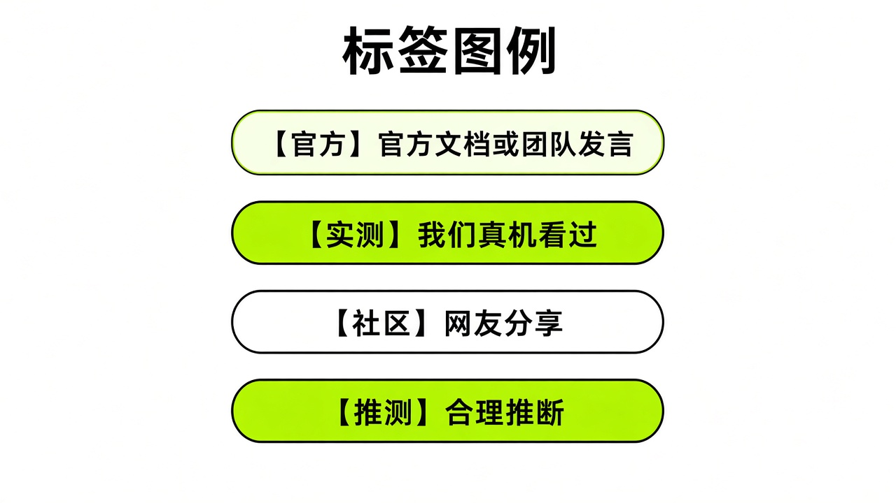
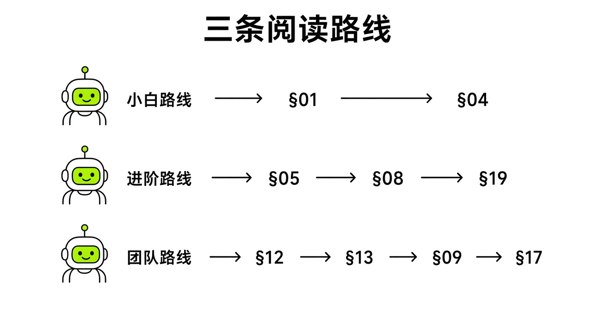
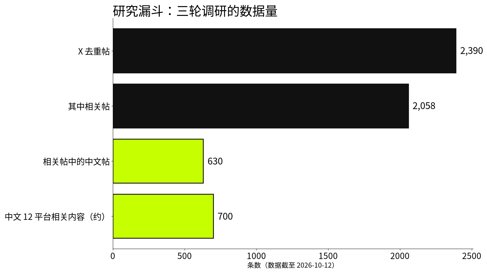

# 《Grok Bot 黑皮书：从零到一支 AI 团队》

[📖 返回目录](../../README.md#-目录) ｜ [下一章：§01 Grok Bot 是什么 · What It Is →](../part1-getting-started/01-what-it-is.md)

---

> 每一步都有出处，每一个坑都有人踩过。

## 封面规格块 Cover Spec

| 项目 | 内容 |
|---|---|
| 版次 | v261012（2026-10-12） |
| 书名 | 《Grok Bot 黑皮书：从零到一支 AI 团队》 |
| 副标题 | 每一步都有出处，每一个坑都有人踩过 |
| 英文副标题 | *From Zero to an AI Team — Every Step Sourced, Every Pitfall Tested* |
| 适用版本 | Grok Bot 桌面版（macOS / Windows / Linux）、iOS、Android；Opus 5.5 路由后【[官方](https://x.com/elonmusk/status/2107724314451878104)】 |
| 本版新增 | 初版；涵盖 Bot 自有邮箱（10/10）、Shopify 连接（10/09）、X 原生搜索与监控（10/08）、Team Bots（9/29）等全部已发布功能【[官方](https://x.ai/news/team-bots)】 |
| 信息源声明 | 见下方 |
| 作者 | [待填] |
| 渠道 | [待填] |

> 信息源声明：本书事实来自以下渠道，每条标注来源类型和原始链接。docs.x.ai 官方文档 22 页【[官方](https://docs.x.ai)】、cursor.com/cn/help 中文帮助页【[官方](https://cursor.com/cn/help/grok-bot/plans)】、x.ai/news 官方公告 16 篇【[官方](https://x.ai/news)】、x.ai/bot/guides 官方岗位指南 27 篇【[官方](https://x.ai/bot/guides)】、@bot 官方 X 账号发布时间线 19 条【[官方](https://x.com/bot)】、X 平台检索 2,390 条去重帖（其中 2,058 条相关、630 条中文相关）【社区】、中文 12 个平台（公众号、CSDN、掘金、V2EX、LINUX DO、即刻、NodeSeek、知乎、小红书、抖音、B站、36氪等媒体）合计约 700 条相关内容【社区】、官方 changelog 49 个版本的更新记录【[官方](https://x.ai/changelog/bot)】、YouTube / 中文视频笔记 26 条【社区】。数据截止日期：2026-10-12。

**四种标签图例**

本书对每条事实性陈述标注以下四种标签之一，附原始链接。你在任何一页看到没有标签的事实陈述，那就是我漏了——请到勘误入口告诉我。

| 标签 | 含义 | 示例 |
|---|---|---|
| 【官方】 | 有 docs.x.ai、x.ai/news、cursor.com 或 @bot 账号的链接 | "每个 Bot 最多 50 个 Routine"——[docs.x.ai/grok-bot/skills-routines-and-automations](https://docs.x.ai/grok-bot/skills-routines-and-automations) |
| 【实测】 | 作者计划在真实 Grok Bot 环境中亲手复现并截图 | 计划实测均标注为【实测·TODO待实测：要测什么】 |
| 【社区】 | X / V2EX / LINUX DO / 公众号等用户自述，附帖子链接 | "用支付宝订阅 Cursor Pro 解锁 Grok Bot"——多名用户交叉印证 |
| 【推测】 | 作者基于已有信息做出的判断，明确标出 | "Midjourney / Suno 路由尚未上线"——即刻用户反馈，官方未确认 |

> 时效提醒：Grok Bot 迭代极快——从 8 月 11 日发布到本书截稿，官方 changelog 已有 49 个版本【[官方](https://x.ai/changelog/bot)】。书中任何一条信息都可能在你读到的时候已经变了。请结合 [docs.x.ai](https://docs.x.ai) 和 [@bot](https://x.com/bot) 账号的最新发布做验证。

> 持续更新：本书的最新版本见 [待填]。

> 勘误入口：如果你发现事实错误、过时信息、或者缺少来源标注的地方，请到 [待填] 提交。我会在每次更新时公开勘误记录——已经犯过的错，也是出处的一部分。

*图：黑底封面（黑皮 + 橙色强调条，致敬但区分于花叔橙皮书系列的白底橙标风格）*

*图：标签图例条（四色横条，每种标签配色 + 简要说明，方便读者随时对照）*

## 致读者 Preface

### 为什么还要再写一本

你手上可能已经有别的 Grok Bot 指南了。

KinGao 的《橙皮书》在 8 月 23 日上线，14 章加 4 张速查表，GitHub 159 星，里面总结的"大脑倾倒"和"反向配置"在社区里传得很开【[社区](https://github.com/KinGao294/grok-bot-orange-book)】。超级峰的《粉皮书》更厚，55 个单元全文免费公开，微信接入写了 3 课【[社区](https://chaojifeng.me/free-courses/grok)】。还有黄叔的《蓝皮书 v0.1》，一句话就能建一个 QQ 邮箱 Bot【[社区](https://ai.lzw.me/best-blogs/article/9b80b0ebd1)】。

我把它们翻了一遍，发现三个问题。

先说时效。橙皮书停在 8 月 24 日，粉皮书核对到 9 月 25 日【[社区](https://chaojifeng.me/free-courses/grok)】。从那之后，Grok Bot 陆续上线了 Team Bots、Cursor 编程交接、X 原生搜索与监控、Shopify 连接、Bot 自有邮箱、Finance 连接器、1Password 集成，以及 Opus 5.5 模型路由。马斯克 10 月 7 日在 X 上说："Going forward, @SpaceX will use the best back end model for any given task, including Claude Opus 5.5, MidJourney, Suno and other leading APIs"【[官方](https://x.com/elonmusk/status/2107724314451878104)】，Grok Bot 团队成员 @poteto 在回复里补了一句 "yes, bot itself will run on opus 5.5"【[官方·团队成员个人帖](https://x.com/poteto/status/2107734770990133319)】（注意：截至 10/12 仍有用户反馈自己的 Bot 尚未切到 Opus，属于逐步推送【社区】）。早期传的"只跑 Grok 自家模型"已经过时。橙皮书写的"Cursor Pro $20 暂不含 Grok Bot"也和现行政策冲突——官方帮助页写得很清楚，Cursor 所有付费个人计划和 Teams 现在都包含 Grok Bot【[官方](https://cursor.com/cn/help/grok-bot/plans)】。

再说出处。橙皮书几乎没引用 docs.x.ai 的页面【[社区](https://github.com/KinGao294/grok-bot-orange-book)】。粉皮书带了一部分官方链接，但不少关键结论没写来源。分不清是官方说的还是博主猜的，就不知道哪天会失效。

最后是国内路径。橙皮书没讲支付宝怎么付、手机号怎么验、国内平台没有插件怎么处理。粉皮书微信接入写得扎实，但支付宝订阅、代充风险和合规问题全是空白。

所以我决定自己写一本。不是前面的书不好，橙皮书"第一个任务"那一章写得很透。我想做的是另一件事：**每条事实都能点进原始链接**，分清官方、社区和推测，再留一页公开勘误。

花叔写《Claude Code 橙皮书》时在封面放了信息源声明，提醒读者结合官方文档验证【[社区](https://github.com/alchaincyf/claude-code-orange-book)】；《Hermes Agent 2.0》在 README 顶部开辟勘误节，认错并贴官方 FAQ 链接【[社区](https://github.com/alchaincyf/hermes-agent-orange-book)】。黑皮书把这件事做到底：四种标签、原始链接、每章来源列表、全书勘误页。哪句话写错了，你能随时查到我错在哪。

### 这本书怎么做的

全书做了三轮调研。

第一轮梳理官方文档。通过 [llms.txt](https://docs.x.ai/llms.txt) 索引抓取了 docs.x.ai 全部 22 个文档页面，加上 x.ai/bot/guides 的 27 篇官方岗位指南、x.ai/news 的 16 篇公告、@bot 官方账号的 19 条 X 发布，以及官方 changelog 的 49 个版本记录【[官方](https://docs.x.ai)】。

第二轮扫 X 平台。跑了 88 次检索和 3 次按 ID 抓取全文，拿到 2,075 条去重帖子。经过主题分类和人工复核，筛出 1,846 条相关帖，其中 293 条长帖拉了全文。话题分布里：定价与额度 341 条、官方发布 260 条、Routine 与 Skill 210 条、连接器与插件 209 条、吐槽与对比 205 条、邮件与日历 180 条。光定价额度就占了快五分之一，大家对收费规则确实困惑【[社区](https://x.com)】。另外补了 YouTube 和英文社区资料，包含 15 条视频转录摘要、Galaxy 大会 10 个官方场次笔记、事故报告与竞品对比等约 50 篇网页。

第三轮覆盖中文平台。X 上的中文相关帖扩充到 630 条。中文平台里，搜狗微信搜到 258 条结果、靠转载站补了 6 篇全文；CSDN 抓了 287 篇（113 篇标记为疑似搬运）；掘金 27 篇；V2EX 40 个主题（17 个含完整回复）；LINUX DO 18 个主题；即刻 5 篇；NodeSeek 2 帖；知乎 2 篇专栏。小红书和抖音受登录墙限制只有间接信息；B站接口和页面返回 412，没拿到正文【[社区](https://x.com)】。

三轮汇总下来：X 平台 2,390 条去重帖（2,058 条相关，其中中文 630 条），中文 12 个平台约 700 条相关内容。

整个过程用 AI 辅助跑了搜索、抓取和归类，书里引用的事实都尽量回溯到原始链接；2026-10-13 又做了一轮逐章事实审计（见勘误记录），仍可能有遗漏。原始文件里标记"未核实"或"需核实"的，要么找到可靠信源补全，要么标【推测】，或者直接不写。**研究文件里没有的数字、日期、价格，一律不编。**

工具书不是小说。有人说花叔的橙皮书系列是"三小时写就的 AI 泔水"【[社区](https://x.com/realchendahuang/status/2108754825181859970)】，也有人统计微信读书上"十本书里只有四本推荐超过非推荐"【[社区](https://x.com/Jack_FluxAI/status/2108809412614009056)】。我不卷入这种争论。我能做的是把方法、数据和勘误全摆出来。哪怕你觉得某页没写好，至少能查到那页的信息是从哪来的。

### 怎么读这本书

这本书不用从头读到尾，**你的情况不同，读法也不同**。

刚听说 Grok Bot、还没用过：从 §01（Grok Bot 是什么）顺着读到 §04（你的第一个任务）。读完能独立跑通任务，也搞懂底层架构。重点看 §02（怎么才能用上），里面讲了支付宝订阅、手机号验证和网络解法，这是国内最常卡住的地方。

已经在用、想用得更顺：直接翻 §05（Bot）和 §07（Skill 与 Routine），把单次任务固化成自动运行的流程。接着看 §08（审批与安全边界）和 §19-§20（额度与省钱），额度烧太快和安全隐患是用一阵后最常踩的坑。

给团队或公司落地：先看 §12-§13（群聊、交接、编制案例），接着看 §09-§11（连接器、官方集成、国内无插件方案），最后看 §17-§18 两个完整落地项目。附录 A（官方硬数字速查）和附录 B（档位与价格表）适合备查。

*图：三条阅读路线图（小白路线 §01→§04、进阶路线 §05→§08→§19、团队路线 §12→§13→§09→§17，用箭头标出推荐顺序）*

*图："研究漏斗"信息图（2,390 条 X 帖 → 2,058 条相关 → 630 条中文；中文 12 平台 ~700 条 → 本书引用）*

### 一句冷静提醒

在建一堆 Bot、排几十条 Routine 之前，先看一句话。

Nate B Jones 在视频里提过：人们常常把流程本身当成了创造出来的价值——"people mistook process for value created"【[社区](https://www.youtube.com/watch?v=LM7Ft7g8qJw)】。

设想一种很常见的情况【推测】：有人设了每天早上 8 点的晨报 Routine，Bot 准时发来竞品动态摘要，但他其实从没根据这份摘要做过任何业务决定。除了白耗额度、让自己觉得"有套自动化系统"，它没有实际意义。

社区里有人写过淘汰 Routine 的审计提示词：列出所有跑过的 Routine，统计真正被采纳的产出，标出静默失败和长期被忽略的任务，强制挑出一个必须删掉的并写明原因【[社区](https://x.com/kocer_eth/status/2101669438038634827)】。Lauren Tan 团队内部甚至做了一个叫 "Dr. Eggbot" 的 Bot，专门定期核算其他 Bot 和 Routine 的开销【[社区](https://www.youtube.com/watch?v=xZ5TEaleUdg)】。

这不是泼冷水。Grok Bot 确实能干实事。Bloomberg 引用的数据显示，9 月 14 日那周周活达到 418,000，周环比增 24%【[社区](https://www.livemint.com/ai/elon-musk-s-grok-bot-hits-418-000-weekly-users-after-one-month-11790093107144.html)】。官方客服案例中，单票成本低至 $0.20–0.30，99% 的退款无需人工介入【[官方](https://x.ai/news/grok-bot-customer-support)】。采购用例 Haggle Bot 把一笔 $14,629 的采购砍到 $6,143，降了 58%【[官方](https://x.ai/news/grok-bot-procurement)】。其中周活来自媒体转述（官方未置评），客服和采购数字是官方自家案例——都是对外公布的数字，但未经第三方审计。

但对个人来说，跑通 Routine 不等于产生价值。衡量它的标准很简单：它有没有帮你改变决策，或者省下你必须亲手花的时间。读完这本书后，不妨每个月问自己一句：

**这条 Routine 改变过哪个决策？**

如果答案是没有，就把它关掉。额度要花钱，注意力也一样。

---

[📖 返回目录](../../README.md#-目录) ｜ [下一章：§01 Grok Bot 是什么 · What It Is →](../part1-getting-started/01-what-it-is.md)
