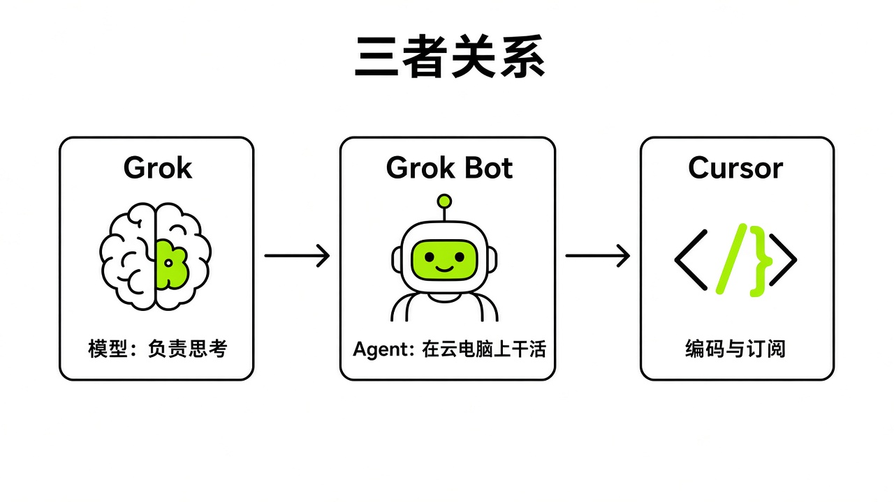
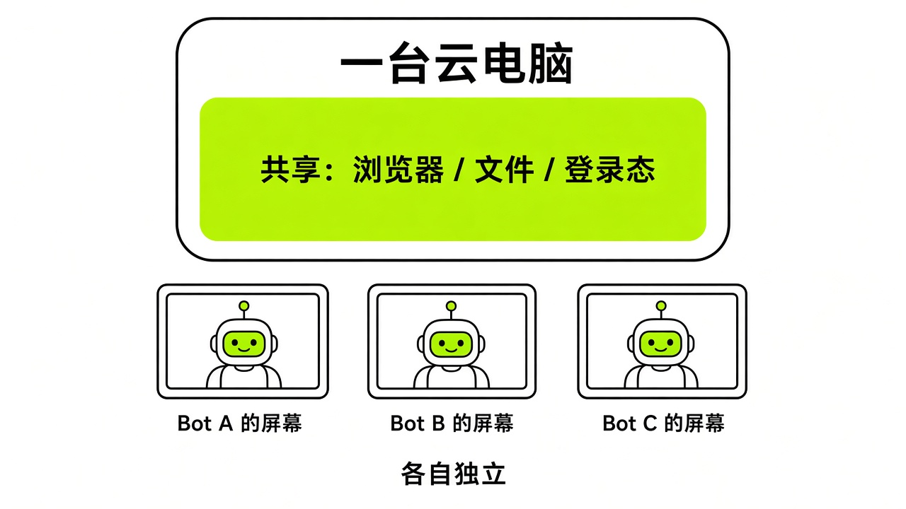
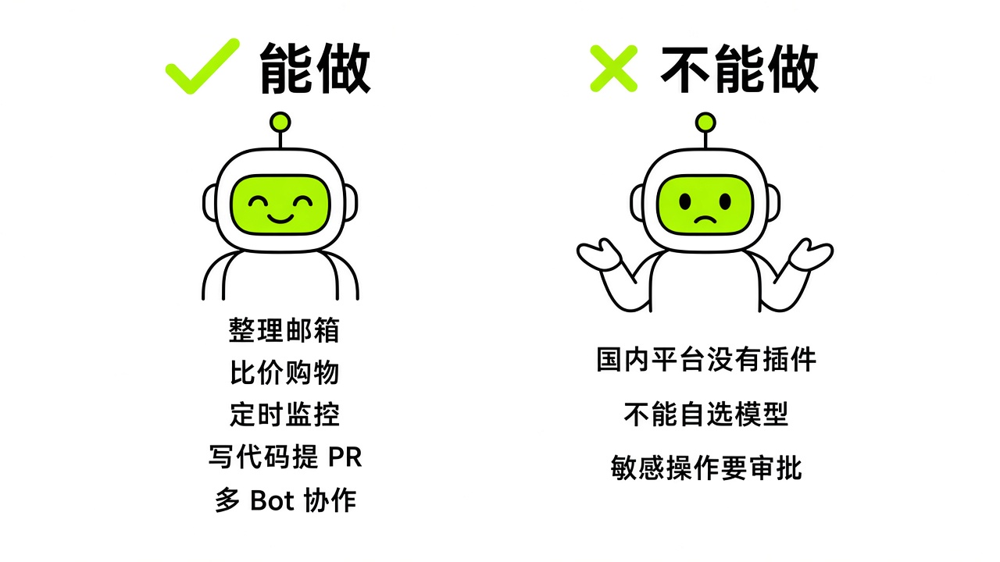
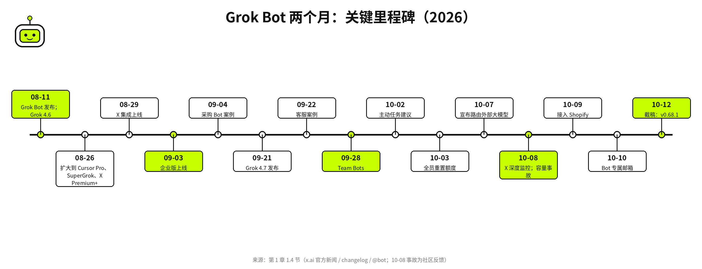
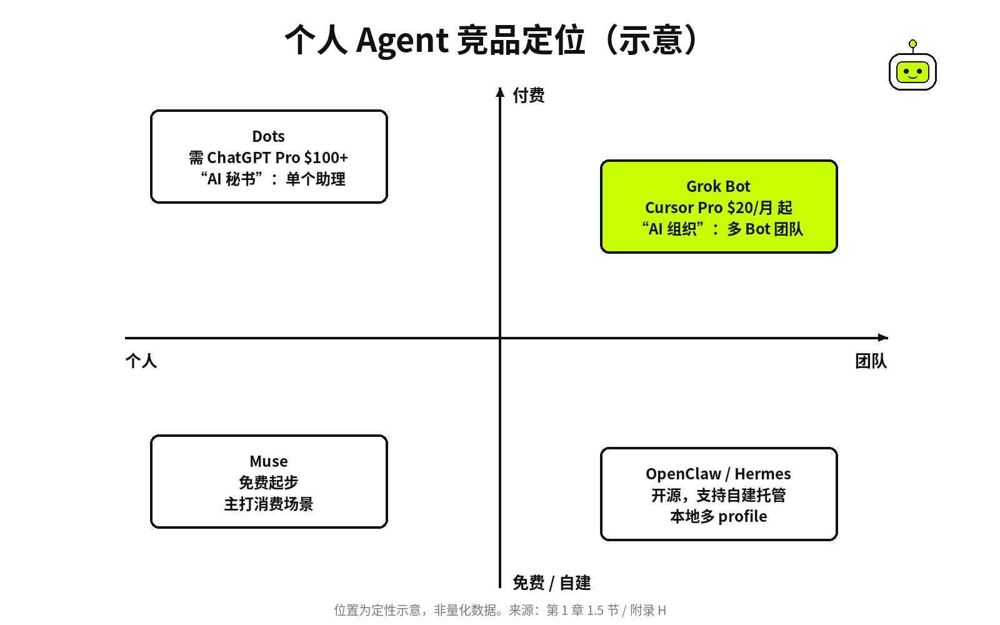

# §01 Grok Bot 是什么 · What It Is

[← 上一章：《Grok Bot 黑皮书：从零到一支 AI 团队》](../part0-preface/00-preface.md) ｜ [📖 返回目录](../../README.md#-目录) ｜ [下一章：§02 怎么才能用上 · Getting Access →](../part1-getting-started/02-access.md)

---

## 1.1 一句话讲清 Grok、Grok Bot、Cursor 的关系 · Grok vs Grok Bot

很多人第一次听说 Grok Bot，以为它是把 Grok 聊天机器人套了个壳。其实不是。

Grok 是 SpaceXSI（前 xAI）的大语言模型。你向它提问，它吐出一段文字。Grok Bot 是搭在模型上层的 Agent 应用——你不是找它聊天，是在给它派活。官方原话写得明白："Grok Bot gives you Bots you can keep around: AI teammates with names, jobs, and context that compounds over time"（[cursor.com/docs/grok-bot](https://cursor.com/docs/grok-bot)）。社区里一条 215 赞的帖子概括得很透彻：Grok 负责调研、比对、理清思路，再把指令下发给 Grok Bot；Grok Bot 负责切进 App、改数据、发消息、把事情收尾（[X 帖](https://x.com/i/status/2106883332432945519)）。一句话：**Grok 负责想，Bot 负责做**。

再说 Cursor。2026 年 2 月 xAI 并入 SpaceX（[x.ai/news/xai-joins-spacex](https://x.ai/news/xai-joins-spacex)），8 月 14 日 AI 编程工具 Cursor 也成为 SpaceXSI 的一部分——官方客服案例原文是 "When Cursor became part of SpaceXSI on August 14"（[x.ai/news/grok-bot-customer-support](https://x.ai/news/grok-bot-customer-support)）。Grok Bot 与 Cursor 共用一套账号和订阅——所有 Cursor 付费个人版和 Teams 计划都直接带 Grok Bot 权限（[cursor.com/docs/grok-bot](https://cursor.com/docs/grok-bot)）。Cursor 的云端代理（Cloud Agent / Cursor Projects）也能在 Grok Bot 内部直接调用，这块我留在 §10 展开。

到了 2026 年 10 月中旬，这三者的绑定进入了完全体阶段。官方在 10 月 13 日至 10 月 18 日期间正式推出 **The X Subscription 三合一统一订阅**（[@bot 官方公告](https://x.com/bot/status/2110063783796572496)，获 3,039 赞、272 转发、540 书签；详见官方帮助中心 [cursor.com/help/the-x-subscription/overview](https://cursor.com/help/the-x-subscription/overview) 与 [cursor.com/help/grok-bot/plans](https://cursor.com/help/grok-bot/plans)）。在这套顶层设计下，**Grok**、**Cursor**、**X Premium** 与 **Grok Bot** 被彻底融合成单一订阅计划，不再需要繁琐的跨平台账号手动关联：

- **三合一档位与准入边界**：The X Subscription 分为 **Premium（$30/月）**、**Super（$100/月）** 与 **Ultra（$200/月）** 三档，全部原生包含 Grok Bot 权限；而免费的 **Free（$0）** 与入门级 **Plus（$8/月）** 档位不包含 Grok Bot（[cursor.com/cn/help/grok-bot/plans](https://cursor.com/cn/help/grok-bot/plans)）。
- **三端共享周额度池与 Prepaid Credits 预付机制**：在 The X Subscription 体系下，Grok Bot、Grok 与 Cursor 三端共用同一个**周额度池（one weekly usage pool）**，每周固定重置且不结转。当周额度耗尽或调用非 Grok 系列的第三方模型时，系统不再走后付费账单，而是直接从用户在 `grok.com/dashboard/billing` 充值的 **Prepaid Credits（预付额度）** 中扣减，支持配置自动充值（Auto Top-up）与月度额外消费封顶上限（[cursor.com/help/grok-bot/plans](https://cursor.com/help/grok-bot/plans)）。
- **老订户保留与 `cursor.com/unify` 单向不可逆切换规则**：既有独立 Cursor Pro（$20/月）、Pro+（$60/月）、Ultra（$200/月）及自助式 Teams（$40/人/月）老订户只要不主动迁移，仍可保留原有独立档位与后付费按需限额（On-demand monthly limit），也能继续通过 `Settings > Usage & Billing > Manage Plan > Get Access with Grok` 关联个人 SuperGrok 或 X Premium+ 账号（多账号额度不叠加，自动取较高一档生效，详见 [cursor.com/help/grok-bot/faqs](https://cursor.com/help/grok-bot/faqs)）。但请注意：**一旦通过 `cursor.com/unify` 或 `accounts.x.ai/unify` 主动合并升级至 The X Subscription，该切换为单向不可逆操作，无法退回旧版独立订阅计划**；同时若此前通过 Apple App Store 或 Google Play 订阅了旧计划，必须在手机端应用商店手动取消，以防双份扣费（[cursor.com/help/the-x-subscription/overview](https://cursor.com/help/the-x-subscription/overview)）。

这三者连起来是一条链条：Grok（模型层）→ Grok Bot（Agent 层）→ Cursor（编码层）。你可以单用 Grok Bot 不碰代码，也可以让 Bot 把编程任务自动分发给 Cursor 的云端 Agent。普通用户面对的入口只有一个：Grok Bot 的桌面端或手机端。

很多刚上手的开发者还会困惑：既然有了 Grok Bot，它和本地终端里的 Claude Code、Codex 到底是什么关系？中文社区创作者一泽Eze（`@eze_is_1`）在一条收获 351 赞、62 转发、705 书签的万字长推中给出了极清晰的架构对比框架（[@eze_is_1 原帖](https://x.com/eze_is_1/status/2109850538045264151)），博主蓝海（`@lanvjian`）也将其力荐为分不清 Grok Bot 与 Codex 的新手必看定位指南（[@lanvjian 推荐帖](https://x.com/lanvjian/status/2111085984855011349)）：

- **本地 Claude Code / Codex 是“深度编码特种兵”**：扎根在你的本地主力开发机或大型代码仓库里，适合需要高频读写本地文件、跑重度编译测试、精雕细琢复杂工程架构的沉浸式编程任务。
- **Grok Bot 是“7×24 小时在线的云端全能总管与连接器中枢”**：它常驻云端沙箱，自带持久化浏览器、专属邮箱、原生免费 X 生态检索以及覆盖日历、飞书/Slack、1Password、Vault 的全套外部连接器，并能通过 BDK（Bot Developer Kit）与本地 CLI 双向互调（如 `@StarkLJM` 实测的跨端派单工作流 [X 帖](https://x.com/starkljm/status/2109544938644107411) 与 `@z_lumia` 的三合一订阅双向互调实践 [X 帖](https://x.com/z_lumia/status/2113800469571313974)）。换言之，Grok Bot 负责全天候盯哨、跨平台信息调度、多智能体编排与生活/运营自动化，而把重度代码攻坚委派给 Cursor Cloud Agents 或本地编码 CLI。

*图：Grok · Grok Bot · Cursor 三者关系图（模型→Agent→编码）*

2026 年 10 月 7 日，马斯克在 X 上公布了一个新动向：Grok Bot 不再只调用自家的 Grok，而是按任务分工路由到 Claude Opus 5.5、Midjourney、Suno 这些外部模型（[马斯克 X 帖](https://x.com/elonmusk/status/2107724314451878104)；[TNW 报道](https://thenextweb.com/news/grok-bot-claude-opus-midjourney-suno-musk)）。Grok Bot 团队成员 @poteto 随后在回复里说："yes, bot itself will run on opus 5.5"，并称 Opus 5.5 "is rolling out right now"（[X 帖](https://x.com/poteto/status/2107734770990133319)）。也就是说，用户不必费心挑模型，Bot 会替你选后端；但这是逐步推送，截至 10/12 仍有用户说自己没感觉到切换（[X 帖](https://x.com/GodlyAlphaM/status/2108885285941698990)），官方 x.ai/news 也还没有专文。虽然没给手动切换的开关，但省心之处在于，你用不着关心各家模型的参数差异。

## 1.2 一台云电脑 + 一群同事 · The Cloud Computer Model

理解 Grok Bot 最省事的方式，就是把它看作你在云端长期开着的一台电脑，上面围坐着一群同事。

每个 Bot 都跑在一台持久化的云电脑里，自带浏览器、文件系统和终端（[cursor.com/help/grok-bot/computer-and-apps](https://cursor.com/help/grok-bot/computer-and-apps)）。你合上笔记本电脑、锁屏甚至直接关机，它依然在云端干活，不吃本地资源（[cursor.com/docs/grok-bot](https://cursor.com/docs/grok-bot)）。这跟网页版 ChatGPT 或 Grok 完全两码事：网页关了任务就断，Grok Bot 则是你走开了，它还在继续跑。

关于这台云电脑（内部代号常被称为 `box`，视觉图标则是一个经典的中餐外卖折盒 `to-go` box 🥡），Grok Bot 官方设计师 Peng Zheng（`@pengzheng_`）在 2026 年 10 月 24 日分享过一段极客味十足的幕后典故（[@pengzheng_ 原帖](https://x.com/pengzheng_/status/2113786630033322239)，获 204 赞、148 书签；及补充帖 [X 帖](https://x.com/pengzheng_/status/2113804819274277015)）：为了搞清楚这个标志性的外卖纸盒在真实物理世界里究竟是怎么折叠成形的，他直接把任务派给了 `@bot`。Bot 先是在全网检索挖掘出 **1908 年的中餐外卖折盒原始专利图纸**，随后直接在自己的云电脑里编写 Python 脚本驱动 **Blender** 完成了 3D 建模——将纸盒的每一片折页严格沿着 1908 年专利图纸上的折痕线（crease lines）绑定为物理铰链（hinge），最终渲染出与 🥡 Emoji 严丝合缝的开合无缝循环动画，用作官方页面的 `og:video`。用云电脑自己考据百年专利、再用 Blender 渲染出云电脑自己的视觉图腾，恰好是这套沙箱能力最生动的注脚。

这台云主机的硬件规格，社区用户测算大致是 8 核 CPU、16GB 内存、约 128GB 硬盘（[X 帖](https://x.com/hejushang8/status/2103760664217174494)；[NodeSeek 帖](https://www.nodeseek.com/post-906175-1)）。官方文档没有对外公开过硬性参数，后续随时可能会变。

核心规则是：**同一个账号下的所有 Bot 共用这一台电脑**。官方文档写得很清楚："Every Bot on your account uses the same computer"（[cursor.com/help/grok-bot/computer-and-apps](https://cursor.com/help/grok-bot/computer-and-apps)）。共用意味着什么？浏览器 Cookie 和登录态完全打通，一个 Bot 登了 Gmail，其他 Bot 抬手就能用（同上）；硬盘文件对所有 Bot 开放（同上）；命令行凭据也是共享的（同上）。

好处是 Bot 之间交接工作不用反复登录、重新配环境，前面做了一半，后面接手就能干。坏处是这里不存在安全边界，官方明确提醒："do not place a credential or file on it if another Bot on your account should not be able to use it"（同上）。§08 讲安全时我会单独拆解，这里先记牢：千万别在云电脑里登你的网银。

虽然共用一台机器，但每个 Bot 分配了独立的屏幕（screen）。多个 Bot 可以并行使用浏览器和桌面工具，不过单个 Bot 同一时间只能跑一个 computer-use 任务（同上）。官方设计博客的比方打得很形象：这更像"和同事同处一室办公"，而不是"操作一台远程机器"——你能看到他们都在忙，探头瞄一眼屏幕就知道进度，遇到卡壳再坐过去接手键盘鼠标（[x.ai/news/designing-grok-bot](https://x.ai/news/designing-grok-bot)）。

> [!NOTE]
> 📸 **截图位（待补）**：Agent Computer 云电脑视图

*图："所有 Bot 共享一台云电脑"示意图——共享区域（浏览器/文件/登录态）与独立区域（各 Bot 的屏幕）*

## 1.3 它能做什么、不能做什么 · Can / Can't

### 能做什么

官方文档列出了 8 个核心方向，每个方向都配了可复制的提示词（[cursor.com/help/grok-bot/use-cases](https://cursor.com/help/grok-bot/use-cases) 与技术文档中心 [cursor.com/docs/grok-bot/use-cases](https://cursor.com/docs/grok-bot/use-cases)）：销售外拓（Sales Outbound，从 CRM 调取目标客户打分并起草外联邮件）、招聘猎头（Talent Scout，按岗位筛选候选人并排除已有记录）、付费投放（Paid Media，拉广告数据比对预算与 CAC）、费用管理（Expense Manager，按周核对报销单据标记违规）、产品性能（Product Performance，调查线上故障出具截图和依据）、Bug 复现（Bug Reproduction，在测试环境还原问题产出复现步骤与最小用例）、客户健康（Account Health，结合用量与工单评估续约风险），以及总参谋长（Chief of Staff，每日通读收件箱、日历、Slack 和纪要梳理优先级）。

中文社区的玩法要接地气得多（本书调研汇总 research/zh/zh-summary.md，非官方页面）：接微信做自动客服（10 月热度最高）、自媒体流水线（公众号和小红书的选题、写稿加排版）、跨境电商巡检竞品与监控新词、结合 Google Maps 和 Gmail 规划旅行、批量退订垃圾邮件、在云电脑里跑 ffmpeg 脚本渲染视频，以及搭建 Notion 数据看板。这些玩法我在 Part 5 会逐个拆解，这里先知道大致框架。

随着 2026 年 10 月中下旬 v0.71.2 至 v0.75.5 版本的密集更新（详见官方更新日志 [x.ai/changelog/bot](https://x.ai/changelog/bot)），Grok Bot 的能力边界又迎来了四项质的飞跃，将此前“无法直接生成视频或维护持久交互看板”的旧限制彻底打破：

1. **Pages（Canvas）实时交互看板与应用（v0.75.2 上线）**：Bot 现在不仅能输出聊天文本，还能直接创建并持续热更新包含表格、图表、时间线与交互组件的 **Pages**（[@bot 官方公告](https://x.com/bot/status/2112991843235610885)，获 6,544 赞、2,008 书签；[x.ai/changelog/bot](https://x.ai/changelog/bot)）。所有生成的 Page 会沉淀在对应 Bot 右侧信息栏的 `Library` 中，并支持 **Only you**（仅自己）、**Your team**（团队可见）和 **Anyone with the link**（公开链接）三级分享权限。例如社区开发者 Melvin Vivas（`@melvindvivas`）就让 Chief of Staff 幕僚长 Bot 创建了一个实时更新的 `Activity Dashboard` 看板（[@melvindvivas 案例帖](https://x.com/melvindvivas/status/2113676935956160882)，获 1,087 赞、1,687 书签），在一个页面内统揽所有专职 Bot 的时间线、进行中任务、已完成事项与待人工审批队列。
2. **Grok Imagine 原生视频生成与代码动效渲染（v0.71.2 上线）**：Bot 现已内置 Grok Imagine 视频生成能力，既能直接在对话中生成与编辑实拍感视频素材（[@bot 生视频官宣](https://x.com/bot/status/2110566041772617908)，获 20,762 赞、1,923 转发、4,769 书签），也能在云电脑中用代码（Remotion / CSS / Canvas / FFmpeg）编写并渲染严丝合缝的动态图形视频（Motion Graphics）（[@bot 代码动效演示](https://x.com/bot/status/2110772748805194127)，获 2,616 赞）。
3. **Vault 内置加密保险箱与 1Password 免密填充（v0.75.2 & v0.75.5 上线）**：针对浏览器自动化中最头疼的账号登录与绑卡结账环节，官方先后推出了两套零明文暴露方案。一是 **1Password Brokered Sign-in（代理逐次授权登录）**（[@bot 1Password 官宣](https://x.com/bot/status/2113301060811161874)，3,663 赞；[@1Password 联合发布](https://x.com/1Password/status/2113276767582498943)，10,507 赞；详见 [cursor.com/help/grok-bot/connect-apps](https://cursor.com/help/grok-bot/connect-apps)），无需配置繁琐的共享 Vault，只需在本地 1Password App（v8.12.42+）上按指纹批准，即可把个人库凭据注入 Bot 浏览器；二是内置只写加密存储区 **`Settings → Vault`**（[@bot Vault 官宣](https://x.com/bot/status/2113754107861532677)，9,398 赞、2,756 书签；详见 [cursor.com/help/grok-bot/secrets](https://cursor.com/help/grok-bot/secrets)），支持保存登录凭据（含 2FA/TOTP）、信用卡（支持手机摄像头扫卡识别）与收货地址，并支持 5 MB 以内的密码管理器 CSV 批量导入。Bot 仅能读取明文 `Hint` 标签并通过底层 `BrowserSecureFill` 注入表单，永远看不到明文密码、完整卡号或 CVV（官方登录与结账调用优先级详见 [cursor.com/docs/grok-bot/work](https://cursor.com/docs/grok-bot/work)）。
4. **iPhone Action Button 一键语音通话（iOS v1.16+ 上线）**：在 iPhone 15 Pro 及后续机型上，用户可将侧边操作按钮（Action Button）直接绑定为 Grok Bot 的 `Start Voice Chat` 或指定专职 Bot 的 `Start Voice Chat with Bot` 快捷指令（[@bot Action Button 官宣](https://x.com/bot/status/2112246033178968161)，7,264 赞、2,213 书签；详见 [cursor.com/help/grok-bot/voice-chat](https://cursor.com/help/grok-bot/voice-chat) 与 [cursor.com/help/grok-bot/mobile](https://cursor.com/help/grok-bot/mobile)）。盲按手机侧键即可随时开口向云端团队派活，挂断后聊天流会自动生成带完整逐字稿（transcript）的语音卡片并立即跟进执行。

### 做不到的事

我调研下来，目前明确做不到的事主要有这几项：

国内主流应用没有任何官方插件。微信、小红书、抖音、QQ 邮箱通通没有接口。想让它跑，只能靠网页版登录、导出文件或者手工截图绕过去（[象鱼工作流](https://xiangyugongzuoliu.com/grokbot-use-cases/)）。这对国内用户来说门槛最高，§11 会专门讲怎么绕路。

你没法手动选底层模型。前面说过，Bot 会按任务自动分流，官方压根没留模型切换开关（[TNW](https://thenextweb.com/news/grok-bot-claude-opus-midjourney-suno-musk)）。

**付款和对外发送必须经过人工审批**。Bot 掏钱买东西会弹出确认卡片让你核对金额，发邮件和发 Slack 消息可以先生成草稿卡片，等你点 Send 才送出（changelog v0.45.0；官方用例提示词也都以"Do not send"、"Do not contact anyone"结尾，[cursor.com/help/grok-bot/use-cases](https://cursor.com/help/grok-bot/use-cases)）。注意这不是绝对红线：9/30 的 v0.64.0 起，草稿卡片上可以选"Disable drafts for this Bot"，之后该 Bot 会直接发送（[x.ai/changelog/bot](https://x.ai/changelog/bot)）。新手建议保持草稿模式。此外在结账环节还有一条极关键的 Vault 边界：根据官方 [cursor.com/help/grok-bot/secrets](https://cursor.com/help/grok-bot/secrets) 说明及社区博主 `@kial`（[X 帖](https://x.com/kial/status/2114201768414646280)）、`@JianWeiSignal`（[X 帖](https://x.com/JianWeiSignal/status/2114195530611855488)）的实测提醒，**一旦将银行卡保存在 Vault 中，结账填充该卡时不会再触发单独的逐笔 Vault 弹窗确认**（仅受通用购买审批约束）；如果你希望每一笔消费都必须亲手输入卡号把关，切勿把主力银行卡常驻保存在 Vault 中。

目标网站随时能拦死它。Bot 虽能跑浏览器，但对方站点一旦开启防爬风控、强制验证码或登录态过期，Bot 就会停下来把控制权交还给你，它自己翻不过去（[cursor.com/docs/grok-bot](https://cursor.com/docs/grok-bot)）。不过现在面对数据中心 IP 被拦的情况，你可以在桌面端开启 `Settings > Computer > Your computer > Route traffic through this computer`，借用本机住宅 IP 绕过大部分云机房反爬拦截（参见 `@XueshiQiao` 实测分享 [X 帖](https://x.com/XueshiQiao/status/2112866936229183589)）。

*图：能力矩阵——左列"能做"（8 个官方用例 + 中文热门 10 例），右列"不能做"（无国内插件、不能选模型、必须审批等）*

## 1.4 时间线：8/11 到今天 · Timeline

Grok Bot 从上线到写书这天刚好两个月，版本迭代极快，官方 changelog 已经刷出了 **49 个版本**（v0.17.0 到 v0.68.1），并在 10 月中下旬继续一路狂飙至 **v0.75.5**（[x.ai/changelog/bot](https://x.ai/changelog/bot)）。我把关键节点梳理出来：

2026 年 2 月 2 日，SpaceX 正式收购 xAI（[x.ai/news/xai-joins-spacex](https://x.ai/news/xai-joins-spacex)）。

8 月 11 日，Grok Bot 正式发布并开放早期测试，官方定义是随时在线的 Agent 团队，自带独立电脑，像人一样操作各类应用（[x.ai/news/introducing-grok-bot](https://x.ai/news/introducing-grok-bot)），同日发布了 Grok 4.6 模型（[x.ai/news/grok-4-6](https://x.ai/news/grok-4-6)）。8 月 26 日扩大权限，SuperGrok 全档、Cursor Pro 和所有 Cursor Teams 计划都包含 Grok Bot（[x.ai/news/grok-bot-more-plans](https://x.ai/news/grok-bot-more-plans)）；X Premium+ 绑定见 8 月 25 日的 changelog v0.27.0（[x.ai/changelog/bot](https://x.ai/changelog/bot)）。三天后，8 月 29 日上线 X 集成，Bot 能读写公开推文（[x.ai/news/grok-bot-and-x](https://x.ai/news/grok-bot-and-x)）。

到了 9 月，节奏全面提速。9 月 3 日企业版上线，补齐访问控制、网络策略和审计日志，同日发布设计架构解析（[x.ai/news/grok-bot-for-enterprise](https://x.ai/news/grok-bot-for-enterprise)；[x.ai/news/designing-grok-bot](https://x.ai/news/designing-grok-bot)）。9 月 4 日官方晒出采购 Bot（Haggle Bot）案例，帮企业省下超 $100,000 直接成本（[x.ai/news/grok-bot-procurement](https://x.ai/news/grok-bot-procurement)）。9 月 21 日发布 Grok 4.7 模型，主打编程和知识工作提速一倍、成本减半（[x.ai/news/grok-4-7](https://x.ai/news/grok-4-7)）。次日又公布客服案例，工单量涨了 175% 却没加一个人，单票成本压到 $0.20–0.30（[x.ai/news/grok-bot-customer-support](https://x.ai/news/grok-bot-customer-support)）。9 月 28 日上线 Team Bots，一个 Bot 全队共用，能直接嵌进 Slack（[x.ai/news/team-bots](https://x.ai/news/team-bots)）。

进入 10 月几乎一天一个样。10 月 2 日推出主动任务建议（[@bot X 帖](https://x.com/bot/status/2105713240701538538)）。10 月 3 日全员重置额度（[@bot X 帖](https://x.com/bot/status/2106083136002310193)）。10 月 7 日马斯克宣布路由外部大模型（[马斯克 X 帖](https://x.com/elonmusk/status/2107724314451878104)；[TNW](https://thenextweb.com/news/grok-bot-claude-opus-midjourney-suno-musk)）。10 月 8 日 X 深度监控上线（[@bot X 帖](https://x.com/bot/status/2107949161878606089)），但同日发生大规模容量事故，大范围出现 "Bot failed to respond"，定时任务全部瘫痪（[Cursor 论坛](https://forum.cursor.com/t/all-grok-bot-routines-failed-to-run/174125)）。10 月 9 日接进 Shopify（[@bot X 帖](https://x.com/bot/status/2108228871938359347)）。10 月 10 日上线 Bot 专属邮箱，能注册服务、发信联系商家（[@bot X 帖](https://x.com/bot/status/2108609764766908772)）。截至 10 月 12 日本书首轮截稿，changelog 刷到 v0.68.1，新加了做幻灯片和换聊天配色（[x.ai/changelog/bot](https://x.ai/changelog/bot)）。

从 10 月 13 日到 10 月 25 日，Grok Bot 又密集迎来了一波重磅更新（[x.ai/changelog/bot](https://x.ai/changelog/bot)）：

- **10 月 13 日–10 月 18 日（The X Subscription 三合一统一订阅）**：`@bot` 正式宣布 Grok Bot 并入 **The X Subscription**，以单一套餐（Premium $30/月、Super $100/月、Ultra $200/月）打通 Grok、Cursor 与 X Premium，共享同一周额度池与 Prepaid Credits 预付额度机制（[@bot X 帖](https://x.com/bot/status/2110063783796572496)；[cursor.com/help/the-x-subscription/overview](https://cursor.com/help/the-x-subscription/overview)）。
- **10 月 14 日（v0.71.2：Grok Imagine 生视频 + 专属邮箱 `+alias` 别名）**：发布 v0.71.2（[x.ai/changelog/bot](https://x.ai/changelog/bot)），正式支持调用 Grok Imagine 生成与编辑视频及代码渲染 Motion Graphics 动效（[@bot 生视频 X 帖](https://x.com/bot/status/2110566041772617908)；[@bot 动效 X 帖](https://x.com/bot/status/2110772748805194127)）；同日工程师 Sam Sokolin（`@SamSokolin`）宣布 `@mail.grokbot.com` 专属邮箱支持 `+alias` 加号子别名，可按特定后缀精准触发对应的 Routine（[@SamSokolin X 帖](https://x.com/SamSokolin/status/2110496237241667621)；[cursor.com/help/grok-bot/agent-email](https://cursor.com/help/grok-bot/agent-email)）。
- **10 月 15 日（Link / X Money 结账与 Elon Musk SpaceX 全额赔付承诺）**：支持在结账环节使用 Link 与 X Money 付款，Elon Musk 公开发文做出背书：如果 Grok Bot 在代购中出错或泄露银行卡（迄今从未发生），SpaceX 将全额赔付（*"If Grok @Bot makes a mistake with a purchase or leaks your card (never happened yet), SpaceX will make you whole"*，[@elonmusk X 帖](https://x.com/elonmusk/status/2110610960474079445)）。
- **10 月 16 日（X Chat 端到端加密私信与消息请求接入）**：工程师 Paul Vann（`@pjvann`）宣布 Grok Bot 打通 X `@chat` 端到端加密私信收件箱与陌生人消息请求（message requests），配合本地沙箱中的官方解密仓库 `github.com/xdevplatform/xchat-grokbot-helper` 与 4 位 PIN 码自动分拣私信（[@pjvann X 帖](https://x.com/pjvann/status/2111104660773687646)）。
- **10 月 19 日（iPhone Action Button 一键实时语音）**：iOS 客户端 v1.16+ 支持将 iPhone 15 Pro 及后续机型的侧边 Action Button 直接绑定为 Grok Bot 实时语音通话或唤醒指定专职 Bot（[@bot X 帖](https://x.com/bot/status/2112246033178968161)；[cursor.com/help/grok-bot/voice-chat](https://cursor.com/help/grok-bot/voice-chat)）。
- **10 月 21 日（Pages 实时交互看板发布）**：正式上线 Pages（Canvas），支持由 Bot 创建并持续热更新实时数据报表、多 Bot 协同看板与内部交互工具，提供三级分享权限（[@bot X 帖](https://x.com/bot/status/2112991843235610885)）。
- **10 月 22 日（v0.75.2：1Password Brokered Sign-in + Routine 300 次/小时大幅提额）**：联手 1Password 发布免共享库的 Brokered Sign-in 逐次生物识别授权登录（[@bot X 帖](https://x.com/bot/status/2113301060811161874)；[@1Password X 帖](https://x.com/1Password/status/2113276767582498943)）；打通 iOS 原生日历、提醒事项与通讯录直读；支持邮件转发保留完整 HTML、内嵌图与附件；并将 Routine 频率上限大幅提升至**全账号所有 Bot 合计 300 次/小时、单条 Routine 最高 200 次/小时**（定时最小间隔仍为 5 分钟，详见 [cursor.com/help/grok-bot/routines](https://cursor.com/help/grok-bot/routines) 与 [x.ai/changelog/bot](https://x.ai/changelog/bot)）。
- **10 月 23 日–10 月 25 日（v0.75.5：Vault 内置保险箱上线与文档全面迁入 `cursor.com`）**：发布 v0.75.5（[x.ai/changelog/bot](https://x.ai/changelog/bot)），全面开放 `Settings → Vault` 加密保存登录凭据、银行卡与地址（[@bot X 帖](https://x.com/bot/status/2113754107861532677)；[cursor.com/help/grok-bot/secrets](https://cursor.com/help/grok-bot/secrets)），同时官方技术文档与帮助中心全面整合至 [cursor.com/docs/grok-bot](https://cursor.com/docs/grok-bot) 与 [cursor.com/help/grok-bot](https://cursor.com/help/grok-bot)。

*图：时间轴长图——从 08-11 发布到 10-12，标注关键里程碑*

用户增长方面：Bloomberg 报道称截至 9 月 14 日周活用户达到 418,000，环比增长 24%，数据来自伦敦活动上的一份演示文稿（[Mint 转载 Bloomberg](https://www.livemint.com/ai/elon-musk-s-grok-bot-hits-418-000-weekly-users-after-one-month-11790093107144.html)）。SpaceX 官方未作回应。而到了 10 月下旬，据社区观察者 Wenser（`@wenser2010`）汇总披露，Grok Bot 上线仅两个月便已突破 **80 万周付费用户（800K weekly paid users）**（[@wenser2010 增长分析帖](https://x.com/wenser2010/status/2113683422409572523) 与 [竞品对比跟帖](https://x.com/wenser2010/status/2113683427069489614)）。这个数字虽然与免费消费级产品 Meta Muse 据报超 300 万的周活体量维度不同（[TNW](https://thenextweb.com/news/grok-bot-claude-opus-midjourney-suno-musk)）——Muse 免费但受限于美国地区及 Meta 账号准入墙，而 Grok Bot 走 $30/月起步的付费路线且扎根生产力与多智能体工作流，80 万周付费用户的含金量极其可观。

## 1.5 为什么是现在 · Why Now

2026 年下半年，各大厂商扎堆涌入个人 AI Agent。每家都在推自己的产品：Meta 推出 Muse（免费，主打消费场景），OpenAI 推出 Dots（需要 ChatGPT Pro $100+），Google 有 Gemini Spark，Anthropic 有 Claude Cowork，开源界也有 OpenClaw 和 Hermes（[aiformortals 三方评测](https://www.aiformortals.co/blog/grok-bot-vs-meta-muse-vs-chatgpt-dots)；本书调研笔记 research/web/compare/compare-notes.md）。社区里有博主一口气测了 21 个通用 Agent（[X 帖](https://x.com/i/status/2105067074720829819)）。

在这场混战里，Grok Bot 的切入点和别人不一样。社区有句广为流传的概括："**Dots 是 AI 秘书，Grok Bot 是 AI 组织**"（[X 帖](https://x.com/i/status/2105404819745718679)）。Muse 和 Dots 给你的是单个助理，Grok Bot 给你的则是一支团队——每个 Bot 有名字、有职位、有长期记忆，能在群聊里互相协同、交接任务。

这套“AI 组织”到底能爆发多大的商业杠杆？官方自己用实战交出了一份教科书级的答卷（[x.ai/news/grok-bot-customer-support](https://x.ai/news/grok-bot-customer-support)）：2026 年 8 月 14 日 Cursor 并入 SpaceXSI 后，全球客服工单量瞬间暴增 **175%**。面对山呼海啸般的咨询与账单请求，官方团队没有扩招哪怕一名全职客服（**0 new support hires**，相当于直接省下了约 200 名新增客服人力），而是部署了一支由 5 位专职 Bot 组成的客服舰队——涵盖分诊接待（Intake Triage Bot）、账单与退款（Billing & Refund Bot）、技术复现（Technical Repro Bot）、事故批处理（Incident Batch Bot）与产品反馈聚类（Product Feedback Synthesizer Bot）。这支 AI 团队直接将单张工单的解决成本压到了 **$0.20–$0.30**（远低于行业平均的 **$1.00–$4.00**），实现了 **99%** 退款申请的全自动核验闭环；在一次线上突发故障中，仅由一名人类工程师审批一张批量确认卡，就在 **10 分钟**内一次性清零了 **204 张**故障工单，并且每天还能从海量对话中自动提炼超过 **20,000+** 个产品反馈数据点反哺研发。

价格层面，随着 The X Subscription 的推出，Grok Bot 的主力门槛定格在 **Premium $30/月**（一价打包 Grok、Cursor 与 X Premium，高于此前的 Super $100/月与 Ultra $200/月则提供更充裕的共享周额度池，同时既有独立 Cursor Pro $20/月老订户仍可维持原价，详见 [cursor.com/help/grok-bot/plans](https://cursor.com/help/grok-bot/plans)）。正如 `@wenser2010` 在三大大厂 Agent 横评中所指出的（[X 帖](https://x.com/wenser2010/status/2113683427069489614)）：Muse 虽是免费起步但有严格的美区准入限制且高级功能也要 $20–100，OpenAI Dots 死死绑定在 $100/月起步的 Pro 订阅上，OpenClaw 和 Hermes 则支持自建托管（[X 价格横比](https://x.com/i/status/2105195069263225049)）。相比之下，$30/月即可同时拿下主力 IDE（Cursor）、主力大模型（Grok）、社媒生态（X Premium）与 24 小时云端 AI 团队（Grok Bot），在性价比和生态协同上形成了降维打击。

有社区用户做过旅行规划的三方实测：Grok Bot 耗时最短，订机票比 Muse 便宜约 $90，Airbnb 便宜约 $136。换到小商家运营测试，Grok Bot 顺畅办完退款，还额外揪出了两笔隐蔽的重复扣费。该作者的结论是："For work, Grok Bot wins"（[aiformortals 评测](https://www.aiformortals.co/blog/grok-bot-vs-meta-muse-vs-chatgpt-dots)）。这属于单一测试样本，不能直接套用到全部场景。

21 个 Agent 横评里，有句评价抓得很准："It works like a black box, no reasoning, no logs, but it produces the outputs I'm always happy with"（[X 帖](https://x.com/i/status/2105067123081105501)）。黑盒运作、缺乏推理过程与执行日志，在需要严密合规审查的企业环境里是潜在隐患。针对这一痛点，官方目前已在企业版中补齐了 ISO/IEC 27001 与 ISO/IEC 42001 认证、OpenTelemetry 遥测过滤（`cursor.surface=grok_bot`）、MCP 出站白名单与 Inference Hooks 推理审计钩子（[cursor.com/docs/grok-bot/security](https://cursor.com/docs/grok-bot/security)），我会在后面的安全章节深入剖析。

竞品赛道变化极快。你读到这篇内容时，上面的部分对照可能已经出现变化。我把详细的竞品功能对照表单挪到了附录 H，正文只聚焦定位差异，省得花篇幅在容易失效的参数对比上。

*图：竞品定位坐标图——横轴"个人→团队"，纵轴"免费→付费"，标注 Muse / Dots / Grok Bot / OpenClaw / Hermes 的大致位置*

---

[← 上一章：《Grok Bot 黑皮书：从零到一支 AI 团队》](../part0-preface/00-preface.md) ｜ [📖 返回目录](../../README.md#-目录) ｜ [下一章：§02 怎么才能用上 · Getting Access →](../part1-getting-started/02-access.md)
