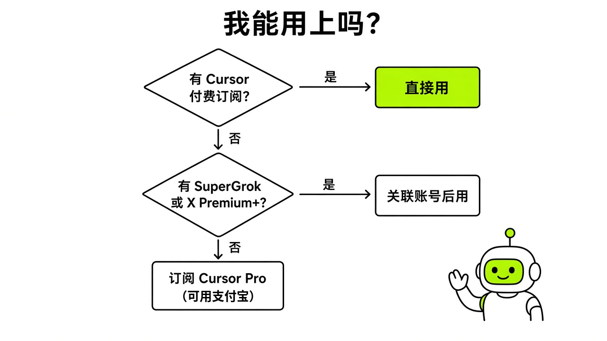
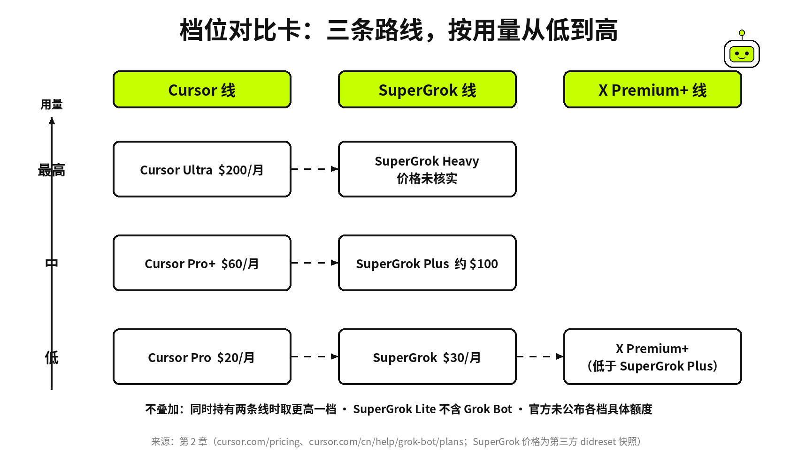
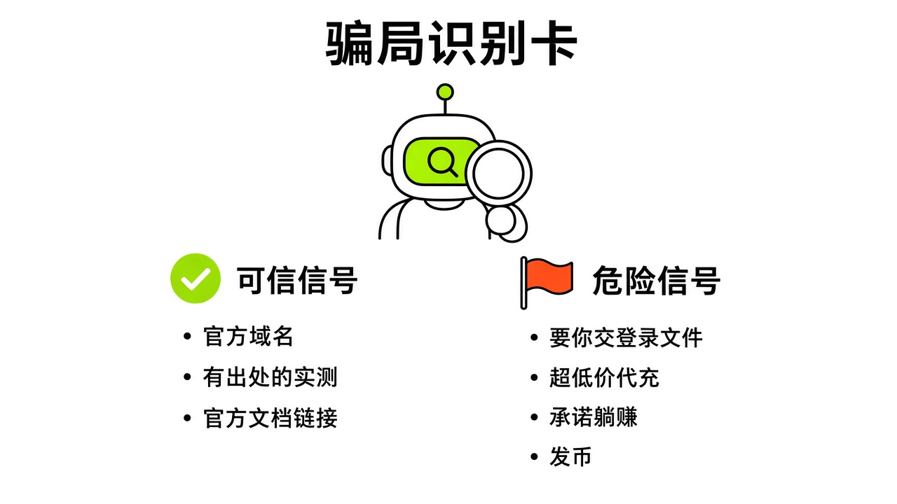

# §02 怎么才能用上 · Getting Access

[← 上一章：§01 Grok Bot 是什么 · What It Is](../part1-getting-started/01-what-it-is.md) ｜ [📖 返回目录](../../README.md#-目录) ｜ [下一章：§03 十分钟安装与开箱 · Install in 10 Minutes →](../part1-getting-started/03-install.md)

---

我调研中文社区时发现，问得最多的就是两件事：怎么用上 Grok Bot，怎么付钱。对国内用户来说，用上本身就是道坎。我把门槛拆成六块：谁能用、花多少钱、怎么付、怎么连，以及哪些坑千万别踩。

## 2.1 资格一张表 · Who Gets It

先搞清一件事：Grok Bot 不单独卖，它是 Cursor 和 SuperGrok 体系里的捆绑权益。不管你走哪条路，用量最终都记在一个 **Cursor 账号**上（"Grok Bot usage is metered on your Cursor account"），所以第一步永远是注册一个 Cursor 账号——哪怕你不写代码、从不打开 Cursor 编辑器【官方】（[cursor.com/help/grok-bot/plans](https://cursor.com/help/grok-bot/plans)）。

> 前提条件：一个能收验证码的邮箱或手机号；一种能付美元订阅的方式（外币卡，或本章 2.3 的支付宝路径）；能稳定访问境外网站的网络。三样缺一样，先看 2.3–2.5。

Cursor 官方帮助页写得很清楚：每个付费个人 Cursor 订阅及团队版都包含 Grok Bot 权限【官方】（[cursor.com/cn/help/grok-bot/plans](https://cursor.com/cn/help/grok-bot/plans)）。只要你订了 Cursor Pro（$20/月），你就已经能用 Grok Bot。Kin 橙皮书说「Cursor Pro $20 暂不含 Grok Bot，Pro+ $60 是最低门槛」，那是老黄历了，官方在 8 月 26 日就把权限下放给了所有付费档【官方】（[x.ai/news/grok-bot-more-plans](https://x.ai/news/grok-bot-more-plans)）。

除了 Cursor 这条线，你也能走 SuperGrok 或 X Premium+ 关联路线。把 Grok 账号关联到 Cursor 账号，就能拿到用量授权。

下面这张表覆盖了目前能用 Grok Bot 的所有情况：

| 你的情况 | 操作 | Grok Bot 用量等级 |
|---|---|---|
| Cursor Ultra（$200/月） | 同账号登录，直接用 | 最高 |
| Cursor Pro+（$60/月） | 同账号登录，直接用 | 中 |
| Cursor Pro（$20/月） | 同账号登录，直接用 | 低 |
| Cursor 团队版（$40/人/月起） | 每位成员用自己的 Cursor 账号登录 | 团队版额度 |
| SuperGrok Heavy（官方价格未抓到，橙皮书写 $300，未核实） | 在 Grok Bot 里关联 Grok 账号 | 最高关联用量 |
| SuperGrok Plus（约 $100，见下表） | 在 Grok Bot 里关联 Grok 账号 | 中 |
| SuperGrok（$30/月，第三方 didreset 数据） | 在 Grok Bot 里关联 Grok 账号 | 低 |
| X Premium+ | 关联 Grok 账号 | 低于 SuperGrok Plus |
| 自助 Grok Business 席位 | 退出后用 Sign in with Grok 重新登录，无需关联 | 与席位许可对应（SuperGrok 或 Heavy） |
| Cursor / Grok Enterprise | 联系客户经理或管理员开通 | 由管理员管理 |
| SuperGrok Lite | 不含 Grok Bot | — |

【官方】来源：[cursor.com/cn/help/grok-bot/plans](https://cursor.com/cn/help/grok-bot/plans)

这里有几个坑我得说明白。第一，Cursor 订阅和 SuperGrok 关联用量不叠加，系统只取两者中更高的一档。比如你同时有 Cursor Pro 和 SuperGrok Plus，额度按 Plus 走，不会加在一起【官方】（[cursor.com/cn/help/grok-bot/plans](https://cursor.com/cn/help/grok-bot/plans)）。第二，关联是**永久的**，不能解绑也不能转移。点关联前，务必确认登录的是你打算长期用的 Cursor 账号【官方】（[cursor.com/cn/help/grok-bot/plans](https://cursor.com/cn/help/grok-bot/plans)）。第三，免费试用给的是一笔固定用量额度和 7 天窗口，按智能体步数和 token 扣除，不是按发了几条消息算。一个大任务就能耗掉大半试用额度，用完不补发【官方】（[cursor.com/cn/help/grok-bot/plans](https://cursor.com/cn/help/grok-bot/plans)）。

*图：资格判定流程图——你有 Cursor 付费订阅？→ 有 → 直接用。没有 → 你有 SuperGrok / X Premium+ → 有 → 关联。是 Lite？→ 不行。都没有 → 免费试用 7 天。*

## 2.2 价格与档位 · Plans & Pricing

下面是官方标价。我只列 Cursor 定价页 JSON-LD 和 x.ai/pricing 能查到的数字，查不到的直接写查不到。

| 套餐 | 月费（美元） | 来源 |
|---|---|---|
| Cursor Pro | $20 | 【官方】cursor.com/pricing |
| Cursor Pro+ | $60 | 【官方】cursor.com/pricing |
| Cursor Ultra | $200 | 【官方】cursor.com/pricing |
| Cursor Teams Standard | $40/人 | 【官方】cursor.com/pricing |
| Cursor Teams Premium | $120/人 | 【官方】cursor.com/pricing |
| SuperGrok | $30 | 【社区】didreset.com 引 x.ai/pricing（2026-09-17 快照） |
| SuperGrok Plus | $100 | 【社区】didreset.com 引 x.ai/pricing（2026-09-17 快照） |
| SuperGrok Heavy | 官方价格页快照未显示价格 | 橙皮书写 $300，未核实 |

【官方】来源：[cursor.com/pricing](https://cursor.com/pricing)、[x.ai/pricing](https://x.ai/pricing)

每个档位到底有多少额度？官方未公布具体数字。Cursor 帮助页只写了相对高低：Ultra 和 Heavy 最高，Pro+ 和 Plus 居中，Pro 和 SuperGrok 最低，没有给任何 token 数、任务数或美元当量【官方】（[cursor.com/cn/help/grok-bot/plans](https://cursor.com/cn/help/grok-bot/plans)）。第三方网站 didreset.com 也写明「xAI publishes no numbers」【社区】。

社区里有各种估算。LINUX DO 有人猜 Cursor Pro 的 Bot 额度大概是 250、450 或 495 美元【社区】（[linux.do/t/topic/2848179](https://linux.do/t/topic/2848179)），X 上也有人说一条消息耗大概 1% 周额度【社区】（[x.com/miniyarov/status/2105428357273800799](https://x.com/miniyarov/status/2105428357273800799)）。这些数字互相打架，我没法替你下结论。最靠谱的办法，是订阅后去 Settings → Usage & Billing 盯自己的 Weekly usage。

用量分三个层次：包含在套餐里的每周用量（Weekly usage）每周重置；用完后如果开了按需用量（On-demand），超出的部分由 Cursor 计费，受**月度限额**（Monthly Limit）约束。限额不会在任务中途强行掐断，跑着的 Bot 可以超出上限后完成任务【官方】（[cursor.com/cn/help/grok-bot/plans](https://cursor.com/cn/help/grok-bot/plans)）。

*图：档位对比卡——三列：Cursor 线、SuperGrok 线、X Premium+ 线，每列按用量从低到高排列，中间用虚线连接同级别的档位。*

## 2.3 中国大陆用户：用支付宝开 Cursor Pro · Alipay Path

很多人最关心的就是这一节。

截至 2026 年 10 月 11 日，多位用户在 X 上实测确认：Cursor 官网结账页支持支付宝付人民币。最早发帖的是 @YuzuCMZ（327 赞 / 448 收藏），随后 @David114467 和 @cheery9998 等人做了交叉印证。AMZ123 跨境头条的谷歌SEO小平也发了带图教程【社区】（[x.com/i/status/2109157438226403420](https://x.com/i/status/2109157438226403420)、[x.com/i/status/2108488671699816806](https://x.com/i/status/2108488671699816806)、[amz123.com/t/lZiL8LFi](https://www.amz123.com/t/lZiL8LFi)）。有用户晒单实付约 139 元人民币（按当时汇率折算 $20）【社区】（[x.com/i/status/2109482976753127757](https://x.com/i/status/2109482976753127757)）。

社区整理的操作步骤如下【社区】【实测·TODO待实测：验证支付宝选项是否稳定出现、自动扣款协议行为及地区差异】：

1. 关掉代理，用浏览器无痕窗口打开 cursor.com/pricing。
2. 登录你以后打算关联 Grok Bot 的 Cursor 账号（关联永久有效，别登错号）。
3. 选 Pro 套餐，一定要**按月订阅**——年付和 Pro+ 目前基本不出支付宝选项。
4. 结账页把账单国家选成中国大陆，币种切到 CNY。
5. 支付方式找到支付宝（Alipay），扫码付款。
6. 付完去 cursor.com/dashboard 确认 Pro 状态，再去 Grok Bot 关联账号。

如果结账页看不到支付宝，这是被问得最多的问题。可以在 US 和 CNY 之间来回切换几次，切到 CNY 有时就会跳出来【社区】（[x.com/i/status/2109157438226403420](https://x.com/i/status/2109157438226403420)）。要是还不出来，清理浏览器缓存或换个浏览器。社区反馈老账号可能不显示，新注册的账号能看到【社区】（[x.com/i/status/2108838924491833373](https://x.com/i/status/2108838924491833373)）；也有人把网络节点切到新加坡后成功刷出【社区】（同上）。实在不行就给 hi@cursor.com 发邮件。

AMZ123 教程里还提到另一条路：在 App 内订阅时选「Pay without Link」，支付方式里也会出现支付宝【社区】（[amz123.com/t/lZiL8LFi](https://www.amz123.com/t/lZiL8LFi)）【实测·TODO待实测：验证 App 内订阅路径在不同设备上是否一致】。

提醒一句：支付宝付款会开通自动续费代扣。付完记得去支付宝设置里查一下代扣协议，下月不想续就随手关掉。另外，这套方法依托 Cursor 结账服务 Stripe 对国内账单地址的支持，随时可能被官方调整，不保证长久可用【社区】。

> [!NOTE]
> 📸 **截图位（待补）**：结账页全流程 6 张——选 Pro → 选 CNY → 出现支付宝 → 扫码 → 支付成功 → 后台确认 Pro 状态

## 2.4 其他路径：App 内订阅、X 会员、SuperGrok · Other Routes

支付宝开 Cursor Pro 不是唯一的路，还有几条途径可选。

如果你手头有 X Premium+，可以在 Grok Bot 里直接关联 X 账号拿到用量。@YuzuCMZ 提过一个技巧：桌面端要是卡在付费页，先给 X 账号绑上手机号（+86 也可以），然后再去登录【社区】（[x.com/i/status/2108748981069394279](https://x.com/i/status/2108748981069394279)）。不过官方明确说过，X Premium+ 属于最低用量档，低于 SuperGrok Plus【官方】（[cursor.com/cn/help/grok-bot/plans](https://cursor.com/cn/help/grok-bot/plans)）。

手里有外币 Visa 或万事达信用卡的话，可以直接上 grok.com 订 SuperGrok（$30/月），再关联到 Cursor。LINUX DO 有人反馈国内双币信用卡也能刷过【社区】（[linux.do/t/topic/2961817](https://linux.do/t/topic/2961817)），NodeSeek 上还有人提到绑 Kraken 卡拿到了试用【社区】（[nodeseek.com/post-906175-1](https://www.nodeseek.com/post-906175-1)）。

手机端也能订。macOS 和 iOS 共享同一个用量池【官方】（[cursor.com/cn/help/grok-bot/plans](https://cursor.com/cn/help/grok-bot/plans)）。但要注意，iOS 的 App Store 试用跟 Grok Bot 自己的 7 天试用不是一码事。App Store 试用到期不取消会自动扣费，得去 Apple ID 的订阅管理里手动退订【官方】（[cursor.com/cn/help/grok-bot/plans](https://cursor.com/cn/help/grok-bot/plans)）。Android 端目前没有 App 内试用。

有人打低价区的主意。LINUX DO 有帖子聊过去印度区订 SuperGrok，一个月只要 50 元人民币左右【社区】（[linux.do/t/topic/2848179](https://linux.do/t/topic/2848179)）。这条路有明确风险：跨区订阅可能违反 xAI 服务条款。关联建立后**不可解绑**，一旦账号被风控封禁，绑在上面的 Cursor 账号和 Bot 用量会一起泡汤。

> [!NOTE]
> 📸 **截图位（待补）**：App 内订阅页（iOS 和 Android 各一张）

## 2.5 访问与网络 · Network

好消息是，境内可以直接打开 x.ai/bot 产品页和 docs.x.ai 官方文档。ai345 的教程作者实测确认了这点【社区】（[ai345.info/ai-guide/grok-bot-china-guide](https://www.ai345.info/ai-guide/grok-bot-china-guide)），@MrRenran 也提到手机没开境外漫游数据照样能访问【社区】（[x.com/i/status/2106964584276037798](https://x.com/i/status/2106964584276037798)）。不过客户端登录和云电脑的连接质量因地区和运营商而异，没法保证哪里都顺畅。

手机号验证是很多人卡住的关卡。用 Grok 账号登录 Cursor 时需要接短信验证码。LINUX DO 用户 @jaffliang 反映，切到美国节点后 +86 手机号能正常收到短信并登录【社区】（[linux.do/t/topic/2743888](https://linux.do/t/topic/2743888)）。但也有人遇到「此手机号验证过多」报错，换节点也没用【社区】（同上，楼主 @KendrickZou 和 @han123 回复）。卡在这里时，可以换换节点；改用 Google 或 GitHub 账号登录 Cursor 也许能绕开这一步，但调研里没有找到实测记录【推测】。

还有一个暗坑是隐私设置。官方排查文档明确写着：如果 Cursor 账号还在用**旧版隐私模式**（Legacy Privacy Mode），Grok Bot 根本无法启动。解决办法很简单，去 Cursor 账号的数据设置里，切换到支持云端存储的模式就行【官方】（[docs.x.ai/grok-bot/troubleshooting](https://docs.x.ai/grok-bot/troubleshooting)）。

此外，Grok Bot 的云电脑跑在境外。如果要让 Bot 操作国内 SaaS 或公司内网，先评估数据出境合规【社区】（[ai345.info/ai-guide/grok-bot-china-guide](https://www.ai345.info/ai-guide/grok-bot-china-guide)）。这不是开个代理就能糊弄过去的。

> [!NOTE]
> 📸 **截图位（待补）**：登录报错示例——Legacy Privacy Mode 错误信息、手机号验证过多报错

## 2.6 代充、跨区与骗局 · Scams & Grey Market

在中文社区里，各种代充和灰产信息满天飞，不提醒很容易踩坑。

最危险的是代充。ClaudeMax 等代充平台打着「SuperGrok 代充 ¥299、Heavy 代充 ¥1,999」的旗号，要求你在浏览器打开 grok.com/api/auth/session，把整段 **Session JSON** 复制给他们，走微信付款【社区】（[claudemax.shop/blog/grok-bot-guide-supergrok](https://claudemax.shop/blog/grok-bot-guide-supergrok)）。ClaudeMax 自己都承认「不是官方也不是授权经销商」。Session JSON 里塞满了你的登录凭证与账号 ID，交出去就等于把账号交到陌生人手里。虽然对方声称用完就删，但你根本没法核实。能用支付宝直接订 Cursor Pro，就千万别碰这种代充。

跨区低价订阅也是雷区。有人去印度低价区订 SuperGrok，月费能压到 50 元人民币左右【社区】（[linux.do/t/topic/2848179](https://linux.do/t/topic/2848179)）。跨区订阅很可能违反服务条款（本书未逐条核对 xAI 条款原文【推测】），一旦触发风控封号，关联 Cursor 又无法解绑，你买的额度和账号全得陪葬。

公众号里还冒出过「Rakazo：Grok Bot 国内体验版」这类第三方工具【社区】（搜狗微信检索到的公众号标题，research/zh/weixin/weixin-list.md）。它不是官方产品。Grok Bot 没有中国大陆专供版，官方入口只有 x.ai/bot 这一个。

X 上还有人炒作 $GROKBOT 币和所谓「Bot 自主交易」，宣称「本金从 49 炒到 4391 美元」甚至翻几十倍【社区】（[x.com/i/status/2102291280965640690](https://x.com/i/status/2102291280965640690)）。这是赤裸裸的币圈营销套路。Grok Bot 确实能在人审批后下单买东西，但任何打着自动炒币暴富旗号的宣传都是骗局。

也有人打歪主意，想借 Bot 的美国云电脑去注册或订阅受地区限制的 Claude Code【社区】（中文社区公众号标题热点，zh-summary.md）。这违反 Anthropic 政策，极易封号。X 上已有用户吐槽，在 Bot 云电脑里刚注册 Claude 就被秒封，因为机房 IP 早就被风控盯上了【社区】（[x.com/i/status/2107099380847370475](https://x.com/i/status/2107099380847370475)）。

还有满天飞的 SEO 垃圾。我在 CSDN 搜出 443 条结果，去重后 287 篇，其中 113 篇是发布日期混乱或零阅读的机翻搬运【社区】（zh-summary.md）。这些文章还在嚼「只有 Heavy 和 Ultra 能用」这种 8 月份的过期旧闻。看到这类文章，先看更新日期，零阅读的直接关掉不用看。

*图：「骗局识别卡」——左列是可信信号（官方域名、有出处的社区实测、官方文档链接），右列是红旗信号（要你交 Session JSON、承诺回报率、低价区跳板、零阅读搬运、「国内体验版」）。*

---

[← 上一章：§01 Grok Bot 是什么 · What It Is](../part1-getting-started/01-what-it-is.md) ｜ [📖 返回目录](../../README.md#-目录) ｜ [下一章：§03 十分钟安装与开箱 · Install in 10 Minutes →](../part1-getting-started/03-install.md)
