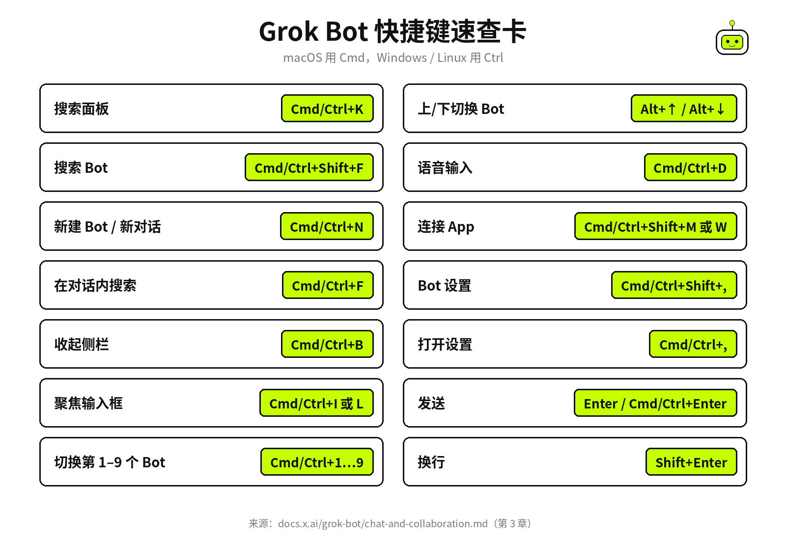

# §03 十分钟安装与开箱 · Install in 10 Minutes

[← 上一章：§02 怎么才能用上 · Getting Access](../part1-getting-started/02-access.md) ｜ [📖 返回目录](../../README.md#-目录) ｜ [下一章：§04 你的第一个任务 · Your First Task →](../part1-getting-started/04-first-task.md)

---

上一章搞定了账号和资格。这一章我们直接动手：把 Grok Bot 装好、登进去、认清界面、改掉几个容易踩坑的默认设置，最后把手机端也连上。整个过程十分钟搞定。

## 3.1 下载与平台 · Download

桌面端下载入口只有一个：**[x.ai/bot](https://x.ai/bot)**【官方】（[来源](https://docs.x.ai/grok-bot/get-started.md)）。打开网页选你的系统安装包。

macOS 分 Apple silicon 和 Intel 两个版本。不知道怎么查？点左上角苹果图标 → 关于本机，看到"芯片"就是 Apple silicon，看到"处理器"就是 Intel【官方】（[来源](https://docs.x.ai/grok-bot/get-started.md)）。下好 dmg 拖进应用程序文件夹，双击启动。系统提示安全确认，直接点打开。

Windows 同样分 x64 和 Arm64。在设置 → 系统 → 关于 → 系统类型里看架构【官方】（[来源](https://docs.x.ai/grok-bot/get-started.md)）。下好 exe 安装包直接运行，装完在开始菜单里打开。

Linux 在下载页的 More downloads 区域，提供 `.deb`（Debian/Ubuntu）、`.rpm`（Fedora/RHEL）和 AppImage 三种格式，各带 x64 和 Arm64 架构。终端敲一行 `uname -m`，输出 `x86_64` 选 x64，输出 `aarch64` 选 Arm64【官方】（[来源](https://docs.x.ai/grok-bot/get-started.md)）。装完直接在应用列表启动。

移动端 iOS 和 Android 都有独立 App。iOS 要求 iOS 18 或更高版本（iPad 要求 iPadOS 18+），Android 要求 Android 9 或更高版本【官方】（[docs.x.ai/grok-bot/mobile.md](https://docs.x.ai/grok-bot/mobile.md)），安装包约 26.63 MB【社区】（[媒体报道](https://www.thetechoutlook.com/new-release/software-apps/grok-bot-is-now-available-on-android/)）。iOS 去 [App Store](https://apps.apple.com/app/id6794501026) 下，Android 去 [Google Play](https://play.google.com/store/apps/details?id=ai.x.grok.bot) 下。Android 版是在 2026 年 9 月 2 日正式上架的【官方】（[@bot 发布帖](https://x.com/bot/status/2095168633559462197)）。注意：国内安卓手机多数没有 Google Play，需要先自行解决 Google 服务问题；iPhone 需要非中国大陆区的 Apple ID 才能在 App Store 搜到【推测】（官方未说明上架地区，请以实际为准）。

安装后不用管更新问题，Grok Bot 会自动静默检测。想手动查，在 Settings → Updates → Check for Updates 点一下就行【官方】（[来源](https://docs.x.ai/grok-bot/get-started.md)）。

> [!NOTE]
> 📸 **截图位（待补）**：x.ai/bot 下载页，标注三个系统入口

## 3.2 用 Cursor 登录与关联账号 · Sign In & Link

打开 Grok Bot 后是一个极简的欢迎页，中间只有一个 Sign in 按钮。点开会自动跳浏览器完成 Cursor 认证，认证完跳回客户端就登录成功了【官方】（[来源](https://docs.x.ai/grok-bot/get-started.md)）。Grok Bot 本身没有独立账号体系，直接复用 Cursor 账号。企业用户走日常的 SSO 流程即可【官方】（[来源](https://docs.x.ai/grok-bot/get-started.md)）。如果在客户端里没自动登录，进 Settings 点 Sign In with Cursor 也能补登【官方】（[来源](https://docs.x.ai/grok-bot/get-started.md)）。

关联 SuperGrok 稍微多一步。桌面端在 Settings → Usage & Billing 里点 Link SuperGrok Heavy（按钮标签会根据你实际的 SuperGrok 等级动态变）。手机端在登录后的 access 页点 Link Grok Account，关联完再点 Finished Linking? Refresh My Status 刷新状态【官方】（[来源](https://docs.x.ai/grok-bot/get-started.md)）。

这里有个坑要注意：如果你的 Cursor 账号处于 **Legacy Privacy Mode**，Grok Bot 会直接拒绝启动。需要先去 [Cursor 隐私设置页](https://cursor.com/dashboard/settings?openPrivacy=true) 把数据模式改掉【官方】（[来源](https://docs.x.ai/grok-bot/get-started.md)）。改完再重新登录就能解决。

遇到登录卡住，官方排查文档给出的步骤很明确：保持客户端开着，确认浏览器显示登录成功后手动切回 App；如果还没反应，重新点一次 Sign in【官方】（[来源](https://docs.x.ai/grok-bot/troubleshooting.md)）。如果报错信息带 Legacy Privacy Mode，就按上面的方法改隐私设置或联系管理员【官方】（[来源](https://docs.x.ai/grok-bot/troubleshooting.md)）。

初次登入后会有一套快速引导：介绍 Bot、云电脑、Routine 的概念，再让你勾选常用工具。这些问卷只是用来推荐第一个 Bot 模版，不会真去连接你的外部账号。云电脑在后台默默就位，最后会停在 Meet a future teammate 界面【官方】（[来源](https://docs.x.ai/grok-bot/get-started.md)）。

企业团队如果要统管，身份和权限完全走 Cursor 原有的 SAML 2.0 SSO，原生支持 Okta、Microsoft Entra、Google Workspace 和 OneLogin。不需要在 IdP 单独搭一个 Grok Bot 应用，直接把现有 Cursor 应用的授权名单放开即可【官方】（[来源](https://docs.x.ai/grok-bot/identity-and-access.md)）。

> [!NOTE]
> 📸 **截图位（待补）**：授权流程 4 张——欢迎页 Sign in 按钮 → 浏览器认证 → 关联 SuperGrok → Meet a future teammate 页面

## 3.3 界面导览 · UI Tour

主界面看着和日常聊天软件差不多，官方的设计初衷就是"像给队友发消息一样给 Bot 派活"【官方】（[来源](https://docs.x.ai/grok-bot/chat-and-collaboration.md)）。我带你按区域走一遍。

左侧是 Bot 列表。每个 Bot 名字下方会挂状态：Needs attention 意味着正等你回答、审批或者人工交接；Unread activity 表示任务跑完了有新结果；Working 或 Typing 说明它正在干活【官方】（[来源](https://docs.x.ai/grok-bot/settings-and-notifications.md)）。点哪个 Bot 就进哪个对话。日常嫌挤，随时按 `Cmd/Ctrl+B` 把侧栏收起来【官方】（[来源](https://docs.x.ai/grok-bot/chat-and-collaboration.md)）。

中间是主对话区。打字、粘贴长文本或链接、丢图片附件、按 `Cmd/Ctrl+D` 语音输入，或者直接开实时语音对话都行。对话流里除了文字回复，还会实时展示 Bot 的工具调用、云电脑桌面操作、生成的文件、提问互动、审批单和语音备忘录【官方】（[来源](https://docs.x.ai/grok-bot/chat-and-collaboration.md)）。

输入框有两个快捷符号：敲 `@` 呼叫其他 Bot、群聊、Routine 或连接器；文档写敲 `/` 可以引用保存好的 Skill（技能，§07 详解）【官方】（[来源](https://docs.x.ai/grok-bot/chat-and-collaboration.md)）。但注意时效：10 月 7 日的 v0.68.1 changelog 写着 "Typing / in the composer no longer opens a menu of skills and actions"【官方】（[x.ai/changelog/bot](https://x.ai/changelog/bot)）——新版本里 `/` 不再弹菜单，直接用文字说"用 XX skill"即可，以你手上的版本为准。

想搞多 Agent 协同可以建群聊。在侧栏点 New，选 2 到 6 个 Bot 就能拉进一个群【官方】（[来源](https://docs.x.ai/grok-bot/chat-and-collaboration.md)）。群里发话后，Bot 们会自动协调谁来接招；你也可以用 `@` 点名指派。群聊也有边界：审批卡片、私密密钥请求、以及草拟的邮件和 Slack 消息都不会发到群里【官方】（[来源](https://docs.x.ai/grok-bot/chat-and-collaboration.md)）。

侧栏的 Marketplace 负责插件（plugin，即让 Bot 能连上 Gmail、Notion 等外部应用的扩展）的发现与安装，装好的插件全在 Your plugins 统一管理【官方】（[来源](https://docs.x.ai/grok-bot/settings-and-notifications.md)）。注意改名：9 月底起侧栏按钮改叫 **Connect apps**，10 月 2 日 Marketplace 整体改名为 Connect Apps【官方】（[x.ai/changelog/bot](https://x.ai/changelog/bot)）。本书沿用"Marketplace"指代同一个入口。

遇到需要人工接管的环节，从对话流里打开**电脑视图**，就能看到云电脑桌面。你替它输完密码、过完二次验证或验证码，再把控制权还回去继续跑【官方】（[来源](https://docs.x.ai/grok-bot/get-started.md)）。

全局搜索按 `Cmd/Ctrl+K` 调出，搜历史记录、找文件、翻 Routine、跨 Bot 跳转都靠它；`Cmd/Ctrl+Shift+F` 则专用于搜索 Bot【官方】（[来源](https://docs.x.ai/grok-bot/chat-and-collaboration.md)）。

常用的快捷键整理在下面，桌面端全平台通用（macOS 用 Cmd，Windows 和 Linux 换 Ctrl）：

| 操作 | 快捷键 |
|---|---|
| 搜索面板 | `Cmd/Ctrl+K` |
| 搜索 Bot | `Cmd/Ctrl+Shift+F` |
| 新建 Bot / 新对话 | `Cmd/Ctrl+N` |
| 在对话内搜索 | `Cmd/Ctrl+F` |
| 收起侧栏 | `Cmd/Ctrl+B` |
| 聚焦输入框 | `Cmd/Ctrl+I` 或 `Cmd/Ctrl+L` |
| 切换到侧栏第 1–9 个 Bot | `Cmd/Ctrl+1` 至 `Cmd/Ctrl+9` |
| 上/下切换 Bot | `Alt+↑` / `Alt+↓` |
| 语音输入 | `Cmd/Ctrl+D` |
| 连接 App | `Cmd/Ctrl+Shift+M` 或 `Cmd/Ctrl+Shift+W` |
| Bot 设置 | `Cmd/Ctrl+Shift+,` |
| 打开设置 | `Cmd/Ctrl+,` |
| 发送 | `Enter`（输入框内）或 `Cmd/Ctrl+Enter`（任意位置） |
| 换行 | `Shift+Enter` |

【官方】（[来源](https://docs.x.ai/grok-bot/chat-and-collaboration.md)）

> [!NOTE]
> 📸 **截图位（待补）**：标注版主界面——侧栏、对话区、输入框、`/` 和 `@` 弹出菜单、电脑视图入口

*图：快捷键速查卡（适合打印贴桌面）*

## 3.4 设置里先改这五项 · First 5 Settings

刚装好先别忙着派活，按 `Cmd/Ctrl+,` 打开 Settings，先把这五个默认设置过一遍。这些地方不留心，后面最容易出乱子。

第一项是时区。路径在 Settings → General → Bot → Timezone【官方】（[来源](https://docs.x.ai/grok-bot/settings-and-notifications.md)）。Routine 定时任务全照着这个时区跑，设错了任务时间全得颠倒。国内环境选 Asia/Shanghai。

第二项是通知。进 Bot 对话详情（View conversation details → Bot settings），打开 Notifications 开关。Bot 跑完交差或者卡住等人时，系统才能弹出通知【官方】（[来源](https://docs.x.ai/grok-bot/settings-and-notifications.md)）。有两个细节要注意：Grok Bot 在前台活动时通知会自动静音，只在侧栏和 Dock 图标上挂红点；另外群聊目前没有单聊那种按 Bot 单独控制的通知开关【官方】（[来源](https://docs.x.ai/grok-bot/settings-and-notifications.md)）。

第三项是 Auto-review 审批规则。位置在 Settings → General → Auto-review【官方】（[来源](https://docs.x.ai/grok-bot/settings-and-notifications.md)）。规则分你自己配的和管理员锁死的（标记为 Required by your admin）。当 Ask first 和 Allow automatically 产生冲突，Ask first 绝对优先【官方】（[来源](https://docs.x.ai/grok-bot/settings-and-notifications.md)）。新手阶段别急着大面积开自动放行，等摸熟了 Bot 的动作习惯再逐步放权。

第四项是按需计费，**新手第一周务必把 On-demand 关掉**。在 Usage & Billing 页面能看周额度。额度跑光后如果 On-demand 开着，Bot 会继续干活并按量扣钱，不设上限极易超支。注意 Cursor Teams 计划**默认开启** On-demand【官方】（[cursor.com/help/grok-bot/plans](https://cursor.com/help/grok-bot/plans)）。铁柱AGI 在实操中发现，Bot 遇到工具报错很容易陷入死循环重试，十几分钟就能打穿整周额度；没关 On-demand 的话扣费更狠【社区】（[来源](https://x.com/cgnot996/status/2108504325609984233)）。建议先关掉或设一个极低的月度限额，心里有数了再开。

第五项是本地电脑执行权限。Settings → General → Bot → Execution on Local Computer 控制的是 Bot 能不能操纵你眼前这台物理机。默认是每条命令都必须手动审批，并且设置只对当前这台电脑生效【官方】（[来源](https://docs.x.ai/grok-bot/settings-and-notifications.md)）。除非任务必须依赖本地机器，否则官方排查指南建议保持关闭【官方】（[来源](https://docs.x.ai/grok-bot/troubleshooting.md)）。

> [!NOTE]
> 📸 **截图位（待补）**：Settings 各页——Timezone 下拉框、Notifications 开关、Auto-review 规则列表、Usage & Billing 页面、Execution on Local Computer 开关

## 3.5 手机端 · Mobile

手机端不是桌面端的缩水壳子，底层连的是同一套 Bot、对话、Routine、连接器和云电脑【官方】（[来源](https://docs.x.ai/grok-bot/mobile.md)）。电脑上配好的 Bot 手机随时能用。活都在云端跑，划掉 App 不会打断后台任务。

平时交互该有的都有：打字、语音听写（Start dictation）、实时语音交流（Start voice chat）、听取 Bot 留下的语音备忘录、发照片或文件、群聊里 `@` 唤醒、Thread 楼中楼回复以及给消息点表情，都能直接操作【官方】（[来源](https://docs.x.ai/grok-bot/mobile.md)）。

手机端最实用的场景就是随身派活与审批。路上有了想法，掏出手机直接交代。用 Start dictation 会转成文字供确认，用 Start voice chat 则是跟 Bot 实时对话【官方】（[来源](https://docs.x.ai/grok-bot/mobile.md)）。Bot 准备发邮件前，对话里会弹出一张 New Email 卡片，点 Send Email 放行或者点 Discard 丢弃，完全不用折腾回电脑前【官方】（[来源](https://docs.x.ai/grok-bot/mobile.md)）。需要人肉干预时，手机上同样能打开云电脑画面看它在干嘛，替它输完密码或过完验证码，交还控制权就能继续【官方】（[来源](https://docs.x.ai/grok-bot/mobile.md)）。

建 Bot 和拉群在主屏点 `+` 就能搞定（New Bot 或 New Group Chat）【官方】（[来源](https://docs.x.ai/grok-bot/mobile.md)）。全局搜索能跨 Messages、Bots、Group Chats、Files 和 Routines 查东西【官方】（[来源](https://docs.x.ai/grok-bot/mobile.md)）。iPhone 还支持系统共享菜单，任何 App 里的图文或链接都能直接甩给 Grok Bot 对话；Android 目前分享菜单只支持纯文本【官方】（[来源](https://docs.x.ai/grok-bot/mobile.md)）。

但要分清边界：**复杂的配置操作必须回桌面端**。修改 Routine 的计划与指令、测试 Routine、以及 Teach by Demo（录屏教 Bot 学操作），目前手机端一概不支持【官方】（[来源](https://docs.x.ai/grok-bot/mobile.md)）。手机端是用来放哨、审批和派活的，不是用来搭脚手架的。

初次启动手机 App 别忘了给通知权限。系统权限和应用内 Bot 通知都打开，后台动态才能准时推送到位【官方】（[来源](https://docs.x.ai/grok-bot/settings-and-notifications.md)）。

> [!NOTE]
> 📸 **截图位（待补）**：iOS 2 张（主屏幕 Bot 列表 + 语音输入界面）、Android 2 张（对话页 + 审批卡片）

---

[← 上一章：§02 怎么才能用上 · Getting Access](../part1-getting-started/02-access.md) ｜ [📖 返回目录](../../README.md#-目录) ｜ [下一章：§04 你的第一个任务 · Your First Task →](../part1-getting-started/04-first-task.md)
