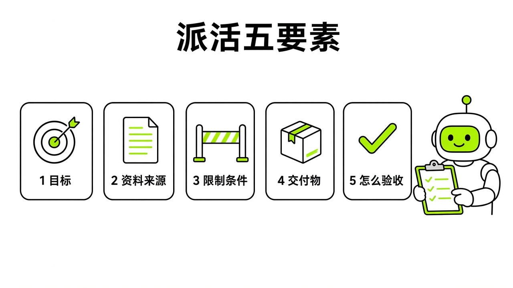

# §04 你的第一个任务 · Your First Task

[← 上一章：§03 十分钟安装与开箱 · Install in 10 Minutes](../part1-getting-started/03-install.md) ｜ [📖 返回目录](../../README.md#-目录) ｜ [下一章：§05 Bot：给每个同事一份岗位说明书 · Bots & Profiles →](../part2-core-concepts/05-bots.md)

---

装好客户端，绑定完账号，看着左边空荡荡的列表，很多人会愣住：第一句话该发什么？

别发“你好，你能帮我做什么”。Grok Bot 不是陪聊的对话框，它背后是跑在云端的电脑和数字员工。你敲字不是在聊天，而是在派工单。

这一章我不扯宏大团队编制，带你把第一件真活交到它手上。

> 适合谁：所有刚装好客户端的人。前提条件：已完成 §02–§03（有可用额度、已登录）。任务一需要 Gmail 等境外邮箱；只有 QQ/163 邮箱的读者可以先做任务二、三，或直接用 4.1 的"上传文档"范例——它不需要任何连接器。

## 4.1 任务五要素 · Outcome / Sources / Constraints / Deliverable / Review

给 Bot 派活最容易踩的坑，就是随手甩一句“帮我看看今天的邮件”。不给边界，它可能会在云电脑里把收件箱翻个底朝天，耗光额度，还翻出不该看的私人邮件。

我翻了官方文档，官方团队一开始就强调派活必须遵循明确结构（https://docs.x.ai/grok-bot/get-started.md）。Kin 在《Grok Bot 橙皮书》里提过“验收前置”（https://github.com/KinGao294/grok-bot-orange-book），但他主要讲了想好结果，没细说数据源边界和硬性约束。官方给出的标准范式包含五个核心要素，缺了一个，Bot 就容易跑偏或越界。

这五个要素是最终结果（Outcome）、信息来源（Sources）、约束条件（Constraints）、交付物形式（Deliverable）和人工审阅点（Review point）。最终结果要明确，说清楚做到什么程度算结束，比如“总结本周新增用户反馈”，别说模糊的“关注一下”。信息来源要限定范围，指明具体应用、网页、本地附件或特定对话，免得它在云电脑里到处乱翻。约束条件是安全底线，写清楚严禁做什么，比如“严禁点击删除”、“严禁修改原文档”、“外发前必须请示”。交付物形式要定死格式，是 5 条要点的纯文本、带表头的表格，还是指定目录下的 Markdown 文档。人工审阅点则是刹车片，规定好在哪个节点停下等你确认，免得它一路狂奔把邮件发了出去或把单买了。



*图：任务五要素结构卡（Outcome / Sources / Constraints / Deliverable / Review）*

官方在快速上手文档里给过一个范例（https://docs.x.ai/grok-bot/get-started.md）。如果手里有一份长文档，想在五分钟内拿到结果，不需要配复杂的连接器，直接把文档当附件上传，发这段指令：

```text
将此文档总结为 5 个核心要点。把文中提及的所有具体日期、最终决策和未决问题单独列在一个独立章节中。每一项内容都必须标注对应的页码或章节出处。严禁修改原始文件。
```

在这段指令里，要点数量是结果，附件是数据源，严禁修改原文件是约束，分章节带出处是交付物。这就是标准的**任务五要素**落地写法。

## 4.2 先连常用 App · Connect Your Apps First

打开界面的第一反应别急着狂敲提示词。新员工连公司邮箱、日历都进不去，再聪明也只能干瞪眼。

Grok Bot 核心团队成员 Lauren（@poteto）在 X 上给过一条新手建议（https://x.com/poteto/status/2107830403549831186），推文拿了 1600 多个赞（10/13 复核为 1,623）。她建议上手第一步别急着建 Bot，先连接日常用的核心工具，包括日历、Slack、工单系统、CRM 和网盘，让它拿到干活的上下文。

> [!NOTE]
> 📸 **截图位（待补）**：侧边栏 Connect apps 授权与接管云电脑登录界面

在桌面客户端里，入口在左侧栏的 Connect apps，快捷键是 Cmd/Ctrl+Shift+M 或 Cmd/Ctrl+Shift+W（https://docs.x.ai/grok-bot/chat-and-collaboration.md）。

官方的应用集成没要求第三方都做 API 插件，而是结合了原生连接器与云电脑浏览器操作（https://docs.x.ai/grok-bot/get-started.md）。遇到要网页登录的系统，具体接管步骤是：

1. Bot 执行任务遇到登录拦截，发出接管请求。你在当前对话里点 Agent Computer 进入云电脑实时画面。
2. 点 Takeover 按钮，控制权切到本地鼠标键盘。
3. 你亲自在云电脑浏览器里输密码、扫码、过二次验证（2FA）或验证码。
4. 点归还控制权，Bot 继续执行。

这种模式的好处是密码由你亲手输入，不必把明文写进对话（但登录后的会话会留在共享云电脑上，见下文和 §08）。而且官方文档明确提到，云电脑浏览器的登录会话（Session）会长驻保存，账号下所有 Bot 共享（https://docs.x.ai/grok-bot/get-started.md）。你在云电脑里登过一次 Gmail 或后台，后面建的助手都能直接复用，不用反复登。

我建议**先连常用 App**，但初期只连一两个只读权限的服务，比如测试用的备用邮箱或日历，先把通道打通，别一上来就接生产数据库。

## 4.3 三个零风险入门任务 · 3 Safe Starters

新手开箱最怕误删数据、乱发邮件，或者脚本写错死循环烧光周额度。

第一天别跑高风险、不可逆的任务。挑只读、不改源数据、交付标准清楚、随时能叫停的轻量活。我整理了三个**零风险入门任务**：

任务一是整理收件箱与退订垃圾邮件。台湾博主 Sorla 发过用 Grok Bot 整理 Gmail 的视频（https://www.youtube.com/watch?v=qL8alDehpBs）。他让 Bot 登录 Gmail 后扫描近期邮件，提炼出需回复、财务运营、项目进度三类，同时提取营销邮件底部的退订链接。底线很明确：只读、只分类、只提供退订链接清单，严禁私自点击退订或代发回复。

> [!TIP]
> 🧪

> [!NOTE]
> 📸 **截图位（待补）**：任务一收件箱整理与退订清单输出

任务二是公开信息比价表。买降噪耳机或采购办公设备，让 Bot 上网跑腿性价比最高。官方在采购案例里展示过 Haggle Bot 对比供应商报价压低成本（https://x.ai/news/grok-bot-procurement）。新手不需要让它去谈判，充当比价员就行。

给它两三个公开电商网站或产品型号，让它在云电脑浏览器里打开页面，抓取当前标价、满减活动和预计发货时效，汇总成四列表格。这不需要登个人账号，不碰支付接口，解析网页卡住了也不影响个人资产。

> [!TIP]
> 🧪

> [!NOTE]
> 📸 **截图位（待补）**：任务二电商比价与规格对比表格生成

任务三是整理行业资讯精选。科技博主 Rowan Cheung 在 X 上分享过监控任务逻辑（https://x.com/rowancheung/status/2108328114552000842）。他强调过滤规则，只保留指明旧任务、工具和实际成果的真实案例，剔除公关通稿和营销帖。

把收藏的三篇技术长文或两期周刊公开链接扔给它，按规则提炼要点。每条要点控制在两句话以内，附带原始论据的章节链接，空话套话直接扔掉。

> [!TIP]
> 🧪

> [!NOTE]
> 📸 **截图位（待补）**：任务三资讯精选提炼与源链接引用

这三个任务不改动生产数据，也不替你对外发声，用来破冰最稳妥。

## 4.4 "大脑倾倒" 与 "反向提问" · Brain Dump & Reverse Config

跑通这几个轻量任务后，该怎么给自己搭 Bot？Kin 在《Grok Bot 橙皮书》第 03 章提过两个方法：“大脑倾倒”和“反向配置”（https://github.com/KinGao294/grok-bot-orange-book）。

以前用 AI 助手总要自己去配参数、写系统提示词、选底层模型。Kin 的思路是把配置动作直接交给 AI。

第一步是倾倒背景。开一个新对话，别急着下指令，把自己平时的工作情况一股脑倒给它：你的行业、业务模式、每天重复的杂活、讨厌处理的琐事、未来两周要推进的目标。想到什么写什么，像跟新来的管家交代家底。

倒完之后，直接用 Kin 的提示词做**反向配置**：

```text
基于你对我的了解，如果是你，你会怎么设置这个工作台？应该建立哪几个 Bot？它们的职位、职责和日常例行工作是什么？
```

> [!NOTE]
> 📸 **截图位（待补）**：大脑倾倒后 Bot 反向生成的岗位建议与确认界面

发出去后，系统会梳理痛点，建议建哪几个岗位，并拟好职责和日常例行工作。你只要做减法，挑最核心的一两个岗位留下就行。

不过这里有个坑要避开。官方设计文章提到过"每个账户约 50 个 Bot"的实用上限（https://x.ai/news/designing-grok-bot），但 9 月 1 日的 v0.31.0 已改为"You can create more than 50 Bots"（https://x.ai/changelog/bot）——数量不再是瓶颈，管理成本才是。核心团队 @poteto 也建议，新手起步尽量只建一个 Bot，流程复杂了再拆（https://x.com/poteto/status/2108097362283597916）。如果按建议一口气建七八个，岗位容易打架，群聊交接还白耗后台额度。

> [!TIP]
> 🧪

## 4.5 异步心态：派完活就走 · Async Mindset

用惯传统对话产品的人，刚换到 Grok Bot 会不适应：任务发出去，对话框没逐字打字，光标闪两下就安静了。很多人以为卡死，忍不住一遍遍刷页面。

官方协作文档说得很清楚，它的设计初衷是“感觉就像在给真实队友发消息”（https://docs.x.ai/grok-bot/chat-and-collaboration.md）。你让工位上的同事做报表，不会站在他背后盯着他敲键盘。交代清楚，你转头干别的，他做完来汇报。

用 Grok Bot 要有**派完活就走**的异步心态。输入框交代完任务，确认它接单，就可以关窗口去忙别的。它在云端电脑里开浏览器、查资料、跑命令都需要时间。做完了或者卡在审批点，它会弹系统通知找你。


*图：同步盯梢与异步派活心智模型对照*

中途干预官方给了两种机制（https://docs.x.ai/grok-bot/chat-and-collaboration.md）：

一种是中途纠偏。任务跑着突然想改主意，或者发现最初给的数据源有遗漏，不用等它跑完。直接在对话里发新指令，用户直接消息在系统调度里优先级最高，能打断当前轮次、重定向流程。

另一种是紧急制动。如果发现它在云电脑里的动作完全跑偏，直接在输入框发：

```text
Stop now
```

收到这条指令，Bot 会立刻停下手头所有后台任务（https://docs.x.ai/grok-bot/chat-and-collaboration.md）。但官方也提醒了：紧急制动只能拦住后面的动作，撤销不了已经做完的操作。如果它刚才已经在网页上点了提交或发出了消息，既成事实撤不回来。所以出发前的约束条件才最关键，不能把安全寄托在事后制动上。

## 试试看 · Try It Yourself

光看没用，把提示词拷进输入框跑一次，才能体会怎么派活。这里准备了 5 条**开箱即用提示词**，嵌入了任务五要素，覆盖文档分析、收件箱管理、竞品调研、反向配置和资讯监控，复制就能用。

第一条：五分钟无连接器文档要点提炼与未决问题梳理（直接附加本地文档使用）

```text
请阅读我上传的这份文档，完成以下分析：
1. 提炼出 5 个最高优先级的核心事实与结论。
2. 单独建立一个章节，按时间顺序列出文中提到的所有明确日期、已达成的决策，以及尚未解决的悬挂问题（Open Questions）。
3. 每一项结论必须在末尾附带出处段落或页码引用。
4. 约束条件：严禁修改原始附件，严禁添加任何未经文档证实的推测。
5. 交付物：直接在当前对话中输出格式整齐的 Markdown 文本。
```

第二条：收件箱晨检与分类回复草稿（适用于已连接邮箱的场景）

```text
请检查我收件箱中过去 24 小时内收到的所有新邮件，并按以下规则处理：
1. 将邮件严格归入三类：必须由我决策的重要事项、日常项目进度同步、系统通知与营销邮件。
2. 针对“必须由我决策的重要事项”，提取发信人、核心诉求，并为每封信撰写一份 100 字以内的建议回复草稿。
3. 针对“系统通知与营销邮件”，检查邮件末尾是否包含退订链接，如有请提取退订链接并整理为清单。
4. 约束条件：严禁擅自发送任何邮件，严禁点击任何外部链接，严禁修改或删除任何邮件。回复草稿仅作为待办事项卡片展示给我，等我逐一点击确认。
5. 交付物：输出一份结构清晰的晨报，并将草稿呈现在独立审阅卡片中。
```

第三条：公开竞品价格与功能矩阵对比表（适用于云电脑浏览器调研）

```text
请打开云电脑的浏览器，访问以下 3 个公开产品主页：[在此粘贴链接 1]、[在此粘贴链接 2]、[在此粘贴链接 3]。
1. 提取每个产品的当前对外公布价格、收费计费周期（按月/按年）、免费试用政策，以及核心功能权益差异。
2. 约束条件：仅允许浏览公开网页，严禁尝试注册账号，严禁点击任何需要支付授权或填写个人信息的按钮。如果遇到登录弹窗或验证码阻拦，立即停止操作并在对话中汇报。
3. 交付物：将收集到的数据整合为一张对比表格，包含产品名称、价格区间、核心权益、限制条款与原始页面来源 URL。表格末尾附带一段 200 字以内的横向对比优缺点总结。
```

第四条：工作台反向配置魔法指令（用于初次开箱时的组织搭建）

```text
这是我目前的所有工作背景与日常痛点：
[在此粘贴你倾倒的所有内容：你的岗位角色、每日机械重复的琐事、最耗费时间的环节、最近要完成的目标]

请基于你对我工作现状的全面了解，反向为我设计一套 Grok Bot 工作台方案：
1. 建议我应该建立哪几个岗位的专职 Bot（优先考虑最核心的 1 到 2 个角色，避免人员冗余）。
2. 为每一个建议的 Bot 撰写一份清晰的岗位说明书，包括：名字、核心职责（One primary job）、工作原则、明确禁止触碰的安全红线。
3. 为其设计 1 项可以直接落地的日常例行工作（Routine）草案。
4. 约束条件：不要直接在系统中创建任何 Bot，先在此处输出完整建议方案供我审阅修改。
```

第五条：行业精选信息源过滤与去噪摘要（适用于资讯提炼）

```text
请阅读以下这几篇行业公开资讯/文章：[在此粘贴文章链接]。
1. 严格过滤内容，剔除所有空洞的公关辞令、未经证实的宣传口号和排比套话。
2. 仅保留满足以下条件的内容：指明了具体业务场景、使用了什么具体工具或技术方案、取得了何种可量化的实际结果（如节约的时间、缩减的步骤或降低的成本）。
3. 最终提炼不超过 3 个最有参考价值的真实案例，每个案例包含：背景痛点、核心解法、实际收益、原始来源 URL。
4. 约束条件：如果所有输入文章均不符合上述筛选标准，直接回复一行文字说明“未发现符合标准的有效案例”，不要强行凑数。
```

---

[← 上一章：§03 十分钟安装与开箱 · Install in 10 Minutes](../part1-getting-started/03-install.md) ｜ [📖 返回目录](../../README.md#-目录) ｜ [下一章：§05 Bot：给每个同事一份岗位说明书 · Bots & Profiles →](../part2-core-concepts/05-bots.md)
