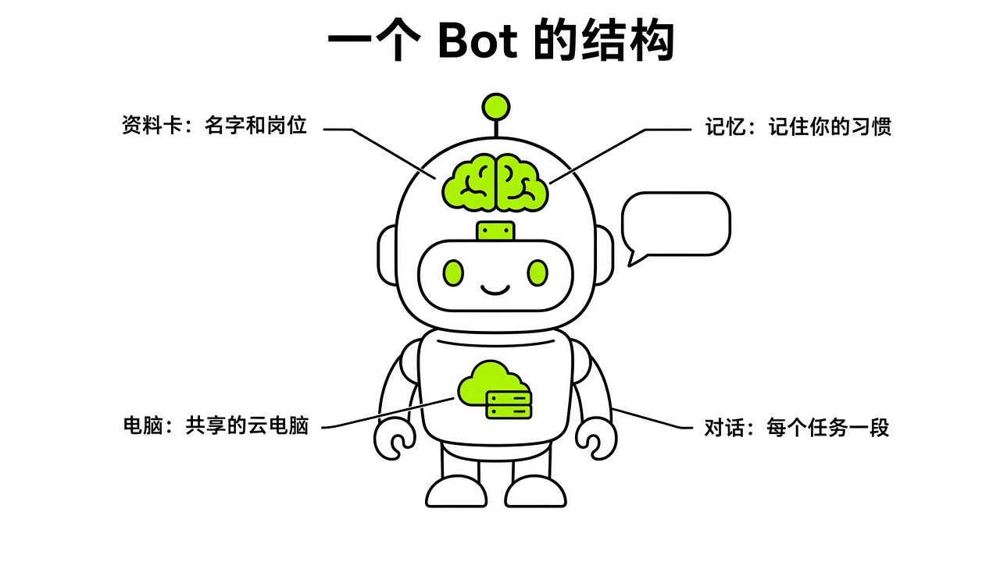

# §05 Bot：给每个同事一份岗位说明书 · Bots & Profiles

[← 上一章：§04 你的第一个任务 · Your First Task](../part1-getting-started/04-first-task.md) ｜ [📖 返回目录](../../README.md#-目录) ｜ [下一章：§06 云电脑：它的工位 · The Computer →](../part2-core-concepts/06-computer.md)

---

## 5.1 一个 Bot 等于什么 · Anatomy

很多人刚接触 Grok Bot 时容易犯一个错误：把它当成套了好看外壳的普通聊天窗口。每次在输入框敲一大段背景，聊完关掉网页；第二天遇到新任务，又开新窗口重敲一遍。这种用法停留在传统聊天机器人的习惯里。聊天会话是随用随扔的消耗品，窗口一关，之前建立的工作默契就散了。

官方文档对它的定义（https://docs.x.ai/grok-bot/bots.md），是一个有名字、有岗位、有独立对话流，能持续积累上下文的**持久共事的数字同事**。官方设计团队在复盘里写过（https://x.ai/news/designing-grok-bot），系统把概念收敛成了五个基础对象：Bot（持久运行的智能体）、Chat（对话界面）、Prompt（指令或技能提示词）、Tool（操作外部世界的工具）和 Artifact（生成的文档、代码等持久产物）。核心不是聊天记录，而是 Bot 本身。

一个完整的 Bot 拆开来看有四个部分。

一个是身份档案（Profile）。包括名称、头像、岗位标签和常驻描述（Description）。新手常把 Description 空着或随手写句客套话。官方文档写得很明确（https://docs.x.ai/grok-bot/bots.md），Description 是用来放持久规则的，聊天框只用来派发单次指令。比如“未经人工明确审批绝不对外发消息”要焊死在 Description 里，而“给这十二家客户起草跟进邮件”才是日常在聊天框里发的内容。

一个是工作记忆（Memory）。它能跨会话记住工作偏好、关键事实和任务摘要，第二天打开软件还能接着昨天的思路干。不过官方文档也提醒（https://docs.x.ai/grok-bot/bots.md），记忆不能代替真实数据源；严肃决策必须让它查实时原始数据，不能靠模糊印象。

一个是独立工位与屏幕（Computer & Workspace）。同一账号下的所有 Bot 共享同一台云电脑、浏览器会话和 /workspace 目录，但界面上各有独立的操作状态和屏幕感知（https://x.ai/news/designing-grok-bot）。官方设计了三层介入机制：后台运行时图标亮紫色表示活跃（Status）；点开能在侧边面板实时预览操作（Preview）；遇到验证码需要人工协助时，能一键全屏接管键鼠（Takeover）。（设计文章配图里还能看到正午、深夜等不同壁纸，是否随时间自动切换文中没有明说。）

一个是对话时间线（Conversation）。对话流里不仅有文字，还有结构化卡片（Inline chat widgets），比如待确认的邮件草稿或多选表单，也有系统事件和例行任务记录（https://x.ai/news/designing-grok-bot）。头像也有状态动作：空闲时安静（Idle），干活时点头（Working），卡住时迟疑（Waiting 或 Blocked），鼠标悬停在头像上能看到当前正在执行的具体步骤，不用盯着三个跳动的圆点猜。

关于容量，官方设计文章给出了硬指标（https://x.ai/news/designing-grok-bot）：当时每个账号的实用上限大概是 50 个 Bot，每个群聊最多容纳 6 个；其中 50 个 Bot 的上限已在 9 月 1 日 v0.31.0 取消（"You can create more than 50 Bots"）（https://x.ai/changelog/bot）。工具和技能是账号通用的公共资产，很多岗位都要用浏览器或邮件；记忆和例行任务则是专岗私有资产，只归属于具体的 Bot。官方建议设置职责明确的岗位，比如人才搜寻员（Talent Scout）、报销管家（Expense Manager）、Bug 复现员（Bug Reproduction），反对设通用助手（General Helper）这种缺乏目标约束的模糊角色（https://docs.x.ai/grok-bot/bots.md）。



*图：Bot 结构解剖图（Profile、Memory、Computer 与 Conversation 边界）*
> [!NOTE]
> 📸 **截图位（待补）**：Bot 资料编辑弹窗（Edit Profile）与侧栏多 Bot 状态展示

## 5.2 岗位说明书五要素 · Job Description Method

翻看中文社区的讨论，很多人抱怨 Bot 乱跑、产出答非所问，根源在建 Bot 时随手敲了一句“你是一个厉害的技术助理，帮我打理日常一切事务”。

掘金开发者迷城在实测中提出过（https://juejin.cn/post/7682695577956483091）：建 Bot 必须给岗位说明书，不能只给一句提示词。一份合格的说明书必须包含**岗位说明书五要素**：身份与记忆、核心使命、关键规则、工作流程、成功指标。

超级峰在粉皮书第 6 课列过由技术总监、公关总监、社群运营、商务总监、增长黑客组成的五人舰队（https://chaojifeng.me/free-courses/grok/learn/basic-06），主要是按业务切分岗位。要想让 Bot 稳定工作，官方采购 Haggle Bot 的真实系统提示是很好的参考（https://x.ai/news/grok-bot-procurement）：用 SYSTEMS 限定数据来源，用 PEOPLE 锁定决策汇报人，用 PERMISSION LINES 划分红黄绿三档权限边界（自主执行、必须人工审批、绝不触碰），用 WHAT GOOD LOOKS LIKE 直接给出好坏交付物的具体正反样例。

我调研了官方做法和社区讨论，整理出这份通用的岗位说明书模板。新建 Bot 时，可以直接填空放进 Description 或初始化工作指引里：

```text
# 岗位说明书：[岗位名称]

## 1. 身份与使命 (Identity & Mission)
- 岗位身份：你是专门负责 [具体业务领域] 的专职执行者。
- 核心使命：端到端独立负责 [核心业务目标]，把凌乱的原始输入加工成可以直接交付的确定性产物。

## 2. 数据来源与工位 (Systems & Sources)
- 权威输入源：只从 [指定的系统/指定目录/特定网址] 提取事实，绝不凭空推测未经验证的数据。
- 工具使用范围：仅允许使用 [指定工具名称或指定已连接插件]。

## 3. 权限红线与审批边界 (Permission Lines)
- 始终允许 (Always Allowed)：读取指定来源的数据、提取分析字段、在 /workspace 写入本地草稿文件。
- 必须报批 (Needs Approval)：向任何外部账号发送消息、提交工单、修改线上生产系统状态、涉及资金与采购决策。
- 绝不执行 (Never Allowed)：自行决定对外付款、越权触碰无关目录、绕过人工审批私自将草稿直接发布。

## 4. 标准作业流程 (Standard Operating Procedure)
- 第 1 步：接收输入并核查数据完整性，若缺少必要字段立即在回复中列出阻塞项。
- 第 2 步：比对既有规则与历史产物，按照既定结构完成分析与草稿编写。
- 第 3 步：自我检查，核对关键数字与原出处链接，标记出必须由人类核决的疑点。
- 第 4 步：输出最终交付物，并在末尾清晰说明下一步待办由谁承接。

## 5. 交付物规范与成功指标 (Deliverables & Metrics)
- 输出格式：必须使用固定的 Markdown 表格/结构化卡片，严格包含 [字段 A]、[字段 B] 与 [原始链接]。
- 成功标准：无捏造事实、无未经核实的数据源、高风险操作 100% 停留在待审批草稿状态。
```

我们可以对比正反两组实际案例。

正例参考了官方 Haggle Bot 的边界约束（https://x.ai/news/grok-bot-procurement），比如外联线索审查员：

```text
岗位名称：SaaS 采购线索审查员
核心使命：审查公司所有软件续约账单与闲置席位，找出潜在节省空间，生成结构化的议价建议清单。
数据源：仅读取管理后台导出的 CSV 报表与采购合同存档，不采信非官方渠道的口头报价。
权限三档：
1. 始终允许：计算闲置率、标记 90 天未登录席位、在本地生成节省测算表。
2. 必须报批：向供应商发起询价邮件、起草改签合同。
3. 绝不执行：直接点击取消订阅按钮、修改支付信用卡信息。
交付规范：每条发现必须以 TODAY（现状）、SAVE（预计节省金额）、REC（操作建议）、NEXT（下一步谁确认）四段格式输出，且必须附带原合同到期日。
```

再看反例：

```text
你是一个超级智能采购助手，请帮我盯着公司所有的日常开销。只要发现有贵的东西或者不划算的软件，就立刻帮我跟对方砍价，想尽一切办法替我省钱。每天向我汇报你的战果。
```

这个反例既没限定数据来源，也没给高危操作上锁。Bot 可能会把宣传页的折扣误当成真实合同条款，甚至自作主张直接给供应商发停约沟通邮件。只有把权限红线切成操作性语言，Bot 才能放心交付。

> [!NOTE]
> 📸 **截图位（待补）**：官方采购 Haggle Bot 的权限配置面板与 Profile 说明

## 5.3 先只建一个 · Start With One

新手容易一上来就建十几个 Bot，起各种头衔，想一口气组建管理舰队。

这种做法很容易失控。Grok Bot 团队核心工程师 @poteto（Lauren Tan）在社区里给新手提过忠告（团队成员，https://x.com/poteto/status/2108097362283597916）：**先只建一个** Bot，直到管理复杂度真正变高之前不要盲目拆分。@poteto 建议第一步先在设置里连上常用的真实 App（团队成员，https://x.com/poteto/status/2107830403549831186），比如日历、Slack、工单系统、CRM 和网盘，让这个 Bot 能接触到每天的真实数据源。

象鱼工作流也提过同样的建议（https://xiangyugongzuoliu.com/grokbot-use-cases/）：第一周别搞太复杂，三个角色就到管理上限了——一个总管、一个领域专家、一个可退回修改的质检官。如果一个 Bot 都没调教好，建太多只会陷入来回纠错的泥潭。

什么时候才该拆出第二个 Bot？官方文档总结了五个拆分条件（https://docs.x.ai/grok-bot/bots.md）：

一个是业务领域或交付目标完全独立（Goal or area of ownership）。比如客服巡检和代码 Bug 复现，核心指标没有交集。

一个是依赖的底层工具与数据源截然不同（Set of tools and sources）。一个全在内部 CRM 和邮件里看数据，另一个需要终端权限和深度代码库集成，工具集割裂就该物理隔离。

一个是工作风格与交付调性不同（Working style）。对外沟通要严谨温和，内部工程报告要精简、只讲事实数据，混在一个 Bot 上容易口吻混乱。

一个是审批边界与安全红线存在天然落差（Approval boundary）。涉及花钱、改线上数据库或对外发信的高危岗位，必须独立并加人工审批门禁；只读公开数据的岗位可以放开自动化。

一个是周期性排程存在差异（Recurring schedule）。有的按工作日清晨定点巡检，有的靠外部 Webhook 触发或偶尔手动唤醒，调度节奏不同适合独立承载。

分出专岗后，多 Bot 组织形态会演化为总监协调（Chief of Staff）模式。SpaceXAI 团队的 Roman Ugarte 在播客里提到（团队成员，https://www.youtube.com/watch?v=maSdsTLaMuU）：Chief of Staff 模式不是一开始刻意规划出来的，而是内测第二周自然长出来的机制。大家发现有三四个专岗后，自己在不同窗口间来回复制粘贴特别痛苦，于是自发把第一个 Bot 提拔成幕僚长，人只对总监下达大目标，由总监去负责拆解任务、分给具体专家并跟踪进度。

多 Bot 协作时，官方群聊（Group Chat）是公开交接的载体（https://docs.x.ai/grok-bot/chat-and-collaboration.md）。群聊上限是 6 个 Bot。不过群聊不是让它们互相附和聊天，每一条分派出去的任务，在群里必须且只能明确点名唯一一位当前交付负责人。

> [!NOTE]
> 📸 **截图位（待补）**：在群聊中通过 @ 呼叫特定 Bot 进行任务交接

## 5.4 记忆与纠错 · Memory & Corrections

刚建好的 Bot 不可能一上来就完美。很多人容易把没调教好的 Bot 直接挂上定时任务通宵裸跑，第二天醒来额度烧光，还留下一堆错误数据。

V2EX 用户 @zhuyinan 在对比本地部署的 Hermes 框架与 Grok Bot 时，分享过一套人工培养经验（https://www.v2ex.com/t/1240012）。他总结出了**养 Bot 的三阶段曲线**：

第一阶段是人工带跑期。刚开始 Bot 完成度通常只有 30% 到 40%，漏洞很多。千万别放手让它自动跑，先带它人肉跑 3 到 5 轮。理解偏了、格式错了、事实漏了，当场在对话里揪出来纠偏。

第二阶段是成熟期。持续纠错几轮后，独立完成度能到 70% 左右。它基本记住了核心偏好：报告用几级标题、表格留哪几列、文案坚决不能出现哪些行业词汇。这时候只要花很少时间微调边角细节。

第三阶段才是挂排程。前面的边缘瑕疵修完、不同输入下的测试都能稳定过关，再正式挂 Routine 自动调度，让它在无人值守的深夜或清晨自行运转。把顺序搞反容易失控。

培养和纠错过程中有两个实用技巧。

一个是明确下达记忆口令。纠正错误时别只说“改一下”，要加上一句“记住这条规则”（https://www.v2ex.com/t/1240012）。带明确记忆指令的纠正会被系统存入 Memory 模块，在后续任务中持续生效。

一个是建立严密的回查闭环。社区实践者 Michael Fenech 提出过纠错准则（https://x.com/Michael_Fenech_/status/2106729045878514147）：纠偏（Correction）必须触发源系统核验（source check），最后才允许给出答案（answer）。指出会议时间或账单金额算错时，严禁让它凭空猜，必须命令它重新打开原始日历、重读邮件或重查 CRM 系统。不回查事实依据的直接认错，只是在用第二段幻觉掩盖第一段幻觉。

觉醒AI 团队在媒体工作流实战中也给过工程建议（https://www.jxxy.net/ai/articles/grok-bot-workflow-training/）：别只信口头上的“记下了”，真正重要的业务调性、规则说明和交付标准，要让 Bot 写成 Markdown 文件存到 /workspace/learn/*.md 目录下。规则落盘成实体文件，后续运行能溯源对比，上下文才不会随着对话轮次变多而漂移。

官方文档在记忆机制上也划出了安全红线（https://docs.x.ai/grok-bot/bots.md）：动态变化的事实永远以源系统为准；过时的假设必须在对话或资料页手动删除；涉及权限和安全底线的规则，必须白纸黑字写进 Profile Description，不能依赖动态记忆。

> [!NOTE]
> 📸 **截图位（待补）**：Bot 记忆面板（Memory）中的已学偏好与手动删除入口

## 5.5 模板与分享 · Templates

把一个 Bot 打磨成执行稳定、规则严密的数字员工后，如果想分享给团队伙伴或发到社区，可以用模板（Templates）系统。

官方工程师 Matt Palmer 在指南文档里打过一个比方（https://x.ai/bot/guides/templates-for-grok-bot）：模板是**食谱而非做好的饭菜**（Think recipe, not meal）。别人导入模板时，拿到的是搭建员工的设计蓝图与配方，不是把你本地烧好的实体原样搬走。

正因为是蓝图而非克隆体，分享前必须搞清楚系统到底打包带走了什么，又留下了什么。

模板会打包带走的内容包括（https://x.ai/bot/guides/templates-for-grok-bot）：身份设定（名字、头像、标签与 Description）、默认排除个人/内部信息后的通用记忆、Skills、Routines，以及插件清单（接收方需要自己重新安装和授权插件）。

模板绝不会带走的内容包括（https://x.ai/bot/guides/templates-for-grok-bot）：个人的私有敏感记忆与内部细节、个人云电脑环境与本地工作区磁盘文件、浏览器里保存的网站登录状态与 Cookie、自己编写的私有脚本与非标准工具代码（如自定义 MCP 服务器）、你的电脑与登录态、过往的私聊对话历史。**但要注意**：公开链接会展示 Bot 的身份、Description、Skills 和 Routines，官方明确要求分享前自行删掉 API Key、内部 URL、客户数据——如果你把密钥写进了 Description 或 Skill，它会跟着模板公开出去（https://docs.x.ai/grok-bot/bots.md）。

分享操作很直观。按现行文档，打开对话顶部的 Share 菜单，选 **Create template**（Matt Palmer 的指南截图里是旧版 Bot 设置右下角的 Share as Template 按钮，9 月 18 日起模板项移到了 Share 菜单（https://x.ai/changelog/bot））。然后选择范围：Enterprise 计划默认“Team-only”（仅团队成员可打开）；其他账号默认“Public link”（任何拿到链接的人都能打开）。准备好后复制带 x.ai 域名的分享链接（https://docs.x.ai/grok-bot/bots.md；https://x.ai/bot/guides/templates-for-grok-bot）。

在浏览器中打开链接，能在 x.ai 看到包含角色说明、技能清单和所需插件的预览详情页。点击“Add to Grok Bot”后，客户端会在接收者账号下新建一个纯净的 Bot 副本。使用第三方分享模板受官方第三方 Bot 分享条款管辖（https://x.ai/legal/bot-sharing-terms）。

发布前必须做好防泄密审查。超级峰在粉皮书 field-01 中强调过（https://chaojifeng.me/free-courses/grok/learn/field-01）：按下发布按钮前，把资料当成全网公开的文件逐字通读一遍。仔细排查 Description 和技能草稿里有没有真实大客户名称、内部私有内网域名、个人私人邮箱、本地硬盘绝对路径，或者透露未公开项目的例行任务标题。一旦发现，必须彻底抹除后再发布。

接收方安装模板后也要注意：因为密钥和浏览器登录态被彻底隔离，新落地的 Bot 副本没法直接开跑。如果模板依赖特定业务系统或特定 API Key，接收方必须按岗位说明书要求，在自己客户端里重新完成连接器授权与凭据录入，Bot 才能真正开工。

> [!TIP]
> 🧪 跨账号复制模板时，依赖的插件、脚本和授权如何提示。

> [!NOTE]
> 📸 **截图位（待补）**：Share as Template 预览详情页（显示包含的 Memory、Skills 与 Plugins 清单）

---

[← 上一章：§04 你的第一个任务 · Your First Task](../part1-getting-started/04-first-task.md) ｜ [📖 返回目录](../../README.md#-目录) ｜ [下一章：§06 云电脑：它的工位 · The Computer →](../part2-core-concepts/06-computer.md)
