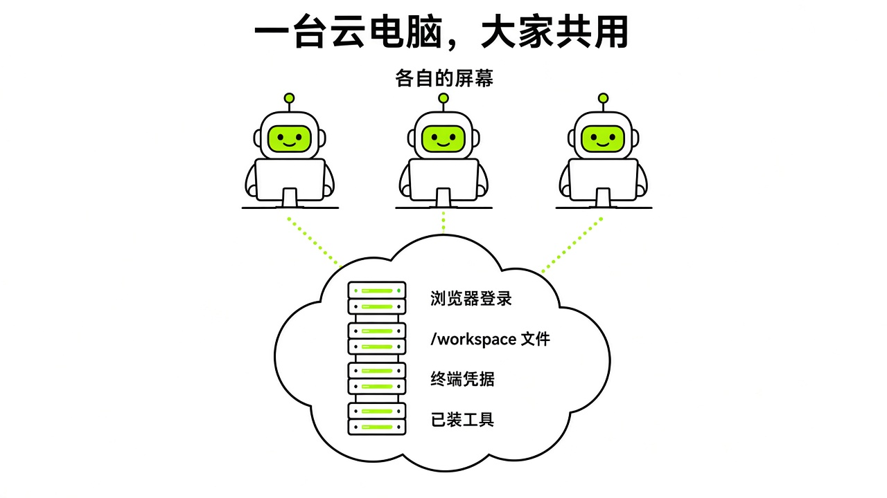
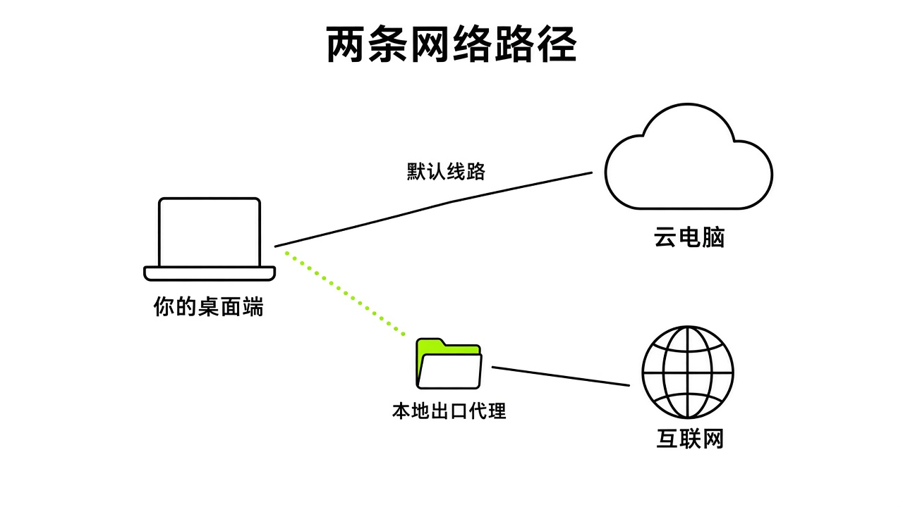

# §06 云电脑：它的工位 · The Computer

[← 上一章：§05 Bot：给每个同事一份岗位说明书 · Bots & Profiles](../part2-core-concepts/05-bots.md) ｜ [📖 返回目录](../../README.md#-目录) ｜ [下一章：§07 Skill 与 Routine：教一次，让它照着做 · Skills & Routines →](../part2-core-concepts/07-skills-routines.md)

---

很多人刚接触 Grok Bot，会以为它和 ChatGPT 或 Claude 一样，只是网页上的一个对话框。但我翻完官方文档和社区讨论后发现，关掉笔记本它还在跑，下载的文件随时能翻看，一个 Bot 登过的账号换个 Bot 也能直接用。马斯克和 Cursor 团队给每个账号配的，根本不是一个单纯的聊天模型，而是一台常驻云端的电脑。

这台云电脑就是你所有 Bot 共同上班的实体工位。如果不了解它的文件存储、网络结构和会话隔离，很容易丢配置、泄露凭据，甚至遇到数据回滚。这一章，我把这台电脑的工作机制、恢复逻辑、网络规则和社区玩法的真实风险拆开讲清楚。

### 6.1 /workspace、文件与附件 · Files

你在桌面端跟 Bot 交代任务，输入框一次最多允许上传 6 个附件【官方】（https://docs.x.ai/grok-bot/files-and-results.md）。单文件体积有明确限制：文档、图片和音频单个不超过 25 MB，视频不超过 200 MB【官方】（https://docs.x.ai/grok-bot/files-and-results.md）。它支持的格式很多，包括图片、音视频、PDF、纯文本、Office（Word、Excel、PowerPoint）、CSV、JSON、YAML、源码、HTML、邮件文件和 Jupyter notebooks【官方】（https://docs.x.ai/grok-bot/files-and-results.md）。如果文件损坏、加密或格式太冷门，可能会解析失败【官方】（https://docs.x.ai/grok-bot/files-and-results.md）。【实测·TODO待实测】接近文件大小上限的附件能否正常解析。。

> [!NOTE]
> 📸 **截图位（待补）**：桌面端对话框中上传多个附件与解析卡片展示

在手机上，iPhone 用户可以直接用系统共享菜单，把其他 App 里的照片、文件、网页链接或文本分享给 Grok Bot；Android 版目前只支持分享文本【官方】（https://docs.x.ai/grok-bot/files-and-results.md）。在聊天里发链接，鼠标悬停在卡片上能预览，点击后会在本机默认浏览器打开【官方】（https://docs.x.ai/grok-bot/files-and-results.md）。

派任务时别只丢一个文件说“帮我分析一下”，要说清楚每个文件是什么、输出什么。为了防止 Bot 胡思乱想，官方建议明确要求交付可审查的结果：比如带小标题和来源链接的文档、定好表头和公式的表格、带演讲备注的 PPT，或者把截图和日志打包到单独文件夹；重要的任务，还可以让它把源系统事实、推断假设、已完成操作、等待审批操作和未解决疑问这五项拆开写【官方】（https://docs.x.ai/grok-bot/files-and-results.md）。想改结果也不用新开话题，直接让它就地修改现有的生成结果就行【官方】（https://docs.x.ai/grok-bot/files-and-results.md）。

云电脑里最核心的持久目录是 `/workspace`。所有 Bot 都能读写保存在 `/workspace` 里的文件，跨 Bot 协作都靠它中转【官方】（https://docs.x.ai/grok-bot/files-and-results.md）。如果让 Bot 把写代码的任务交接给 Cloud Agent，任务完成后，Bot 会自动把报告里引用的图片、视频和文件复制回云电脑，并作为附件放到回复里【官方】（https://docs.x.ai/grok-bot/files-and-results.md）。

记牢一条规则：把 `/workspace` 当成**所有 Bot 共享的持久工位**，中间产物、关键数据和交接文件都按项目文件夹存在这里【官方】（https://docs.x.ai/grok-bot/files-and-results.md）。保存在 `/workspace` 之外的临时文件、终端手动装的软件、没提交的应用状态，在系统更新或恢复时都会被抹掉【官方】（https://docs.x.ai/grok-bot/computer-and-apps.md）。

### 6.2 浏览器、终端与登录态共享 · Shared Sessions

很多人会以为自己建了五个 Bot，云端就会开五台虚拟机。并不是这样。官方设计很直接：你账号下的所有 Bot，共用同一台云电脑【官方】（https://docs.x.ai/grok-bot/computer-and-apps.md）。



*图：一台云电脑下共享浏览器会话、/workspace、终端凭据与多 Bot 独立工作屏幕的架构示意*

因为底座只有一台，整台电脑的状态是全局共享的：浏览器里的 Cookie 和登录态全局可见，磁盘上的文件全局可见，终端里的凭据全局可见，一个 Bot 做了一半另一个 Bot 随时能接手【官方】（https://docs.x.ai/grok-bot/computer-and-apps.md）。这台电脑绑定在你的用户账号上，而不是某个 Bot 身上；不想让其他 Bot 看到的密码或文件，绝对不能放在这台电脑里【官方】（https://docs.x.ai/grok-bot/computer-and-apps.md）。

为了支持多任务，系统给每个 Bot 分配了一个独立的工作屏幕（screen，10 月 7 日起分辨率从 1280×800 提升到 1920×1200【官方】（https://x.ai/changelog/bot ）），多个 Bot 能并行操作浏览器和桌面工具，但单个 Bot 一次只能在自己的屏幕上做一项电脑操作【官方】（https://docs.x.ai/grok-bot/computer-and-apps.md）。不过要注意，独立屏幕只是工作画面的切分，**屏幕隔离并不等于安全隔离**【官方】（https://docs.x.ai/grok-bot/computer-and-apps.md）。

你在对话界面点 Agent Computer，能随时看它在桌面的实时操作，包括鼠标点击、打字和页面跳转；关掉客户端或合上电脑，它都在后台继续跑【官方】（https://docs.x.ai/grok-bot/computer-and-apps.md）。碰到密码输入、通行密钥（Passkey）、两步验证（2FA）、CAPTCHA 人机验证、支付核验，或者明确禁止自动化脚本的网站，Bot 会停下来请求人工接管【官方】（https://docs.x.ai/grok-bot/computer-and-apps.md）。直接在弹出的远程电脑画面里手动完成验证，再让 Bot 继续，千万别把密码或验证码明文发在聊天框里【官方】（https://docs.x.ai/grok-bot/computer-and-apps.md）。如果是通过受支持的插件输入机密凭据，系统会用掩码遮挡，不会存进对话记录【官方】（https://docs.x.ai/grok-bot/computer-and-apps.md）。

浏览器登录态能持久保留，但也有风控问题。你在一个 Bot 里登了某个平台，其他 Bot 也能直接带着登录态操作；要是网站超时或风控退登、要求二次验证，记得在规则里让 Bot 暂停并通知人工，别让它去硬绕验证【官方】（https://docs.x.ai/grok-bot/computer-and-apps.md）。

操作第三方服务时，有插件就优先用插件。在侧边栏的 Connect apps 装上插件后，聊天里输入 `@` 调插件，输入 `/` 调 Skill【官方】（https://docs.x.ai/grok-bot/computer-and-apps.md）。插件走的是结构化接口，比在浏览器里模拟点击稳得多；只有没有对应插件，或者需要纯视觉操作时，才让它操控浏览器【官方】（https://docs.x.ai/grok-bot/computer-and-apps.md）。另外，Bot 看 X 平台上的公开推文、趋势和评论是原生只读的，不用绑你的 X 账号；只有想让它看私信、书签或主页动态时，才需要装 X 插件并登录自己的账号【官方】（https://docs.x.ai/grok-bot/computer-and-apps.md）。你本地的 Mac 或 Windows 和这台云电脑是物理隔离的，只有你主动开启本地电脑权限并逐项审批，Bot 才能碰你的本地设备【官方】（https://docs.x.ai/grok-bot/computer-and-apps.md）。

### 6.3 恢复、更新与重置 · Recover / Update / Reset

云电脑长期运行，难免会出现假死、无响应或连不上的情况。很多人一遇到故障就直接去点重置，把配好的环境清得一干二净。要排查故障，先得搞清楚 Update、Recover 和 Reset 底层都在干什么。

> [!NOTE]
> 📸 **截图位（待补）**：设置面板中的 Update、Reset 与断连状态下的 Recover 按钮界面

这三个操作的数据保留范围完全不同【官方】（https://cursor.com/help/grok-bot/computer-recovery.md）：

Update 是系统升级。日常的客户端更新会保留电脑里的所有东西，包括你自己手动装的应用和软件包；但整机镜像更新只会保留 Bots 配置、已保存文件和登录状态，手动装的外部软件会被抹掉【官方】（https://cursor.com/help/grok-bot/computer-recovery.md）。如果检测到文件没备份完，Update 会提示未就绪并放弃；如果有 Bot 正在跑任务且没法安全暂停，更新也会取消，不会强退【官方】（https://cursor.com/help/grok-bot/computer-recovery.md）。

Recover 是紧急抢救。它会尽量保存当前数据，拉起一台新版纯净电脑，再把数据导进去【官方】（https://cursor.com/help/grok-bot/computer-recovery.md）。运行中的任务会被打断；同步好的 Bots、文件和登录态能恢复，但手动安装的软件会丢失，如果电脑完全失联导致读不到最新数据，最近一点点改动也会丢【官方】（https://cursor.com/help/grok-bot/computer-recovery.md）。要注意的是，Recover 按钮不在 Settings 页面里，只在出现 Couldn't Reach Grok Bot's Computer 这种断连报错页时才会出现【官方】（https://docs.x.ai/grok-bot/computer-and-apps.md，https://cursor.com/help/grok-bot/computer-recovery.md）。

Reset 是重置重建。它不再读取当前故障机器的未保存数据，直接用上一次成功保存的快照重搭一台电脑【官方】（https://docs.x.ai/grok-bot/computer-and-apps.md，https://cursor.com/help/grok-bot/computer-recovery.md）。跑着的任务立刻中断，手动安装的包全没，未同步的极近期改动丢失，只有历史快照里的 Bots、文件和登录态能恢复【官方】（https://cursor.com/help/grok-bot/computer-recovery.md）。

云电脑有个底层机制：对话历史是独立保存在电脑外部的。哪怕在终端里敲 `rm -rf /` 删光磁盘，聊天记录也不会丢【官方】（https://cursor.com/help/grok-bot/computer-recovery.md）。但要注意，官方文档明确说明前端的 `node_modules` 和 Python 的 `venv` 这类依赖目录不进系统快照，电脑重建后必须重新装【官方】（https://cursor.com/help/grok-bot/computer-recovery.md）。如果桌面端提示磁盘空间不足，侧边栏会自动唤醒一个叫 Disk Saver 的机器人提建议，人工确认前绝不会擅自删文件【官方】（https://cursor.com/help/grok-bot/computer-recovery.md）。

连接断开时，按官方推荐的步骤逐级排查，**千万不要一连不上就点 Reset**【官方】（https://cursor.com/help/grok-bot/computer-recovery.md）：

1. 先等两三分钟，显示 Reconnecting 或失败时点 Retry，这时数据是安全的。
2. 彻底退出客户端再重新打开（Mac 用户记得在菜单栏点 Quit，不能只关红叉窗口）。
3. 去 Settings 里的 Updates 页面，有 Update 就执行更新。
4. 更新卡死或页面弹出 Recover 选项时，再点 Recover。
5. 前四步都没用，最后才点 Reset。如果在更新或重置中途卡住，不要连续点第二次重置，否则会打断正在恢复的数据流；重试一次失败后就联系官方客服【官方】（https://cursor.com/help/grok-bot/computer-recovery.md）。

云电脑也会出故障。2026 年 9 月 8 日（UTC 时间），Cursor 社区出现过大面积回滚，很多用户反映对话记录被截断，当天建的 Bot 和群聊全没了，多端设备也被同步成截断状态（【社区】https://forum.cursor.com/t/grok-bot-conversation-history-and-newly-created-bots-groups-suddenly-rolled-back-and-synchronized-across-all-devices/171008）。有用户反映，Bot 午夜刚执行完促销调价，回滚失忆后第二天早晨又来问“是否要调价”，操作可能会被重复执行（【社区】https://forum.cursor.com/t/grok-bot-conversation-history-and-newly-created-bots-groups-suddenly-rolled-back-and-synchronized-across-all-devices/171008）。9 月 8 日 19:12 UTC，Cursor 员工 @Colin 在论坛说明了原因：后台错误地给部分用户分配了重复实例（duplicate computer），会话被路由到了没有历史数据的空机器上，修复后才逐步切回原机器（【官方】https://forum.cursor.com/t/grok-bot-conversation-history-and-newly-created-bots-groups-suddenly-rolled-back-and-synchronized-across-all-devices/171008?page=2）。更早前的 9 月 5 日，国内社区也有人遇到手机、Mac 和 Windows 全端连不上云电脑、点重置报错，但后台挂的监控却在跑，后来证实是后台维护导致的实例休眠（【社区】https://linux.do/t/topic/2860519）。

### 6.4 本机代理与私有网络 · Proxy & Private Network

> 适合谁：在公司网络/企业版环境里用 Grok Bot、或需要访问内网的读者。个人用户可以跳过本节，只记住"Route traffic through this computer 会让网站看到你本机 IP"即可。

在公司网络里用 Grok Bot，常会碰到一种情况：聊天和审批卡片都正常，但只要点 Agent Computer 看工作画面，页面就一直转圈或报错。

这是因为桌面端与云端走的是两条完全分开的链路：一条通往 Cursor API 主机 `*.cursor.sh`，管会话消息、账号登录和审批流；另一条直连云电脑控制平面的嵌套域名 `*.*.cursorvm.com`，管环境初始化、桌面画面推流和命令行 Shell 通讯【官方】（https://docs.x.ai/grok-bot/proxies.md）。很多公司在部署 Zscaler 这类安全网关时，白名单里只配了单级通配符 `*.cursorvm.com`。但云电脑的主机名格式是 `<computer>.<cluster>.cursorvm.com`，有两级子域名，单级通配符匹配不上，第二条链路就被掐死了【官方】（https://docs.x.ai/grok-bot/proxies.md）。此外，如果网关对这个域名开启了 TLS（SSL）证书审查，或者开了响应缓冲（Response Buffering），也会打断 SSE 流式长连接【官方】（https://docs.x.ai/grok-bot/proxies.md）。解决办法是让公司 IT 把 `*.cursor.sh`、`*.cursor-cdn.com`、`*.cursorapi.com`、`*.cursorvm.com`、`*.*.cursorvm.com`、`cursor.com` 和 `downloads.cursor.com` 全部列入放行名单，并豁免 TLS 审查与缓冲【官方】（https://docs.x.ai/grok-bot/proxies.md）。

设置面板里还有一个容易搞反的网络开关：Settings -> Computer -> Network 里的 Route traffic through this computer【官方】（https://docs.x.ai/grok-bot/proxies.md，https://docs.x.ai/grok-bot/private-networks.md）。



*图：桌面端到云电脑的双路网络与本地出口代理路由拓扑*

国内社区有人以为这个功能是把本地电脑的代理转给 Bot（【社区】https://linux.do/t/topic/2906870）。其实完全相反。社区有人排查后指出，官方定义其实是**把云电脑的出站流量拉回本地网络**：平时云电脑访问外网用的是 Cursor 官方共享的静态出站 IP；一旦勾选这个开关，云电脑向外的出口流量（egress）会全部走你本地电脑的网络路由【官方】（https://docs.x.ai/grok-bot/proxies.md，https://docs.x.ai/grok-bot/private-networks.md，【社区】https://linux.do/t/topic/2906870）。开启后，目标网站看到的 IP 是你本地电脑的公网 IP，Bot 也能顺势访问你本地才能连上的公司内网服务【官方】（https://docs.x.ai/grok-bot/private-networks.md）。

企业版（Enterprise）还支持更高级的私有网络方案：Team Setup【官方】（https://docs.x.ai/grok-bot/private-networks.md）。管理员可以在控制台写脚本清单（Manifest），每台团队云电脑在开机以及大约每天一次的周期刷新时，会自动用 `sudo` 权限执行这些脚本【官方】（https://docs.x.ai/grok-bot/private-networks.md）。官方给出的典型方案有两种：一是装 Tailscale 并配置连入内网 VPC 的 exit node 或 subnet routers；二是用 `cloudflared` 客户端，需要时由 Bot 执行 `cloudflared access tcp` 打开本地监听端口，连进内网数据库或 SSH【官方】（https://docs.x.ai/grok-bot/private-networks.md）。写脚本时别把 Token 或 Key 硬编码在 Manifest 里，因为清单在团队内是明文显示的，密钥必须配在控制台的 Team Secrets 里，以环境变量形式注入【官方】（https://docs.x.ai/grok-bot/private-networks.md）。

### 6.5 云电脑玩法 · Power Uses

NodeSeek 和 LINUX DO 上有社区帖称（个例，配置可能随时调整），这台机器底层是运行在云端的 Debian 13 虚拟机，8 核 Intel Xeon CPU、16G 内存、约 126G 硬盘（开箱剩余约 115G 可用空间），没有独立显卡，机器只有内网 IP，对外走 Cloudflare 网络，跑 Agent 时测出的下行带宽约 4G、上行约 1G（【社区】https://linux.do/t/topic/2781038，https://www.nodeseek.com/post-878897-1，https://www.nodeseek.com/post-906175-1）。

面对这台机器，社区折腾出几种玩法：
有人把它当常驻 Linux 服务器，让 Bot 下载安装 Tailscale 加入私有局域网（Tailnet），启动 SSH 后在本地用 VS Code Remote 或终端直连（【社区】https://www.nodeseek.com/post-878897-1，https://www.nodeseek.com/post-906175-1）。
有人玩套娃 Agent，即刻用户「歸藏」分享过在虚拟机里装开源 Agent（如 Pi），由 Grok Bot 作为总指挥调度 Pi 和外部模型（【社区】https://m.okjike.com/originalPosts/6a9b0894756bbb6658bf093d）；也有人搭桥接脚本接入 OpenRouter 免费模型当执行层，用 Grok Bot 做高层调度来省额度（【社区】https://m.okjike.com/originalPosts/6a9b0894756bbb6658bf093d，https://x.com/NFT_Chen）。
还有人在里面装 Cursor CLI，借云端的 Opus 5.5 模型跑后台开发与构建（【社区】https://linux.do/t/topic/2990677）。

这些玩法技术上行得通，但背后的坑不少：

环境随时可能丢。很多人习惯了 VPS，以为配好的环境能一直用。但只要遇到整机镜像更新（Update）、系统恢复（Recover）或重置（Reset），手动装的软件包、Tailscale 进程、SSH 服务和工具链都会被清空【官方】（https://cursor.com/help/grok-bot/computer-recovery.md）。把核心开发环境绑在上面，一次自动升级就全白费了。

凭据也是全局共享的。这台电脑是账号下所有 Bot 共用的单一工位【官方】（https://docs.x.ai/grok-bot/computer-and-apps.md）。如果把 GitHub Token、云服务 API Key 或穿透密钥写进全局环境变量或配置文件，账号下的所有 Bot 都能直接读取甚至误操作这些敏感凭据【官方】（https://docs.x.ai/grok-bot/computer-and-apps.md）。

机器可能会自动休眠，别把它当 24 小时开机的独立服务器。LINUX DO 有社区帖称（个例），没任务时大约跑 6 小时会休眠 3 小时左右，只能靠新消息或定时任务唤醒（【社区】https://linux.do/t/topic/2875793）；在企业版管理策略里，如果连续 30 天没用，系统甚至会自动 terminate 销毁实例【官方】（https://docs.x.ai/grok-bot/computers.md）。想在上面跑常驻服务，随时会断。

死循环还会烧光额度。没有沙箱限制时，让 Bot 跑常驻监听脚本，一旦逻辑死循环，额度很快就会见底。LINUX DO 社区有人记录过真实案例：建了个叫 Elon 的 Bot，没加提示词限制，结果在云端死循环自言自语，反复抓头像、尝试生成真人照片，硬生生烧掉了 4% 的整周用量限额（【社区】https://linux.do/t/topic/2807876）。

指挥云电脑干活，要记住：**它只是一次性可替换的执行工位**。不要把依赖押在虚拟机的本地持久性上。需要跑 Python 数据处理或批量任务时，把装依赖和执行步骤打包成幂等流程，随用随装，并且强制把产出存到 `/workspace`：

```text
请在这台云电脑上处理当前任务：
1. 检查执行环境，如缺失依赖则在当前会话中安装必要库（不要依赖历史残留环境）。
2. 所有中间过程文件与最终输出结果，必须保存在 /workspace/data_reports 目录下。
3. 严格禁止在脚本中硬编码任何敏感密钥或密码；若需认证，请在操作卡片中提示我手动确认。
4. 任务执行完成后，清理临时目录中的无用缓存，并在回复中列出产出文件的绝对路径。
```

### 本章来源

- 官方文档：Files and results，https://docs.x.ai/grok-bot/files-and-results.md
- 官方文档：Use the computer and apps，https://docs.x.ai/grok-bot/computer-and-apps.md
- 官方文档：Manage Grok Bot computers，https://docs.x.ai/grok-bot/computers.md
- 官方帮助：Grok Bot computer recovery，https://cursor.com/help/grok-bot/computer-recovery.md
- 官方文档：Configure TLS-inspecting proxies，https://docs.x.ai/grok-bot/proxies.md
- 官方文档：Connect to private networks，https://docs.x.ai/grok-bot/private-networks.md
- 官方论坛：9/8 Grok Bot 账户历史回滚事故讨论与员工回复，https://forum.cursor.com/t/grok-bot-conversation-history-and-newly-created-bots-groups-suddenly-rolled-back-and-synchronized-across-all-devices/171008
- LINUX DO：也算是体验上了马斯克的 Grok bot，https://linux.do/t/topic/2781038
- LINUX DO：惊！Grok Bot竟在我电脑上...，https://linux.do/t/topic/2807876
- LINUX DO：我的grok bot 链接不上云电脑了，https://linux.do/t/topic/2860519
- LINUX DO：网页版GPT接入GrokBot的机器，https://linux.do/t/topic/2875793
- LINUX DO：讲一下这几天用grok bot 的小心得，https://linux.do/t/topic/2906870
- LINUX DO：老马你来真的啊，grok bot真路由opus5.5了，https://linux.do/t/topic/2990677
- NodeSeek：Grok Bot 免费 8核16G 机器实测，https://www.nodeseek.com/post-878897-1
- NodeSeek：Grok发邮件试用，领了后下载Grok Bot，https://www.nodeseek.com/post-906175-1
- 即刻 App：Grok bot 里边自带的虚拟机玩法，https://m.okjike.com/originalPosts/6a9b0894756bbb6658bf093d

---

[← 上一章：§05 Bot：给每个同事一份岗位说明书 · Bots & Profiles](../part2-core-concepts/05-bots.md) ｜ [📖 返回目录](../../README.md#-目录) ｜ [下一章：§07 Skill 与 Routine：教一次，让它照着做 · Skills & Routines →](../part2-core-concepts/07-skills-routines.md)
