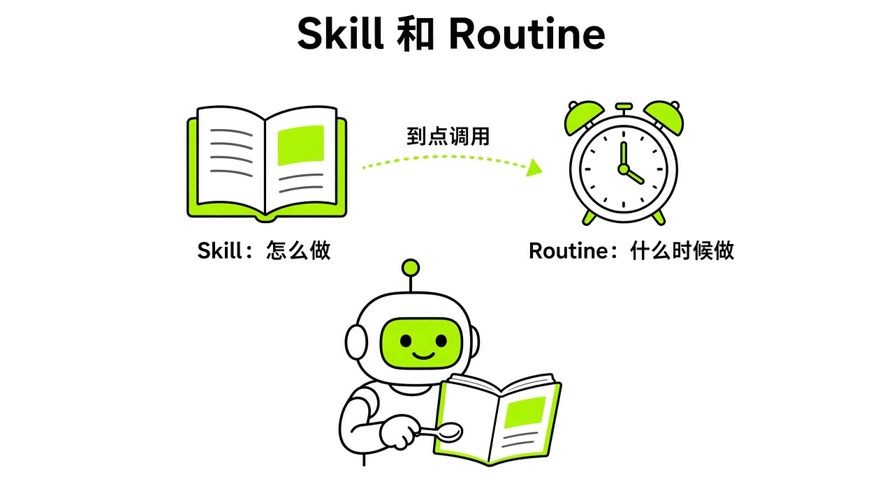
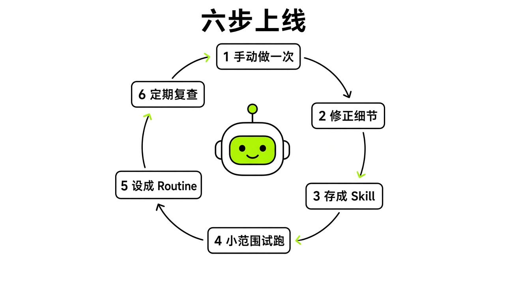
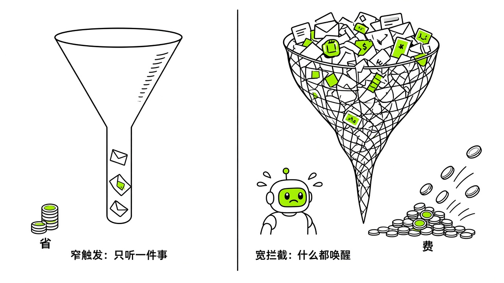

# §07 Skill 与 Routine：教一次，让它照着做 · Skills & Routines

[← 上一章：§06 云电脑：它的工位 · The Computer](../part2-core-concepts/06-computer.md) ｜ [📖 返回目录](../../README.md#-目录) ｜ [下一章：§08 审批与安全边界 · Approvals & Safety →](../part2-core-concepts/08-approvals-safety.md)

---

很多新手刚接触 Grok Bot，容易把它当普通网页聊天框用。每次想干活，都重新敲一遍提示词，输出格式次次参差不齐。还有人把随手写的提示词直接挂成定时任务，跑了几天，额度烧掉一大截，收件箱里全是毫无价值的垃圾信息。

想让 Bot 真正变成可靠的数字同事，得搞懂它的两层自动化构件：Skill 和 Routine。我翻完文档和社区讨论才明白，教它做事和让它定时跑，在底层是两套完全不同的逻辑。

## 7.1 两者的区别 · How vs When

按官方文档的架构设计，**Skill 是解决怎么做（How）的方法库，而 Routine 是规定何时由谁来跑（When）的排期表**（https://docs.x.ai/grok-bot/skills-routines-and-automations.md）。很多人容易把这两个概念搞混。

Skill 是一套可复用的操作指令集。它记录了具体任务的步骤、分支判断、交付格式以及安全审批红线。你教出来的 Skill 不属于某一个具体的 Bot，而是保存在整个账户的私有技能库里。你在 Bot A 这里保存的技能，只要挂载了对应的连接器或网页登录态，Bot B 也能直接调。在桌面客户端输入框里，按 `/` 键就能检索并插入已存的 Skill；按 `@` 键用来找具体的 Bot、群聊、Routine 或连接器（https://docs.x.ai/grok-bot/skills-routines-and-automations.md）。（时效提醒：10 月 7 日 v0.68.1 起 `/` 不再弹出技能菜单，可以直接用文字点名 Skill，见 §03（https://x.ai/changelog/bot）。）要是快捷菜单里没看到某个 Skill，可以去侧边栏的 Marketplace，进插件和技能管理页面，看它在不在 Private skills 列表里（https://docs.x.ai/grok-bot/skills-routines-and-automations.md）。

Routine 是一张具体的排期委派单。它必须绑定一个明确的负责 Bot，还要设定执行时间表或事件触发源（https://docs.x.ai/grok-bot/skills-routines-and-automations.md）。一个 Routine 本质上就是对 Bot 说：在指定时刻，调某项 Skill 去处理当前数据，再把结果推到指定位置。



*图：Skill 与 Routine 的职责边界与调用关系*

早期社区里 Kin 的《Grok Bot 橙皮书》有句口号叫“示范一遍它学一辈子”（https://github.com/KinGao294/grok-bot-orange-book）。这句宣传语把不少新手带偏了，以为让 AI 看一次屏幕动作就能应付真实世界的所有变化。官方文档专门纠偏过：演示录制生成的产物只是一份“草稿技能（draft skill）”（https://docs.x.ai/grok-bot/skills-routines-and-automations.md）。拿到初稿后，必须手动补充判断规则、容错策略和审批卡点，并在安全数据上跑通测试，才能交给 Routine 定期跑（https://docs.x.ai/grok-bot/skills-routines-and-automations.md）。

## 7.2 Teach a task 录制 · Teach by Demo

要是网页操作步骤太繁琐，逐字写提示词得敲上千字，这时候可以用电脑视图里的 Teach a task 功能（https://docs.x.ai/grok-bot/skills-routines-and-automations.md）。这功能不是让你当甩手掌柜，而是靠录屏快速抓取一套技能骨架。

录制步骤很直接。在桌面端打开单聊窗口，切到云电脑屏幕视图，点击 Teach a task（https://docs.x.ai/grok-bot/skills-routines-and-automations.md）。系统会先让你用文字写明目标，接着你在云电脑浏览器里把业务完整操作一遍（https://docs.x.ai/grok-bot/skills-routines-and-automations.md）。演示完点击停止，Bot 就会根据屏幕动作，自动整理出一份草稿 Skill（https://docs.x.ai/grok-bot/skills-routines-and-automations.md）。

这里有两条死规则。第一，单次录制最多 10 分钟（https://docs.x.ai/grok-bot/skills-routines-and-automations.md），超时自动截断。第二，录制只看屏幕画面，完全不录麦克风声音（https://docs.x.ai/grok-bot/skills-routines-and-automations.md），不用对着电脑自言自语。在官方 101 直播里，讲师演示了让 Bot 学会搭建 Google 表单并发布。官方强调，把演示固化成技能核心是为了省 token（tokenomics），省得 Bot 每次执行类似任务都在原始 HTML 页面里盲目试错（https://www.youtube.com/watch?v=8xXhE25vJZY）。

我读官方规范发现，安全是录制时必须卡死的底线。屏幕画面会被模型逐帧读取并写入技能说明，绝对不能在录屏期间明文输入密码、二次验证码或银行卡号（https://docs.x.ai/grok-bot/skills-routines-and-automations.md）。遇到敏感凭据，必须走系统的凭据交接流程（https://docs.x.ai/grok-bot/skills-routines-and-automations.md）。

> [!NOTE]
> 📸 **截图位（待补）**：Teach a task 录制界面与生成的草稿技能面板

社区有人试过对同一个流程连录 3 次让 Bot 取平均值（https://x.com/B_doong2daddy/status/2100573792569303402），但官方没支持过这种做法，效果也没经验证。核心问题在于，**录制生成的技能永远只是一份未经打磨的初稿**（https://docs.x.ai/grok-bot/skills-routines-and-automations.md）。演示走的只是理想路径，真实环境里经常遇到加载超时、弹窗拦截或空数据。拿草稿直接去排期，一旦撞上预期外的变化，Bot 很容易卡死或乱点。

另外，Teach a task 属于分批灰度功能（https://docs.x.ai/grok-bot/skills-routines-and-automations.md）。要是你的电脑视图里还没这个按钮，不用慌。直接指挥 Bot 手动跑通一次单次任务，然后在对话里让它把刚才成功的流程、数据源和格式规则提取保存为私有技能（https://docs.x.ai/grok-bot/skills-routines-and-automations.md）。

> [!TIP]
> 🧪 录制中出现误操作时，生成的 Skill 草稿是否会保留无效步骤。

## 7.3 从一次任务到 Routine 的六步 · Task → Fix → Skill → Test → Routine

不少人抱怨 Bot 经常失控，根子就在于跳过了中间的质检环节。社区实践者总结过一句话：**绝不能直接从随手写的一句提示词直接跳到例行排期（Prompt → Routine）**（https://x.com/Michael_Fenech_/status/2106352565528977469）。官方核心团队接受采访时也强调，正确的路线永远是先看单次任务，再沉淀成技能，建立了信任最后才做自动化排期（https://www.youtube.com/watch?v=xZ5TEaleUdg）。

按官方工作流指南和社区经验（https://x.com/Michael_Fenech_/status/2106352565528977469），搞定一条稳固的例行工作流要走完六步：

1. 手动跑通单次真实任务（Task）。拿当下的真数据当输入，别捏造假例子。在对话框里一步步发指令，确认 Bot 具备任务所需的网页权限、登录态或插件连接（https://x.com/Michael_Fenech_/status/2106352565528977469）。
2. 现场纠偏（Fix）。单次跑几乎总会暴露出问题，比如抓了旧数据、漏了字段，或者输出冗长套话。在这个阶段改指令、对标准、调格式，直到它能稳定产出满意的结果（https://x.com/Michael_Fenech_/status/2106352565528977469）。
3. 存为技能（Skill）。对完成任务的 Bot 说：“把我们刚刚使用的流程保存为名为 [技能名称] 的技能”。在提示词里列清楚触发场景、依赖数据源、操作步骤、校验方法，以及必须人工审批的边界（https://docs.x.ai/grok-bot/skills-routines-and-automations.md）。
4. 换第二份真数据测试（Test a second input）。这一步最容易刷掉劣质技能。只在一个特定输入上跑通就急着封装，存下来的只是针对单次历史的作弊条（https://x.com/Michael_Fenech_/status/2106352565528977469）。换一组参数或不同日期的输入再跑一次，确保流程稳定。
5. 定义失败策略（Define failure）。把异常处理写死在指令里：数据源连不上怎么办？没查到新数据怎么办？中间某步失败是直接终止还是汇报部分进度？涉及对外发送、删数据或付款的操作，有没有锁进审批卡（https://docs.x.ai/grok-bot/skills-routines-and-automations.md）？
6. 绑定排期并用测试运行复核（Routine & Test run）。在负责该任务的 Bot 对话框里，设好时区、排期频次与执行规则，启用后仔细对一遍历史记录（https://docs.x.ai/grok-bot/skills-routines-and-automations.md）。



*图：从单次任务演进到稳定 Routine 的六步闭环*

看社区里 Rowan Cheung 分享的日常监控工作流（https://x.com/rowancheung/status/2108328114552000842），一条及格的 Routine 提示词在结构上必须严密闭环，时间、时区、数据范围、过滤规则、输出格式、禁止项和失败处理都得写全。这是一份可以直接参考的模板：

```text
Every weekday at 9:00 AM in Asia/Shanghai time zone, run the Competitor Product Updates skill against our target list in /workspace/competitors.md.

Look back strictly within the last 24 hours. Catch only three categories of updates:
1. Pricing or plan structure changes.
2. New feature launches or deprecations.
3. Outages, security incidents, or policy updates.

Ignore routine marketing campaigns, hype threads, promotional discounts, and generic reposts. 
Return at most 5 items. For each item, provide:
- Competitor name
- Change category
- Direct source URL
- One-sentence neutral summary of what changed
- Potential impact on our product (High, Medium, Low)

Post the summary directly in this conversation. 
Never post, comment, send email, or contact anyone externally. 
If the source data cannot be retrieved or the network fails, post an explicit error notification stating which source failed, and stop immediately. Never use outdated cache or hallucinate placeholder data. 
If no qualifying updates occurred in the last 24 hours, post exactly one line: "No qualifying competitor updates in the last 24 hours."

Save this as a routine.
```

## 7.4 硬限制 · Limits

搭 Routine 前，官方设下的硬限制要先摸清，不然任务容易莫名中断，甚至丢数据。

每个 Bot 最多建 50 个 Routine（https://docs.x.ai/grok-bot/skills-routines-and-automations.md）。一个 Bot 的任务数量要是逼近上限，说明职责没拆开，得按业务线新开专职 Bot（https://x.com/Michael_Fenech_/status/2105697750645977298）。

定时排期的触发间隔至少要 5 分钟（https://docs.x.ai/grok-bot/skills-routines-and-automations.md），系统不支持低于 5 分钟的高频轮询。轮询太密只会白白耗尽周额度，还给目标服务器造成不必要的压力。

系统对运行历史很克制。每个 Routine 只保留最近 20 条运行记录（https://docs.x.ai/grok-bot/skills-routines-and-automations.md）。遇到连续报错，早期的记录很快就会被顶掉。要想做长期复盘，必须在 Skill 里让 Bot 把产出写进云电脑本地文件，别指望界面的日志面板。

在面板里点删除 Routine 是立即生效的，没有撤销（undo）功能（https://docs.x.ai/grok-bot/skills-routines-and-automations.md）。更要注意的是，在主界面直接删掉某个 Bot，它名下的所有 Routine 会一起被清空（https://docs.x.ai/grok-bot/skills-routines-and-automations.md）。

很多新手刚建好 Routine，顺手就点 Test run 想试试水，以为这只是沙盒演练。官方文档特意警告过：**测试运行会产生真实的网页点击、文件改动和接口调用，绝对不是无害的沙盒模拟**（https://docs.x.ai/grok-bot/skills-routines-and-automations.md）。如果流程里有发消息、改生产文件或付款的操作，又没配审批卡，一点 Test run 就会直接把操作打到外部生产环境里。

为了防止用户离线时后台空转烧额度，系统有无人值守防护。长时间没动客户端，Grok Bot 可能会弹窗问你要不要继续维持后台任务；如果在设定时间内没回复，系统会自动暂停这些 Routine（https://docs.x.ai/grok-bot/skills-routines-and-automations.md）。重新打开客户端时，记得去 Bot 详情页看一眼有没有被暂停的任务，手动点恢复。

> [!NOTE]
> 📸 **截图位（待补）**：Bot 的 Routines 管理面板与运行历史记录

另外，按官方安全规则，Routine 或后台任务发起的审批卡片，等大概 10 分钟没人理就会变 Expired（已过期），操作直接作废（https://docs.x.ai/grok-bot/approvals-security-and-privacy.md）。合上笔记本电脑，云电脑上的排期照样在云端跑（https://docs.x.ai/grok-bot/faq.md），但关键步骤卡在审批上、你 10 分钟内没点通过，整个任务链就会停在那里。

## 7.5 事件触发 · Event Triggers

除了按时间表跑，Grok Bot 还能靠外部事件触发（https://docs.x.ai/grok-bot/skills-routines-and-automations.md）。通过 Cursor 账户集成的连接渠道，外部系统有变动时能唤醒 Bot，比如收到某条特定 Slack 消息或 GitHub 仓库通知（https://docs.x.ai/grok-bot/skills-routines-and-automations.md）。changelog 里还能看到 Microsoft Teams 消息、Linear 工单、Sentry 告警、PagerDuty 事件触发（8/12），以及带独立 URL 和密钥的 Webhook 触发（v0.21.0，8/19）（https://x.ai/changelog/bot）。这些触发源大多是海外团队协作工具；国内读者如果不用它们，定时 Routine 就够用。这种事件驱动要单独授权连接，跟普通第三方插件不太一样（https://docs.x.ai/grok-bot/skills-routines-and-automations.md）。

配事件触发器最容易踩坑的，是监听条件设得太宽。官方文档专门提过：**永远不要配置诸如监听每一条新消息这类宽泛触发器**（https://docs.x.ai/grok-bot/skills-routines-and-automations.md）。



*图：狭窄事件触发器与宽泛监听器的运行成本对比*

如果把 Bot 挂在活跃的 Slack 频道里听所有新消息，大家闲聊、发表情包甚至系统机器人推送，都会频繁唤醒 Bot。每次唤醒都要调大模型过一遍上下文，不仅疯狂烧额度，还会塞满上下文噪音，甚至让 Bot 在别人闲聊时误触发动作（https://docs.x.ai/grok-bot/skills-routines-and-automations.md）。

合格的事件触发器，条件必须卡得很窄（https://docs.x.ai/grok-bot/skills-routines-and-automations.md）。官方给的范例是同时盯频道、格式和关键词：“当 `#customer-escalations` 频道的消息同时带有工单链接和 ‘needs repro’ 时，才在预发环境复现问题并输出报告”（https://docs.x.ai/grok-bot/skills-routines-and-automations.md）。就算触发成功，像写回 Slack 或在 GitHub 开 PR 这种操作，指令里也必须卡死人工审批，绝不能让它自己静默搞定（https://docs.x.ai/grok-bot/skills-routines-and-automations.md）。

## 7.6 Routine 审计 · Audit

社区里有句话：“在 Grok Bot 体系里，Routine 才是真正的产品，而不是那个 Bot 头像”（https://x.com/i/status/2109516426767654962）。但新鲜劲一过，很多人搭的 Routine 慢慢全变成了信息垃圾。

有行业观察者提过：别把“搭了复杂的流程”当成“创造了真实的业务价值”（https://www.youtube.com/watch?v=LM7Ft7g8qJw）。每天早晨推过来的行业日报、数据摘要或竞品清单，要是连续一个月都没改变过你的任何业务决策，那它根本没必要存在。

再算一笔成本账。社区开发者按 API 价格估算过（不是订阅的实际扣费）：每 5 分钟跑一次的 Routine，一个月会在后台跑 8,640 次（https://x.com/fleyta88/status/2109346840382415019）。要是有 95% 的时候源数据根本没变，Bot 每次还去啃一遍完整页面和长上下文，额度就全打水漂了（https://x.com/fleyta88/status/2109346840382415019）。

所以必须定期做 Routine 审计。Grok Bot 团队的 Lauren Tan 在访谈里提到，她有一个叫 Dr. Eggbot 的 Bot 专门定期审计所有 Bot 和 Routine 的成本（团队成员访谈，https://www.youtube.com/watch?v=xZ5TEaleUdg）。社区的做法是每月搞一次淘汰审计（https://x.com/kocer_eth/status/2101669438038634827）：数一数上个月跑过的任务，看结果到底被你采纳了几次；找出那些长期失败、没人看的幽灵任务；每次审计至少强制删掉一条没用的 Routine（https://x.com/kocer_eth/status/2101669438038634827）。

> [!NOTE]
> 📸 **截图位（待补）**：Routine 审计提示词在对话中的执行与停用确认

你可以把下面这段审计提示词直接发给负责调度的 Bot。它会检查所有排期，把高频轮询改成看哈希值、计数器或时间戳的轻量检查，而且没有你确认绝不动手删（https://x.com/fleyta88/status/2109346840382415019）：

```text
Audit all my existing routines across all Bots and optimize the execution plan around actual business changes.

Perform the following steps:
1. List every routine, its owning Bot, its schedule or trigger, and its expected output.
2. Flag routines where over 90% of historical runs produced no change or were ignored.
3. Replace high-frequency full runs with lightweight change checks: inspect only a file hash, record count, or updated timestamp before doing downstream heavy work.
4. If no underlying data has changed, instruct the routine to terminate immediately without generating notifications.
5. Identify any routine that has not directly influenced a decision or workflow in the past 30 days and nominate it for deletion.
6. Verify that all irreversible external actions remain gated behind human approval.

Show me the full audit report, proposed schedule adjustments, and estimated savings first. 
Do not modify, pause, or delete any routine without my explicit confirmation.
```

说到底，**例行自动化本身只是过程，如果输出结果从未影响过你的任何实际决策，它就是在白白烧钱**（https://www.youtube.com/watch?v=LM7Ft7g8qJw）。定期大扫除，留下真正能办事的坚固闭环，你的 Bot 团队才算上了正轨。

---

[← 上一章：§06 云电脑：它的工位 · The Computer](../part2-core-concepts/06-computer.md) ｜ [📖 返回目录](../../README.md#-目录) ｜ [下一章：§08 审批与安全边界 · Approvals & Safety →](../part2-core-concepts/08-approvals-safety.md)
