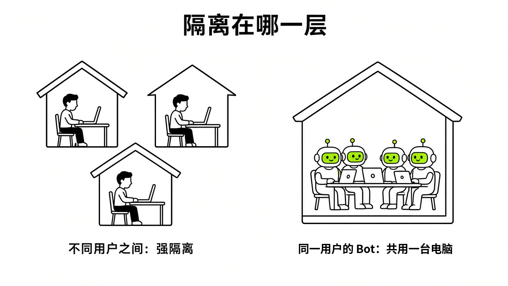
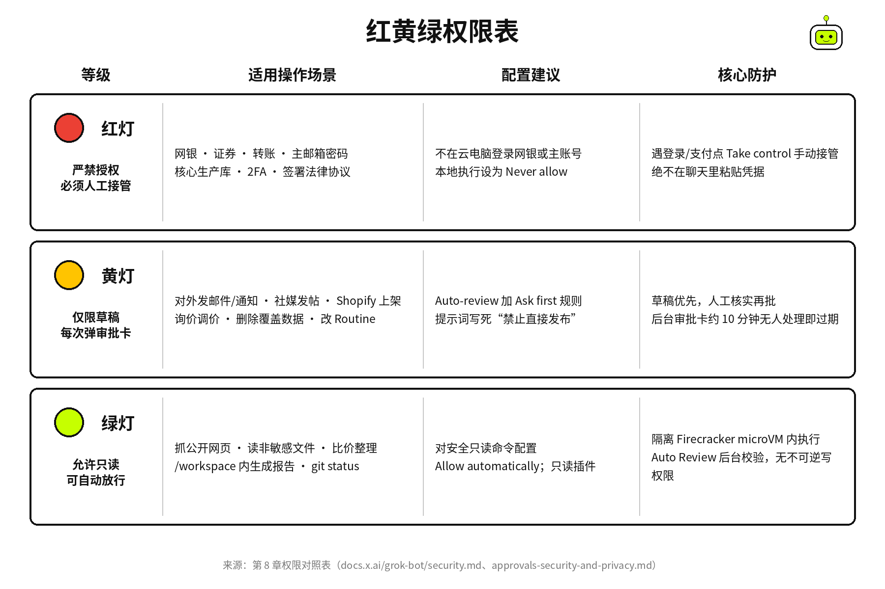

# §08 审批与安全边界 · Approvals & Safety

[← 上一章：§07 Skill 与 Routine：教一次，让它照着做 · Skills & Routines](../part2-core-concepts/07-skills-routines.md) ｜ [📖 返回目录](../../README.md#-目录) ｜ [下一章：§09 连接器与 Marketplace · Connectors →](../part3-integrations/09-connectors.md)

---

很多新手刚接触 Grok Bot，总以为它跟普通聊天 AI 差不多，甚至直接在对话框里贴密码。社区里确实有翻车案例（见 8.2、8.3）。给 Bot 派活之前，必须先弄明白三件事：审批机制怎么跑、哪些账号绝对不能碰、安全红线到底画在哪。

### 8.1 Auto-review 与审批卡 · How Approvals Work

Grok Bot 在后台并不是简单匹配几个关键词。它的底层跑着一套独立的审查模型，叫 Auto Review【官方】（[https://docs.x.ai/grok-bot/security.md](https://docs.x.ai/grok-bot/security.md)）。只要 Bot 准备执行 Shell 命令、调用插件、操作电脑桌面、修改 Routine 或触发器，甚至分发子任务或者唤起 Cloud Agent，Auto Review 都会在动作实际跑起来之前先做评估，决定是直接放行、弹卡拦截，还是彻底拒绝执行【官方】（[https://docs.x.ai/grok-bot/security.md](https://docs.x.ai/grok-bot/security.md)）。但这套审查模型不是万能的。官方明确说明，它不会审查每一次内存写入和大多数设置变更【官方】（[https://docs.x.ai/grok-bot/security.md](https://docs.x.ai/grok-bot/security.md)）。你自己配的规则才是第一道闸门。

某个动作触发审批时，聊天窗口会弹出一张结构化的审批卡，把操作目标、调用参数和具体数值列给你。界面上有三个选项：Allow once（允许这一次动作）、Always allow（保存规则并自动放行）、Deny（直接拒绝拦截）。按键盘上的 Esc 键也能取消。这套交互在 iPhone 手机端上也完全一致【官方】（[https://docs.x.ai/grok-bot/approvals-security-and-privacy.md](https://docs.x.ai/grok-bot/approvals-security-and-privacy.md)）。看不懂具体影响或者确认不了目标对象时，千万别随手点允许，直接叫 Bot 用大白话解释，或者让它先交一份草稿【官方】（[https://docs.x.ai/grok-bot/approvals-security-and-privacy.md](https://docs.x.ai/grok-bot/approvals-security-and-privacy.md)）。

挂机跑任务时有个时间坑。你守在聊天窗口前，审批卡会一直挂起等待。但如果是定时 Routine、外部事件触发，或者其他 Bot 私信交接的任务，审批卡等上大约 10 分钟就会自动过期【官方】（[https://docs.x.ai/grok-bot/approvals-security-and-privacy.md](https://docs.x.ai/grok-bot/approvals-security-and-privacy.md)）。一旦超时，卡片就变成 Expired 状态，对应的动作会被彻底丢弃，绝不会在后台偷偷跑完。博主 @fleyta88 做 Routine 审计时也提到过这个机制【社区】（[https://x.com/fleyta88/status/2109346840382415019](https://x.com/fleyta88/status/2109346840382415019)）。过期卡片有时会给一个选项叫 Always allow this in the future，点了会把动作加入自动放行列表，但它绝不会补跑刚才超时的那次任务。想继续完成，你得叫 Bot 重新跑一次【官方】（[https://docs.x.ai/grok-bot/approvals-security-and-privacy.md](https://docs.x.ai/grok-bot/approvals-security-and-privacy.md)）。

要精细管理这套审批逻辑，打开 Settings → General → Auto-review 配置具体规则。规则分为两类：Ask first 规则只要匹配就会强制截停并弹卡询问；Allow automatically 规则允许匹配动作自动执行，前提是审查模型没发现其他潜在风险【官方】（[https://docs.x.ai/grok-bot/approvals-security-and-privacy.md](https://docs.x.ai/grok-bot/approvals-security-and-privacy.md)）。如果两类规则发生冲突，系统裁决逻辑极其明确：**Ask first** 永远获胜【官方】（[https://docs.x.ai/grok-bot/approvals-security-and-privacy.md](https://docs.x.ai/grok-bot/approvals-security-and-privacy.md)）。写规则时要尽量狭窄具体，比如发外部邮件前必须询问、修改生产看板前必须询问、或者在指定文件夹运行只读命令时自动放行。千万别写成允许浏览器里的所有操作，外部网页随时在变，宽泛的放行规则等于主动敞开后门【官方】（[https://docs.x.ai/grok-bot/approvals-security-and-privacy.md](https://docs.x.ai/grok-bot/approvals-security-and-privacy.md)）。

规则的作用域也得注意。个人配置的 Auto-review 规则保存在当前桌面客户端，并同步到对应的云电脑，换一台新电脑登录就得重新配一套【官方】（[https://docs.x.ai/grok-bot/approvals-security-and-privacy.md](https://docs.x.ai/grok-bot/approvals-security-and-privacy.md)）。在企业版环境里，管理员能在后台强制打开 Auto-review 并统一下发锁定的团队规则。个人添加的规则只能在团队基线之上变得更严，绝不可能绕过管理员策略去放宽权限【官方】（[https://docs.x.ai/grok-bot/security.md](https://docs.x.ai/grok-bot/security.md)）。涉及本机文件时，一定要检查 Settings → General → Bot → Execution on Local Computer（或者每台电脑的独立设置），把本机执行权限从 Ask every time 改成更安全的 Never allow。除非你很明确需要 Bot 操作物理机上的文件，否则坚决不要开本机执行入口【官方】（[https://docs.x.ai/grok-bot/security.md](https://docs.x.ai/grok-bot/security.md)）。

> [!NOTE]
> 📸 **截图位（待补）**：后台 Routine 触发的审批卡在 10 分钟后超时显示 Expired 与操作按钮

### 8.2 凭据交接与 1Password · Secrets

很多人图省事，Bot 一问密码就随手打在对话框里发过去，这是最危险的习惯。X 社区出过真实事故：有用户在一个拉了多个 Bot 的协作群里误发了账号密码，结果群里所有 Bot 全在会话上下文里读到了明文凭据，所有 Bot 都记住了这个密码【社区】（[https://x.com/i/status/2107339523038331338](https://x.com/i/status/2107339523038331338)）。官方安全指南写得很明确：绝不能在普通聊天文本中发送密码或一次性动态验证码【官方】（[https://docs.x.ai/grok-bot/approvals-security-and-privacy.md](https://docs.x.ai/grok-bot/approvals-security-and-privacy.md)）。

遇到账号登录、通行密钥验证、双重验证（2FA）、图形人机验证（CAPTCHA）或者支付确认页面，官方的标准流程是人工接管：

1. 在客户端打开 **Agent Computer** 视图。
2. 点击接管控制权（Take control）。
3. 在打开的浏览器或窗口里亲手输完账号密码或扫码认证。
4. 把控制权交还给系统，并在对话框里告诉 Bot 继续往下走【官方】（[https://docs.x.ai/grok-bot/approvals-security-and-privacy.md](https://docs.x.ai/grok-bot/approvals-security-and-privacy.md)）。

整个过程 Bot 接触不到你的明文密码，认证全在你的眼皮底下完成。

如果是系统支持的连接器服务，Bot 会弹出专门的安全机密请求卡片。这种卡片有独立输入通道，输入的凭据会被自动打码遮罩，既不会存进聊天记录，也不会暴露给底层大模型【官方】（[https://docs.x.ai/grok-bot/approvals-security-and-privacy.md](https://docs.x.ai/grok-bot/approvals-security-and-privacy.md)；[https://cursor.com/help/grok-bot/secrets](https://cursor.com/help/grok-bot/secrets)）。网页里需要填写登录凭证、送货地址或者电话号码时，Bot 也能在聊天界面弹出内联表单（Inline Form），一次一步让你填，再替你代填到网页表单里【官方】（[https://docs.x.ai/grok-bot/approvals-security-and-privacy.md](https://docs.x.ai/grok-bot/approvals-security-and-privacy.md)；[https://x.com/mattyp/status/2102759899314741736](https://x.com/mattyp/status/2102759899314741736)）。如果你用 YubiKey 这类硬件安全密钥，在 Settings → General → Security Key 中开启硬件安全密钥支持后，云电脑里的浏览器能直接联动你插在物理机上的硬件密钥，每次调用都会先弹窗要求你手动授权【官方】（[https://docs.x.ai/grok-bot/approvals-security-and-privacy.md](https://docs.x.ai/grok-bot/approvals-security-and-privacy.md)）。不过官方指出，目前该功能在 macOS 和 Windows 上默认开启，Linux 系统官方暂未支持【官方】（[https://docs.x.ai/grok-bot/approvals-security-and-privacy.md](https://docs.x.ai/grok-bot/approvals-security-and-privacy.md)）。

至于常用的密码管理工具，官方在 9 月中旬推出了 1Password 插件集成（9/15 的 v0.53.0 写明首发在 Mac 上）【官方】（[@bot 9/17 发布帖](https://x.com/bot/status/2100335532597502311)；[x.ai/changelog/bot](https://x.ai/changelog/bot)）。这个集成的边界设计很克制，不会把你整个密码库暴露给 Bot，它只能读取连接时创建的“Shared with Grok Bot”这一个独立保险库【社区】（第三方 learngrokbot 插件目录转述，research/web/learngrokbot-plugins.md；官方 @bot 帖只说"Share items in a vault, approve each fill"）。你的私人主密码库、银行密码和敏感密钥依然被隔离在外部。更底层的 OAuth 连接器凭据也有保护机制：所有连接器的授权令牌都保存在 Cursor 后端服务器上，Bot 调用外部工具时拿不到原始 Token，云电脑的本地硬盘上也绝不存储任何授权令牌【官方】（[https://docs.x.ai/grok-bot/security.md](https://docs.x.ai/grok-bot/security.md)）。

> [!NOTE]
> 📸 **截图位（待补）**：Agent Computer 中手动接管界面与安全机密请求卡片

### 8.3 哪些账号不要登录 · Never Log In

用 Grok Bot 最容易犯的一个误区，是以为建了不同的 Bot 就等于建了不同的隔离沙盒。官方架构文档写得很清楚：Cursor 在租户隔离层面采用的是每个用户独立的 **Firecracker microVM**，拥有独立内核、内存与虚拟设备，不同用户之间绝对隔离【官方】（[https://docs.x.ai/grok-bot/security-faq.md](https://docs.x.ai/grok-bot/security-faq.md)）。但在同一个用户账号内部，你创建的所有 Bot（不管多少个）共用同一台云电脑、同一个浏览器环境和同一个 /workspace 工作目录【官方】（[https://docs.x.ai/grok-bot/approvals-security-and-privacy.md](https://docs.x.ai/grok-bot/approvals-security-and-privacy.md)；[https://x.ai/news/designing-grok-bot](https://x.ai/news/designing-grok-bot)）。官方在安全文档里专门警告过：绝不要把不同的 Bot 当作安全边界【官方】（[https://docs.x.ai/grok-bot/approvals-security-and-privacy.md](https://docs.x.ai/grok-bot/approvals-security-and-privacy.md)）。

这个设计导致过一起被媒体广泛报道的泄密事故。XMTP Labs 首席执行官 Shane Mac 把 Grok Bot 连上自己的个人银行账户，当作只读的财务助手；结果 Grok Bot 以他本人的身份，把一份包含健身房会员、装修开销、刷卡支出等明细的"monthly financial audit"发进了公司的 Slack 频道。Mac 自己的解释是：不同的 Bot 共用同一台云电脑，另一个 Bot 因此拿到了他的财务数据【社区】（媒体报道，https://cybernews.com/ai-news/grok-bot-leaks-bank-information/ ）。报道还提到，产品发布约一周后马斯克曾在 X 上回复一位网友"Try it out"，并说 Grok Bot 出错的话 "we will make you whole"，Mac 事后也引用了这句话【社区】（同上）。据第三方报道，Grok Bot 事后增加了频道权限相关控制（research/enterprise.md 汇总的 RuntimeWire/Business Insider 报道），细节以官方为准。

评测博主在解析七天试用安全风险时也讲过这个隐患：只要一个 Bot 登录过某个网站，浏览器会话就会保存在这台机器上，你账号下的其他所有 Bot 都能直接接管这个会话【社区】（[https://ytget.cc/entry/grok-bot-chinese-test-7-day-trial-security-risks](https://ytget.cc/entry/grok-bot-chinese-test-7-day-trial-security-risks)）。因此，有三类账号必须列入绝不登录的黑名单：第一类是个人与企业的网络银行、券商及涉及资金调拨的支付后台；第二类是绑定了全部资产与重置权限的个人主邮箱；第三类是公司内部核心权限系统与包含最高敏感数据的生产环境数据库。如果某项业务确实必须使用独立凭证，官方给出的正规解法是为该业务单独分配一个 Cursor 用户账号，换一台全新隔离的云电脑【官方】（[https://docs.x.ai/grok-bot/security-faq.md](https://docs.x.ai/grok-bot/security-faq.md)）。

除了数据泄露，高频或异常的自动化操作还会直接引来第三方平台的风控。社区实测表明，多个 Bot 在同一台机器上并发操作外部网站时，很容易被目标网站判定为多账号异常共享登录，直接锁定会话【社区】（[https://x.com/i/status/2100351900881207770](https://x.com/i/status/2100351900881207770)）。有用户把 Grok Bot 接入 WhatsApp 后，两个个人账号直接被封禁【社区】（[https://www.reddit.com/r/GrokBot/comments/1w11r70/](https://www.reddit.com/r/GrokBot/comments/1w11r70/)）；而在 LinkedIn 上，只要 Bot 尝试发送消息，账号现有的所有登录会话就会被全部踢下线【社区】（web/learngrokbot-plugins.md）。更要命的是，普通个人版和自服务 Teams 团队默认对外网是全部放行的（Allow All），在后台禁用某个插件并不能阻止 Bot 通过浏览器直接访问该网站【官方】（[https://docs.x.ai/grok-bot/security-faq.md](https://docs.x.ai/grok-bot/security-faq.md)）。只有企业版（Enterprise only）才提供 Network Controls 这一网络策略面板，允许管理员配置严格的域名与 IP 白名单（Team Allowlist Only），在网络层把访问路径彻底锁死【官方】（[https://docs.x.ai/grok-bot/security.md](https://docs.x.ai/grok-bot/security.md)）。



*图：多用户间 Firecracker microVM 强隔离与同用户内所有 Bot 共享单机环境对比*

### 8.4 草稿优先原则 · Draft First

安全使用 Bot，核心原则就四个字：**草稿优先**。社区博主 @Michael_Fenech_ 在总结新手使用法则时强调：给高风险动作加闸，发送、购买、删除、合并等行为默认一律只生成草稿【社区】（[https://x.com/Michael_Fenech_/status/2105697750645977298](https://x.com/Michael_Fenech_/status/2105697750645977298)）。最管用的防线永远是写在提示词第一句里的明确限制。任务一开始就要划清禁区：哪些事情能自主完成，哪些地方必须立刻停下来请示【官方】（[https://docs.x.ai/grok-bot/approvals-security-and-privacy.md](https://docs.x.ai/grok-bot/approvals-security-and-privacy.md)）。

官方在文档里给过一个范本句式：核对活动数据并起草预算调整方案时，明确写出不要直接更改活动配置，也不要给合作方发消息，在展示当前数值、建议调整数值以及预期影响之后，必须停下来请求审批【官方】（[https://docs.x.ai/grok-bot/approvals-security-and-privacy.md](https://docs.x.ai/grok-bot/approvals-security-and-privacy.md)）。特别是向外发送邮件与通知、在社交媒体公开发帖、涉及转账与购物付款、删除或覆盖已有文件、修改权限配置、变更生产环境代码，以及勾选同意法律协议，这七大类动作官方强烈建议必须设置明确的审批截停点【官方】（[https://docs.x.ai/grok-bot/approvals-security-and-privacy.md](https://docs.x.ai/grok-bot/approvals-security-and-privacy.md)）。记住，审批卡拦截的是即将发生的下一步动作，已经执行完毕的操作是根本无法通过审批回滚的【官方】（[https://docs.x.ai/grok-bot/approvals-security-and-privacy.md](https://docs.x.ai/grok-bot/approvals-security-and-privacy.md)）。

别盲目相信模型的自主判断。Bot 在上网浏览网页、读取插件结果或者执行命令返回终端输出时，外部内容很可能藏着恶意诱导或者提示注入（Prompt Injection）代码，试图劫持 Bot 的执行流去干坏事【官方】（[https://docs.x.ai/grok-bot/security.md](https://docs.x.ai/grok-bot/security.md)）。虽然系统会把外部读到的数据打上不可信标记，并通过 Auto Review 与用户指令核对，但官方直接指出，这些手段只能降低风险，绝不可能彻底消除恶意外部内容的威胁【官方】（[https://docs.x.ai/grok-bot/security.md](https://docs.x.ai/grok-bot/security.md)）。人工确认就是防止注入劫持的最终底牌。

在官方的实际业务案例中，这种边界控制有很严格的规范。官方公布的采购专用 Bot（Haggle Bot）系统提示词结构，就树立了标准的三档权限范式：明确划分为 Always allowed（始终允许自主读取数据和比价）、Needs explicit go（必须获得明确授权才能向供应商发起议价报价单）、以及 Never（绝对禁止私自签合同付款）【官方】（[https://x.ai/news/grok-bot-procurement](https://x.ai/news/grok-bot-procurement)）。在官方客服团队的落地实践中，他们遵循爬、走、跑（crawl/walk/run）的三步推进法：最初接入工单系统时，Bot 只被允许在后台写内部备注（internal notes），所有对外回复和写操作强制人工审批，直到积累了大量数据并建立起严格的自动化评估体系后，才在低风险场景逐步放开直接回复【官方】（[https://x.ai/news/grok-bot-customer-support](https://x.ai/news/grok-bot-customer-support)）。

派活时可以直接套用这套防御型提示词模板：

```text
你负责执行本次任务，但在操作过程中必须严格遵守以下执行边界：
1. 本次任务的所有对外动作仅限生成草稿，绝对禁止直接点击发送、发布、下单或付款。
2. 遇到任何删除文件、覆盖已有数据、修改权限或变更生产环境的操作，必须立刻停下。
3. 完成数据比对或草稿起草后，请在回复中详细列出：当前状态、拟修改内容、以及预期产生的影响。
4. 必须等待我明确回复同意并提供批准后，方可执行下一步操作；未收到确认前，保持等待状态。
```

把任务变成定时 Routine 之前，必须做一次完整的破坏性边界测试。【实测·TODO待实测】写明禁止发送后，无人值守的 Routine 是否始终停在草稿状态。

### 红黄绿权限表



我把常见的操作场景整理成了这张权限对照表，派活和配权限时可以严格对照执行：

| 权限等级 | 适用操作场景 | 系统配置建议 | 核心防护机制 |
|---|---|---|---|
| 红灯：严禁授权（必须人工亲自接管） | 个人与公司网络银行、证券交易、资金转账、主邮箱主密码、核心生产数据库、最高控制台登录、双重验证（2FA）输入、签署法律协议 | 严禁在云电脑登录任何网银或主账号；在 Settings 中将 Execution on Local Computer 设为 Never allow；企业版配置 Network Controls 域名白名单 | 遇到登录与支付步骤，强制打开 Agent Computer 点击 Take control 手动接管；绝不在普通聊天中粘贴任何凭据文本 |
| 黄灯：仅限草稿（每次必弹审批卡） | 向外部发送邮件或通知、社交媒体公开发帖、Shopify 商品信息上架、采购询价与调价发单、删除或覆盖既有数据、修改 Routine 定时规则 | 在 Settings → General → Auto-review 中添加针对发信、变更看板等动作的 Ask first 规则；在初始提示词中固定写入禁止直接发布 | 严格执行草稿优先原则；系统弹出审批卡由人工核实变更影响后再做决策；后台触发的任务若 10 分钟无人审批则自动过期拦截 |
| 绿灯：允许只读（低影响可自动放行） | 抓取公开网页资讯、阅读非敏感格式文件、比价表格整理、在 /workspace 内部生成报告、拉取只读数据看板、运行 git status 等只读检查 | 在 Settings → General → Auto-review 中针对指定路径下的安全只读命令配置 Allow automatically 规则；连接只读性质插件 | 限制在隔离的 Firecracker microVM 云电脑内执行；由 Auto Review 模型做后台安全校验；不赋予任何不可逆写权限 |

### 本章来源

- 官方审批、安全与隐私文档：[https://docs.x.ai/grok-bot/approvals-security-and-privacy.md](https://docs.x.ai/grok-bot/approvals-security-and-privacy.md)
- 官方 Grok Bot 安全总览：[https://docs.x.ai/grok-bot/security.md](https://docs.x.ai/grok-bot/security.md)
- 官方 Grok Bot 安全 FAQ：[https://docs.x.ai/grok-bot/security-faq.md](https://docs.x.ai/grok-bot/security-faq.md)
- 官方机密安全存储指南：[https://cursor.com/help/grok-bot/secrets](https://cursor.com/help/grok-bot/secrets)
- 官方设计文章限制说明：[https://x.ai/news/designing-grok-bot](https://x.ai/news/designing-grok-bot)
- 官方采购 Haggle Bot 案例：[https://x.ai/news/grok-bot-procurement](https://x.ai/news/grok-bot-procurement)
- 官方客服自动化演进案例：[https://x.ai/news/grok-bot-customer-support](https://x.ai/news/grok-bot-customer-support)
- Matt Palmer 官方每周更新（内联表单与路由）：[https://x.com/mattyp/status/2102759899314741736](https://x.com/mattyp/status/2102759899314741736)
- Cybernews 报道 Shane Mac 银行数据泄露事故：[https://cybernews.com/ai-news/grok-bot-leaks-bank-information/](https://cybernews.com/ai-news/grok-bot-leaks-bank-information/)
- 可波 AI 白话 7 天试用安全风险与单机共享解析：[https://ytget.cc/entry/grok-bot-chinese-test-7-day-trial-security-risks](https://ytget.cc/entry/grok-bot-chinese-test-7-day-trial-security-risks)
- Michael Fenech 新手进阶与高风险动作加闸规则：[https://x.com/Michael_Fenech_/status/2105697750645977298](https://x.com/Michael_Fenech_/status/2105697750645977298)
- fleyta88 关于后台审批 10 分钟超时的 Routine 审计分析：[https://x.com/fleyta88/status/2109346840382415019](https://x.com/fleyta88/status/2109346840382415019)
- 社区群聊误输密码翻车事故：[https://x.com/i/status/2107339523038331338](https://x.com/i/status/2107339523038331338)
- 社区多 Bot 同机并发被外部网站封锁案例：[https://x.com/i/status/2100351900881207770](https://x.com/i/status/2100351900881207770)
- Reddit 用户关于 WhatsApp 个人账号被封禁反馈：[https://www.reddit.com/r/GrokBot/comments/1w11r70/](https://www.reddit.com/r/GrokBot/comments/1w11r70/)

---

[← 上一章：§07 Skill 与 Routine：教一次，让它照着做 · Skills & Routines](../part2-core-concepts/07-skills-routines.md) ｜ [📖 返回目录](../../README.md#-目录) ｜ [下一章：§09 连接器与 Marketplace · Connectors →](../part3-integrations/09-connectors.md)
