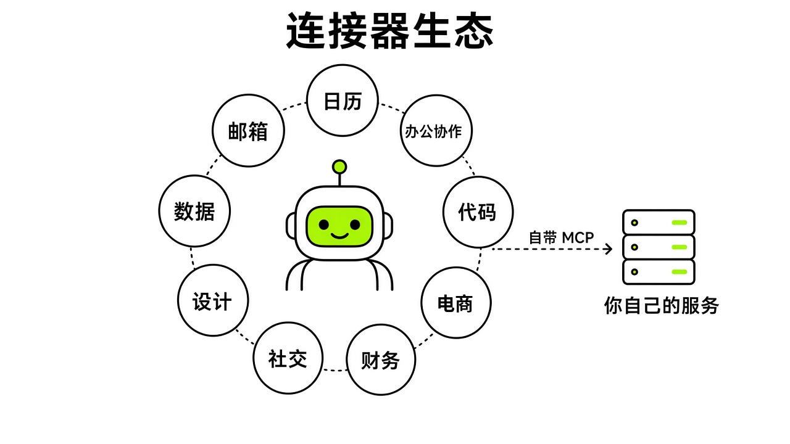
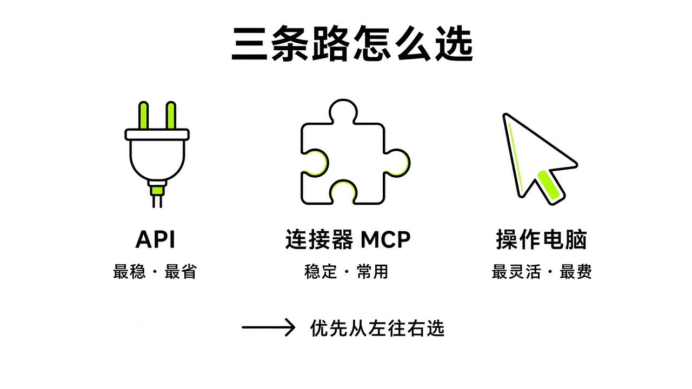

# §09 连接器与 Marketplace · Connectors

[← 上一章：§08 审批与安全边界 · Approvals & Safety](../part2-core-concepts/08-approvals-safety.md) ｜ [📖 返回目录](../../README.md#-目录) ｜ [下一章：§10 官方合作集成逐个讲 · Partner Integrations →](../part3-integrations/10-partners.md)

---

## 9.1 Marketplace、Plugins 与 @ 的用法 · Marketplace, Plugins & The @ Symbol

我刚看文档时，最容易被界面上的几个词搞晕：一会儿是 Marketplace，一会儿是 Plugins，一会儿又是 Connect Apps。新手很容易以为 Marketplace 像手机应用商店，点进去就能给 Bot 装各种底层 API 插件。但官方页面的定位完全不同。

先厘清时间线：客户端里的 Marketplace 早期同时列插件和 Bot 模板；9 月 29 日起客户端 Marketplace 只放插件，10 月 2 日改名 **Connect Apps**，Bot 模板挪到网页上【官方】（https://x.ai/changelog/bot ）。所以现在：**客户端 Connect Apps = 装插件（连接器）**；**网页 x.ai/bot/marketplace = Bot 模板集市**【官方】（https://x.ai/bot/marketplace ）。下面先说网页版模板集市。页面按部门分类：官方团队、工程、销售、市场、设计、个人、招聘、产品、运营。比如官方做的外联获客 Bot「Outbound Prospecting」（Krista Letz 开发）、内容策划 Bot「SEO & AEO Desk」（Adam Tanguay 开发）、采购谈判 Bot「Haggle Bot」（Daniel Gartshein 开发）、面试协调 Bot「Recruiting Coordinator」（Tommy Hansen 开发）；还有社区开发者提交的模板，像打包外部 API 的「tinkabot」（Lauren Tan 开发）、管理编码代理的代码主管「Lingxi's Engineer Bot」（Lingxi Li 开发）、设计走查「Critiquito」、组织治理「Alfred」（Robin Delta 开发）。在 Marketplace 里点添加，复制到工作区的只是一份包含角色设定、规则、提示词和既定流程的 Bot 配置副本，并不会直接打通个人账号的外部应用授权。

真正面向代码和终端环境的插件生态，是官方 2026 年 6 月 11 日推出的 Grok Build Plugin Marketplace（https://x.ai/news/grok-plugin-marketplace ）【官方】。这是内置在终端开发环境里的插件体系，开源目录在 GitHub 的 xai-org/plugin-marketplace。它把 skills、斜杠命令、agents、hooks、MCP 服务和语言服务协议 LSPs 打包成规范的安装包，支持终端输入 `/marketplace` 浏览，或者运行命令：

```text
grok plugin marketplace list
grok plugin install <name> --trust
```

上线时首批生态伙伴包括 MongoDB、Vercel、Sentry、Chrome DevTools、Cloudflare 和 Superpowers。目录里的远程插件都严格锁定了特定的 commit SHA，安装阶段会做哈希完整性校验。

平时在桌面客户端里让 Bot 读邮件、查日历、提代码的入口到底在哪？在客户端左侧边栏底部的 Connect Apps【社区】（来源见 learngrokbot.com/plugins https://learngrokbot.com/plugins ）。早期有些二手网帖把它混称为 Marketplace 或设置里的 Plugins，容易让人在设置面板里白转悠。其实它就固定在左侧边栏最下方，排在所有 Bot 列表下面。在这里配的插件是账号级的：属于当前 Cursor 或 Grok Bot 账户，连上一次，名下每个 Bot 都能用，不用挨个登录。

通过 Connect Apps 连接应用，流程分四步【社区】（来源：learngrokbot.com/plugins ）：
1. 点击侧边栏底部的 Connect apps 按钮唤出弹窗。
2. 搜索应用名或点分类标签，点击旁边的 Add。密码管理器 1Password 显示为 Connect，系统自带的 GitHub 显示为 Connect GitHub。
3. 默认浏览器会自动打开对应应用的官方授权页。像 Google 授权页会提示正连接至 Grok 或 Cursor，需要在十分钟内完成确认并关闭页面。
4. 回到客户端检查插件列表的最终状态。

这里最容易踩的坑是：**Added 不等于 Connected**【社区】（来源：learngrokbot.com/plugins ）。在管理面板里看到 Added，只代表插件装进了环境配置，还没登录成功。点进详情页，账户行还是 Needs auth，旁边挂着 Authenticate 按钮。这时候让 Bot 干活，Bot 会直接报错说找不到应用或缺少授权。只有变成绿色的 Connected，凭证才算生效。以后如果授权因令牌过期失效，不用卸载重装，在详情页重新点 Authenticate 走一遍浏览器确认就行。要同时管理多个账号，比如工作专用的 Notion 和个人笔记 Notion，点 Add Another Account 分别绑定打标签，跟 Bot 说明「使用我的工作 Notion」即可路由。详情页里的 Tools 行还能单独关掉敏感权限。如果用的是 Cursor Teams 方案，管理员也可以后台统一禁用，客户端会显示 Disabled by team admin。

授权完成后，对话里调用插件最直接的办法是打 `@`【社区】（来源：learngrokbot.com/plugins ）。在输入框敲 `@` 会弹出一个浮层，里面有连好的插件和技能，点选就能把任务派给它。没提前连也没关系，直接跟 Bot 说查日程，Bot 发现没授权会在对话框里甩出一张带 Authorize 按钮的卡片，点卡片原地跳浏览器登录。

> [!NOTE]
> 📸 **截图位（待补）**：Grok Bot 侧边栏 Connect Apps 入口、搜索与分类弹窗、Manage plugins 状态页面及聊天中 @ 唤起插件浮层

> [!TIP]
> 🧪 【实测·TODO待实测】用 @ 调用插件并完成 OAuth 授权的流程。

## 9.2 连接器总览（上百个，按类别）· Catalog

连接器到底有多少个？网上说法差别很大：有人发帖说 110 个，有人说 219 个，第三方指南还写过 238 个。对比研究记录来看，主要是统计口径冲突【推测】。

官方 2026 年 5 月 6 日发过一篇 Grok 应用（不是 Grok Bot，那时 Grok Bot 还没发布）的连接器公告（https://x.ai/news/grok-connectors ）【官方】，列的是 SharePoint、Outlook、OneDrive、Google Workspace、Notion、GitHub、Linear 和 Bring Your Own MCP，没公布过固定总数；官方 Marketplace 页面（https://x.ai/bot/marketplace ）【官方】展示的又全是 Bot 角色模板。民间统计里，社区帖称有 110 个连接器（个例），包含 88 个官方与 22 个自定义 MCP（https://x.com/1920web1080/status/2107160327112777835 ）【社区】；GitHub 上的 awesome-grok-bot-plugins 仓库（https://github.com/rdmgator12/awesome-grok-bot-plugins ）【社区】2026 年 8 月 12 日快照收录了 219 个；第三方站 learngrokbot.com（https://learngrokbot.com/plugins ）【社区】10 月 6 日清单列了 238 个，但这数字是把十个分类直接累加，算进了跨分类重复项。目前严谨的说法只能是**上百个**，没有官方固定的个位数值。

参考 learngrokbot.com 整理的清单（来源：learngrokbot.com/plugins https://learngrokbot.com/plugins ），整个生态大致涵盖十个方向，文档和社区里记录了不少限制和细节：

密码管理类目前只有一家：1Password【官方】（官方更新日志见 2026 年 9 月 17 日 @bot 账号公告，转述见 enterprise.md ；用法见 learngrokbot.com/plugins ）。它的隔离设计很特殊：点击 Connect 授权后，1Password 会在后台建一个名为「Shared with Grok Bot」的专属保险库。Bot 碰不到个人主保险库，只能读取你手动放进共享保险库的条目。老企业后台或者没做插件的网站，把账号密码放进这个保险库让 Bot 代登，是最稳妥的办法。

办公生产力类包括 Notion、Linear、Airtable、Asana、ClickUp、Coda、Monday.com、Todoist、Zapier、Box、Miro、Smartsheet 等。这里有个容易混淆的点：第三方清单称 Google 办公套件只列了 Google Docs 和 Google Slides，没有名为 Google Drive 或 Google Sheets 的插件【社区】（来源：learngrokbot.com/plugins ）。但官方 changelog 9 月 15 日写着 "Bots can upload files to Google Drive or OneDrive"，10 月 7 日又支持交付 Google Slides【官方】（https://x.ai/changelog/bot ）——说明至少上传到 Drive 是支持的。Sheets 能否原生读写，以你客户端里 Connect Apps 的实际搜索结果为准；不行就走浏览器或导出 CSV/Excel。

通讯协作类包含 Gmail、Google Calendar、Slack、X 以及微软组件。注意微软没给打包的 Microsoft 365 插件，而是拆成了 Outlook、Outlook Calendar、OneDrive、Teams 四个独立插件【社区】（来源：learngrokbot.com/plugins ）。加了邮件不等于加了日历，得分别配。沟通类应用有两个风险：Zoom 插件授权常报 4700 错误（Invalid redirect），属于已知故障，客户端暂时无解；另外 WhatsApp 和 LinkedIn 没有原生插件，社区帖称有用户让 Bot 用云电脑浏览器接管 WhatsApp 发信被封号（个例，Reddit 讨论帖：https://www.reddit.com/r/GrokBot/comments/1w11r70/ ）【社区】，也有社区帖称在 LinkedIn 上自动化发消息导致会话被强制下线（个例，Reddit 讨论帖：https://www.reddit.com/r/GrokBot/comments/1wp291u/ ）【社区】。连 X 插件会自动开通开发者账号并扣 API 点数，付费套餐里送了初始额度。

代码工程类自带 GitHub 插件，按钮直接叫 Connect GitHub，没有卸载选项【社区】（来源：learngrokbot.com/plugins ）。另外有 Vercel、Sentry、MongoDB、Docker、Cloudflare、Supabase、Postman、Temporal、Datadog 等。10 月 1 日官方宣布 Bot 可以把编码任务交给 Cursor、用 GitHub 和 Origin 插件管理 PR【官方】（https://x.com/bot/status/2105373767568621895 ）；9 月 17 日 changelog 也扩展了 releases、tags、labels、PR review 等 GitHub 能力【官方】（https://x.ai/changelog/bot ）。

数据分析类包含 Amplitude、Snowflake、PostHog、Hex、ClickHouse、dbt Labs、Grafana 等。官方企业用例公布过内部数据团队的做法：用只读凭证连 Databricks，配合 Hex 和 Statsig，让 Bot 跑覆盖数万张数据表的复杂查询【官方】（来源：enterprise.md ；https://x.ai/news/team-bots ）。

销售获客类覆盖 Salesforce、HubSpot、Gong、Apollo.io、Clay、Outreach 等。官方企业版公告举的例子是：通话中 Bot 根据实时笔记更新演示文稿；招聘场景下根据当天的 Gong 通话提交面试评分卡【官方】（来源：https://x.ai/news/grok-bot-for-enterprise ）。

财务交易类中，官方 2026 年 9 月 27 日发布了只读的 Finance 插件，通过 Plaid 连接银行卡和投资账户（官方 X 帖子：https://x.com/bot/status/2103936247995752705 ）【官方】；10 月 9 日上线了 Shopify 插件，能查订单、追库存、同步商品（官方 X 帖子：https://x.com/bot/status/2108228871938359347 ）【官方】。此外还有 Stripe、Ramp、Brex、Xero。碰财务数据必须留心隔离：XMTP Labs CEO Shane Mac 遇到过事故，Grok Bot 以他的身份把包含银行余额和消费明细的月度财务审计发进了公司 Slack 频道（事故报道：https://cybernews.com/ai-news/grok-bot-leaks-bank-information/ ；https://runtimewire.com/article/xmtp-shane-mac-grok-bot-bank-audit-slack ）【社区】。只读接口管不住 Bot 把读到的数据发到外网，关键操作必须加人工确认。

除了官方目录，Grok 还支持 Bring Your Own MCP【官方】（来源：https://x.ai/news/grok-connectors ）。企业内网接口或自建数据库不用等官方做插件。Connect Apps 界面没有输入框，加自定义 MCP 靠直接在对话框里发指令【社区】（来源：learngrokbot.com/plugins https://learngrokbot.com/plugins ）：

```text
Add this MCP server: https://your-app.example.com/mcp
```

Bot 收到后会让你确认服务信息并完成挂载。两个硬性条件：第一，地址必须是公网 HTTPS，Bot 跑在云端虚拟机里，访问不到本机的 localhost；第二，挂载后全账户共享，名下所有 Bot 都能调。



*图：Grok Bot 十大类连接器生态分布图与 Bring Your Own MCP 公网接入拓扑*

> [!TIP]
> 🧪 【实测·TODO待实测】1Password 共享保险库登录与自定义 MCP 服务的调用。

## 9.3 Computer use、MCP、API 怎么选 · Which Path

让 Bot 接管一个系统，选哪条路？是用 Computer use 在虚拟屏幕上点浏览器，还是走 MCP 和原生插件，还是直接写 API 脚本？社区博主 @Michael_Fenech_（https://x.com/Michael_Fenech_/status/2102048957777981938 ）【社区】和官方 101 直播（https://www.youtube.com/watch?v=8xXhE25vJZY ）【官方】给出了明确分工。

第一条路是 Computer use（云电脑操作）。它的长处是零开发成本、适应性强。没有接口的老旧系统，只要人在浏览器里能点，Bot 靠看屏幕就能模拟键鼠操作。试错阶段这也是低成本方式【社区】（来源：https://x.com/Michael_Fenech_/status/2102048957777981938 ）。不确定新业务值不值得写代码，让 Bot 先点两次试试，不合适随时停掉。缺点也很明显：它依赖截屏和视觉识别，耗 Token，占周额度；遇到验证码、动态弹窗或前端改版容易卡死。官方常见问答明确写着，遇到登录拦截、双重认证或人机验证，Bot 必须停下来把控制权交还人工，不能强行绕过（https://docs.x.ai/grok-bot/faq.md ）【官方】。

第二条路是 MCP 与原生连接器（Plugins）。业务一旦确定长期跑、每天高频发生，就该尽早从屏幕点击切到 MCP 或插件【社区】（来源：https://x.com/Michael_Fenech_/status/2102048957777981938 ）。协议对接不用渲染网页，一次工具调用就搞定收发邮件、查单同步。速度压缩到秒级，省 Token，拿到的也是结构化数据。但官方 101 直播指出了局限：插件能力完全取决于服务商开放了什么。比如 Figma 插件只能读取设计稿元数据，真要调图层和改样式，还是得退回云电脑屏幕操作（来源：https://www.youtube.com/watch?v=8xXhE25vJZY ）【官方】。

第三条路是底层 API 脚本直连。面对批量大、吞吐高、要求稳定成功率的数据任务，纯靠大模型在对话框里发指令很不划算。这时可以让 Bot 当调度中枢，由独立的后台脚本去跑 API 直连【社区】（来源：https://x.com/Michael_Fenech_/status/2102048957777981938 ；另见 workflows.md 铁柱AGI 调度器实践）。Bot 只管「什么时候启动」和「最终结果怎样」，具体拉数据、洗数据、批量入库交给云电脑或服务器上的 Python 脚本处理。这样能把模型用量压到最低，数据流也更可控。

选型逻辑可以概括为**从验证到固化的三层递进**：探索阶段用 Computer use 快速试错；跑通后转成 MCP 或插件长期跑；批量大数据拉取，交给底层 API 脚本。



*图：Computer use、MCP 与 API 三条实现路径在灵活性、稳定性与成本维度的选型决策漏斗*

> [!TIP]
> 🧪 【实测·TODO待实测】同一任务分别用 Computer use、MCP、API 完成的差异。

## 本章来源

- 官方 Marketplace 页面：https://x.ai/bot/marketplace
- 官方 Grok Build 插件市场发布公告：https://x.ai/news/grok-plugin-marketplace
- 官方 GitHub 插件市场目录仓库：https://github.com/xai-org/plugin-marketplace
- 官方 Connectors 发布公告：https://x.ai/news/grok-connectors
- 官方 Connectors 开发文档：https://docs.x.ai/grok/connectors
- 官方 Grok Bot 常见问答文档：https://docs.x.ai/grok-bot/faq.md
- 第三方 Grok Bot 插件深度指南：https://learngrokbot.com/plugins
- 社区博主 @1920web1080 连接器数量帖：https://x.com/1920web1080/status/2107160327112777835
- 社区开源项目 awesome-grok-bot-plugins：https://github.com/rdmgator12/awesome-grok-bot-plugins
- Reddit 社区 WhatsApp 封号讨论：https://www.reddit.com/r/GrokBot/comments/1w11r70/
- Reddit 社区 LinkedIn 会话失效讨论：https://www.reddit.com/r/GrokBot/comments/1wp291u/
- 官方 @bot 账号 Finance 插件发布公告：https://x.com/bot/status/2103936247995752705
- 官方 @bot 账号 Shopify 插件发布公告：https://x.com/bot/status/2108228871938359347
- Cybernews 关于 Grok Bot 银行数据泄露事件报道：https://cybernews.com/ai-news/grok-bot-leaks-bank-information/
- RuntimeWire 关于 Shane Mac 财务审计泄露报道：https://runtimewire.com/article/xmtp-shane-mac-grok-bot-bank-audit-slack
- 官方 Team Bots 发布公告：https://x.ai/news/team-bots
- 官方 Grok Bot 企业版发布公告：https://x.ai/news/grok-bot-for-enterprise
- 社区博主 @Michael_Fenech_ 工具集成选型逻辑：https://x.com/Michael_Fenech_/status/2102048957777981938
- 官方 Grok Bot 101 直播录像：https://www.youtube.com/watch?v=8xXhE25vJZY

---

[← 上一章：§08 审批与安全边界 · Approvals & Safety](../part2-core-concepts/08-approvals-safety.md) ｜ [📖 返回目录](../../README.md#-目录) ｜ [下一章：§10 官方合作集成逐个讲 · Partner Integrations →](../part3-integrations/10-partners.md)
