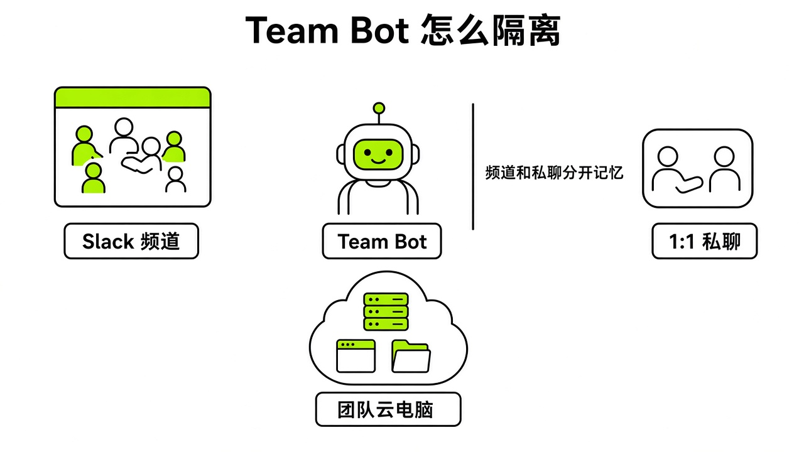
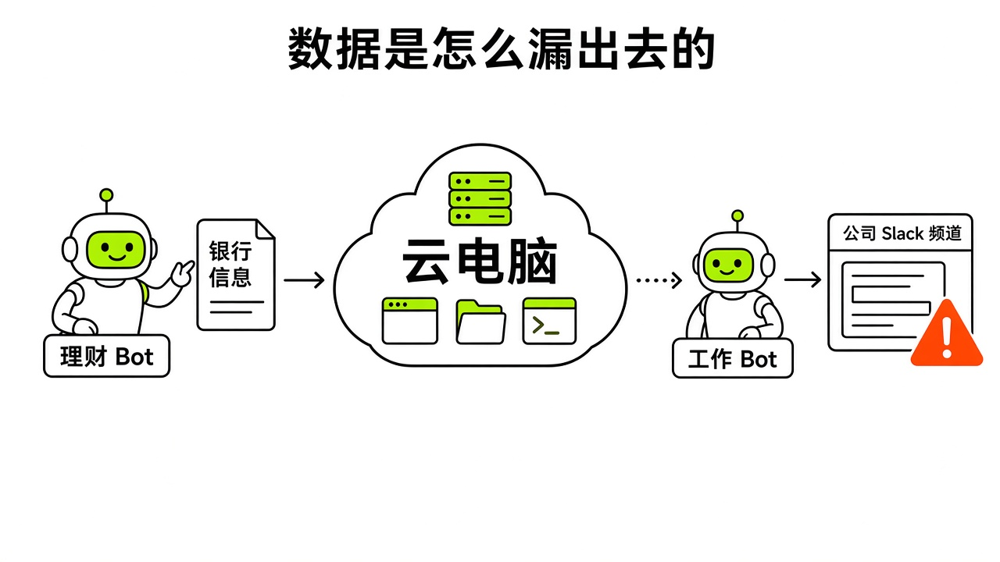

# §10 官方合作集成逐个讲 · Partner Integrations

[← 上一章：§09 连接器与 Marketplace · Connectors](../part3-integrations/09-connectors.md) ｜ [📖 返回目录](../../README.md#-目录) ｜ [下一章：§11 中国用户的集成：没有插件也能用 · China Integrations →](../part3-integrations/11-china-integrations.md)

---

## 10.1 Cursor：云端 Agent、交接与模型路由 · Cursor Handoff

> [!NOTE]
> 📸 **截图位（待补）**：dashboard/usage 页面（注意：社区对 usage 页是否显示具体模型说法不一，见下文）

> 适合谁：10.1–10.2 主要面向写代码的读者（需要 GitHub/Cursor）；10.3 面向用 Slack 的团队；不写代码、不用 Slack 的个人读者可以直接跳到 10.4（X）、10.5（邮箱）、10.7–10.8。

我调研发现，Grok Bot 在架构上扮演的是工程师主管与协调员，而不是单打独斗的代码生成窗口（https://x.ai/bot/guides/grok-bot-for-engineering）。SpaceXSI 工程师 Lingxi Li 分享过官方实践：Bot 能直接创建 Cursor 云端 Agent（Cloud Agents），把包含上下文规范、视觉要求和预设 Skill 的完整 Prompt 派发过去，全程监听 transcript 记录和伴随产物。如果云端 Agent 遇到网络抖动卡住了，Grok Bot 会自动排队补发消息排障；发现思路跑偏了，也能直接中断（https://x.ai/bot/guides/grok-bot-for-engineering）。底层模型也不只靠自身。马斯克在 2026 年 10 月 7 日宣布，Grok Bot 会根据具体任务动态路由到最优模型，包括 Claude Opus 5.5、Midjourney 和 Suno（https://x.com/elonmusk/status/2107724314451878104），（https://thenextweb.com/news/grok-bot-claude-opus-midjourney-suno-musk）。（有视频博主提到在 Bot 电脑里装 Grok Build CLI、用 Composer 2.5 跑有 skill 支撑的任务更省（research/youtube/youtube-summaries.md），但官方 Composer 2.5 公告并未提及 Grok Bot 的路由规则，原稿"长任务走 Composer 2.5"无依据，已删除。）有社区帖称，查看 Cursor 后台 usage 页面，部分任务确实调用了 Claude Opus 5.5（个例）（https://linux.do/t/topic/2990677）。

连接 Cursor 主要有两种方式。第一种是原生账号授权：拿买了 Cursor 付费权益的账号登录 Grok Bot，两端云端调度权限就打通了，Cloud Agent 卡片可以选 Open in Web 或 Open in Cursor（changelog v0.31.0，https://x.ai/changelog/bot）；也有用户分享了在 Cursor 客户端 Agents 窗口打开的体验（https://x.com/i/status/2105881504744460675）。第二种是终端直连：有社区帖分享，让 Grok Bot 在云电脑终端跑官方安装脚本装 Cursor CLI，然后在对话界面的凭据输入框填 Cursor 的 API Key。界面会自动打码脱敏，这样就能在云电脑命令行里调 Opus 5.5（个例）（https://x.com/i/status/2109088800903483616）。（原稿把 https://x.ai/cli/install.sh 当作 Cursor CLI 的官方安装脚本——它其实是 Grok CLI / Grok Build 的安装脚本，已删除该链接。）

> [!TIP]
> 🧪 Bot 交接给 Cursor 云端 Agent 后，usage 页显示的模型。

官方目前并未公开模型路由的具体触发规则与任务分发逻辑（https://thenextweb.com/news/grok-bot-claude-opus-midjourney-suno-musk）。有社区帖反映，很多日常任务在 usage 里显示的还是 grok-bot-default，也有人截图称切到 Opus 5.5 后思考等级只有 low（个例）（https://linux.do/t/topic/2991033）；另有中文教程称 Grok Bot 用量统一记为"Grok Bot 用量"、不按模型区分（research/zh/douyin/chunduai-motion-studio.md）。两种说法冲突，以你自己的 usage 页为准。而且云端 Agent 如果缺乏明确的完成证据检查，很容易陷入反复重试的死循环，把周额度快速耗尽。记住，云端 Agent 并不等同于可以完全免审的最终交付人，所有代码改动与视觉截图仍需人工检查。

## 10.2 GitHub 与 Origin：Bug 复现与 PR 自动化 · GitHub & Origin

Grok Bot 原生支持 GitHub 和 Origin 插件（https://x.com/bot/status/2105373767568621895）。在工程流水线里，它主要干两件事：复现 Bug 和托管 PR。按官方指南，Bot 收到 Bug 报告后，必须在暂存环境用全新测试账号复现，整理出操作步骤、预期与实际表现、截图证据、操作系统及浏览器版本、网络控制台记录，并尽量提取最小测试用例（https://docs.x.ai/grok-bot/use-cases.md）。在改代码阶段，Bot 能结合 Cursor 生成分支、提交代码、发起 PR，甚至附带录屏或操作截图当证明（https://x.ai/bot/guides/grok-bot-for-engineering），（https://x.com/bot/status/2105373767568621895）。

接入 GitHub 时，在应用连接面板里找到 GitHub 插件，走标准 OAuth 授权组织和仓库就行（https://docs.x.ai/grok-bot/team-bots.md）。如果想让 Bot 在自带的云电脑终端里跑 git clone、commit 或 push，要在安全凭据卡片里录入细粒度、受限作用域的 Personal Access Token 或专用 SSH Key。配 Routine 时，可以设成定时检查未关闭的 Issue，或者监控特定分支的变更状态（https://docs.x.ai/grok-bot/use-cases.md）。

> [!TIP]
> 🧪 从 Issue 复现到草稿 PR，以及未经批准是否不合并。

权限失控是 GitHub 集成中最严重的隐患。官方工程团队指出，只有当模型审查的置信度极高且改动影响极小时，才允许自动合并，常规项目必须保留人工代码复核（https://x.ai/bot/guides/grok-bot-for-engineering）。**绝不能把未经审批的代码直接合并进主分支**，并且在自动化复现任何缺陷时，官方安全准则严厉禁止把生产环境的真实客户数据作为测试输入（https://docs.x.ai/grok-bot/use-cases.md）。

## 10.3 Slack 与 Team Bots：共享企业协作 · Slack & Team Bots

*图：Team Bot 在 Slack 频道、1:1 私聊与云电脑之间的隔离架构*

2026 年 9 月 28 日，官方推出了面向企业团队的 Team Bots（https://x.ai/news/team-bots）。管理员配好技能库、知识文件、插件和凭据后，可以把 Team Bot 发布成企业 Slack 的原生应用，拥有独立的名字、头像与 handle（https://docs.x.ai/grok-bot/team-bots.md）。团队成员能在公开频道里 @mention 叫醒它，也能在私聊 DM 里单聊。在官方展示的内部案例中，大客户专员 Bot 每晚聚合新闻、Gong 通话记录与文档，清晨在客户频道发早报；研发协调 Bot 在频道里捕获缺陷、触发云端修复并提 PR；只读数据分析 Bot 则依据 SQL 技能库在群里直接查指标（https://x.ai/news/team-bots）。

接入 Slack 时，管理员先在桌面端配好 Team Bot，选发布给团队，在详情页点 Bring to your team's Slack 授权工作区（https://docs.x.ai/grok-bot/team-bots.md）。要是工作区需要审批应用，就等待批准，也可以配 Slack 自动化规则来实现自动批准（https://cursor.com/bot/slack-auto-approve）。安装完毕后，在目标频道用 `/invite @BotName` 邀请加入。成员还需在设置里关联自己的 Slack 账号，这样每个人的对话权限与用量扣费才会独立计算（https://docs.x.ai/grok-bot/team-bots.md）。

> [!TIP]
> 🧪 未关联账号的成员在 Slack 里 @bot 时的表现。

必须看清底层计算资源的分配差异：个人 1:1 私聊或应用内对话时，每个人用的是各自的专属云电脑。但在 Slack 频道、群聊与公共 Thread 中，Slack 频道中的 Bot 运行在同一台共享云电脑上（https://docs.x.ai/grok-bot/team-bots.md）。这意味着在共享频道上传的文件会留在公共机器上，其他成员提问时可能调阅到这些数据。另外，有社区帖提醒，切勿给 Bot 设置无条件监听全频道消息的 Routine，这会导致空转轮询并快速烧尽额度（个例）（https://x.com/fleyta88/status/2109346840382415019）。

## 10.4 X：原生检索、时间线监控与 @bot 派单 · X Integration

Grok Bot 于 2026 年 8 月 29 日接入了 X 平台，付费用户有初始 X API 调用额度（https://x.ai/news/grok-bot-and-x），并在 10 月 8 日上线了搜索、读取与监控 X 动态的能力（https://x.com/bot/status/2107949161878606089）。除了在客户端让 Bot 监控时间线、抓取书签或整理热点，官方还推出了 Tag on X 机制：刷推时遇到长文、技术讨论或新闻，直接在下方回复并 @bot 加上处理要求，@bot 会回一条接单确认，后台云电脑自动展开作业，过程与产物都保存在客户端会话中（https://docs.x.ai/grok-bot/tag-on-x.md）。有社区帖提到，创作者常借助这个通道搭行业舆情监控和线索捕捉 Routine（个例）（https://x.com/rowancheung/status/2108328114552000842）。

接入 X 的搜索与分析功能，只要在客户端通过 X connector 登录账号就行（https://x.ai/news/grok-bot-and-x）。想用回复 @bot 派发任务的能力，必须满足四个条件：在 grok.com 绑定 X 账号；该 Grok 账号有有效的 Grok Bot 权限；名下至少创建过一个属于自己的 Bot；X 账号注册地在支持的国家或地区（https://docs.x.ai/grok-bot/tag-on-x.md）。

> [!TIP]
> 🧪 在 X 上回复 @bot 派单后的任务流转。

Tag on X 有严格的地域限制。官方文档明确指出，注册地在澳大利亚、英国、欧盟、冰岛、列支敦士登或挪威的账号，以及注册地显示为泛区域（如 South Asia）或未填国家的账号，都无法触发 @bot 接单，用代理也绕不过归属地判定（https://docs.x.ai/grok-bot/tag-on-x.md）。推文包含视频、GIF 动图，或者同时标记了 @grok 时，@bot 同样会静默忽略（https://docs.x.ai/grok-bot/tag-on-x.md）。@bot 只在支持的国家和地区回帖接单。有社区帖提醒，在 X 上高频自动互动可能触发平台反垃圾算法的审查与标记（个例）（https://linux.do/t/topic/3004566）。

## 10.5 邮箱体系：Gmail 与 @mail.grokbot.com 专属邮箱 · Email Systems

> [!NOTE]
> 📸 **截图位（待补）**：在 Grok Bot 对话界面中向 Bot 发送认领 @mail.grokbot.com 邮箱的提示词

接个人 Gmail 只能让 Bot 在收件箱里被动打标签或起草回复。2026 年 10 月 10 日，官方为 Grok Bot 推出了专属独立邮箱（https://x.com/bot/status/2108609764766908772）。分配给 Bot 的邮箱以 `@mail.grokbot.com` 结尾，支持自定义前缀，单账号限领一个（https://www.163.com/dy/article/L8S7SDMS0511B8LM.html）。有了专属邮箱，Bot 成了有独立联络通道的数字员工，能代表你向供应商发询价、代为注册第三方服务、收验证码，或者排会议日程（https://x.ai/news/grok-bot-procurement），（https://www.163.com/dy/article/L8S7SDMS0511B8LM.html）。有社区帖称，发往该域名的邮件能实时推送给 Bot，不用像外部邮箱那样定时轮询拉取（个例）（https://linux.do/t/topic/3001934）。

连接外部 Gmail 只要在插件中心添加 Google 插件，授权读取邮件与日历即可。认领专属的 `@mail.grokbot.com` 邮箱：社区帖称直接跟 Bot 说要注册邮箱即可，单账号限领一个，且只能通过 Grok Bot 收发，功能是灰度推送的（个例）（https://linux.do/t/topic/3002150；https://linux.do/t/topic/3001934）。（原稿写"前提是 SuperGrok/X Premium+ 订阅"，该帖并无此说法，已改。）满足条件后，在对话窗口向 Bot 发送指令认领并指定期望的前缀，系统检测未被占用就能完成绑定（https://www.163.com/dy/article/L8S7SDMS0511B8LM.html）。

> [!TIP]
> 🧪 Bot 自有邮箱收到会议邀请后的处理。

在命名与权限上有个容易踩的坑。有社区帖提醒，千万别用你自己的名字给 Bot 邮箱命名，因为当它对外发邮件时，名字如果与真人一致，在抄送和协同中会引发身份混乱（个例）（https://x.com/petergyang/status/2108624122339287335）。此外，社区反馈专属邮箱只能通过 Grok Bot 收发（https://linux.do/t/topic/3002150）；是否开放 IMAP 等标准协议，官方未说明（CSDN 上"Grok Bot 专属邮箱 IMAP/SMTP 实战"之类文章发布日期混乱，属于 SEO 搬运，勿信）。有社区帖反映早期测试中个别邮件出现过未及时触发动作的情况（个例）（https://x.com/petergyang/status/2108412799684915576）。对外发送真实邮件前，必须严格人工审批。

## 10.6 Notion · Notion

Notion 不只用来抓取或生成单篇笔记，官方把它当成长周期的结构化状态看板（https://x.ai/bot/guides/grok-bot-for-engineering）。模型上下文有限，长周期任务如果全堆在单次会话里肯定会丢信息。官方团队的做法是：多个工程师 Bot 共享一个 Notion 数据库，每 30 分钟轮询一次 PR 状态，自动筛查 CI 失败、安全告警与合并冲突，在看板中推进任务阶段（https://x.ai/bot/guides/grok-bot-for-engineering）。有社区帖展示过在 15 分钟内用 Grok Bot 搭出自媒体数据看板（个例）（https://x.com/op7418/status/2108545983647023493），也有社区帖分享了让 Bot 把长文抓取排版成 PDF 存入 Notion 的用法（个例）（https://x.com/KinGao476942/status/2100073265716928662）。

接入 Notion 时，在插件列表中选 Notion 做 OAuth 授权。在权限配置窗口里，要精确勾选允许该 Bot 读写的具体页面或数据库，不要盲目授权整个工作区。完成授权后，先在 Notion 建好包含明确字段（例如标题、状态、URL、更新时间）的 Database，把链接告知 Bot，让它把读写规范存成复用 Skill。

> [!TIP]
> 🧪 Bot 向 Notion 数据表写入内容的格式。

权限给得太宽容易造成页面污染，提示词不够精准时，模型可能会修改其他无关页面。另外，如果有人改动了数据库的列字段，没做容错处理的 Routine 会直接报错。记住，用 Notion 数据库作为 Bot 上下文溢出时的外挂看板，不要试图依赖短期对话记忆去维持几周前的任务进展（https://x.ai/bot/guides/grok-bot-for-engineering）。

## 10.7 Shopify · Shopify

2026 年 10 月 9 日，官方宣布推出 Shopify 电商集成插件（https://x.com/bot/status/2108228871938359347）。Bot 能直接查询未处理订单与履约状态、监控低库存商品清单，还能针对促销策略批量更新商品标题、描述与 SEO 关键词（https://x.com/bot/status/2108228871938359347）。有社区帖提到，配合云电脑定时任务，可以让 Bot 结合社媒舆情巡检竞品价格与差评，针对性优化自家店铺（个例）（https://x.com/Hensen1016/status/2108025562048483583）。

接入时，在应用市场选 Shopify 插件，输入店铺二级域名完成 OAuth 登录授权。日常下发指令时，建议把商品上架与修改规则写进 Bot 的系统设定。如果需要批量上架或覆盖属性，一定要在提示词里强制要求先出修改预览，严禁直接提交。

> [!TIP]
> 🧪 Shopify 测试店铺的库存查询与商品描述草稿。

电商后台的数据直接关乎资金结算与订单履约。模型批量修改数值时偶有幻觉，价格、计量单位或库存一旦填错，损失很难挽回。所以日常运营中，涉及改价和库存变更必须坚持草稿优先，人工审核后才能同步线上。另外，有社区帖指出，外部平台的半公开数据检索召回率不稳定，不能直接单凭它做经营决策（个例）（https://x.com/Hensen1016/status/2108025562048483583）。

## 10.8 Finance（Plaid 只读）与财务隔离 · Finance & Plaid

*图：Shane Mac 银行数据跨 Bot 泄露路径与共享云电脑风险*

2026 年 9 月 27 日，官方推出了 Finance 金融连接能力，通过 Plaid 协议只读连接银行账户、信用卡与投资组合（https://x.com/bot/status/2103936247995752705）。有社区帖提到，可以向专属财务 Bot 询问未来 10 天即将发生的扣款总额、分析日常支出明细，或者参考跨账户资金调拨（个例）（https://x.com/B_doong2daddy/status/2105711764641833238）。

接入时，在插件中心点击 Finance 插件，在 Plaid 弹窗里选银行并完成双重认证。从协议层面看，Plaid 仅提供只读凭据，Bot 无法直接发起转账交易，也不能修改银行账户设置。

> [!TIP]
> 🧪 Plaid 只读连接后的支出汇总与日志脱敏。

这里出现过一起真实的数据泄露事故——XMTP Labs CEO Shane Mac 银行数据泄露事件（https://cybernews.com/ai-news/grok-bot-leaks-bank-information/）。Mac 把个人银行账户连入 Grok Bot 当财务助理，以为只读权限很安全。但同一个账号下的所有 Bot 共用同一台云电脑与文件系统（https://docs.x.ai/grok-bot/computer-and-apps.md）。按 Mac 本人的解释，另一个 Bot 因此拿到了财务数据，Grok Bot 以他的名义把包含健身房会费、装修开销和刷卡支出的月度审计发进了公司 Slack 频道（https://cybernews.com/ai-news/grok-bot-leaks-bank-information/）。**只读权限绝对不等于数据不会被转发泄露**，个人银行账户绝不能与包含团队协作工具的账号共用同一套运行环境。

## 10.9 1Password、Microsoft Teams 与 Salesforce 等企服生态 · Enterprise Services

2026 年 9 月 17 日，官方支持了 1Password 集成，Bot 可以在云电脑浏览器中受控调用指定保险库的账号密码登录，真实凭据留在密码管理器中（https://x.com/bot/status/2100335532597502311）。企业管理员在 cursor.com/dashboard/bot 开通 Grok Bot（https://x.ai/news/grok-bot-for-enterprise）；后台的 Setup Checklist 包含插件、Slack 或 Microsoft Teams、网络设置等步骤，Routine 也可以由 Microsoft Teams 消息触发（changelog 8/12、9/16，https://x.ai/changelog/bot）。（原稿称企业公告写了"统一部署 Salesforce 插件同步 CRM、配置 Teams 插件发早报"，公告原文没有这些内容，已改。）

接入 1Password 时，要在客户端单独建一个专用共享保险库（建议命名为 Shared with Grok Bot），只把允许 Bot 使用的凭据移进去（https://learngrokbot.com/plugins）。随后在 Grok Bot 中关联扩展，每次 Bot 尝试提取密码并执行自动填充时，系统都会向用户弹出单独的审批确认卡（https://x.com/bot/status/2100335532597502311）。企业版管理员可以在 Team Marketplace 管理团队可用的插件、配置网络策略（https://docs.x.ai/grok-bot/teams-and-enterprises.md）。

> [!TIP]
> 🧪 1Password 专用库登录时的审批与日志脱敏。

有社区帖提到，曾有用户在多 Bot 群聊里误输入明文密码，导致同一群组的所有 Bot 全部捕获到了凭据（个例）（https://x.com/i/status/2107339523038331338）。**绝不能在共享群聊中向 Bot 发送明文凭据**，任何外部访问必须通过专用的密码库或环境变量 Secrets 管理。在对接 Salesforce 等关键业务数据库时，如果后台未设置严格的字段级只读策略，Bot 误操作可能会覆盖销售阶段与客户线索。

---

[← 上一章：§09 连接器与 Marketplace · Connectors](../part3-integrations/09-connectors.md) ｜ [📖 返回目录](../../README.md#-目录) ｜ [下一章：§11 中国用户的集成：没有插件也能用 · China Integrations →](../part3-integrations/11-china-integrations.md)
