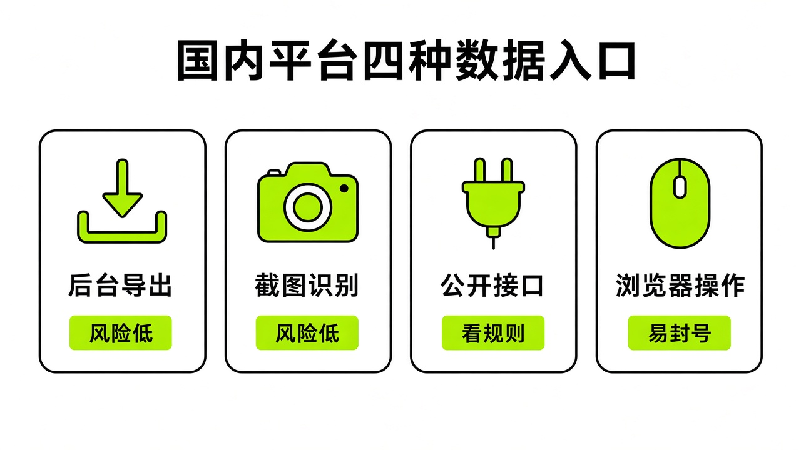

# §11 中国用户的集成：没有插件也能用 · China Integrations

[← 上一章：§10 官方合作集成逐个讲 · Partner Integrations](../part3-integrations/10-partners.md) ｜ [📖 返回目录](../../README.md#-目录) ｜ [下一章：§12 群聊与交接 · Groups & Handoffs →](../part4-multi-bot/12-groups.md)

---

> 说明：国内平台没有官方连接器，所以本章大部分内容来自社区帖和第三方教程，标。使用前请自行核实，并注意平台规则。

国内用户打开 Grok Bot 的连接器市场，大概率会傻眼：除了 Gmail、Notion、Slack、GitHub 和 X，没有任何国内常用软件。微信、飞书、公众号、小红书、抖音、视频号全都没有插件，连 QQ 邮箱和网易邮箱也找不到原生入口。很多人看到这里就打了退堂鼓，觉得这套工具在国内根本没法用。

但如果你调研一圈就会发现，Grok Bot 的核心价值本来就不是那几个官方插件，而是那台 7×24 小时常驻在云端的虚拟电脑。只要云电脑能发网络请求、能开浏览器、能跑脚本，就算国内平台没有官方接口，也能把工作流搭起来。尤其在官方推出 **The X Subscription 三合一统一订阅**（见 [The X Subscription 总览](https://cursor.com/help/the-x-subscription/overview) 与 [Grok Bot 档位说明](https://cursor.com/help/grok-bot/plans)，中文版见 [https://cursor.com/cn/help/grok-bot/plans](https://cursor.com/cn/help/grok-bot/plans)）之后，**Premium（$30/月）**、**Super（$100/月）** 与 **Ultra（$200/月）** 档位把 Grok、Cursor 和 X Premium 整合进同一个共享周额度池（超出部分通过 `grok.com/dashboard/billing` 预充值的 Prepaid Credits 扣除；既有独立 Cursor Pro $20 / Pro+ $60 / Ultra $200 / Teams $40 老订户可保留原计划，或通过 `cursor.com/unify` 单向升级且不可逆）。这意味着国内开发者与创作者可以用同一套订阅同时驱动云端 Grok Bot 与本地 Cursor CLI。这一章把社区摸索出来的国内平台接入方案、故障表和合规边界完整整理出来。

## 11.1 微信接入（iLink/ClawBot）· WeChat

> 前提条件：微信版本满足下文要求且"插件"里能看到微信ClawBot（并非人人可见）；能看懂 Bot 在云电脑上写的转发脚本出错信息，或愿意让 Bot 自己排错。不写代码的读者也能照提示词跑通，但出故障时排查门槛偏高；只想"看数据、出草稿"的读者可以先读 11.3。

微信是国内每天打开频次最高的消息入口。过去十年里，微信机器人方案换了一代又一代：2016 到 2017 年基于 Web 协议的 itchat 和 wxpy 被彻底切断接口；2017 到 2019 年基于 Xposed Hook 修改客户端的方案随版本更新失效；2019 到 2025 年灰产常用的 iPad 协议屡遭起诉；本地 PC Hook 注入内存方案也随时有封号风险（https://ele.ac.cn/2171/）。

这次社区走通的方案不太一样。它基于腾讯随 OpenClaw 框架开放的个人微信 Bot 接口 iLink，域名是 `ilinkai.weixin.qq.com`（https://ele.ac.cn/2171/）。通信走纯 HTTP 和 JSON 协议，不需要 WebSocket，也不用在公网开端口，云电脑全程只发出站请求（https://xput.app/N4rlhi）。配合微信客户端自带的「微信ClawBot」插件，真正要人工操作的只有发一段提示词、复制两个凭据、扫一次码。

这个通道底层依赖四个 HTTP 接口：先调 `get_bot_qrcode` 拿绑定二维码；再轮询 `get_qrcode_status` 获取授权状态并提取 `bot_token`；接着转发脚本调 `getupdates` 做长轮询，单轮挂起约 35 秒带游标拉取消息；处理完后调 `sendmessage` 回复文本（https://ele.ac.cn/2171/）。核心前提是每次回复必须带上用户上行消息里的 `context_token`。这就决定了 iLink 接口没法主动群发或单向推送，必须你在微信里先给它发一条，它才能回传（https://ele.ac.cn/2171/）。

第一步，把社区开发者 Kin 整理的这套提示词发给 Grok Bot，让它在云电脑上调研接口并写好转发脚本（https://xput.app/N4rlhi）：

```text
我想把你接到我的微信上，让我能在微信里直接给你发消息、收到你的回复。请按下面的思路做，每做完一步告诉我结果，需要我操作的地方停下来等我。

1、先调研方案：腾讯「微信ClawBot」插件用的是 iLink 接口（ilinkai.weixin.qq.com）。请确认怎么用 getupdates 长轮询收消息、怎么用 sendmessage 回消息。整个程序只走出站请求，不要开公网端口。

2、在 Grok Bot 里建一个由 webhook 触发的 routine，名字可以叫「微信下旨入口」。建好后告诉我去 routine 面板复制 Webhook URL 和 key，然后弹出加密弹框让我填进去，不要让我在聊天里发明文。

3、在你的云端电脑上写一个小转发程序：收到微信消息后 POST 给这个 routine；你处理完以后，用一个 reply 脚本把回复发回微信，同时在我们的主聊天里同步一份。

4、等我在手机微信里启用 ClawBot 插件以后，生成二维码让我用手机扫码确认，同时给我一个可以在微信里直接打开的备用链接。二维码大约 5 分钟有效。

5、绑定成功后，提醒我先在 ClawBot 对话里发一句话，因为回复要用到这条消息带的 context_token。

6、规则：只认绑定的这一个人，别人的消息不处理；回复一律用纯文本，不要用 Markdown，因为微信不渲染 Markdown。

7、最后告诉我：云端电脑重启以后，怎么把转发程序重新拉起来；如果遇到错误码 -14（凭证过期），提醒我重新扫码。
```

> [!NOTE]
> 📸 **截图位（待补）**：Grok Bot 收到提示词后在云电脑生成转发程序

第二步，配置通信凭据。Grok Bot 建好名为「微信下旨入口」的 Webhook Routine 后，会让你去 Routine 面板复制两样东西：Webhook URL 是消息接收地址，key 是身份凭据（https://xput.app/N4rlhi）。别在普通聊天框里直接发明文密钥。Grok Bot 会弹出一个专属加密输入框，把 URL 和 key 贴进去提交即可（https://xput.app/N4rlhi）。此外，根据官方 v0.75.2 更新说明（[https://x.ai/changelog/bot](https://x.ai/changelog/bot) 与 [Routines 帮助文档](https://cursor.com/help/grok-bot/routines)），Routine 的小时级触发频率上限已大幅上调至**全账号所有 Bot 合计 300 次/小时，单条 Routine 最高 200 次/小时**（定时触发最小间隔仍为 5 分钟），因此在微信里连续高频与 Bot 对话发指令时，Webhook 触发不再容易撞上小时级频控上限。

> [!NOTE]
> 📸 **截图位（待补）**：Routine 面板里的「微信下旨入口」与 Webhook URL、Key
> [!NOTE]
> 📸 **截图位（待补）**：Grok Bot 弹出的加密凭据输入框

第三步，在手机微信上绑定。先看版本号：iOS 需在 8.0.70 及以上，Android 需在 8.0.69 及以上（https://xput.app/N4rlhi）。满足后，打开微信点「我」→「设置」→「插件」，找到红色龙虾图标的「微信ClawBot」开启（https://xput.app/N4rlhi）。

> [!NOTE]
> 📸 **截图位（待补）**：手机微信设置里的插件页面找到「微信ClawBot」并开启

开启后回 Grok Bot 发一句「插件开好了」，它会生成一张绑定二维码和备用链接（https://xput.app/N4rlhi）。用微信扫码授权。扫码完成后，必须在微信的 ClawBot 对话框里主动发第一句话（比如「你好」），让 Bot 拿到回信所需的 `context_token`（https://ele.ac.cn/2171/）。ClawBot 回复纯文本，且 Grok Bot 主界面同步显示，就说明连通了（https://xput.app/N4rlhi）。

> [!NOTE]
> 📸 **截图位（待补）**：Grok Bot 生成的 5 分钟有效绑定二维码与备用链接
> [!NOTE]
> 📸 **截图位（待补）**：手机微信扫码授权确认界面
> [!NOTE]
> 📸 **截图位（待补）**：在手机微信 ClawBot 发送第一条测试消息并收到纯文本回复
> [!NOTE]
> 📸 **截图位（待补）**：Grok Bot 主对话界面同步显示微信会话

日常维护里容易遇到几个高频问题，社区整理了一张速查表：

| 故障现象 | 产生原因 | 解决办法 | 来源 |
| --- | --- | --- | --- |
| 接口返回错误码 -14 | 微信端登录凭证或 token 过期 | 无需重装，让 Bot 重新调 `get_bot_qrcode` 生成二维码，手机重新扫码即可 | https://ele.ac.cn/2171/ |
| 扫码提示登录超时或无响应 | 绑定二维码有效期大约仅 5 分钟 | 重新要求 Grok Bot 生成一张全新的二维码并在 5 分钟内扫码确认 | https://xput.app/N4rlhi |
| 微信发消息 Bot 完全不回 | 云电脑因底层维护或休眠重启，中继转发进程中断 | 在 Grok Bot 对话框要求其将云电脑中的传话脚本进程重新拉起 | https://xput.app/N4rlhi |
| 消息有时回、有时完全不回 | 同一个微信号同时绑定了其他 OpenClaw 实例导致消息被抢占 | 排查并解绑其他客户端上的 OpenClaw 实例，保持单实例接入 | https://ele.ac.cn/2171/ |
| 微信端收到的回复排版错乱 | 微信聊天窗口不原生渲染 Markdown 语法 | 在 Bot 的 prompt 规则中强制约束仅输出纯文本，禁用 Markdown 标记 | https://xput.app/N4rlhi |

关于封号风险，社区教程作者 Kin 在推文里称「不会封号，因为用的是微信官方开放的 ClawBot 接口（iLink），属于正常使用」（https://xput.app/N4rlhi）。但要注意：**这是社区教程作者的个人观点，绝非腾讯官方对第三方自动化免责的正式承诺**。虽然 iLink 走官方通道且只发出站请求，但平台随时可能调整风控规则。用个人常用主号高频调用始终有未知风险。如果不希望让 Grok Bot 自己写脚本，社区也有腾讯开源的 `openclaw-weixin` 和第三方封装的 `grok-wechat-plugin` 可以参考（https://ele.ac.cn/2171/）。

iLink 转发部署、长时间保活与 -14 重新扫码。

## 11.2 飞书 · Feishu

很多国内团队日常重度依赖飞书。但在 Grok Bot 官方插件市场里，目前找不到飞书连接器（https://xiangyugongzuoliu.com/grokbot-use-cases/）。

没有官方插件时，社区最通用的方案是利用飞书群的「自定义机器人 Webhook」（https://x.com/KinGao476942/status/2100224440948916593）。在群设置里加一个自定义机器人，就能拿到形如 `https://open.feishu.cn/open-apis/bot/v2/hook/...` 的推送地址。在 Grok Bot 里配好日常巡检或分析的 Routine 后，任务最后加一段脚本，把结果用 HTTP POST 推到群 Webhook 即可。

这里有个频控限制要卡住：**飞书目前没有官方插件**，第三方教程称飞书自定义机器人 Webhook 有约每分钟 20 条的频控限制（aitoolku 飞书接入教程，https://www.aitoolku.cn/tutorials/grok-feishu，需以飞书开放平台文档为准）。如果多个 Bot 集中推送日志或轮询过密，容易触发 HTTP 429 限流导致消息丢失。写提示词时要让 Bot 合并推送内容，不要逐行刷屏。

省额度方面，铁柱 AGI 的思路是让脚本负责轮询，有变化才用 webhook 唤醒 Bot，不要让 Bot 自己高频盯消息（铁柱AGI 文章转载，https://readcopilot.ionichina.com/articles/53772）。放到飞书上，就是把飞书当通知出口，而不是让 Bot 监听群里每一条消息。邮件这条路有人这样做：用收信规则过滤掉敏感邮件，再把常用邮箱（含飞书邮箱）转发给 Bot 的 agent mail，让它每天总结提醒（https://x.com/i/status/2106774095820095969）。Kin 也分享过让 Grok Bot 抓取视频、转写文案并存进飞书知识库的用法（https://x.com/KinGao476942/status/2100224440948916593）。

除了单向群通知，国内研发团队已经将飞书升级为工程研发流水线的上下文中枢。开发者 `@realbenzh`（Ben Zhang）在 2026 年 10 月 17 日分享了一套将 **飞书（Feishu）+ Linear + 电子邮箱 + 团队文档** 统一接入 Grok Bot 的真实工程研发工作流（[https://x.com/realbenzh/status/2111295936635015631](https://x.com/realbenzh/status/2111295936635015631)）。在他的架构中，Grok Bot 不再只是个传话筒，而是扮演研发项目经理与构建调度员：

1. **多源上下文汇聚**：通过飞书 API / Webhook 与团队文档读取日常业务讨论和 PRD 变更，结合官方原生支持的 Linear 连接器与邮箱（详见官方 [Connect Apps 指南](https://cursor.com/help/grok-bot/connect-apps)），将分散在国内协作工具（飞书）与海外工程工具（Linear）中的碎片需求拉齐到同一个会话窗口。
2. **对话层对齐验收标准（Acceptance Criteria）**：在动工写代码前，先在 Grok Bot 聊天窗口里与 Bot 多轮探讨，把飞书文档里模糊的产品诉求收敛为可验证的交付目标和验收标准。这也契合了中文社区 `@Khazix0918`（[https://x.com/Khazix0918/status/2111709708226797737](https://x.com/Khazix0918/status/2111709708226797737)）与 `@object_nullll`（[https://x.com/object_nullll/status/2111717423837778173](https://x.com/object_nullll/status/2111717423837778173)）关于“对话层负责对齐上下文与验收标准，重度干活交由底层 CLI 或 Cloud Agent”的架构共识。
3. **驱动 `@orca_build` CLI 完成构建交付**：验收标准确认后，Grok Bot 在云电脑或关联的开发机上通过命令行交互式驱动 `@orca_build` CLI 执行代码构建、测试与打包，完成后再将构建产物与 Linear 状态变更同步回飞书群。

如果你也想复刻 `@realbenzh` 的飞书 + Linear + CLI 研发闭环，可以直接使用下面这套任务编排提示词模板：

```text
你现在的角色是研发交付主控（Engineering PM Bot）。每当收到新的功能需求或修复任务时，请严格按以下四步执行：

1. 收集跨端上下文：
   - 读取我在飞书文档/群汇总脚本中同步过来的最新业务需求说明；
   - 查询 Linear 中关联的 Issue 状态、历史评论与子任务；
   - 检查专属邮箱中是否有相关的客户报错或补充邮件。

2. 对齐验收标准（Acceptance Criteria）：
   - 不要立刻开始写代码或调 CLI！先向我输出一份结构化的【交付目标与验收清单（AC）】，列出边界条件、改动范围与测试标准，等待我回复“确认”后再进入下一步。

3. 驱动 CLI 构建：
   - 在获得我的确认后，在终端通过非交互式或受控会话调用构建工具（如 orca_build / cursor-agent），将对齐好的 AC 作为输入指令执行构建与自测。

4. 结果回填与飞书通知：
   - 构建与测试通过后，更新 Linear Issue 状态，并将【变更摘要 + PR/构建链接 + 验收结果】合并成一条结构化消息，通过 HTTP POST 推送到飞书群自定义机器人 Webhook（注意合并发送，遵守飞书每分钟 20 条以内的频控限制）。
```

飞书 webhook 推送在频率限制下的表现。

## 11.3 公众号、小红书、抖音、视频号：四种数据入口 · No-Plugin Playbook

国内创作者用 Grok Bot 最容易犯的错误，是直接对它说「看下我昨天公众号的阅读量」或「抓下小红书这篇笔记的完播率」。这种指令发过去，Bot 要么胡编，要么一直卡在页面重试（https://xiangyugongzuoliu.com/grokbot-use-cases/）。

原因很简单：微信公众号、小红书、抖音、视频号在 Grok Bot 插件市场里全都没有，而且平台后台不对海外第三方工具开放粉丝画像、完播率或后台阅读量的标准 API（https://xiangyugongzuoliu.com/grokbot-use-cases/）。随手丢一条 `mp.weixin.qq.com/s/xxxx` 公开链接，源码里只有正文和标题，根本没有后台的阅读数、完读率和分享量（https://xiangyugongzuoliu.com/grokbot-use-cases/）。**阅读量与完播率不在公开页面上，国内创作者平台必须依赖四种替代入口**。

面对国内平台，创作者博主翔宇总结出了四种可行的数据接入方式（https://xiangyugongzuoliu.com/grokbot-use-cases/）：



*图：国内自媒体平台四种数据入口与风险对照表*

| 入口类型 | 具体怎么做 | 适合获取的数据 | 严禁与风险项 |
| --- | --- | --- | --- |
| 1. 公开 URL 喂入 | 整理 10-20 条已发公开文章/笔记链接，让 Bot 抓取正文分析文风与结构 | 文章标题、公开发布的正文排版、公开可见的点赞与评论 | 严禁指望它从公开链接猜出后台阅读量与完播率 |
| 2. 导出表格或截图 | 人工登录创作者后台，导出 CSV/Excel 数据表或截取数据看板图片拖入对话框 | 真实阅读量、完播率、用户停留时长、粉丝画像 | 严禁让 Bot 凭空估算；没给表格时必须强制其标注 UNSURE |
| 3. 已登录后台窗口 | 在云电脑的自带浏览器中人工完成扫码登录，让 Bot 控制页面阅读屏幕表格 | 无导出功能的系统后台界面数据、待办工单列表 | 严禁用于高频例行任务；自动化点击极易触发平台验证码与风控封禁 |
| 4. 人工发布与审批 | Bot 仅负责输出选题简报与候选文案草稿，最终审核与发布按钮留在人工端 | 选题策划案、初稿排版、分发版本文案适配 | 严禁让 Bot 自动点击最终发布、回复私信、批量点赞或发起支付 |

处理微信公众号时，可以把历史文章的公开链接汇总给 Bot 分析文风，但别让它替你去创作者后台爬数据（https://xiangyugongzuoliu.com/grokbot-use-cases/）。小红书公开页面能看到点赞和收藏，曝光量和完播率得靠后台截图或表格（https://xiangyugongzuoliu.com/grokbot-use-cases/）。抖音和微信视频号的口播文案可以用转录脚本提取，完播指标同样锁在创作者服务中心里（https://xiangyugongzuoliu.com/grokbot-use-cases/）。

这里最容易踩坑的是平台风控。国内内容平台对海外机房 IP 和无头浏览器非常敏感。如果把后台登录态交给 Bot 并挂高频 Routine 刷页面，云电脑会频繁弹出滑块验证码，账号也容易被判定异常遭封禁。最稳妥的做法始终是：人工导出数据喂给 Bot 诊断，Bot 产出内容后再由人工点击发布（https://xiangyugongzuoliu.com/grokbot-use-cases/）。

Bot 解析公众号公开文章链接的效果。

### 11.3.1 公众号日更与香港政务/生活 8 线并行实战（`@bitman2140` 案例）

虽然不能让 Bot 强刷微信公众号后台数据，但把 Grok Bot 当成“全自动内容情报与排版中枢 + 跨境生活政务秘书”却能跑出极高的生产力。博主 `@bitman2140`（0xbitman）在 2026 年 10 月 25 日分享了他一人在 Grok Bot 上同时跑通的 **8 大真实生活与创作工作流**（[https://x.com/bitman2140/status/2114210291546493153](https://x.com/bitman2140/status/2114210291546493153)）：

1. **微信公众号日更运营**：利用 Grok Bot 每日抓取海内外一手信源，按预设个人文风自动完成公众号选题策划、初稿撰写与微信 HTML 排版生成，人工只需最后审阅并复制进公众号后台点击群发。
2. **X 平台同步发帖运营**：将同一套核心素材“一鱼多吃”，自动拆解改写为适合 X 传播的短帖与长推（Thread）。
3. **每日 AI 情报简报**：通过定时 Routine 每天汇总全网 AI 动态，为公众号与 X 源源不断提供弹药。
4. **随时随地灵感捕捉**：日常通勤或阅读时随手把碎片想法丢给 Bot 归档入库，自动沉淀为后续文章选题。
5. **香港优才计划（Quality Migrant Admission Scheme）续签材料跟进**：针对大湾区与跨境用户极其头疼的香港入境处续签政策、材料清单核对与时间节点提醒，专门建立长期跟踪项目，让 Bot 持续梳理证明文件缺口。
6. **香港孩子学校插班（School Transfer）信息搜集与申请**：让 Bot 定时巡检香港各目标中小学的插班开放日期、报名简章要求与面试准备资料，汇总成对比表格（甚至可直接用官方 v0.75.2 上线的 **Pages** 画布生成实时追踪看板，见 [官方 Changelog](https://x.ai/changelog/bot)）。
7. **考试备考辅导**：根据考纲定制每日练习题、错题解析与复习计划。
8. **全栈写代码开发**：在写作与处理家庭事务之余，随时调度云电脑完成全栈项目编码。

同理，中文社区的 `@CyberAlice3269`（夏哥研究室）也验证了 **“1 个 CEO Bot + 5 个专职 Bot（情报搜集、选题策划、初稿撰写、审校润色、配图制作）”** 的 6-Bot 自媒体内容工作室架构（[https://x.com/CyberAlice3269/status/2112098767151468645](https://x.com/CyberAlice3269/status/2112098767151468645)），全员共享同一套知识库与 SOP，再结合 v0.71.2 上线的原生 **Grok Imagine** 生图生视频与代码动效渲染能力（[https://x.com/bot/status/2110566041772617908](https://x.com/bot/status/2110566041772617908)），无需任何国内平台插件即可跑通端到端内容工厂。

### 11.3.2 突破机房 IP 封锁与硬件外设直连（`@XueshiQiao` 本机住宅 IP 路由与 `@guoxudong_` ESP32 语音盒子）

在实际访问公众号文章、知乎、小红书公开页或部分对数据中心 IP 设防的海内外网站时，Grok Bot 云电脑自带的机房 IP 经常会撞上反爬拦截或无限验证码。同时，国内用户也希望在不打开复杂客户端的情况下用语音随时调度 Bot。社区在 2026 年 10 月中下旬摸索出了两套极其实用的网络与硬件破局方案：

#### 方案 A：开启 `Route traffic through this computer` 借用本机住宅 IP 绕过反爬拦截（`@XueshiQiao`）
开发者 `@XueshiQiao`（Xueshi）在 2026 年 10 月 21 日指出（[https://x.com/XueshiQiao/status/2112866936229183589](https://x.com/XueshiQiao/status/2112866936229183589)），当云端浏览器因机房 IP 被目标网站封锁或频繁弹出 Captcha 验证码时，根本不需要在云电脑里折腾复杂的第三方住宅代理池，只需直接启用 Grok Bot 桌面端内置的本地流量转发功能（详见官方 [Settings 文档](https://cursor.com/docs/grok-bot/settings) 与 [v0.75.5 更新日志](https://x.ai/changelog/bot) 对本地电脑流量转发的稳定性修复）：

1. 在你家里或办公室的电脑上安装并打开 Grok Bot 桌面客户端（或像官方工程师 `@ericzakariasson` 推荐的那样，在家里常开的 Mac mini 上保持登录，见 [https://x.com/ericzakariasson/status/2114095056630272099](https://x.com/ericzakariasson/status/2114095056630272099)）。
2. 依次进入 **`Settings > Computer > Your computer`**。
3. 勾选开启 **`Route traffic through this computer`**（通过本机路由流量）。

开启后，云端 Bot 浏览器的出站网络请求会直接通过加密隧道走你本地电脑所在的真实家庭宽带/办公网络 IP（住宅 IP），绝大多数针对云机房数据中心 IP 段的反爬拦截与滑块验证都会迎刃而解。对于有内网 NAS 或私有服务访问需求的进阶玩家，还可以参考 `@lyuan1618` 的方案（[https://x.com/lyuan1618/status/2114214704008798674](https://x.com/lyuan1618/status/2114214704008798674)），在 Grok Bot 云电脑中配置 **Tailscale** 与本地家庭内网组建私有 Mesh 局域网。

#### 方案 B：ESP32 开源硬件语音盒子 + Cloudflare Tunnel + 本地 MCP 2 分钟接通 Grok Bot（`@guoxudong_`）
如果你不仅想在手机上按 iPhone Action Button 语音呼出 Bot（官方 v1.16+ 已原生支持，详见 [Voice Chat 指南](https://cursor.com/help/grok-bot/voice-chat) 与 `@bot` 公告 [https://x.com/bot/status/2112246033178968161](https://x.com/bot/status/2112246033178968161)），还想在书桌或客厅摆一个像智能音箱一样的独立硬件语音盒子，国内极客 `@guoxudong_`（Xudong Guo）在 2026 年 10 月 18 日展示了一套 **2 分钟跑通全链路的 ESP32 硬件接入方案**（[https://x.com/guoxudong_/status/2111767457560215771](https://x.com/guoxudong_/status/2111767457560215771)）。

其完整数据链路无需公网固定 IP，全靠 **Cloudflare Tunnel** 与本地 **MCP Server** 串联：

```text
[桌面 ESP32 硬件语音盒子（拾音/播报）]
       │
       ▼ (1) 音频流经 Cloudflare Tunnel 穿透回传
[家里常开的 Mac 本地节点]
  ├── 本地 Speech-to-Text (STT) 语音转文字
  └── 本地 MCP Server 封装指令与工具接口
       │
       ▼ (2) 经 Cloudflare Tunnel 双向桥接
[云端 Grok Bot 虚拟电脑 (Cloud Box)]
  └── 解析自然语言指令 → 调取工具/执行工作流 → 将结果原路返回播报
```

通过这套架构，你在国内网络环境下对着桌面的 ESP32 小盒子说一句话，本地 Mac 完成极速语音识别并通过 Cloudflare Tunnel 与云端 Grok Bot 交互，不到 2 分钟就能搭建起一套不依赖任何国内智能音箱厂商生态的私人 AI 硬件终端。

## 11.4 QQ 与网易邮箱 · Domestic Email

国内很多业务通知和账单都在 QQ 邮箱或网易 163 邮箱里。但 Grok Bot 连接器里只有 Gmail 和 Outlook，没有国内邮箱（https://xiangyugongzuoliu.com/grokbot-use-cases/）。**国内邮箱无法直接直连插件，必须通过自动转发、网页版登录或导出文件处理**（https://xiangyugongzuoliu.com/grokbot-use-cases/）。

第一种做法是设置自动转发。在 QQ 邮箱或 163 邮箱设置里建分流规则，把特定发件人或关键词的邮件自动转到绑了插件的 Gmail、Outlook，或者直接转给 Grok Bot 的专属邮箱（https://x.com/i/status/2106774095820095969，https://x.com/i/status/2109320438807670985，官方专属邮箱机制详见 [Agent Email 帮助文档](https://cursor.com/help/grok-bot/agent-email)）。转发前要建好排除规则，过滤掉网银账单、找回密码和验证码邮件。

在 2026 年 10 月中下旬的两次关键版本迭代中，Grok Bot 的专属邮箱 `@mail.grokbot.com` 迎来了两项彻底改变国内邮箱转发体验的重磅升级：

1. **v0.71.2 新增 `+alias` 加号子别名与定向 Routine 触发**（见 [官方 Changelog](https://x.ai/changelog/bot)、[Agent Email 文档](https://cursor.com/help/grok-bot/agent-email) 及官方工程师 `@SamSokolin` 发布帖 [https://x.com/SamSokolin/status/2110496237241667621](https://x.com/SamSokolin/status/2110496237241667621)）：现在你的 Bot 专属邮箱原生支持在 `@` 符号前添加任意 `+tag` 后缀（例如你的基础地址是 `mybot@mail.grokbot.com`，你可以直接使用 `mybot+qqbills@mail.grokbot.com`、`mybot+163work@mail.grokbot.com` 或 `mybot+newsletters@mail.grokbot.com`）。更重要的是，**在配置邮件触发的 Routine 时，可以指定仅当收件地址匹配某一个具体的 `+alias` 别名时才唤醒该 Routine**。
2. **v0.75.2 支持原样保留完整 HTML 排版、正文内嵌图片与文件附件转发**（见 [官方 Changelog](https://x.ai/changelog/bot) 与 [Agent Email 文档](https://cursor.com/help/grok-bot/agent-email)）：过去通过 Agent Email 转发带复杂表格、内嵌二维码/截图或 PDF 发票附件的国内通知邮件时，容易出现纯文本化导致排版丢失或附件脱落的问题；自 v0.75.2 起，无论使用 `@mail.grokbot.com` 还是已连接的外部邮箱转发邮件，系统都能原封不动地保留原始 HTML 样式、内嵌图片（inline images）与全部附件。

结合这两项新特性，国内 QQ 邮箱与网易 163/126 邮箱的自动转发分流架构可以升级为“**一邮箱多 `+alias` 管道**”精准路由模式（这也是 `@AIShovelLab` 总结的六大核心联动范式之一，见 [https://x.com/AIShovelLab/status/2113123121070817421](https://x.com/AIShovelLab/status/2113123121070817421)，以及 `@songsong275452` 引用 `@gokul_i` 的 Newsletter 隔离周报方案，见 [https://x.com/songsong275452/status/2113108916229886371](https://x.com/songsong275452/status/2113108916229886371)）：

```text
[QQ 邮箱 / 网易 163 邮箱「收信规则」自动转发配置示例]

规则 1（电子发票归集）：
- 条件：主题包含「发票」或「电子客票」，且不含「验证码 / 密码」
- 动作：自动转发至 → mybot+invoices@mail.grokbot.com
- 对应 Grok Bot Routine（仅监听 +invoices）：提取邮件内嵌图片或 PDF 附件中的金额、税号与开票日期，记入月度报销 Page 看板，并将原邮件（保留完整 HTML 与 PDF 附件）原样转发给财务邮箱。

规则 2（工作项目通知）：
- 条件：发件人来自公司域名或客户域名
- 动作：自动转发至 → mybot+work@mail.grokbot.com
- 对应 Grok Bot Routine（仅监听 +work）：提炼待办事项，同步至飞书群 Webhook 或 iOS 原生提醒事项（v0.75.2 支持）。

规则 3（行业订阅与 Newsletter）：
- 条件：来自各类日报、周刊订阅源
- 动作：自动转发至 → mybot+digest@mail.grokbot.com
- 对应 Grok Bot Routine（不设单封触发以节省 The X Subscription 周额度，改为每周六早 9:00 定时运行）：一次性汇总本周所有发往 +digest 的邮件，生成结构化中文精华周报。
```

第二种做法是在云电脑浏览器里开网页版邮箱（比如 `mail.qq.com` 或 `mail.163.com`），手动扫码登录（https://xiangyugongzuoliu.com/grokbot-use-cases/）。如果你需要用账号密码登录，自 v0.75.2 和 v0.75.5 起，官方已上线 **1Password Brokered Sign-in**（[https://cursor.com/help/grok-bot/connect-apps](https://cursor.com/help/grok-bot/connect-apps)）与内置加密保险箱 **Grok Bot Vault**（`Settings → Vault`，详见 [Secrets & Vault 官方文档](https://cursor.com/help/grok-bot/secrets)），可通过 `BrowserSecureFill` 安全注入凭据而不让 Bot 在上下文里看到明文密码。在给 Bot 的提示词里严格限制权限：只准读未读邮件标题整理清单，不能删邮件，更不能对外发邮件。

第三种做法是手动导出。附件较多或对账时，在本地把邮件存成 `.eml` 或提取表格，拖到云电脑 `/workspace/` 目录下让 Bot 离线解析。多了一步人工，但不会泄露登录态，也不会误发邮件。

163 邮箱转发到 Gmail 后的摘要 Routine。

## 11.5 合规与数据出境 · Compliance

把国内工作流接进 Grok Bot 前，有几道安全底线必须想清楚。

先看网络链路。国内评测媒体提到，`x.ai/bot` 和 `cursor.com/docs/grok-bot` 在部分国内网络下能直接打开（https://www.ai345.info/ai-guide/grok-bot-china-guide）。但这不代表数据在境内处理。Grok Bot 的云电脑本质是境外机房虚拟机，走的是海外机房 IP（https://x.com/i/status/2099409639234289914），网络连接稳定性因地区和运营商而异。

再看数据合规。**境外云电脑不属于安全沙箱边界，国内团队调用前必须评估数据出境合规**（https://www.ai345.info/ai-guide/grok-bot-china-guide）。把未公开的客户联系人、内部代码、财务流水或国内系统凭据交给 Grok Bot，数据就实质离开了境内边界。企业使用时要对照《数据安全法》和《个人信息保护法》做风险评估，不能把敏感客户隐私或核心数据库权限直接交给云端 Agent（https://www.ai345.info/ai-guide/grok-bot-china-guide）。在企业级安全治理方面，官方在 [Security 技术文档](https://cursor.com/docs/grok-bot/security) 中披露，平台已通过 **ISO/IEC 27001** 与 **ISO/IEC 42001** 认证，且团队管理员可配置出站网络域名白名单（并勾选 `Apply to MCP servers` 强制约束所有 MCP 服务器流量）、自定义自然语言 Auto-Review 阻断规则以及推理审计钩子（Inference Hooks）。

多 Bot 架构也有权限边界风险。官方文档写明，同一个账号下的所有 Bot 共享同一台云电脑，文件目录、浏览器 Cookie 和登录态全量互通（https://cursor.com/help/grok-bot/computer-and-apps）。Bot 之间没有权限隔离。如果一个 Bot 登录了内部系统，另一个有联网权限的 Bot 同样能读取这些 Cookie 和登录态。此外，在使用 v0.75.5 新增的 `Settings → Vault` 存储支付卡时，务必留意官方 [Secrets & Vault 文档](https://cursor.com/help/grok-bot/secrets) 标注的规则（中文社区 `@JianWeiSignal` 在 [https://x.com/JianWeiSignal/status/2114195530611855488](https://x.com/JianWeiSignal/status/2114195530611855488) 以及英文社区 `@kial` 在 [https://x.com/kial/status/2114201768414646280](https://x.com/kial/status/2114201768414646280) 也专门发出过提醒）：**保存在 Vault 中的银行卡在结账自动填充时，不会触发单独的逐笔 Vault 弹窗确认**。因此，国内用户切勿将主力信用卡常驻保存在 Vault 中，建议参考 `@martinpaulweiss` 的“一密一宅（One home per secret）”原则（[https://x.com/martinpaulweiss/status/2114210343467536531](https://x.com/martinpaulweiss/status/2114210343467536531)），将重要登录凭据放在每次都需要生物识别审批的 1Password（`Settings → Connect apps → 1Password`）中。

在没有原生插件的环境下用 Grok Bot，要守住四条底线：一是绝不让云电脑登录网银、核心财务或高权限管理账号；二是资金支付、发正式邮件、合并代码等敏感操作必须人工二次确认；三是不需要联网的历史数据，清洗脱敏后再以文件交付；四是始终认清云电脑在境外的属性，守住合规底线。

---

[← 上一章：§10 官方合作集成逐个讲 · Partner Integrations](../part3-integrations/10-partners.md) ｜ [📖 返回目录](../../README.md#-目录) ｜ [下一章：§12 群聊与交接 · Groups & Handoffs →](../part4-multi-bot/12-groups.md)
