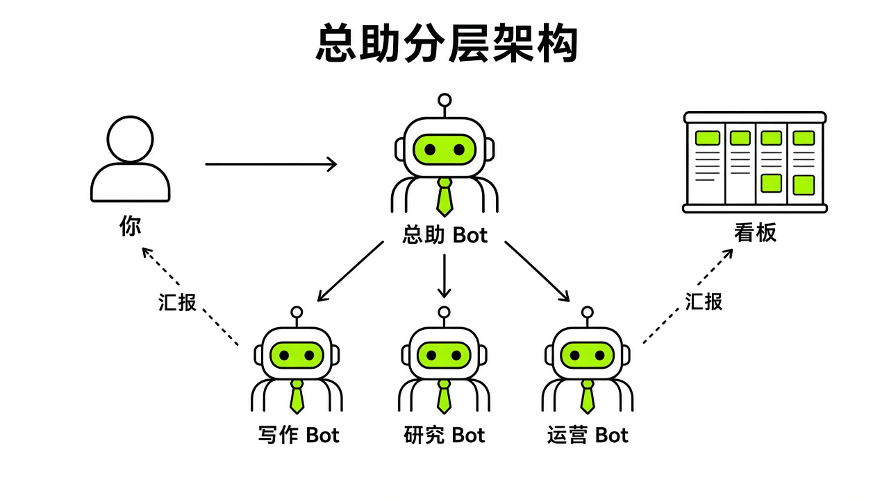

# §12 群聊与交接 · Groups & Handoffs

[← 上一章：§11 中国用户的集成：没有插件也能用 · China Integrations](../part3-integrations/11-china-integrations.md) ｜ [📖 返回目录](../../README.md#-目录) ｜ [下一章：§13 编制案例库 · Team Blueprints →](../part4-multi-bot/13-blueprints.md)

---

## 12.1 建群 · Groups

如果只在侧边栏单独点开每个 Bot，开四五个窗口切着派活：写代码找 Coder，查资料找 Researcher，写文案找 Writer。单兵作战还行，一旦多角色协作，人就成了“人肉中继器”，得把 Researcher 找的链接复制给 Writer，再把初稿粘给 Reviewer。为了让多个 Bot 一起干活，官方提供了群聊功能（[Group Chats 官方文档](https://cursor.com/help/grok-bot/group-chats)）。

桌面端建群很简单。在侧边栏顶部点“New”，在弹出的面板里勾选 2 到 6 个 Bot 就行（[Group Chats 官方文档](https://cursor.com/help/grok-bot/group-chats)）。官方设计文章写得很明确：每个群上限 6 个 Bot（[designing-grok-bot](https://x.ai/news/designing-grok-bot)）；文中提到的"每账户约 50 个 Bot"已在 9 月 1 日 v0.31.0 取消（[changelog](https://x.ai/changelog/bot)）。手机端点“+”号选“New Group Chat”也能建。建完后默认群名随时能改，之后也能在群信息里调整成员（[Group Chats 官方文档](https://cursor.com/help/grok-bot/group-chats)）。

进群后怎么派活？主要靠群发和点名。直接发自然语言，群里的 Bot 会自己判断谁来接话；明确知道某一步该谁做，就敲“@”选对应的 Bot（[Group Chats 官方文档](https://cursor.com/help/grok-bot/group-chats)）。一条消息能同时 @ 多个 Bot。不过“@everyone”会唤醒所有人，官方建议尽量少用，免得刷屏（[Group Chats 官方文档](https://cursor.com/help/grok-bot/group-chats)）。想接某个 Bot 的话，点它发言下方的“Reply”定向回复（[Group Chats 官方文档](https://cursor.com/help/grok-bot/group-chats)）。官方文档给过一个很规范的开工写法：先让 Researcher 收集素材并附来源链接，让 Writer 写发布初稿，再让 Reviewer 对照来源审查并只列阻塞项，最后明确卡上一句严禁对外发布（[Group Chats 官方文档](https://cursor.com/help/grok-bot/group-chats)）。

很多人容易误以为群聊能干单聊的所有事。官方在交互边界上做了明确隔离：**审批请求、密钥与登录凭据申请，以及邮件或 Slack 草稿确认，绝不会出现在群聊中**（[Group Chats 官方文档](https://cursor.com/help/grok-bot/group-chats)）。群里能发附件，Bot 也能回复文件、提问或表单，作答后会定向交还给提问的 Bot。但只要碰上高危权限审批、凭据输入或对外草稿放行，审批卡片只会单独发到你和该 Bot 的私聊里，避免多个 Bot 串扰（[Group Chats 官方文档](https://cursor.com/help/grok-bot/group-chats)）。另外，目前 Bot 间交接只支持纯文本。如果某个 Bot 产出了图片想让另一个 Bot 看，必须走 1 对 1 单聊发图，不能指望群聊广播（[Group Chats 官方文档](https://cursor.com/help/grok-bot/group-chats)）。此外，在实时语音通话（Live Voice Chat）维度，官方也划定了严格的会话边界：**同一时间仅支持一个活跃语音通话，且语音通话仅限 1 对 1 会话，群聊（Group Chats）内不支持直接发起语音通话**；如果你在团队协作中需要与队友共享的 Team Bot 语音沟通，可以在桌面端进入该 Team Bot 的 1 对 1 会话窗口发起语音通话（[Voice Chat 官方文档](https://cursor.com/help/grok-bot/voice-chat)，[Teams 团队治理文档](https://cursor.com/docs/grok-bot/teams)）。

再来看安全。群里的所有 Bot 共享同一台云电脑、文件系统和浏览器会话（[Group Chats 官方文档](https://cursor.com/help/grok-bot/group-chats)）。群聊只是一个聊天视窗，根本没有权限隔离。社区里出过真实事故：有用户在全员群里误发了账号密码，导致这台云电脑上的所有 Bot 同时知道了这段敏感凭据（[X 原帖](https://x.com/i/status/2107339523038331338)）。另外别把这里的个人多 Bot 群聊和企业级的 Team Bots 搞混。Team Bots 是把做好的 Bot 共享给团队或接入 Slack 频道，让同事们各自拥有独立私聊并共享团队记忆，同时支持企业管理员通过团队治理后台统一管控（[Teams 团队治理文档](https://cursor.com/docs/grok-bot/teams)）；这里的群聊，是你一个人指挥多 Bot 协作攻坚的作战室。

在规划多 Bot 群聊编制时，还需要结合当前的订阅计费架构合理设计团队规模。自 2026 年 10 月 18 日官方推出 **The X Subscription 三合一统一订阅**（[官方公告](https://x.com/bot/status/2110063783796572496)，[The X Subscription 总览](https://cursor.com/help/the-x-subscription/overview)）以来，**Premium（$30/月）**、**Super（$100/月）** 与 **Ultra（$200/月）** 三档计划将 Grok Bot、Grok 与 Cursor 整合进同一个共享周额度池（Free $0 与 Plus $8/月 不包含 Grok Bot 权限），周额度耗尽后从 `grok.com/dashboard/billing` 充值的 **Prepaid Credits（预付额度）** 中扣减；而既有的独立 Cursor Pro（$20/月）、Pro+（$60/月）、Ultra（$200/月）及 Teams（$40/人/月）老订户虽可保留原计划，但一旦通过 `cursor.com/unify` 单向切换至 The X Subscription 即不可逆（[Plans 计费文档](https://cursor.com/help/grok-bot/plans)）。由于群聊内每个被唤醒的 Bot 都会消耗同一个周额度池，精准控制群成员数量与唤醒频次尤为关键。

> [!NOTE]
> 📸 **截图位（待补）**：在桌面端新建群聊面板中勾选 2 到 6 个 Bot 并配置群名称

测试不同数量 Bot 在同一群聊内连续触发异步协作时的端到端响应耗时。

## 12.2 "安静交接" profile 句式 · Quiet Handoff

拉几个 Bot 进群自动交接，最容易踩的坑是额度消耗失控。Cursor 官方论坛上有个典型求助帖（[Cursor 论坛](https://forum.cursor.com/t/1-500-in-one-week-running-a-grok-bot-fleet-expected-or-a-bug/172705)）。比利时电商 Angelo.be 的 CTO 在团队里配置了同事型 Bot（总助 Slaude、研发、设计、审核、文档、客服财务市场）和工具型 Bot（Shopify、Klaviyo、Vercel、迁移），任务挂在 Notion 看板上，通过自建 Slack 应用以 Socket Mode 转接消息。社区帖称短短一周时间，超额用量消耗了大约 1,500 美元（个例）（[Cursor 论坛](https://forum.cursor.com/t/1-500-in-one-week-running-a-grok-bot-fleet-expected-or-a-bug/172705)），发帖人怀疑计费系统出了故障。

Cursor 官方员工 @kevinn 调取后台数据后确认，计费系统没有任何异常（[Cursor 论坛](https://forum.cursor.com/t/1-500-in-one-week-running-a-grok-bot-fleet-expected-or-a-bug/172705)）。问题出在 Grok Bot 的运行机制上：每次轮到某个 Bot 发言，系统都会重读该会话完整的历史上下文（[Cursor 论坛](https://forum.cursor.com/t/1-500-in-one-week-running-a-grok-bot-fleet-expected-or-a-bug/172705)）。当时最忙的几个 Bot，每走一步都要重新加载约 8 到 9 万个 token，而且整个舰队约三分之一的轮次纯粹是 Bot 之间在互相唤醒（[Cursor 论坛](https://forum.cursor.com/t/1-500-in-one-week-running-a-grok-bot-fleet-expected-or-a-bug/172705)）。发帖人后续也确认，消耗大量 token 的不是外部轮询，而是历史上下文在每次消息流转时被全量重读（[Cursor 论坛](https://forum.cursor.com/t/1-500-in-one-week-running-a-grok-bot-fleet-expected-or-a-bug/172705)）。

大模型扮演人类同事时，天生带着客套习惯。A 做完一段研究交接给 B，顺口说一句“报告整理好了，请查收”；B 收到立刻回复“收到，非常感谢，我现在开始排版”；A 又回一句“不客气，辛苦了”。人类觉得礼貌，但在多 Bot 协作里很烧钱。每一次客套回复都是一次独立的唤醒轮次，每次唤醒都要重新吃进 8 到 9 万 token 的历史窗口。几个回合下来，账单就失控了。

官方员工给出的解法很明确：**在每个 Bot 的 Edit Profile 里必须写入安静交接指令以切断无谓的客套唤醒**（[Cursor 论坛](https://forum.cursor.com/t/1-500-in-one-week-running-a-grok-bot-fleet-expected-or-a-bug/172705)）。具体包含四项调整：第一，新任务开启全新对话，长期指令固化在 Edit Profile 里，任务状态放在 Notion 看板，总助 Bot 每天早晨开新对话并附带极简交接摘要；第二，在所有协作 Bot 的 Profile 中加入硬性交接规矩；第三，放宽 Routine 的触发频率，原本每 8 分钟或 30 分钟跑一次的检查，拉长到每小时或每天数次（尽管官方在 v0.75.2 中已将 Routine 的频率上限大幅上调至**全账号所有 Bot 合计 300 次/小时、单条 Routine 最高 200 次/小时**，定时最小间隔仍为 5 分钟，详见 [Routines 官方文档](https://cursor.com/help/grok-bot/routines)，但 जैसा `@charlie_pmp` 在 [额度分析帖](https://x.com/charlie_pmp/status/2114214503416271131) 中所指出的，高频冗余的 Routine 依然是后台静默吞噬 The X Subscription 三端共享周额度池的头号元凶）；第四，随时在官方用量后台监控 token 消耗（[Cursor 论坛](https://forum.cursor.com/t/1-500-in-one-week-running-a-grok-bot-fleet-expected-or-a-bug/172705)）。

官方技术人员推荐把这段英文直接加进参与协作的 Profile 中：

```text
Only message another bot when it needs to act. No acknowledgments, thanks, or progress pings. Send one summary when the work is done.
```

如果使用中文环境，也可以在下方追加对应的中文约束：

```text
仅在需要对方执行具体动作时才向其他 Bot 发送消息。严禁发送“收到”、“谢谢”、“已开始处理”等无意义确认或进度闲聊。工作全部完成后，仅发送一份最终结果摘要。
```

社区开发者 @Zachariah 在该案例讨论中也提出了工程建议：尽量使用带有效负载的 Webhook 按需定向唤醒特定 Bot，而不是让 Bot 在群聊里死循环轮询；前置的路由与意图分类交给更轻量便宜的外部模型处理，避免主力 Bot 持续空转（[Cursor 论坛](https://forum.cursor.com/t/1-500-in-one-week-running-a-grok-bot-fleet-expected-or-a-bug/172705)）。

测试多 Bot 连续交接任务在注入安静指令前后的上下文调用量与费用变化。

## 12.3 Chief of Staff 总助模式 · CoS

手头的 Bot 一多，人很容易被琐碎的调度吞没。官方团队成员 Roman Ugarte 在 Lenny 播客中提到，Chief of Staff（参谋长/总助，简称 CoS）模式不是团队自上而下预设的功能，而是在封闭内测第二周由早期用户自然用出来的协作形态（团队成员访谈，[Lenny 播客](https://www.youtube.com/watch?v=maSdsTLaMuU)）。大家不想当工头逐个催进度，最自然的办法是找一个大管家替你统管全盘。

Grok Bot 团队成员 Eric Zakariasson 写过一篇官方指南，公开了他管理多个 Grok Bot 团队的实践经验（[官方指南](https://x.ai/bot/guides/how-i-run-multiple-teams-of-grok-bots)）。他发现把 Coder、Writer、Researcher 放在各自独立的对话里单线沟通，项目一多，有效信息就会被杂音淹没（[官方指南](https://x.ai/bot/guides/how-i-run-multiple-teams-of-grok-bots)）。现实中人是通过项目来协作的，因此他把这种结构搬进了 Grok Bot：每一个项目对应侧边栏里的一个专属群聊频道，同时对应 Notion 数据库里的一条项目记录（[官方指南](https://x.ai/bot/guides/how-i-run-multiple-teams-of-grok-bots)）。

在 Zakariasson 的架构中，Notion 里建了两个核心数据库：Projects（项目表）和 Tasks（任务表）（[官方指南](https://x.ai/bot/guides/how-i-run-multiple-teams-of-grok-bots)）。所有业务 Bot 之上常驻着一个名为“projects”（复数）的项目管理 Bot，配有名为 Project Ops 的专业技能，负责全流程元工作：立项、建群、按需抽调适合的 Bot 组建编制（[官方指南](https://x.ai/bot/guides/how-i-run-multiple-teams-of-grok-bots)）。他为这个大管家定下了三条严格的编制规则：第一，优先复用现有板凳席上的成熟 Bot，例如已有的 Coder、Researcher 或 Writer；第二，除了项目经理自身，每个频道最多只提名 5 个专业 Bot（他自己说"六个"是随手定的数字，"just an arbitrary number I came up with"，恰好也等于官方群聊上限）；第三，只有当现有专员都不匹配且得到人类明确确认后，才允许新建特定领域的专业 Bot（[官方指南](https://x.ai/bot/guides/how-i-run-multiple-teams-of-grok-bots)）。群聊建好后，项目经理在群内默默跟踪进度并维护 Notion 状态，只有当某个专员 Bot 陷入卡点时，该 Bot 才会将任务标为 Blocked 并在群里呼叫人类介入（[官方指南](https://x.ai/bot/guides/how-i-run-multiple-teams-of-grok-bots)）。

社区博主 0xRafy 将总助的标准工作流抽象为六步闭环：收集（Collect）→ 排序（Prioritize）→ 委派（Delegate）→ 追踪（Track）→ 升级（Escalate）→ 汇报（Report）（[0xRafy 帖子 A](https://x.com/0xRafy/status/2099278275906265417)，[0xRafy 帖子 B](https://x.com/0xRafy/status/2099986062806298991)）。向上汇报任何重要事项时，总助必须结构化提供三要素：信息源头（Source）、为何重要（Why it matters）、下一步建议（Next step）（[0xRafy 帖子 A](https://x.com/0xRafy/status/2099278275906265417)）。

对于中文用户，开发者李哈利总结过一个分工思路：**直接面向人类的总助 Bot 必须深刻理解你的个人偏好与决策习惯，而下层专职 Bot 只需要懂具体业务规则**（[李哈利视频](https://www.youtube.com/watch?v=8jkkCniMgBw)）。人类平时只与这一个总助对话，总助负责拆解建立专职助手（例如邮箱日历助手、任务看板助手）。下层各专员之间建立“线索直连”，彼此直接传递数据，而不是什么事都让总助倒手一遍，减少系统内耗（[李哈利视频](https://www.youtube.com/watch?v=8jkkCniMgBw)）。

官方团队的 @poteto 同样建议：起步时务必先只建一个 Bot，当管理复杂度真正提升、职责产生冲突时再去拆分专员，切忌一上来建一堆空壳 Bot（[poteto 帖子](https://x.com/poteto/status/2108097362283597916)）。如果你打算给总助开通专属邮箱，Peter Yang 建议给它起一个独立的英文名，不要用你自己的名字命名，否则在抄送邮件或向外沟通时会很不自然（[Peter Yang 帖子](https://x.com/petergyang/status/2108624122339287335)）。



*图：Chief of Staff 总助分层架构与任务流转图（人类 ↔ 总助 CoS ↔ 专职执行 Bot ↔ 外部看板系统）*

可以直接复制以下 Profile 模板来配置总助 Bot：

```text
你是我的总管参谋长（Chief of Staff），你的唯一职责是组织协调、优先级排序与全局进展合成。
1. 收集各活跃任务的动态，梳理优先级，并将具体执行精准委派给专业 Bot。
2. 只有当任务状态被标记为 Blocked，或者涉及需要人类审批的安全边界时，才向我发起上报。
3. 每次上报必须包含三要素：数据来源（Source）、重要性评估（Why it matters）、下一步行动建议（Next step）。
4. 确保 Notion/外部看板的任务状态与实际执行保持同步。
5. 严格执行安静交接原则：非必要不打扰，指令直达专人，杜绝无意义客套。
```

测试总助在五个并发任务切换时同步 Notion 看板与任务指派的准确率。

### 12.3.1 Pages 实时看板总控模式 · CoS Activity Dashboard Page

以往，多 Bot 团队要么只能靠总助在群里发长段文字总结来同步进度，要么必须依赖外部配置 Notion 数据库。随着 2026 年 10 月 21 日（v0.75.2）官方正式推出 **Pages（内部由 `WriteCanvas` / `EditCanvas` / `ReadCanvas` / `ListCanvases` 工具驱动的实时交互画布）**（[官方公告](https://x.com/bot/status/2112991843235610885)，6,544 赞 / 567 转发 / 2,008 书签；[官方 Changelog](https://x.ai/changelog/bot)），**Pages（Canvas）共享看板** 已正式确立为多 Bot 团队状态同步的标准中枢，彻底改变了过去单纯靠群聊刷屏报进度的单一方式。

开发者 Melvin Vivas（`@melvindvivas`）在 X 上发布的 **Chief of Staff `Activity Dashboard` Page** 方案（[主帖](https://x.com/melvindvivas/status/2113676935956160882)，获 1,087 赞、51 转发、1,687 书签；[提示词跟帖](https://x.com/melvindvivas/status/2113676938820895045)，104 赞；[Routine 自动刷新跟帖](https://x.com/melvindvivas/status/2113968491573514576)）精准击中了多智能体协作的核心痛点：当你的团队扩展到五六个甚至像 `@milesdeutscher` 在 [Grok Swarms 蜂群架构帖](https://x.com/milesdeutscher/status/2113653818651189419) 中展示的“1 个总控 + 10+ 个专职 Bot”规模时，逐个点开左侧聊天窗查看进展会陷入严重的“多 Bot 界面混乱（multi-bot UI chaos）”。`@JayKurtz90` 在点评中将这套总助看板方案盛赞为 Grok Bot Pages 上线以来最惊艳的杀手级用例（[点评原帖](https://x.com/JayKurtz90/status/2113983882018119823)）。

在这套架构中，你不再需要去翻阅每个 Bot 的聊天记录，而是直接要求 Chief of Staff（幕僚长）Bot 创建并长期维护一张名为 `Grok Bot Activity Dashboard` 的实时交互 Page（页面会永久沉淀在 `Bot info pane → Library` 资料库中，并支持 `Only you`、`Your team`、`Anyone with the link` 三级权限分享，团队管理员也可在 `Dashboard → Grok Bot → Bot capabilities` 中管控共享策略）。该看板集中呈现四大核心视图：

1. **Timeline view（全局时间线视图）**：按时间轴顺序列出所有专职 Bot 最近触发的动作、交接节点与交付物链接。
2. **Tasks in progress（进行中任务）**：展示每个专职 Bot 当前正在执行的任务名称、已耗时与当前步骤。
3. **Completed tasks（已完成任务）**：归档当日已闭环的任务及对应产出文件或报告入口。
4. **Items waiting for human approval（等待人工审批事项）**：高亮汇总所有卡在权限放行、Vault/1Password 登录审批、外发邮件确认或 `Blocked` 状态的事项，让你一眼看到哪里需要人类拍板。

为了实现全员自动同步与定时热更新，你可以直接复制 `@melvindvivas` 验证过的两段核心配置——第一段发给 Chief of Staff 建立看板并写入各 Bot 规范，第二段挂载为定时 Routine 持续刷新页面（[提示词原帖](https://x.com/melvindvivas/status/2113676938820895045)，[Routine 跟帖](https://x.com/melvindvivas/status/2113968491573514576)）：

```text
Create a live Page called "Grok Bot Activity Dashboard" to act as our central command center across all my bots.
Include four interactive sections on the Page:
1. Timeline View: chronological feed of recent actions across all specialist bots.
2. Tasks in Progress: active tasks grouped by bot name and status.
3. Completed Tasks: finished deliverables with quick summary notes.
4. Waiting for Human Approval: any blocked tasks, pending approvals, or decisions needed from me.

Treat this Page as a living document. Whenever you delegate a task or receive a handoff summary from another bot, immediately update the Activity Dashboard Page using EditCanvas instead of posting noisy status updates in chat.
```

接着，在 Chief of Staff Bot 上追加一条自动巡检刷新 Routine（完美契合 v0.75.2 全账号 300 次/小时、单 Routine 200 次/小时的充裕配额）：

```text
每隔 30 分钟检查一次共享工作区状态与各专职 Bot 的最新交接产出，使用 EditCanvas 静默更新 "Grok Bot Activity Dashboard" Page 中的进行中任务、已完成事项与待我审批列表。除非出现新的高优阻塞项（Waiting for Human Approval），否则仅更新 Page 面板，不要在聊天窗口向我发送文字提醒。将此任务保存为 Routine。
```

这套“幕僚长 + 共享工作台”范式在官方生产环境中同样得到了大规模验证。在 [Grok Bot 客服自动化官方案例](https://x.ai/news/grok-bot-customer-support) 中，面对并入 SpaceX SuperIntelligence 后暴增 **175%** 的客服工单，官方正是利用由 **Intake Triage Bot（分诊接待）**、**Billing & Refund Bot（账单退款）**、**Technical Repro Bot（技术复现）**、**Incident Batch Bot（事故批处理）** 与 **Product Feedback Synthesizer Bot（反馈聚类）** 组成的 5-Bot 协作舰队，实现了 **0 新增客服招聘**、单票成本从行业 $1.00–$4.00 降至 **$0.20–$0.30**、**99% 退款全自动闭环**，并在重大故障期间由一名工程师审核一张批量审批卡（batch approval card）即在 **10 分钟内清零 204 张事故工单**。

## 12.4 每晚语音汇报 · Nightly Voice Memo

多个 Bot 跑起来之后，天天看满屏的文字日志容易让人眼花。当日常任务被分派给不同 Bot 异步推进之后，比起一大堆文字，睡前或通勤路上戴耳机听两分钟语音备忘录要轻松得多。

Grok Bot 原生支持语音备忘与音频卡片交互（[Group Chats 官方文档](https://cursor.com/help/grok-bot/group-chats)，[Voice Chat 官方文档](https://cursor.com/help/grok-bot/voice-chat)）。在会话流中，Bot 不仅能回复纯文本，还能直接发送语音备忘卡片（Voice Memo Card）。桌面端或手机端点击卡片上的“Play voice memo”开始收听，点击“Pause voice memo”暂停；不方便听声音时，直接展开卡片就能看到完整的文字转录（Transcript）。这和在桌面端按 `Cmd/Ctrl+D` 呼出的人声听写（Dictate），或者在输入框为空时点击“Start voice chat”进入的实时通话不同，它是专门用来承载高密度异步音频简报的（[Voice Chat 官方文档](https://cursor.com/help/grok-bot/voice-chat)）。

社区里有用户分享过这个习惯：让 Bot 每天晚上准时生成一条语音备忘录，系统梳理全天各业务线的工作交付（[X 原帖](https://x.com/i/status/2101851806330712339)）。Alex Finn 分享过一组早晚提示词搭配（[Alex Finn 帖子](https://x.com/AlexFinn/status/2108319537116725426)）。睡前，对负责具体项目的 Bot 发送指令，问它趁自己睡觉这段时间，能自主开始搭建的一项大成果是什么；早晨起床后，对负责个人日程的总助 Bot 发送指令，让它列出我们现在立刻就能敲定以推动大盘进展的核心决策（[Alex Finn 帖子](https://x.com/AlexFinn/status/2108319537116725426)）。连接睡前与早晨的纽带，就是每晚自动生成的语音备忘。

但在落地语音汇报时，必须警惕流程空转。Nate B Jones 指出过，很多人容易把流程形式当成了创造价值，如果一份早报或晚报每天风雨无阻地送达，却从未真正改变过你的任何业务决策，那它纯粹是在空耗计算资源（[Nate B Jones 视频](https://www.youtube.com/watch?v=LM7Ft7g8qJw)）。**每晚语音汇报的核心价值在于压缩决策信息并指出阻塞项，而非罗列流水账**。一份合格的晚报录音必须在两分钟内讲清楚三件事：今天闭环交付了什么、目前卡在何处需要什么外部权限、明早需要我拍板的决策项是什么。

想要把这项工作自动化，直接在总助 Bot 上挂一条定时 Routine 即可（[Routines 官方文档](https://cursor.com/help/grok-bot/routines)）。可以直接使用下面的 Routine 提示词：

```text
Every weekday at 9:00pm in my time zone, review the status of all active projects and tasks.
Synthesize the progress into a concise voice memo reply.
Cover three points in under two minutes:
1. Deliverables completed today.
2. Tasks currently marked Blocked and the exact blocker.
3. Top decisions or approvals I need to make tomorrow morning.
Do not read raw logs or tool activity. Send this as a voice memo card in this conversation.
Save this as a routine.
```

如果交互以中文为主，提示词可设为：

```text
在我的时区，每个工作日晚上 21:00 检查所有进行中项目和任务的状态。
将当天的核心进展浓缩为一条简明扼要的语音备忘录（Voice Memo）回复。
在 2 分钟内讲清三点内容：
1. 今天已闭环交付的成果。
2. 当前被标记为 Blocked 的任务及具体受阻原因。
3. 明天早晨需要我亲自审批或拍板的核心决策。
严禁念读原始日志或工具调用细节。直接在当前会话中以语音备忘录卡片形式发送。
将此任务保存为 Routine。
```

收工躺下前听一遍语音卡片，明早起来点开审批卡直接放行，多 Bot 协作才能真正跑顺。

> [!NOTE]
> 📸 **截图位（待补）**：会话流中可播放、暂停并展开文字转录的语音备忘录卡片

测试每晚定时触发语音备忘在桌面端与移动端的音频合成完整度与转录一致性。

### 12.4.1 iPhone Action Button 一键语音呼叫主控 Bot 与挂断自动派单闭环

除了被动收听总助每晚发来的异步语音备忘录，2026 年 10 月 19 日官方发布的 **iPhone Action Button（侧边操作按钮）一键实时语音通话**功能（[官方公告](https://x.com/bot/status/2112246033178968161)，7,264 赞 / 505 转发 / 2,213 书签；[Voice Chat 官方文档](https://cursor.com/help/grok-bot/voice-chat)；[Mobile 移动端指南](https://cursor.com/help/grok-bot/mobile)；以及 `@SawyerMerritt` 的 [实机演示视频](https://x.com/SawyerMerritt/status/2112252980015579431)），更是将多 Bot 团队的“移动语音交接”推向了完全免打字的物理按键时代。

在配备 Action Button 的 iPhone（iPhone 15 Pro 及后续机型）上，只要将 Grok Bot iOS 客户端更新至 **v1.16 或更高版本**并至少打开过一次 App，即可通过两条官方路径将侧边物理按键绑定为你的“总助对讲机”：

1. **直接呼叫默认主控 Bot（Primary Bot）**：进入 iPhone 系统 `Settings → Action Button → Shortcut → Choose a Shortcut → Grok Bot → Start Voice Chat`。
2. **定向呼叫 Chief of Staff / CEO Bot（配合 iOS 快捷指令 App）**：打开 iOS **Shortcuts（快捷指令）** App，添加 Grok Bot 提供的 `Start Voice Chat with Bot` 动作，将目标固定绑定为你的 `Chief of Staff`（或设为 `Ask Each Time` 每次弹窗选择），再将该快捷指令挂载到 Action Button 或通过 `"Hey Siri"` 语音唤醒（如 `@TyeInBloom` 在 [iOS 全家桶联动帖](https://x.com/TyeInBloom/status/2113767679588770271) 与 `@D__cup` 在 [Shokz 骨传导耳机免提外脑帖](https://x.com/D__cup/status/2114211130365358350) 中分享的通勤随身调度方案）。

这套语音机制之所以能成为多 Bot 交接的枢纽，核心在于官方设计的**挂断即归档与自动跟进机制**（[Voice Chat 官方文档](https://cursor.com/help/grok-bot/voice-chat)）：当你在走路、开车或睡前长按 Action Button 与主控 Bot 实时对话（通话中可随时切换 Mute/Unmute、展开实时字幕 Show transcript 或调节音色、语速与语种）并点击 **Hang up（挂断）** 的瞬间，主控 Bot 的聊天流中会立即自动生成一张 **Voice chat card（语音通话卡片）**，完整记录本次通话时长与全文逐字稿（full transcript）；紧接着，主控 Bot 无需任何额外唤醒，就会在同一会话窗口或共享群聊中自动根据刚才的语音逐字稿拆解任务，向各个专职 Bot 派单或直接更新 `Activity Dashboard` Page。

中文社区博主 `@CyberAlice3269`（夏哥研究室）在 [“1 个 CEO + 5 个专职 Bot”自媒体工作室实战帖](https://x.com/CyberAlice3269/status/2112098767151468645) 中，完整展示了这一“语音对讲总控 + 多专员流水线”的 1+5 架构：

- **1 个主控中枢（CEO Bot）**：平时人类只用语音跟这一个 CEO Bot 说话。按下手机侧键口述今日灵感或选题方向，挂断生成 Voice chat card 后，CEO Bot 立即读取共享知识库与标准 SOP 启动编排。
- **5 个专职执行 Bot**：CEO Bot 按照流水线顺序，依次将任务安静交接给 **情报搜集 Bot**（抓取 X 与全网一手信源）、**选题策划 Bot**（提炼切入点与大纲）、**初稿撰写 Bot**（按账号语感成文）、**审校润色 Bot**（核查事实与去 AI 味）以及 **配图制作 Bot**（调用 Grok Imagine 生成视觉素材）。

你可以将以下“语音挂断自动拆单”规则追加到主控 CEO / Chief of Staff Bot 的 Profile 中，实现长按手机侧键说完即走、全团队自动运转的闭环：

```text
当我与你结束实时语音通话（Voice Chat）、会话中生成包含完整逐字稿的 Voice chat card 后，你必须立即自动执行以下交接闭环：
1. 从刚生成的语音通话逐字稿中提取我的全部口头指令、灵感要点与交付期限。
2. 将口头需求拆解为结构化子任务，按照各专职 Bot（情报、选题、撰稿、审校、视觉/研发）的职责边界，直接定向 @ 对应 Bot 派发指令。
3. 同步调用 EditCanvas 将新派发的任务写入 "Grok Bot Activity Dashboard" Page 的 Tasks in Progress 栏。
4. 在当前 1 对 1 窗口向我回复一条不超过 5 行的派单确认清单，无需我二次打字确认即刻启动流水线。
```

---

[← 上一章：§11 中国用户的集成：没有插件也能用 · China Integrations](../part3-integrations/11-china-integrations.md) ｜ [📖 返回目录](../../README.md#-目录) ｜ [下一章：§13 编制案例库 · Team Blueprints →](../part4-multi-bot/13-blueprints.md)
