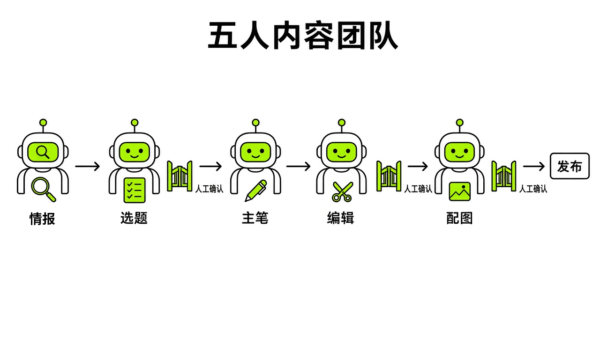
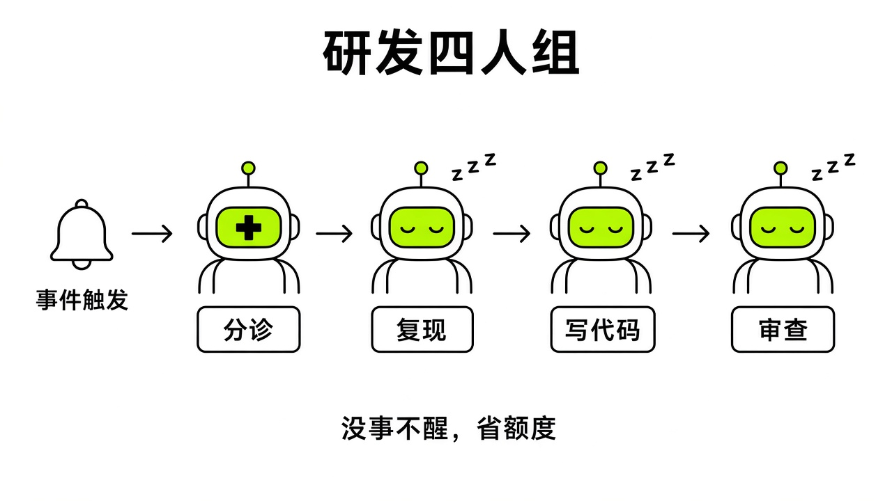
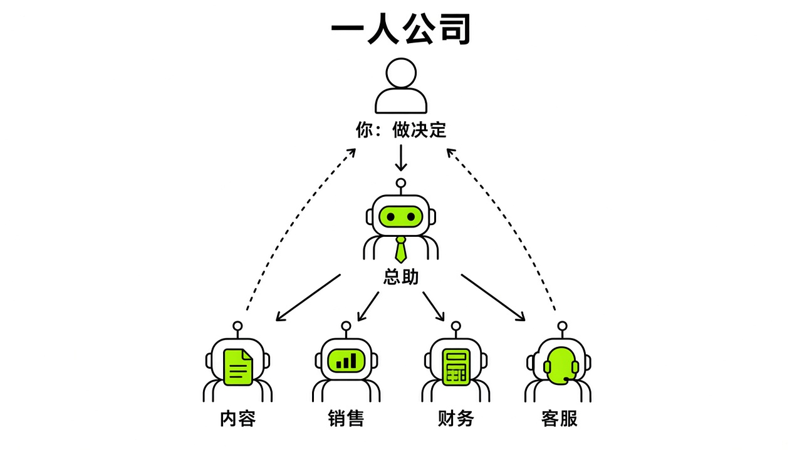
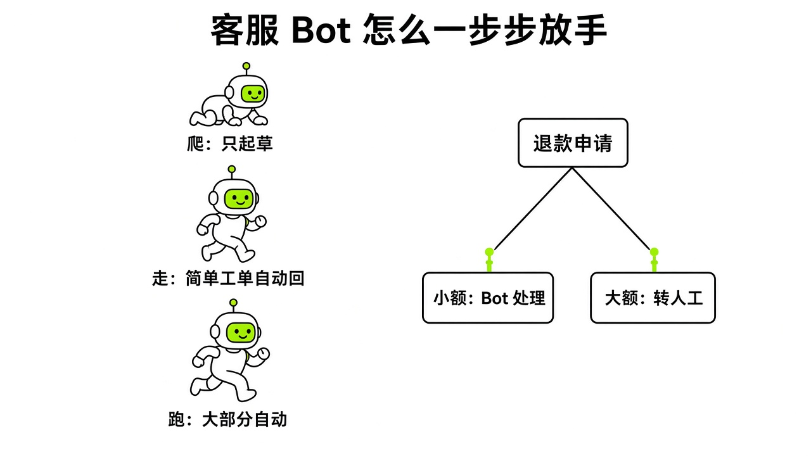

# §13 编制案例库 · Team Blueprints

[← 上一章：§12 群聊与交接 · Groups & Handoffs](../part4-multi-bot/12-groups.md) ｜ [📖 返回目录](../../README.md#-目录) ｜ [下一章：§14 个人与生活 · Personal & Daily Life →](../part5-use-cases/14-personal.md)

---

我调研社区讨论时发现，新手组建多 Bot 团队最容易踩的坑，就是以为只要把几个 Bot 拉进群、随便丢一句提示词，它们就能像人类员工一样自动把事办好。结果往往是 Bot 之间互相客套、疯狂刷屏，几分钟就撑爆上下文，最后连初始任务是什么都忘光了。Kin 橙皮书里提过 Alex Finn 的五人舰队，但那属于二手转述，既没给官方配置依据和用量成本核算，还建议用内网穿透反向控制主机，完全忽视了共用云电脑环境下的安全边界。

多 Bot 协作不是角色扮演，而是岗位工程。官方设计文档明确写着，每个群聊最多 6 个 Bot【官方】（https://x.ai/news/designing-grok-bot ）。把一群自主 Agent 放在一起，必须有明确的岗位说明书、事件驱动机制和权限门禁。这一章我梳理了中文自媒体实测、真实开发组争议、一人公司业务线以及官方标杆案例，把这四种编制架构、成本陷阱和安全防线拆开来看。

## 13.1 五人内容团队（小红书/公众号/抖音）· Content Team

做中文自媒体的人最先尝试多 Bot 协作。掘金作者迷城在实测中记录了他搭建 7 个自媒体 Bot 的过程【社区】（https://juejin.cn/post/7682695577956483091 ）。他指出，给 Bot 写设定不能只写一句身份，得写成包含身份记忆、核心使命、关键规则、工作流程和成功指标的岗位说明书。迷城拉了个名为“自媒体创作团队”的群聊让 Bot 各司其职，并通过命令行安装 OpenCode CLI 1.18.25 调度外部代码能力。不过他文章里认为“只有高配套餐才包含 Grok Bot”并不准确，官方帮助页写明 Cursor Pro/Pro+/Ultra 都可用 Grok Bot，另可关联 SuperGrok/X Premium+ 等 xAI 订阅【官方】（https://cursor.com/help/grok-bot/plans ）。

七七行銷筆記在视频实测中展示了一支五人社媒内容小队【社区】（https://ytget.cc/entry/grok-bot-five-ai-team-x-account 原片 https://www.youtube.com/watch?v=Z3ghSHtu8dk ）。他在群里发了一句“安排本周内容”，总经理由此拆解任务。实测里第一版选题太偏，去讲大语言模型校对，脱离了大众关注点。创作者没逐个找分析师或文案重说，而是直接在群里给总经理提了三点要求：选题要有大众热度、分析师要贴合账号定位、文案必须从具体场景切入口语化表达。总经理随后要求下属重新修改并再次交付。这说明内容团队的主脑不能只是传话筒，提示词里必须赋予它退回修改与质量验收的权力。

觉醒AI 在小红书团队工作流实录中总结了三道硬门禁【社区】（https://www.jxxy.net/ai/articles/grok-bot-xiaohongshu-team-workflow/ ）：外部源文只认人类给的原始链接，数据核算只认本地生成的报告，**发布权与终审权永远留在人手里**。他们把媒体团队拆成情报侦察、选题策划、内容主笔、事实编辑和数据复盘五个岗位【社区】（https://www.jxxy.net/ai/articles/AdrianPunk115-2097311704547987756/ ），把账号风格调性、选题终稿和违禁词规则全部落盘到云电脑的 `/workspace/learn/*.md` 路径下【社区】（https://www.jxxy.net/ai/articles/grok-bot-workflow-training/ ），让所有 Bot 每次生成时对照文件，而不是对照上一轮的聊天记录。

象鱼工作流在总结国内平台用例时提醒了操作边界【社区】（https://xiangyugongzuoliu.com/grokbot-use-cases/ ）：国内自媒体平台没有官方插件，公众号阅读与完读数据不在公开页面，需要人工导出后台数据，或者让 Bot 读取已经登录后台的浏览器窗口。而且平台对高频点击和自动化操作很敏感，定时频繁刷新会触发风控，最终的发布、点赞和私信沟通必须留在手机或客户端上由人工完成。

综合这些实操案例，我梳理出一套五人中文内容团队的标准编制。五个专职 Bot 各司其职：总编兼协调官负责接收人类目标、拆解排期并把关各环节交付物；情报侦察员只读抓取公开行业动态与 X 热门话题，输出结构化事实；主笔负责写微信公众号深度长文、小红书图文文案或短视频口播脚本；视觉排版员输出结构化 Markdown 与配图描述；质检员核对敏感词、核实数据出处，给出退回或放行建议。

> [!NOTE]
> 📸 **截图位（待补）**：在 Grok Bot 中建立自媒体创作群聊并配置 5 个专职 Bot 的侧边栏列表


*图：五人中文内容团队的分工协作流水线与三道人工硬门禁*

总编 Bot 的核心系统提示词必须设好拦截机制：

```text
你是一个 5 人中文内容团队的总编辑。
群内成员包含：@情报侦察、@平台主笔、@视觉排版、@内容质检。

你的核心工作职责：
1. 接收人类提出的选题方向或目标，将其拆解为具体任务派发给对应角色。
2. 调度顺序：情报侦察输出事实简报 -> 平台主笔撰写文案初稿 -> 视觉排版生成图文排版草稿 -> 内容质检核查事实与敏感词。
3. 严格执行质量把关：如果质检未通过或初稿偏离要求，必须直接指出具体问题并要求对应 Bot 修改，严禁未经检查直接将下属的半成品递交给人类。
4. 遵守硬性安全规则：严禁在任何第三方自媒体平台执行自动登录、自动发布或私信操作；所有最终成果必须以 Markdown 文本与配图建议的形式提交，等待人类最终审核。
```

在成本和配额上，群聊消息具有全员广播特性。五人团队如果频繁在群里对话，上下文会飞速膨胀。社区用户反馈，Cursor 个人订阅下的高频交互会导致周额度快速耗尽。所以内容团队必须执行“安静交接”原则：非必要不艾特全员，只在交接节点传递最终结构化结果。

> [!TIP]
> 🧪 【实测·TODO待实测】：在微信公众号后台由 Bot 提取阅读数据并与本地排版草稿进行核对。

## 13.2 研发组（Lead/Dev/QA/Ops）与反对意见 · Dev Team

在研发场景下组织多 Bot，社区里存在激烈争论。V2EX 开发者 diudiuu 分享过他为开源模型采集项目搭建的数字员工开发流程【社区】（https://www.v2ex.com/t/1241365 社区帖称……个例）。他的流水线由项目管理工具 Linear 触发，任务自动进入 TPS 开发主群。群内固定配置了 Lead、Dev、QA、Ops 四个 Bot，最终在 GitHub 仓库成功实现了自动提交并合入拉取请求【社区】（https://github.com/adiudiuu/tps/pulls?q=is%3Apr+state%3Aclosed ）。

在这个体系里，Lead 负责在检测到新 Issue 时把标题和链接同步进群，严禁自主盲目认领或定时轮询；Dev 负责对照需求写代码修改模型数据并提交 Pull Request；QA 对照 Issue 和拉取请求跑测试，保留操作步骤和截图；Ops 负责构建、部署和回滚，记录完整的命令行日志。整个流程有一条铁律：**代码规范与职责边界只认仓库里的 AGENTS.md**。所有的循环任务由 Linear 自带的周期机制推送到群内，完全不让 Grok Bot 在后台轮询。

这个方案在 V2EX 引来了同行质疑。用户 @ThisDay 批评，搞这种人设聊天群纯粹是浪费 Token 和撑爆上下文，单凭一个编程智能体的子代理机制就能搞定；用户 @jsdi 指出多 Agent 协作极其复杂，绝大部分场景根本不需要，群聊模式中看不中用；用户 @kiliter 认为多智能体在实际开发中更像自嗨，一句话就能指挥模型完成修复、测试与发版，拆成多个智能体呼来唤去反而增加管理负担；用户 @fanfou 从架构分析，群聊点对点消息让上下文极度混乱，远不如具备领导者、任务看板和收件箱的主从架构可控；用户 @syyyyy 则直言群聊额度消耗太快，一天半就会用光周配额。

面对这些批评，diudiuu 回应说，单人处理单个简单需求确实一句话搞定，但要跨多个代码仓库维护日常更新、每天产生大量琐碎 Pull Request 时，固定角色能把任务流转规整化，人不用陷进每个修改细节去排查原因。

官方工程师 Lingxi Li 在 Galaxy 大会工程专场的分享也印证了类似的分工思路【官方】（团队成员演讲，https://youtu.be/zCqmTSF2ctg ）。在官方实践中，Bot 团队每天凌晨 3 点扫描代码仓库排查代码质量隐患，早上统一提交 Pull Request。团队只允许使用云端编码 Agent，合并代码的最终权力必须牢牢由人类掌控。为了解决模型自主验证时的虚假汇报，他们开发了 verify 系列验证技能，要求 Bot 通过运行实际测试命令、保存终端日志、提取退出码和网页截图来提供客观证据，严禁无人看管的死循环。

> [!NOTE]
> 📸 **截图位（待补）**：Linear Issue 触发后 Lead 将任务同步进 TPS 开发群并关联 GitHub PR


*图：研发四人组流水线与规避上下文膨胀的防空转事件驱动架构*

想让研发四人组不变成烧额度的闲聊群，关键是掐断 Bot 之间的无效对话。提示词可以这样写：

```text
你是 TPS 开发群的技术主管 Lead。
群内协作 Bot 包含：@Dev、@QA、@Ops。

执行规则：
1. 接收到 Linear 任务后，向开发群输出任务摘要与链接，指定 @Dev 认领。
2. 禁止任何闲聊、感谢或不必要的中间状态确认。
3. @Dev 编写代码并提交 PR 后，通知 @QA 运行测试套件。
4. @QA 必须输出包含测试通过命令和截图的报告；测试通过后通知 @Ops 生成部署构建预览。
5. 最终合并操作必须由人类在 GitHub 网页端手动点击批准，严禁任何 Bot 尝试自动合并到主分支。
```

> [!TIP]
> 🧪 【实测·TODO待实测】：在开源仓库中由 Dev 自动根据 issue 开 PR 并由 QA 运行 Playwright 留下测试截图。

## 13.3 一人公司 / 一条业务线（Milo）· Solo Business

单人创作者或小型创业者经常想靠 Bot 独立维系一条完整业务线。X 社区用户分享过名为 Milo 的全托管 Bot 案例【社区】（https://x.com/i/status/2109152147325796381 社区帖称……个例，作者自述，效果未核实）。该用户设了一个专职 Bot 运营 AI 工具目录网站。Bot 盯紧社交媒体公告帖下的回复，全天候根据用户反馈自动提交 Pull Request，自主添加了 7 个以上的功能模块，每隔 15 分钟推送一次业务分析数据，主动提交搜索引擎收录优化，甚至试图自主联络赞助商。

仔细审视 Milo 这类模式，背后藏着巨大的运行成本与失控风险。社区用户 @fleyta88 算过 Routine 运行成本【社区】（https://x.com/fleyta88/status/2109346840382415019 ）：每 5 分钟轮询一次的高频任务，一个月将执行 8640 次，按 API 估算消耗高达约 397 美元；如果改用检查变更指纹的轻量检测，成本能降到约 45 美元。Milo 每隔 15 分钟做一次全量推送，如果长期无人监管，很快就会烧尽用量额度。而且让模型自主寻找赞助商和对外商业沟通，缺乏人工审核环节，很容易产生虚假承诺甚至合规事故。

官方产品指南中 Eric Zakariasson 给出了更克制也更实用的编排模式【官方】（团队成员指南，https://x.ai/bot/guides/how-i-run-multiple-teams-of-grok-bots ）。他为每个项目分别建立一个 Grok Bot 侧边栏频道和 Notion 数据库，将团队结构固定为项目与任务两张表，并设立了一个项目经理 Bot 专门负责更高层级的项目开辟与资源协调。

Zakariasson 制定了三条关键编制规则：第一，优先复用已有的功能 Bot，比如已有的代码员或研究员；第二，除了项目经理之外，每个项目频道最多提议 5 个 Bot，将单个频道内的成员总数严格控制在 6 个以内；第三，只有在现有人员完全无法胜任且经过人类明确同意后，才允许新建特定领域的专用 Bot。当任何 Bot 在执行中遭遇阻碍或需要关键决策时，**遇到阻塞必须标记 Blocked 并停下等待人类输入**。人类可以在 Notion 看板上看着卡片流转，只在出现阻塞时进入群聊介入。

这种分层治理思路与官方内测期涌现出的总助模式完全一致。Grok 团队成员 Roman Ugarte 提到，Chief of Staff 模式在团队内测第二周就自然产生【官方】（团队成员访谈，https://www.youtube.com/watch?v=maSdsTLaMuU ）。Claire Vo 同样在实践中利用总助 Bot 统一过滤收件箱、日历与通讯软件信息【社区】（https://www.youtube.com/watch?v=QBmgF1kJSK4 ）。一人运营一条业务线的健康结构，是让人类只与顶层的总助或项目经理对接，由主脑向垂直执行 Bot 下发指令，底层 Bot 专注调用工具，避免让所有 Bot 同时与人类对话产生严重的信息噪音。

> [!NOTE]
> 📸 **截图位（待补）**：Notion 中的 Projects 与 Tasks 数据库配合 Projects Manager Bot 协同状态


*图：一人公司的分层架构：人类决策者、总助中枢与垂直业务线 Bot*

项目经理 Bot 协调 Notion 看板的提示词可以这样写：

```text
你是一个负责多项目推进的项目协调中枢 Project Manager。
你在 Notion 中管理两个数据库：Projects 和 Tasks。

你的运行原则：
1. 每个新项目建立独立的项目频道，频道内除你之外最多配置 5 个专职执行 Bot。
2. 调度原则：优先分配已有专职 Bot，严禁未经人类许可随意生成新 Bot 实例。
3. 状态管理：实时监控 Tasks 数据库中的任务状态；一旦执行 Bot 缺乏凭证、遇到报错或需要业务决断，将其任务状态变更为 Blocked，并在频道内艾特人类管理者。
4. 任何对外联系、发布上线与资金变动动作，必须生成草稿并在人类解除 Blocked 状态前保持暂停。
```

> [!TIP]
> 🧪 【实测·TODO待实测】：在 Notion 任务看板中配置 Blocked 状态监听并由 Bot 自动向群聊推送阻塞预警。

## 13.4 采购 Haggle Bot、客服 Bot 团队（官方案例）· Official Cases

在涉及真金白银的企业级场景下，多 Bot 编制必须具备极其严密的安全与权限边界。官方披露了两个内部严苛验证的标杆案例：采购谈判 Haggle Bot 与客户支持 Bot 团队。

采购场景中，官方披露 Haggle Bot 帮助企业实现了超过 100,000 美元的直接成本节省【官方】（https://x.ai/news/grok-bot-procurement ）。在真实案例中，一笔金额为 14,629 美元的科技采购单，经由 Haggle Bot 多轮谈判比价，最终被压缩至 6,143 美元，降幅达到 58%，价格谈定后交回 Amazon Bot 下单。官方提供了该 Bot 模板（原文链接 /bot/marketplace/bots/haggle-bot；Marketplace 已于 9 月底改为 Connect Apps，模板入口移到网页端【官方】（https://x.ai/changelog/bot ））。

Haggle Bot 之所以没出事故，核心在于官方在系统提示中确立了三档权限红线架构。在具体落地中，**把写操作和资金退款严格锁定在三档权限内**。第一档是允许自主执行的内部动作（如查用量、比市场价，具体由模板使用者填写）【推测】；第二档是每次都必须人工批准（Needs explicit go），官方模板举的例子是"任何发给供应商的消息"；第三档是绝对禁止执行（Never），比如签署合同、购买或订阅、批准扣款等任何有约束力的承诺；另外绝不向供应商透露用量数据、席位数、内部项目、时间紧迫性或"已决定续约"。

官方公开的提示词模板要求 Bot 用 TODAY/SAVE/REC/NEXT 四段格式汇报，下面是按官方给出的"强发现"示例（视频会议软件 10/14 续约、210 席中 74 席闲置 90 天、缩到 150 席约省 $18k/年）改写的中文版【官方】：

```text
TODAY: 视频会议软件将于 10 月 14 日到期续约。
SAVE: 管理日志显示当前购买了 210 个席位，其中 74 个席位已闲置超过 90 天。续约时缩减至 150 席，预计每年可节省约 18,000 美元。
REC: 建议以此为筹码向销售代表要求老客户阶梯折扣。
NEXT: 等待采购负责人确认还价邮件草稿，批准后由 Bot 代为发出。
```

在客户支持领域，官方披露其客服 Bot 团队在工单处理量激增 175% 的前提下实现了零新增客服人手【官方】（https://x.ai/news/grok-bot-customer-support ）。传统 AI 客服工具按每次解决收费 1 到 4 美元，而他们经过小幅优化后，单票成本可低至 0.20 至 0.30 美元。在整个退款流程中，99% 的退款请求实现了无需人工干预的自动化处理。对于复杂或存在争议的对话，系统设定了硬性熔断：一旦与用户的对话来回超过 3 次，立刻无条件自动升级至人工管理层处理；每天由 Bot 对超过 20,000 条用户反馈进行聚类分析并同步给工程团队。

官方在客服团队的部署中推行了“爬行、步行、奔跑”三阶段落地法则。在最初的爬行阶段，Bot 接入工单工具 Plain 与任务系统 Linear，但只能撰写内部备注，任何对客户的回复与修改都必须由人类坐席人工确认；在步行阶段，团队引入运行追踪与效果评估机制，第一天先让人工针对最简单直观的常见工单进行复核，核实质量无误后当天放开自动直回；在奔跑阶段，团队引入超过 100 万条历史对话沉淀服务语气，实现 Bot 之间互相巡检纠错，并自动关联 X 社交媒体上的舆情监测。

Galaxy 大会客服专场上，David Gan 展示的 FlyLo 虚拟航空客服团队进一步将职责细化为四个协作 Bot【官方】（团队成员演讲，https://youtu.be/BSB--jUnx9U ）：Reply 负责对照政策直接回复工单并在支付网关 Stripe 执行小额退款；Tune 负责从日常客服真实对话中提取新问题并向公开知识库提交修改；Alert 负责盯紧服务异常日志并推送到 Slack；Build 负责处理周边集成构建。

FlyLo 的业务逻辑设立了严格的策略分流：在规定政策窗口内，直接自动执行 20 美元的全额退款；超出 20 天的申请，Bot 明确拒绝退款并自动变更为账期结束时取消订阅。如果遇到公开 FAQ 缺失的冷门问题，Reply 会主动将置信度调低并转交人工，同时触发 Tune 撰写新 FAQ 条目；知识库更新前必须经过人工 A/B 测试确认，更新生效后 Reply 才会对类似工单恢复高置信度的自动处理。如果遇到处于系统抑制名单中的异常邮件地址，Bot 会如实汇报报错，绝不盲目重试。

> [!NOTE]
> 📸 **截图位（待补）**：Haggle Bot 扫描供应商闲置席位后生成的 TODAY/SAVE/REC/NEXT 采购谈判卡片


*图：官方客服 Bot 团队的 crawl-walk-run 演进路线与退款分流决策树*

> [!TIP]
> 🧪 【实测·TODO待实测】：在沙箱环境中复现三档权限下的供应商席位闲置审计与还价邮件草稿生成。

从这四个典型编制中可以看出，无论是自媒体内容组、代码研发组、一人业务线还是官方采购客服组，多 Bot 能够跑通的核心绝不是让模型自由发挥。关键是建立明确的触发条件、落实防空转的事件驱动架构、坚守草稿优先与权限分级，并设立随时可以由人类接管的断路器机制。

---

[← 上一章：§12 群聊与交接 · Groups & Handoffs](../part4-multi-bot/12-groups.md) ｜ [📖 返回目录](../../README.md#-目录) ｜ [下一章：§14 个人与生活 · Personal & Daily Life →](../part5-use-cases/14-personal.md)
