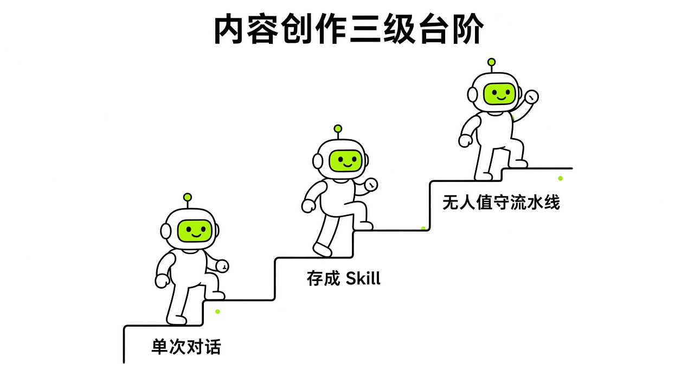
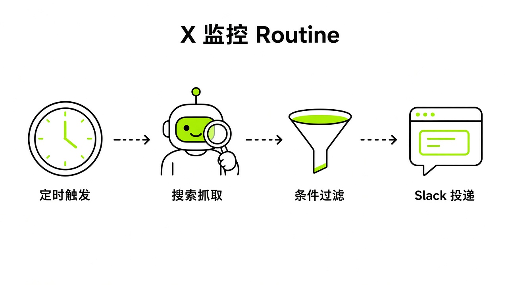
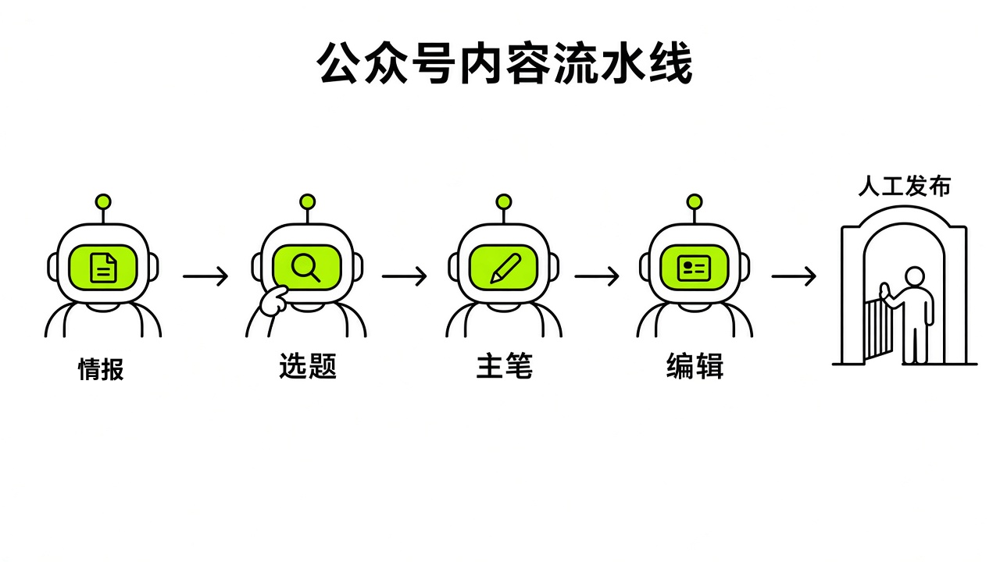
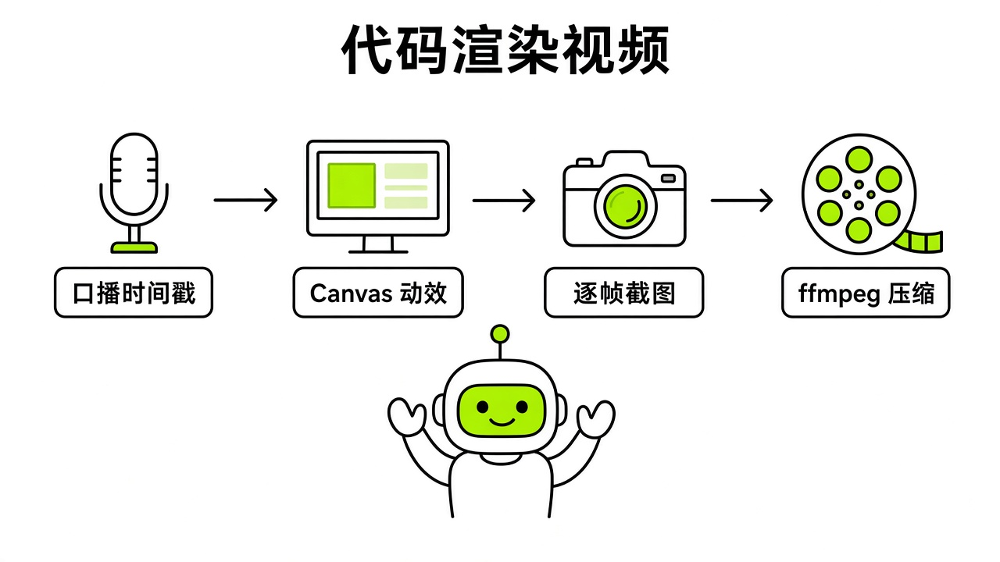
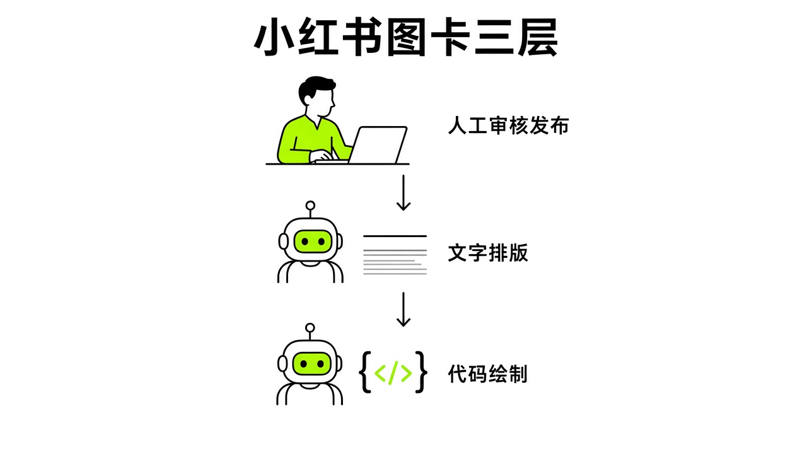

# §15 内容创作 · Creators

[← 上一章：§14 个人与生活 · Personal & Daily Life](../part5-use-cases/14-personal.md) ｜ [📖 返回目录](../../README.md#-目录) ｜ [下一章：§16 赚钱与工作 · Work & Business →](../part5-use-cases/16-business.md)

---

很多人把 Grok Bot 当成另一个网页聊天窗口，每次想发内容就打开它问一句帮我写条推文。这种用法把它的后台例程和云电脑完全浪费了。我调研发现，做内容创作时，Grok Bot 真正的分水岭不是文笔，而是你从亲自干活的作者变成了调度流水线的**责任主编**。

> **适合谁**：做 X、公众号、小红书、短视频的个人创作者。15.1 需要 X 账号，例程示例把结果推到 Slack（没有 Slack 就把"Send it to me on Slack"改成"在对话里告诉我"）；15.3 涉及脚本和命令行，零代码读者可以只看思路，把提示词整段交给 Bot 去执行。



*图：内容创作从单次对话到无人值守流水线的演进路径*

### 15.1 X 监控 4 个 Routine · X Monitoring Routines

#### 场景
做内容天天自己刷推特找素材，效率太低了。2026 年 10 月 8 日，官方宣布 Grok Bot 原生支持搜索、阅读和监控 X（https://x.com/bot/status/2107949161878606089）。早在 8 月 30 日官方就宣布：关联 X 账号后，系统会自动创建开发者账户并附带一些初始额度（https://x.com/bot/status/2093822274067706170）。有了这个能力，就能让 Bot 充当全天候雷达。
Rowan Cheung 基于这次更新设计了 4 个监控例程（https://x.com/rowancheung/status/2108328114552000842）：挖别人在跑的真实 AI 工作流、盯自己品牌的提及和口碑、抓竞品品类里的潜在客户痛点，以及跟进刚加的新人脉。我看他的例程，结构写得很死：卡死时间和时区、限定时间窗口、写清过滤规则、定死输出字段、绑好 Slack 投递，严格禁止私自跟外界互动，没抓到结果时也有单行兜底。

进入 2026 年 10 月中下旬，社区与官方进一步把 X 监控进化成了全链路双语运营、私信分拣与跨平台改写系统：
1. **24 小时中美时差双语 X 运营工作流（`@sisiliu517`）**：创作者 siyuan liu（`@sisiliu517`，2026-10-15，https://x.com/sisiliu517/status/2110869965612183642）利用小时级 Routine 配合中美时差策略，搭建了日夜轮转的双语运营体系——**白天时段主攻中文 X 圈层互动与发帖，夜间时段自动切换为英文 X 圈层运营**。每天深夜，Bot 还会自动拉取当日帖子表现生成一份互动数据复盘报告，直接反哺并迭代次日的选题方向与高优回复目标账号列表（High-priority reply targets）。
2. **`@chat` 端到端加密私信与陌生人消息请求自动分拣（`@pjvann`）**：2026 年 10 月 16 日，X 与 Grok Bot 工程师 Paul Vann（`@pjvann`，1,069 赞 / 108 转发 / 132 书签，https://x.com/pjvann/status/2111104660773687646）宣布 Grok Bot 正式打通 X 的 `@chat` 端到端加密私信收件箱与陌生人消息请求（message requests）。底层通过沙箱克隆官方解密辅助库（https://github.com/xdevplatform/xchat-grokbot-helper）并配合用户 4 位数字 X Chat PIN 码在本地解密。`@pjvann` 分享了自己整周让 `@bot` 自动审查陌生人私信请求、过滤垃圾营销、批准高价值合作私信并起草回复草稿的真实工作流。
3. **Personal 𝕏 Assistant 与 Content Repurposer 爆款多平台分发（`@milesdeutscher`）**：Miles Deutscher（`@milesdeutscher`）在其获 3,100 赞、4,503 书签的“10 大逆天 Grok Bot 用例”长推（https://x.com/milesdeutscher/status/2113653680834859262）中，公开了两套创作者核心打法：
   - **#10 Personal 𝕏 Assistant（个人 X 运营副驾）**（72 赞，https://x.com/milesdeutscher/status/2113653710631166414）：集个人品牌研究员、黄金开头（Hook）专家与每日初稿写手于一身，根据账号过往高赞推文的语感与结构，每日自动生成待发推文草稿。
   - **#5 Content Repurposer（一鱼多吃跨平台内容改写器）**（34 赞，https://x.com/milesdeutscher/status/2113653788196430242）：自动抓取 X 平台上的爆款异常值（outlier）帖子，调用自定义 Agent Skills 将其一键改写为适配 LinkedIn 专业长贴、邮件通讯（Newsletter）与短视频口播脚本的多平台版本。

#### 提示词
例程 1：抓取真实 AI 工作流
```text
Every weekday at 9:15am in my time zone, search X and the web for new AI workflows people are actually running. Keep only cases that name the old task, the tool, and the result: time saved, a step removed, or a handoff that used to need a person. Drop product announcements, "10 prompts" threads, and anything the author has not used more than once. Return at most 3. For each, give the link, the job it replaces, what I would need connected, and whether it fits my work. Send it to me on Slack. Do not post or reply anywhere else. Save this as a routine. If nothing qualifies, send one line saying so.
```

例程 2：品牌提及监控
```text
Every weekday at 9:00am, search X for mentions in the last 24 hours of [your brand, @handle, or your own name]. For each hit, give the author, link, a one-line summary, and whether it is praise, complaint, question, or neutral. Do not reply to anyone. Post the digest in [your Slack channel] and tag me. Save this as a routine. If a source is unavailable, say which one.
```

例程 3：潜在客户监听（每 4 小时）
```text
Every 4 hours, search X for people evaluating [your category]. Catch three things: reviews or complaints about [category]; posts asking which [category] to use; and complaints about the problem [your product] solves. Quote the post, link it, name the account, and label it review, shopping, or complaint. Skip anything older than 24 hours, and skip [category] accounts promoting themselves. Post to [your Slack channel] only if there is at least one new hit you haven't already shared. Do not reply to or interact with anyone. Save this as a routine. If the search fails, report the failure in Slack.
```

例程 4：新联系人跟进
```text
Every weekday at 8:30am in my time zone, read my address book and list contacts added in the last 14 days. For each, show name, date added, phone, email, and any note. Ask me what we talked about before you write anything. Once I reply, draft a follow-up task for each person in [your task tool] with the context attached. Never text, email, or call anyone. Save this as a routine. If the address book is unavailable, say so and do not use old data.
```

例程 5：24 小时中美时差双语 X 运营与晚间复盘（参考 `@sisiliu517` 范式）
```text
You are my bilingual X operations manager running on a 24-hour US-China timezone cycle:
1. Daytime (09:00–21:00 UTC+8): Monitor Chinese AI & tech discussions on X. Draft 2 original Chinese posts and 5 high-value reply drafts to trending Chinese threads.
2. Nighttime (21:00–09:00 UTC+8): Switch to English X ecosystem. Monitor US tech leaders and AI builders, draft 2 English posts and 5 insightful English reply drafts.
3. Daily Review (Every night at 23:30 UTC+8): Pull metrics (impressions, likes, bookmarks, replies) of all posts and replies from the past 24 hours. Write a review report to /workspace/x-ops/reviews/YYYY-MM-DD.md, and update tomorrow's topic backlog and top 10 reply target @handles based on what performed best. Never publish posts or send replies without my explicit approval.
```

例程 6：Personal 𝕏 Assistant & Content Repurposer（参考 `@milesdeutscher` #10 & #5 范式）
```text
Every day at 08:00am, run a two-stage creator pipeline:
Stage 1 (Personal X Assistant): Analyze my top-performing X posts in /workspace/x-ops/winning-posts.md and today's trending AI news. Generate 3 high-converting hooks and complete X post drafts matching my personal voice.
Stage 2 (Content Repurposer): Identify the #1 outlier post (highest engagement-to-follower ratio) in my niche from the last 24 hours. Using my custom repurposing skills, rewrite its core insight into:
- 1 LinkedIn long-form post
- 1 Newsletter digest section
- 1 60-second short-form video script with visual cues
Save all outputs to /workspace/x-ops/repurposed/YYYY-MM-DD.md and send me the summary card.
```

#### Routine
官方规定每个 Bot 最多配 50 个 Routine，每个 Routine 保留最近 20 次运行记录，定时触发最小间隔仍为 5 分钟；自 v0.75.2（2026-10-22，https://x.ai/changelog/bot）起，官方将 Routine 的小时级运行频率限制大幅上调至**全账号所有 Bot 合计 300 次/小时（300 runs per hour across all Bots），单条 Routine 最高 200 次/小时（200 runs per hour for a single Routine）**（https://cursor.com/help/grok-bot/routines）。在这套监控里，工作流挖掘、品牌提及和人脉跟进排在每个工作日早上的固定时间（8:30、9:00、9:15），潜在客户监听设为每 4 小时一次，而双语时差运营与 `@chat` 陌生人私信请求分拣则可按早晚班次定时触发。时间一到，Bot 会唤醒云电脑，调 X 搜索接口或 X Chat 解密工具抓最近 24 小时的帖子与私信，去重过滤后通过 Slack 连接器把 Markdown 简报推到频道里。要是没抓到匹配内容，发一行说明就停，不吵人。

#### 成本
官方未公布单独搜索 X 的计费标准，Grok Bot 内置的公开 X 数据读取完全免费包含在订阅内（若通过 X 插件访问私有账号数据则依据 https://cursor.com/help/grok-bot/connect-apps 说明可能需要 `https://console.x.com` 的 X API 额度），所有模型交互都扣套餐自带的周额度（https://cursor.com/help/grok-bot/plans）。自 2026 年 10 月 18 日官方推出 **The X Subscription 三合一统一订阅**（https://cursor.com/help/the-x-subscription/overview 与 https://x.com/bot/status/2110063783796572496）后，**Premium（$30/月）**、**Super（$100/月）** 与 **Ultra（$200/月）** 档位均包含 Grok Bot（Free $0 与 Plus $8/月不含），且 **Grok Bot、Grok 与 Cursor 三端共享同一个周额度池（one weekly usage pool）**，超额用量改为从 `grok.com/dashboard/billing` 充值的 **Prepaid Credits（预付额度）** 中扣除；既有独立 Cursor Pro（$20/月）、Pro+（$60/月）、Ultra（$200/月）与 Teams（$40/人/月）老订户若不主动切换仍可保留原计划，但一旦在 `cursor.com/unify` 切换至 The X Subscription 即为单向不可逆。
社区有人算过一笔账，要是设成每 5 分钟跑一次 Routine，一个月触发 8,640 次，能把一个 33 美元的活烧成 397 美元（个例）（@fleyta88 https://x.com/fleyta88/status/2109346840382415019）。`@charlie_pmp`（https://x.com/charlie_pmp/status/2114214503416271131）也专门提醒：在三合一订阅三端共用周额度池的背景下，高频且未加精简的冗余 Routine 是后台静默吞噬额度的头号杀手。社区帖称在 Cursor Pro 订阅下，单条交互消息大约消耗 1% 周额度（个例）（@miniyarov https://x.com/miniyarov/status/2105428357273800799）。Rowan Cheung 把大部分监控设成每天跑一次，请求频次就压得很低。
成本实测状态：测定 4 个 Routine 在 Cursor Pro 或 The X Subscription Premium（$30/月）订阅下连续运行一周消耗的周用量百分比。

#### 坑
第一个坑是**禁止动作缺失**。提示词里要是没写死禁止私自发帖、回复和私信，Bot 可能会擅自去跟搜出来的推文互动，弄不好就封号甚至搞出公关事故。
第二个坑是后台审批超时。官方文档写明，后台或其他 Bot 触发的审批卡大约 10 分钟就会过期显示 Expired，动作就不执行了（https://cursor.com/docs/grok-bot/security）。第四个跟进例程起草任务前要等你回复，要是 10 分钟没理它，这一轮流程就中断了。
第三个坑是没搜到结果时的幻觉。要是没规定搜索落空怎么办，Bot 会为了交差拼凑旧消息甚至硬编推文。必须在提示词最后加一句，没结果就回一行单行说明。
第四个坑是例程空转。每天准时推的早报要是两周都没人看，额度就全打水漂了。社区经验指出，例程本身不是产出，能帮你做决定的例程才有价值，没产出的例程要及时删掉（https://x.com/kocer_eth/status/2101669438038634827）。

> [!NOTE]
> 📸 **截图位（待补）**：Grok Bot 中配置完成的 X 监控例程界面与 Slack 接收到的摘要通知


*图：X 监控 Routine 从搜索抓取、条件过滤到 Slack 投递的单向数据流*

### 15.2 公众号选题与日推 · WeChat Official Account Topics and Daily Pushes

#### 场景
做微信公众号有个现实问题：Grok Bot 没有任何国内平台的官方插件（https://xiangyugongzuoliu.com/grokbot-use-cases/）。后台的阅读量、完读率和用户画像全是非公开数据，公开网页抓不到，只能靠手动导数据或者提供材料。
觉醒AI 的 Adrian Punk 和 yvchengshanren 摸索出了一条自媒体流水线（https://www.jxxy.net/ai/articles/AdrianPunk115-2097311704547987756/ 与 https://www.jxxy.net/ai/articles/grok-bot-xiaohongshu-team-workflow/）。千万别指望建一个全能 Bot 搞定全部，那只是把找材料、写初稿和审校的堵点全堆在同一个窗口里。他们的做法是在云电脑 `/workspace/content-team/` 目录下按流程建文件夹，分出情报侦察员、选题策划师、内容主笔、事实编辑四个专职角色，靠文件传递交接。社区创作者夏哥研究室（`@CyberAlice3269`，2026-10-19，https://x.com/CyberAlice3269/status/2112098767151468645）与 0xbitman（`@bitman2140`，2026-10-25，https://x.com/bitman2140/status/2114210291546493153）也验证了类似的“1 个 CEO Bot + 5 个专职 Bot（情报搜集、选题策划、初稿撰写、审校润色、配图制作）”自媒体工作室与微信公众号日更流水线。
跑这条线要守住**三道硬门**：输入的源文必须来自人工指定的公开链接或一手文档，禁止 Bot 翻不可信的二手谣言；专业数据必须来自真实的测试报告，禁止 Bot 自行瞎编；最终的排版入库和发布按钮必须由人工手动点击，绝不下放给 Bot（https://www.jxxy.net/ai/articles/grok-bot-xiaohongshu-team-workflow/）。

在 `01-inbox/` 一手选题素材的高效、低成本采集上，两位中文社区创作者给出了极具启发性的高阶范式：
1. **“AI 写确定性爬虫，脚本跑日常轮询”零额度抓榜法（`@StarkLJM`）**：Mr.鼓先生（`@StarkLJM`，2026-10-18，https://x.com/starkljm/status/2111803996734419377 及 2026-10-21 跟进帖 https://x.com/starkljm/status/2112818533797343312）指出，面对每天需要固定抓取的热门榜单或选题源，**绝不能让大模型每天开浏览器消耗 Token 去读网页**。他的做法是：先用 Cursor CLI 仅耗时 **28.6 秒**编写出一套确定性的 Python 爬虫脚本；此后每天定时运行该脚本，仅需 **1.99 秒**即可抓取完 30 条榜单数据，**日常运行消耗 0 模型额度（zero model tokens）**。为了防止脏数据污染选题判断，脚本内置了严格的防御性编程规则——一旦遇到上游字段缺失立即触发告警，且当源数据缺少评分时严格存入 `null`，绝不用 `0` 填充以免拉低均值计算。
2. **1Password 授权突破彭博社等海外付费墙抓深度研报（`@oxpsats`）**：公众号想要写出差异化深度长文，往往依赖海外一手付费信源。偶像派作手（`@oxpsats`，2026-10-25，https://x.com/oxpsats/status/2114207006064365670）将自己的彭博社（Bloomberg）付费会员账号存入 1Password 并授权给 Grok Bot（配合 v0.75.2 上线的 1Password Brokered Sign-in 逐次授权登录或共享库，详见 https://cursor.com/help/grok-bot/connect-apps），让 Bot 能够全自动登录突破付费墙（paywall），定时抓取海外核心财经深度报道并沉淀进选题收件箱。

#### 提示词
```text
你负责微信公众号的日常选题策划与推文初稿。工作路径严格基于 /workspace/content-team/ 共享目录。

【输入与依据】
1. 仅读取 01-inbox/ 中已核验的一手事实卡，以及 00-profile/voice.md 中定义的账号调性与读者画像。
2. 严禁自行联网搜索未经验证的二手谣言，严禁捏造行业数据、用户案例或未公布的技术指标。

【执行步骤】
第一步：从线索中筛选出 3 个选题 Brief，写入 02-briefs/YYYY-MM-DD.md。每个选题包含：一句话核心事实、读者业务痛点、切入角度、一手证据链接以及给主笔的写作要求。生成后停下等待人工批准。
第二步：收到人工明确批准后，将选定 Brief 扩展为一篇公众号推文初稿，写入 03-drafts/YYYY-MM-DD-title.md。

【写作规范】
1. 结构采用问题引入、技术原理拆解、实操步骤、踩坑提示四段式，语言平实口语化。
2. 严禁使用“在当今”、“革命性”、“赋能”、“颠覆”、“毫无疑问”等空洞套话。
3. 文中每处核心论点必须紧跟事实依据；未亲测内容显式标注为“待实测”。
4. 文末附带需要人工确认的事项清单与配图建议。完成后仅汇报文件路径。
```

附：`@StarkLJM` 零模型额度确定性抓榜脚本生成与防御性校验示例（保存在 `/workspace/content-team/scripts/fetch_rank.py`）：
```python
#!/usr/bin/env python3
"""
确定性选题榜单抓取脚本（日常运行 0 Token 消耗，~1.99s 完成 30 条记录采集）
防御性原则：核心字段缺失立即抛错告警；缺失评分严格记为 None (JSON null)，严禁用 0 污染均值。
"""
import json
import time
import urllib.request
from pathlib import Path

REQUIRED_KEYS = {"id", "title", "url"}

def fetch_top30_topics(api_url: str, out_path: Path) -> None:
    t0 = time.perf_counter()
    req = urllib.request.Request(api_url, headers={"User-Agent": "GrokBot-TopicFetcher/1.0"})
    with urllib.request.urlopen(req, timeout=10) as resp:
        payload = json.loads(resp.read().decode("utf-8"))

    items = payload.get("items", [])[:30]
    if not items:
        raise RuntimeError("ALERT: 上游榜单返回为空，请检查接口或反爬状态！")

    cleaned = []
    for idx, raw in enumerate(items, 1):
        missing = REQUIRED_KEYS - raw.keys()
        if missing:
            raise KeyError(f"ALERT: 第 {idx} 条记录缺失关键字段 {missing}，已中止入库！")
        # 严格区分无评分与 0 分：缺失评分存 None (null)，绝不填 0
        raw_score = raw.get("score")
        score = float(raw_score) if raw_score is not None else None
        cleaned.append({
            "rank": idx,
            "id": str(raw["id"]),
            "title": str(raw["title"]).strip(),
            "url": str(raw["url"]),
            "score": score,
        })

    out_path.parent.mkdir(parents=True, exist_ok=True)
    out_path.write_text(json.dumps({"fetched_at": time.strftime("%Y-%m-%d %H:%M:%S"), "count": len(cleaned), "items": cleaned}, ensure_ascii=False, indent=2), encoding="utf-8")
    elapsed = time.perf_counter() - t0
    print(f"OK: 抓取 {len(cleaned)} 条榜单记录，耗时 {elapsed:.2f}s，模型 Token 消耗: 0")
```

#### Routine
这个流程可以配成工作日早上的例程。先由系统 `cron` 在每天 08:25 零 Token 运行一次 `fetch_rank.py`，将 30 条结构化榜单写入 `01-inbox/`；随后设成每个工作日早晨 08:30 执行 Grok Bot Routine（在 v0.75.2 全账号 300 次/小时、单 Routine 200 次/小时的配额下绰绰有余，详见 https://cursor.com/help/grok-bot/routines），Bot 先看 `/workspace/content-team/01-inbox/` 目录下有没有前一天沉淀的事实卡、彭博社付费墙摘录与早间榜单。只要有材料，就自动提炼出当天的 3 个选题 Brief 存入 `02-briefs/` 目录。
人工在对话中选定并回复批准后，触发主笔 Bot 生成完整初稿。因为国内平台没有官方接口，Bot 把初稿写入 `03-drafts/` 后就会停下，通过微信下发渠道或系统提示通知。我们把 Markdown 复制到排版工具或公众号后台，自己人工点击发布。

#### 成本
所有 Bot 运行都消耗账户的统一周额度（https://cursor.com/help/grok-bot/plans）。在 **The X Subscription 三合一统一订阅**（Premium $30/月、Super $100/月、Ultra $200/月，https://cursor.com/help/the-x-subscription/overview）下，Grok Bot 与 Grok、Cursor 共享每周重置的周额度池，超出后扣减 Prepaid Credits（老订户仍可維持独立 Cursor Pro $20 / Pro+ $60 / Ultra $200 / Teams $40 计划，但经 `cursor.com/unify` 切换后不可逆）。Grok Bot 没有模型选单，也不显示每次请求的底层模型，所以别指望靠在界面里切便宜模型省额度（https://cursor.com/help/grok-bot/models，转引自 carlstack 额度文章）。不过，采用 `@StarkLJM` 的“确定性 Python 爬虫跑日常采集 + 仅在提炼 Brief 与写稿时唤醒 Bot”的架构，可将日常数据采集环节的周额度消耗直接降为 **0**。社区帖称 Pro 档每条消息约耗 1% 周额度（个例）（https://x.com/miniyarov/status/2105428357273800799）。一次完整四岗交接的额度消耗。
成本实测状态：测定公众号从线索汇总到成稿审校全流程单次消耗的周用量百分比。

#### 坑
第一个坑是模拟登录招来风控。象鱼工作流指出国内平台没有原生插件，如果在云电脑里用高频脚本刷新网页或模拟点击，容易触发平台的安全拦截甚至封号（https://xiangyugongzuoliu.com/grokbot-use-cases/）。切忌让 Bot 自动去公众号后台点发布，把发布权留在人类客户端。
第二个坑是主笔瞎编技术数据。主笔 Bot 写长文容易顺手编造出“性能提升 300%”或“某大厂全员采用”这类假数据。必须在角色描述和提示词里加上禁止项，要求所有数字必须追溯至真实材料，没有出处的数字一律不得写入（https://www.jxxy.net/ai/articles/AdrianPunk115-2097311704547987756/）。
第三个坑是共享云电脑带来的凭据泄漏风险。官方文档指出同一账号下的所有 Bot 共享同一台 Linux 云电脑、同一个浏览器登录态和同一个 `/workspace`（https://cursor.com/docs/grok-bot/work）。前一个 Bot 保存了私有凭据，其他 Bot 都能直接读取，切勿在云电脑环境中以明文存放主账号密码或私密会话凭据——对于彭博社等付费资讯站点的登录，强烈建议使用 v0.75.2 上线的 **1Password Brokered Sign-in**（https://x.com/bot/status/2113301060811161874）或 v0.75.5 上线的 **Grok Bot Vault**（https://cursor.com/help/grok-bot/secrets），让密码通过底层加密注入，使 Bot 上下文彻底接触不到明文密码。
第四个坑是口头纠错未落盘。觉醒AI 指出，你在对话里纠正 Bot 的错误时，Bot 经常回答“记下了”，但只要没把规则写入 `voice.md` 或技能规则文件，下一次新建会话它照样犯同样的错误（https://www.jxxy.net/ai/articles/grok-bot-workflow-training/）。

> [!NOTE]
> 📸 **截图位（待补）**：/workspace/content-team/ 目录下生成的选题 Brief 与主笔初稿文件


*图：公众号内容流水线分工：情报、选题、主笔、编辑与人工发布守门*

### 15.3 写代码渲染视频（ffmpeg） · Code-Rendered Video

#### 场景
在早期版本中，传统短视频制作要么靠剪辑软件拼素材，要么靠外部文生视频模型抽卡；而从 **v0.71.2（2026-10-14，https://x.ai/changelog/bot）** 开始，Grok Bot 迎来了视频创作能力的史诗级跃升——**不仅支持 FFmpeg 脚本压制，现已全面形成“Grok Imagine 原生生图/生视频（`GenerateImage` / `GenerateVideo`）+ Remotion / Blender / Canvas / FFmpeg 代码动效渲染”双剑合璧的完整视觉工作站！**

文生视频虽然画面逼真，但在数据图表、知识科普、产品演示和精确文字动效上根本对不齐节奏，改动一个字整段画面就会完全变形。因此，将 Grok Imagine 的生成式画面与纯代码驱动的确定性动效结合，成了最强大的解法。
早先 Leo Xiaolei 和 0xCarnagee 摸索出了一条纯代码渲染的视频管线（https://x.com/leo_xiaolei/status/2108159484401262882 与 https://x.com/0xCarnagee/status/2108501747643670780）：让 Grok Bot 编写基于 HTML Canvas 或 SVG 的前端动效页面，通过无头浏览器 Playwright 驱动 Chromium 逐帧截图，最后调用 ffmpeg 将连续图片与音频压制为竖屏 MP4 视频。
这套管线有两个核心支柱。第一是**放弃系统时钟**，页面暴露 `window.seek(t)` 纯时间函数，输入任意时间戳 t 永远渲染出完全一致的静态画面，粒子等随机特效采用 Mulberry32 算法锁定随机种子；第二是使用 edge-tts 生成配音并显式传入 `boundary='WordBoundary'` 导出词级时间戳，让口播念出的每一个字充当画面动效的时钟基准。

在此基础上，2026 年 10 月中下旬涌现出**四大极具代表性的官方与社区视频创作标杆案例**，彻底拓宽了 Grok Bot 视频工业化的边界：

1. **标杆案例一：`@bot` 官方原生生视频（Grok Imagine）与 Remotion 代码动效双官宣**
   - 2026 年 10 月 15 日，`@bot` 官方发布主帖 *"Your Grok Bot can now make videos"*（20,762 赞 / 1,923 转发 / 4,769 书签，https://x.com/bot/status/2110566041772617908），正式宣告 Bot 可直接调用内置的 `GenerateImage` 与 `GenerateVideo` 工具在聊天流中生成和编辑实拍感视频片段；紧接着同日发布续帖 *"And motion graphics with code"*（2,616 赞 / 211 转发 / 725 书签，https://x.com/bot/status/2110772748805194127），展示了在云电脑中用 Remotion / 代码直接渲染丝滑 UI 动效与动态信息图的官方范式。

2. **标杆案例二：`@StarkLJM` 通过 BDK 从本地 Claude Code 跨端派单渲染 20 秒《上下五千年》中国史动画（含 2.7 MB 源码包）**
   - Mr.鼓先生（`@StarkLJM`，2026-10-12，https://x.com/starkljm/status/2109544938644107411）实战演示了如何利用 **BDK（Bot Developer Kit / `cursor-grokbot-agents`）** 将本地终端里的 Claude Code / Codex 与云端 Grok Bot 打通。他在本地 Claude Code 中向云端 Grok Bot 下达了“制作一段 20 秒《上下五千年》中国历史线条画动画短片”的指令；云端 Grok Bot 在沙箱中独立完成朝代分镜绘制、时间轴动效编排与音画合成，直接向本地返回了渲染完毕的 `0:20` MP4 视频卡片以及 `2.7 MB` 的完整可复用源码压缩包。

3. **标杆案例三：`@pengzheng_` 检索 1908 年专利图纸并用 Python 驱动 Blender 渲染 3D 折痕铰链无缝循环动画**
   - Grok Bot 设计师 Peng Zheng（`@pengzheng_`，2026-10-24，204 赞 / 148 书签，https://x.com/pengzheng_/status/2113786630033322239 及补充帖 https://x.com/pengzheng_/status/2113804819274277015）分享了一个惊艳的 3D 工业级案例：为了弄清楚代表云电脑沙箱的经典中餐外卖折盒（`to-go` box 🥡）究竟是如何折叠的，他让 `@bot` 自主考证。Bot 先在全网检索并挖出了 **1908 年的原始专利图纸**，随后直接在云电脑里编写 Python 脚本驱动 **Blender** 建模——将纸盒的每一个折页严格沿着 1908 年专利图纸上的折痕线（crease lines）绑定为物理骨骼铰链（hinge），渲染出与 🥡 Emoji 角度严丝合缝的开合无缝循环 3D 动画，直接用作网页的 `og:video`。

4. **标杆案例四：`@LisaMAUSA` 的 SceneEdit Video Studio 单镜头局部修补工作流（免全片重渲）**
   - 针对代码渲染长视频“改一个镜头就要重跑几十分钟全片”的痛点，社区开发者 `@LisaMAUSA`（2026-10-25，https://x.com/LisaMAUSA/status/2114208018388643852）在响应 `@leerob` 的反馈悬赏帖（https://x.com/leerob/status/2113792409448714468）时开源了 **SceneEdit Video Studio** 模板：将整条视频按镜头（Scene）切分为独立时间段与缓存切片，当需要修改某几秒的画面或台词时，仅针对该单镜头调用 `GenerateVideo` 或重跑局部帧渲染，再通过 FFmpeg `concat` 无损流拷贝拼接回母带，彻底告别全片重渲。

#### 提示词
```text
你负责将指定的口播文案制作成竖屏（1080×1920、30fps）代码渲染动效视频。

【技术规范】
1. 动效页面 index.html 必须暴露 window.seek(t) 函数，仅依赖参数 t 计算元素属性与位置，严禁使用 setTimeout、setInterval 或 requestAnimationFrame。
2. 随机动效必须使用固定的 Mulberry32 随机种子，严禁使用 Math.random()。
3. 页面内所有文字必须使用代码绘制，严禁使用图像模型生成文字。
4. 标题与图表不得低于 y=1388，字幕带限制在 y=1400 至 y=1520，y=1520 以下保留底色以避开平台交互按钮。

【执行流程】
第一步：调用 edge-tts 生成配音并导出按词切分的时间戳文件 timing.json。
第二步：编写 HTML/Canvas 页面并生成关键静帧（stills at 0, 0.3, 0.6），停下等待人工审查。
第三步：人工确认静帧通过后，运行 render.py 截取全量帧，并运行 mix.sh 进行音频侧链闪避与响度归一化（母带达到 -14 LUFS，真峰值不超过 -1.5 dBTP）。
第四步：使用 ffmpeg 生成 4×2 时间码联系表 contact.png 并汇报。
口播文案：[在此填入口播文本]
```

附：结合 v0.71.2 `GenerateVideo` + Blender 3D + SceneEdit 局部热替换的进阶提示词模板：
```text
你负责在 /workspace/video-studio/ 下构建一条“Grok Imagine + 代码动效 + SceneEdit 单镜头修补”混合视频管线：
1. 素材分层：空镜与写实过场调用内置 GenerateImage / GenerateVideo（Grok Imagine）生成；数据图表、历史时间线与精确文字动效使用 Remotion / HTML Canvas 或 Blender Python（bpy）无头渲染。
2. 镜头模块化（SceneEdit 规范）：按镜头切片保存为 scenes/scene_01.mp4 ... scene_N.mp4，并维护 manifest.json 记录每个镜头的起止时间码、渲染脚本与哈希值。
3. 局部热替换：当收到“仅修改第 K 个镜头”的指令时，严禁重渲其他未改动镜头！仅重新生成 scene_K.mp4，校验分辨率（1080×1920）、帧率（30fps）与像素格式（yuv420p）一致后，使用 ffmpeg -f concat -safe 0 -i scenes.txt -c copy 快速合成最终成片，并打包源码与 MP4 交付。
```

#### Routine
为了避免白天交互时长时间占用云电脑资源，可以将渲染包装为夜间渲染队列例程。
在 `/workspace/studio/` 目录下编写 `render-queue.sh`，利用 Linux `flock` 文件锁确保同一时间只有一个渲染任务运行。在设置中配置 Routine（支持 v0.75.2 最新频率上限：全账号合计 300 次/小时、单条 Routine 最高 200 次/小时，详见 https://cursor.com/help/grok-bot/routines）：每天晚上 23:00 自动检查 `/workspace/studio/projects/` 目录下带有 `APPROVED` 与 `READY` 标记的项目。
若存在待渲染工程，Routine 启动 Playwright、Remotion、Blender 或 ffmpeg 批量压制成片，自动生成 `contact.png` 联系表并打上 `PASSED` 标记。次日早晨 08:00 交付 Bot 将最终成片与联系表推送过来，即便合上笔记本也能在夜间全自动完成压制。

#### 成本
官方帮助页没有列出云电脑计算时长的单独收费项，按现有说明，Bot 的工作（包含调用 `GenerateImage` / `GenerateVideo` 以及云电脑渲染交互）都计入 **The X Subscription**（Premium $30/月、Super $100/月、Ultra $200/月，三端共享周额度池 + Prepaid Credits 预付额度，https://cursor.com/help/the-x-subscription/overview）或旧版独立 Cursor 套餐自带的周额度（https://cursor.com/help/grok-bot/plans）。在速度与资源消耗方面，社区实测表明在 Grok Bot 云电脑上运行 4 秒示例视频（120 帧），全流程从生成到压制约耗时 10 到 14 秒（作者自述，https://chunduai.com/tutorials/grok-bot-code-video；代码 https://gist.github.com/threerocks/5f6f6d5b3801a400bb5343379082580c）；在 2 核无 GPU 的 Linux 机器上，15 秒动效的草稿渲染约 48 秒，带运动模糊的 60fps 终版约 6 分钟（https://chunduai.com/tutorials/grok-bot-motion-studio，整理自 https://x.com/0xCarnagee/status/2108501747643670780）；而 `@StarkLJM` 通过 BDK 跨端派单渲染 20 秒《上下五千年》中国史线条画动画并打包 2.7 MB 源码（https://x.com/starkljm/status/2109544938644107411）同样在单次任务交互中顺畅完成。
成本实测状态：测定 60 秒 30fps 动效短视频在云电脑上完整渲染单次消耗的周用量百分比。

#### 坑
第一个坑是未核对静帧直接渲染整片。1 分钟 30fps 的视频需要截取 1800 张高清图片，在无显卡的云电脑上单次渲染可能耗费二十多分钟（https://chunduai.com/tutorials/grok-bot-code-video）。如果代码中存在排版错位，整段渲染全部报废。必须在提示词里强制执行硬门禁：静帧未获人工确认，严禁启动全片渲染；若成片后只需微调单镜头，务必采用 `@LisaMAUSA` 的 SceneEdit 局部重渲拼接法（https://x.com/LisaMAUSA/status/2114208018388643852），避免全片推倒重来。
第二个坑是中文字体缺失导致乱码。官方说明云电脑做"电脑更新"、Recover 或 Reset 后会移除手动安装的应用和软件包（普通软件更新会保留）（https://cursor.com/help/grok-bot/computer-recovery）。如果系统中缺少思源黑体或 Noto Sans CJK，Canvas 或 Blender 渲染出的中文字符会全部退化为空白方块。必须将中文字体安装命令写入环境初始化脚本 `bootstrap.sh` 中，并在渲染前通过 `fc-list :lang=zh` 进行校验（https://chunduai.com/tutorials/grok-bot-code-video）。
第三个坑是模型“看不了视频”的审片盲区。当前大模型只能接受静态图片输入，无法直接回放 MP4 视频。如果直接问 Bot 成片质量，它只能根据文字描述凭空推断。必须通过 ffmpeg 提取每 0.5 秒一帧拼成带时间码的联系表（Contact Sheet），新开一个没有制作上下文的独立审片 Bot 会话进行挑错；同时配音语气与卡点模型完全无法试听，必须戴上耳机亲自听一遍。
第四个坑是音频起振杂音与字幕字号偏差。代码生成的占位音效若未添加 2 到 12 毫秒的淡入淡出，拼接处会产生轻微爆音；而在使用 ASS 格式烧录字幕时，思源黑体的字号不是屏幕像素，实际高度等于 FontSize 除以 1.448，必须通过一帧静帧量测矫正（同上）。

> [!NOTE]
> 📸 **截图位（待补）**：云电脑终端运行 render.py 逐帧截图与生成的审片联系表 contact.png


*图：代码渲染视频流水线：口播时间戳驱动 Canvas 动效、Playwright 逐帧截图与 ffmpeg 压制*

### 15.4 配图 skill 与小红书图卡 · Illustration Skills and Xiaohongshu Graphic Cards

#### 场景
视觉卡片是小红书等社交平台的第一入口。很多创作者直接用生图模型生成图文卡片，但图像模型做不到多张卡片风格一致，画面上生成的文字也基本全错。觉醒AI 在实战中甚至彻底关闭了纯 AI 配图，因为低质假图极易被平台识别判定为低质内容（https://www.jxxy.net/ai/articles/grok-bot-xiaohongshu-team-workflow/）。
Miles Ma 提出的知识图卡流程给出了切实可行的方案（https://immilesma.com/blog/grok-bot-practical-guide/ 原文 https://x.com/miles_mazy/status/2098708209095819605）：让 Grok Bot 担任小红书编辑，围绕特定主题制作一套符合 3:4 竖屏比例（1080×1440）的六联张图卡，涵盖封面、框选截图、整屏保存、当前窗口、剪贴板历史与快捷键对照表。
这套方案的关键是将视觉资产拆分为**代码排版层**与素材层：Bot 负责查阅官方资料，编写规范的 SVG 矢量排版代码与配套文案，同时在云电脑上直接输出无损 PNG 成图，并生成一个 HTML 画廊供创作者直观验收（自 v0.75.2 上线 **Pages / Canvas** 功能后，还可以直接让 Bot 生成一个可在线预览、支持三级权限分享的交互式图卡看板 Page，详见 https://x.com/bot/status/2112991843235610885）。

#### 提示词
```text
你负责为小红书制作面向电脑新手的成套知识图文卡片。

【任务要求】
1. 主题为“Windows 截图后，图片去哪了”，严格查阅微软官方文档获取技术依据。
2. 制作 6 张 1080×1440（3:4 竖屏）的图卡，结构分别为：封面、框选截图、整屏保存、当前窗口、剪贴板历史、快捷键对照表。
3. 配色采用统一规范：米白底色、深蓝主体与亮黄点缀。文字排版清晰，关键操作附带直观示意图。
4. 交付物要求：直接交付 PNG 成图文件、SVG 矢量源文件以及小红书配套发布正文，并在 /workspace 目录下生成一个可全屏预览整套图片的 HTML 画廊。
5. 缺少或待确认的技术细节显式标注，严禁凭空编造快捷键。
```

#### Routine
小红书图卡制作适合配置为周期性的选题生产例程。设定每周日晚上 20:00 自动触发，Bot 读取 `/workspace/content-team/02-briefs/` 目录中积攒的通过审核的知识点。
Routine 批量调用 SVG 模板引擎生成当周的图卡包，在对应文件夹下生成带时间戳的图片与 Markdown 文案，并将生成的 HTML 画廊本地链接汇报在对话中。次日早晨创作者直接在浏览器中打开画廊，挑选质量过关的图包下载到手机相册中。

#### 成本
生成 SVG 矢量代码和借助云电脑渲染 PNG 图卡属于轻量级纯文本与无头浏览器操作，不涉及第三方生图 API 扣费，完全受控于 The X Subscription（Premium $30/月、Super $100/月、Ultra $200/月，https://cursor.com/help/the-x-subscription/overview）或旧版独立 Cursor 套餐自带的周用量（https://cursor.com/help/grok-bot/plans）。社区创作者实测表明，制作一套 6 张高清图卡仅需数次轮次的上下文交互，额度消耗极低（https://immilesma.com/blog/grok-bot-practical-guide/）。
成本实测状态：测定 6 张 1080×1440 知识图卡从 SVG 生成到 PNG 导出全流程消耗的周额度。

#### 坑
第一个坑是画幅比例错误。小红书移动端的标准展示比例是 3:4（即 1080×1440 像素），许多新手让 Bot 产出图片时未限定分辨率，默认生成 16:9 或 1:1，导致发布后关键内容被平台截断。必须在提示词中将 1080×1440 像素作为硬指标写死。
第二个坑是让图像模型直接画文字。大模型生成图像时的字符渲染机制不同于字体排版，画面中的文字必定变成错别字或不可读字符。解决办法是让图像模型（包括 v0.71.2 内置的 `GenerateImage`）仅负责无字纯背景或局部插图，所有文字和排版一律由 SVG 或 HTML Canvas 代码通过绝对坐标叠加（https://chunduai.com/tutorials/grok-bot-code-video）。
第三个坑是伪造透明背景的假 PNG 与假截图。觉醒AI 踩过的典型坑是 Bot 直接输出了一张带棋盘格背景的所谓透明图，拼合后画面粗糙不堪（https://www.jxxy.net/ai/articles/grok-bot-xiaohongshu-team-workflow/）。对于软件教程类配图，必须由创作者提供真实截图或由 Bot 在云电脑浏览器中截取真实页面，坚决不用 AI 臆造的虚拟软件界面。
第四个坑是严禁脚本自动发帖。由于国内平台具备严格的设备指纹与风控检测，任何利用云电脑脚本在网页端模拟发布笔记的行为都会招致账号降权甚至限流。必须将最终的图片与文案导出至本地，在官方手机客户端进行人工复核与发布（https://xiangyugongzuoliu.com/grokbot-use-cases/）。

> [!NOTE]
> 📸 **截图位（待补）**：生成的 6 张 1080×1440 小红书知识图卡预览画廊与 SVG 源文件


*图：小红书知识图卡的分层架构：底层代码绘制、中层文字排版与顶层人工审核发布*

---

[← 上一章：§14 个人与生活 · Personal & Daily Life](../part5-use-cases/14-personal.md) ｜ [📖 返回目录](../../README.md#-目录) ｜ [下一章：§16 赚钱与工作 · Work & Business →](../part5-use-cases/16-business.md)
