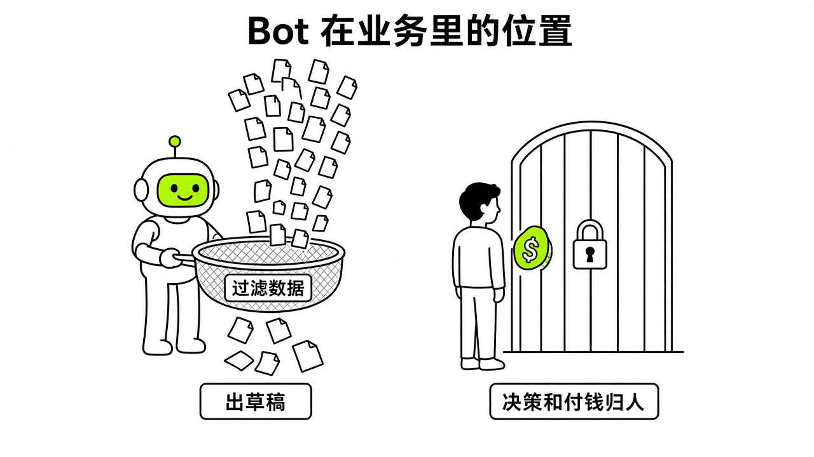
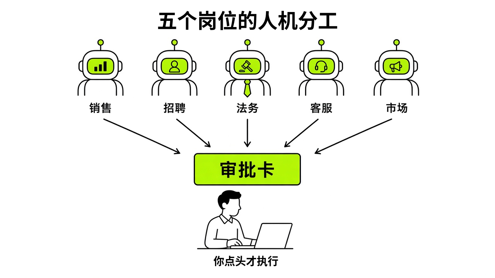

# §16 赚钱与工作 · Work & Business

[← 上一章：§15 内容创作 · Creators](../part5-use-cases/15-creators.md) ｜ [📖 返回目录](../../README.md#-目录) ｜ [下一章：§17 从零搭一个“中文内容工作室” · Capstone A: Building a Chinese Content Studio →](../part6-capstones/17-capstone-a.md)

---

> **适合谁**：想用 Bot 辅助副业、跨境电商或团队业务的读者。16.3 的官方岗位指南面向用 Slack、CRM、ATS 的海外团队；国内小团队可以只借鉴"Bot 起草、人工发送"的分工方式。

很多人以为给 AI 一台电脑，就能全自动赚钱。真敢这么放手，账户额度一天就会烧光，搞不好还会被封号。我调研了一圈发现，Grok Bot 根本不是什么自动吐钞机，它就是一个不知疲倦的数字劳动力。能赚钱的工作流，从来不是让它从头到尾接管商业闭环，而是把它卡在整个链路里最枯燥、最耗时、确定性最高的环节。



*图：商业与工作流中的 Grok Bot 定位：充当高频数据过滤器与草稿发生器，决策与资金闸门由人把控*

## 16.1 出海找新词建站 · Micro-SaaS Keyword Radar

做出海小工具站，以前每天要花两三个小时在各种论坛里肉眼翻帖子，人工找别人的抱怨。雇人干成本太高，自己干又心累。社区帖称有人用 Grok Bot 做新词监控，再自己买域名、用 Claude 建站、接 Stripe 收款，当晚拿到出海站首单。注意，原帖里 Grok Bot 只负责找词这一环【社区】（个例，https://x.com/0xEcho99/status/2108927962305511520）。整个链路里，**Bot 负责雷达探测，人负责临门一脚**。

> [!NOTE]
> 📸 **截图位（待补）**：新词监控 Bot 生成的海外高频痛点词与建站场景候选清单

### 场景

海外 Micro-SaaS 或出海内容站的核心竞争力在于抓早期的长尾需求。当一个新问题在海外社交平台反复被提及，而现成的搜索结果里还没有成熟工具时，做一个单功能网页往往就能接住精准搜索流量。这个任务要求 Bot 充当趋势侦察兵，每天定期扫描公开讨论中的高频抱怨与求助关键词，过滤掉闲聊和营销水帖，提取出具备建站可能性的功能词。

### 提示词

```text
你是一名专注海外 Micro-SaaS 机会的新词雷达分析师。你的工作环境是一台配备浏览器的云电脑。

请执行以下任务：
1. 检索当前公开网络与社交平台上关于“how to automate”、“tool for”、“alternative to”以及近期热门软件痛点的讨论。
2. 过滤掉大厂已成熟解决的标准功能需求，寻找用户正在抱怨“现存工具太贵”、“流程太繁琐”或“没有轻量工具”的长尾场景。
3. 整理出 5 个高潜力关键词，每个词按照固定结构输出：
   - 原始长尾词（英文原生表述）
   - 用户核心痛点（引用 1-2 条代表性质询场景）
   - 商业化形态设想（单页计算器、轻量生成器或自动化脚本）
   - 竞争度初步判断（目前搜索结果是论坛讨论还是已有竞品页面）
4. 将结果以 Markdown 格式保存为 /workspace/keywords/daily_radar_latest.md，严禁编造搜索数据，不确定的数据标注未核实。
```

### Routine

建立一条命名为 Daily-Niche-Keyword-Scan 的 Routine。触发周期设为每 24 小时执行一次，执行时间推荐在海外活跃时段结束后的清晨。官方文档规定 Routine 的最短执行间隔不少于 5 分钟【官方】（https://cursor.com/help/grok-bot/routines）。设置中必须关闭自动发帖或向外部分享的权限，仅让它在工作区生成文件，并在完成时通过系统通知提示查看报告。

### 成本

基础使用基于 Cursor Pro 套餐，官方每月标价为 20 美元【官方】（https://cursor.com/pricing）。官方未公布具体的每周额度数字【官方】（https://cursor.com/help/grok-bot/plans）。社区帖称每条交互消息大约消耗 1% 的周额度（个例，https://x.com/miniyarov/status/2105428357273800799）。每日运行一次检索 Routine，每周大约消耗 7 次自动化运行轮次，在个人 Pro 配额内能够平稳运转，不会触发 On-demand 额外扣费。

### 坑

第一个坑是让 Bot 自动去买域名和配置服务器。由于涉及真实的支付凭证和外部敏感账户，绝对不要把支付密码存在 Bot 环境里，稍有误判就会造成资金损失。第二个坑是遇到热门公关事件或刷量营销时，Bot 容易把水军刷屏的话题误判为真实痛点，导致找出的词全无商业价值。

> [!TIP]
> 🧪 【实测·TODO待实测】测试设置不同长尾检索词库时云电脑浏览器抓取结果的去重率与误报率。

## 16.2 跨境电商竞品巡检 · Cross-Border E-Commerce Inspection

做跨境电商最怕竞品半夜调价或者上新爆款，隔两三天才能发现。传统做法是人工每天把竞品店铺一个个打开看一遍，极其耗人。官方在 10 月 9 日为 @bot 增加了 Shopify 原生集成，支持查订单、跟库存和更新商品信息【官方】（https://x.com/bot/status/2108228871938359347）。结合云电脑的公开网页读取能力，Bot 可以成为一名不知疲倦的商品巡检员。核心原则是**把竞品巡检当报警器，而不是自动下单机**。

> [!NOTE]
> 📸 **截图位（待补）**：跨境电商竞品价格变动与差评聚类巡检简报

### 场景

跨境卖家需要实时盯紧对手的三个核心指标：主推款价格变动、新品上架动作、以及买家在近期留下的差评。差评里暴露的做工差、发货慢或尺寸不对，正是自己优化产品文案和供应链切入点的关键情报。同时，巡检独立站外部的推广动态，也能帮助判断竞品的起量渠道。

### 提示词

```text
你是一名跨境电商竞品监控专家。你的任务是巡检指定的竞品公开页面。

请按照以下规则执行巡检：
1. 打开指定的竞品独立站与商品落地页列表。
2. 提取当前商品标题、变体价格、促销折扣标签与库存展示状态。
3. 对比 /workspace/ecommerce/history_prices.json 中的上一轮巡检数据，标记出价格上调、下调超过 5% 的款式。
4. 抓取该商品公开评价区最新的 10 条买家差评（1-3 星），聚类出核心不满原因（如尺寸不符、物流延迟、配件缺失）。
5. 输出一份简报，包含“价格异动表”与“差评切入点分析”，以 Markdown 格式追加写入 /workspace/ecommerce/daily_report.md。
6. 如果发现竞品主推款降价超过 15%，生成高优先级审批提醒，但不得执行任何自主调价行为。
```

### Routine

在后台创建 Competitor-Price-Watch 巡检 Routine。频率建议设为每天固定 1-2 次，例如海外当地时间的上午和下午各跑一次。切勿为了追求所谓的实时而把频率调成 5 分钟一次，那会迅速把周额度耗尽。在 Routine 配置中，指定运行脚本读取固定的目标 URL 列表，巡检完毕后将结果以内部卡片形式呈现。

### 成本

使用 Cursor Pro 方案，标价每月 20 美元【官方】（https://cursor.com/pricing）。官方未公布精确的 token 与运行额度折算规则【官方】（https://cursor.com/help/grok-bot/plans）。巡检如果走云电脑自带浏览器渲染页面并解析 DOM，单次运行消耗的资源高于纯文本对话。控制在每天 1 次巡检，周额度通常维持在健康水位；若开启团队版或 Pro+（每月 60 美元【官方】，https://cursor.com/pricing），额度容错空间更大。

### 坑

第一个坑是半公开信息召回准确率波动【社区】（https://x.com/Hensen1016/status/2108025562048483583）。各电商站点的反爬机制和动态前端加载差异大，Bot 有时无法完整拉取评论列表。第二个坑是机房 IP 拦截问题。Grok Bot 默认运行在数据中心网络环境，容易被防爬系统拦截，需要按官方说明更新电脑组件后开启本地出口路由（Local Egress Routing）借由本机 IP 发起请求【社区】（https://x.com/xiaohu/status/2099409639234289914）。第三个坑是让 Bot 自动修改自己店铺售价。长对话里 Bot 可能忘掉之前的调价约定，所以关键运营动作必须有人类复核【推测】。

> [!TIP]
> 🧪 【实测·TODO待实测】测试云电脑在开启本地出口路由下连续访问主流电商商品页的抗封禁表现。

## 16.3 官方岗位指南速览 · Official Role Playbooks

xAI 官方在 `https://x.ai/bot/guides 页面上线了一系列官方岗位实战指南，覆盖销售、招聘、法务、支持和市场营销等职能【官方】（https://x.ai/bot/guides）。**官方所有岗位指南的核心哲学就是把人类留在关键判断上**。官方指南逐一拆解了如何用专门的 Bot 接管高频杂活，而在涉及对外发送、花钱和签署的闸门处一律配置人工审批。



*图：官方五大职能岗位（销售、招聘、法务、客服、市场）的人机分工与审批卡闸门体系*

### 1. 销售：Founder-Led Sales 与 Post-Sales

官方专门推出了针对创始人销售（Founder-Led Sales）和售后面向客户支持（Post-Sales）的指南【官方】（https://x.ai/bot/guides/sales）。在销售场景中，Bot 被定义为客户专员的幕僚长（Chief of Staff），负责在开会前准备背景材料，开会后把录音转录成跟进邮件草稿，并更新客户关系管理系统（CRM），让人类全神贯注于客户信任的建立。官方推荐的销售 Bot 包括 Jon Grigull 开发的 Deal Inspector（基于通话记录根据准入标准检查商机阶段）、Krista Letz 开发的 Pipeline Pulse（扫描商机停滞环节与预测风险）和 Outbound Prospecting（匹配潜在客户并起草初次沟通话术），以及 Daniel Brill 开发的 Call Follow-Ups 与 Sales Call Coach【官方】（https://x.ai/bot/guides/sales）。

销售人员跑完一场会议后往往没有精力写复盘和更新 CRM，可以直接给 Call Follow-Ups 设定以下提示词：

```text
你是一名 B2B 销售幕僚长。你的职责是将本次客户会议纪要转化为跟进邮件草稿与 CRM 更新记录。

请按照以下要求处理输入的内容：
1. 读取附带的客户通话纪要与转录文本。
2. 提取客户明确表达的 3 个核心痛点以及我们在会议中承诺交付的事项。
3. 模仿我的语气撰写一封感谢与跟进邮件草稿，重点强调下一步推进节点与交付承诺，语气专业、直接。
4. 生成 CRM 字段更新字典：包含商机阶段、预估签约时间、当前阻碍点。
5. 所有邮件草稿必须以待审核状态呈现，严禁自动发送邮件给客户。
```

将这个流程制作成 Routine，关联每场会议结束的日历事件或通话录音归档，自动产出复盘。单月成本依托 Cursor Pro 的 20 美元月费即可启动【官方】（https://cursor.com/pricing）。这套玩法的常见坑是幻觉承诺：Bot 可能在草稿中顺着客户的提问擅自答应超出产品能力的功能排期，销售人员如果没仔细看草稿就直接发出，会酿成严重交付事故。

### 2. 招聘：Recruiting & ATS Triage

官方招聘指南《Grok Bot for Recruiting》详细介绍了招聘团队如何借助 Bot 承担通宵人才寻访、面试评分卡整理以及申请追踪系统（ATS）流转【官方】（https://x.ai/bot/guides/recruiting）。官方生态里推荐了 Tommy Hansen 制作的 Recruiting Coordinator（负责排期和面试官准备，且绝不会单独向候选人发邮件）与 Talent Discovery（在 ATS 之外发掘新人才），Simon Lackowski 制作的 Hiring Signals（监控选定公司的招聘动态并标出变动），以及 Natasha Kuo 的 Executive Assistant 和 Matt Palmer 的 Writing Bot【官方】（https://x.ai/bot/guides/recruiting）。

在候选人寻访场景中，招聘专员要在海量公开资料中比对岗位匹配度，提示词可以针对硬性指标进行规范：

```text
你是一名技术招聘助理。你的任务是根据指定的资深前端岗位描述，在候选人信息中进行硬性条件初筛。

岗位硬性条件：
- 熟悉 TypeScript 与现代 Web 应用架构；
- 具备 3 年以上分布式系统或复杂客户端开发经验；
- 有开源项目贡献或技术写作经历。

执行步骤：
1. 分析候选人公开简历与履历。
2. 逐一比对上述 3 项硬性条件，明确给出每项匹配度说明（完全符合 / 部分符合 / 不符合）。
3. 提炼出 3 个值得在首轮技术沟通中深入询问的具体项目难点。
4. 输出候选人评估摘要，存入 /workspace/recruiting/shortlist.md。
5. 绝不得直接向任何候选人发送沟通邮件。
```

官方企业版公告举过例子：Bot 夜里寻访候选人，早上给出短名单，外联消息排队等人审核【官方】（https://x.ai/news/grok-bot-for-enterprise）。照这个思路，Routine 可以设成每晚处理 ATS 导出的简历文件夹。成本同属基础套餐范围。招聘场景最严重的坑是偏见与误杀：由于 Bot 对简历中非标准表达理解有限，可能将具备实际优秀经验但文书不标准的候选人过滤掉；同时，招聘涉及个人敏感隐私，千万不要让 Bot 把含有候选人联系方式的数据同步到公开渠道。

### 3. 法务与采购：Legal Ops & Haggle Bot

官方指南《Grok Bot for Legal Ops》展示了法务运维团队如何使用 Bot 进行法律顾问 1 对 1 会前准备、Slack 工单分流、合同工作流流转，并始终贯彻“起草完毕由人工发送”的审核流程【官方】（https://x.ai/bot/guides/legal）。法务相关的推荐 Bot 包括 Daniel Gartshein 的 Haggle Bot（检查企业 SaaS 软件闲置席位与重复扣费，并起草谈判降价邮件）、Shub Gaur 的 Sell Bot（在客户生命周期中起草方案和合同）、Farzad 的 Researchy（带出处的实效网络检索与事实核查）、Lenny Rachitsky 的 Overheard，以及 Anoop Baliga 的 Company Docs Q&A【官方】（https://x.ai/bot/guides/legal）。

在企业实际案例中，xAI 内部使用 Haggle Bot 为公司找到了超过 100,000 美元的直接节省，其中一笔科技采购单通过分析直接从 14,629 美元降至 6,143 美元，降幅达 58%【官方】（https://x.ai/news/grok-bot-procurement）。该采购提示词的核心是参数比对：

```text
你是一名企业采购谈判顾问。你的任务是审查当前公司的软件采购续约账单。

请按以下流程处理：
1. 提取当前软件合同中的席位单价、总席位数、历史续约条款以及当前实际使用率。
2. 检索当前市场上同类工具的公开采购折扣基准与同等规模企业的成交价格区间。
3. 检查是否有闲置未分配席位或功能重复的采购项。
4. 按照 TODAY / SAVE / REC / NEXT 的标准格式输出审查报告。
5. 起草一封给供应商客户经理的续约协商函草稿，明确提出削减闲置席位并申请 15% 长期客户折扣。
6. 协商函仅供人工审核，不得自动外发。
```

Routine 可以挂接在财务账单审批流上，每月巡检一次续约项目。成本方面，仅需个人或企业版基础开销，却能撬动数千乃至数万美元的成本削减。法务和采购的踩坑点是权责边界：合同条款里的免责、管辖权和违约责任极度敏感，Bot 生成的条款修改意见只能作为初审参考，绝不能替代持证法务人员的正式审查；同时，千万不要将公司未公开的商业合同原文随意投喂到没有权限隔离的环境中。

### 4. 客户支持：Support Queue & Plain Integration

官方指南《Grok Bot for Support》介绍了客服团队如何在合上电脑后，依然通过连接器、分类任务和自动 Routine 保证工单不掉线【官方】（https://x.ai/bot/guides/support）。官方推荐 Bot 包括 Anoop Baliga 的 Product Support Inbox Assistant（寻找并起草产品问题答复，但绝不自动发出）、Customer Call Coach & Assistant、Customer Proof Desk（逐字保留原话把通话记录转换为客户故事），以及 Krista Letz 的 EBR & Value Deck Builder（为特定大客户构建高管复盘报告，绝不编造数字）【官方】（https://x.ai/bot/guides/support）。

在官方公开的客服团队实践中，接入 Grok Bot 后客服工单总量增长了 175%，而团队没有新增任何一名人手【官方】（https://x.ai/news/grok-bot-customer-support）。单次工单处理成本仅为 0.20 至 0.30 美元，远低于传统 AI 客服每次 1 至 4 美元的成本【官方】（https://x.ai/news/grok-bot-customer-support）。系统学习了超过 100 万条历史工单口吻，99% 的退款请求无需人工介入，但在对话来回超过 3 次时会自动升级转人工【官方】（https://x.ai/news/grok-bot-customer-support）。客服分流提示词如下：

```text
你是一名客户支持工单初审专员。你的工作是阅读客户工单并起草答复。

处理规则：
1. 阅读客户提交的技术问题，对照 /workspace/docs/help_center.md 中的官方文档。
2. 如果属于已知高频配置问题，提取准确的步骤链接，并起草一段语气温和、直接解答的回复。
3. 如果客户问题涉及退款、账号安全或系统严重 Bug，标记为 HIGH 优先级并直接指派给人工值班专员。
4. 如果此工单在此前已经过 2 轮沟通仍未解决，立刻触发人工接管升级流程。
5. 所有答复保持内部草稿状态，经人工支持人员确认前严禁直接点击发送给客户。
```

配置为常驻 Routine，轮询客服系统待办队列。成本方面，高并发场景下需要企业版权限支持。客服的核心坑在于失控回复：如果放任 Bot 自由直复，遇到复杂 Bug 时容易给出错误排查建议导致用户误操作破坏数据；因此官方内部也是严格走完“只写内部备注与人工审批”到“评估充分后放开特定场景直回”的阶段演进【官方】（https://x.ai/news/grok-bot-customer-support）。

### 5. 市场营销：Performance Marketing & Content Desk

官方指南《Grok Bot for Marketing》和《Grok Bot for Performance Marketing》系统展示了营销团队如何运用多个专门 Bot 完成竞品调研、Google Docs 定位草案撰写、广告投放骨架搭建以及直接向营销站点提交 PR【官方】（https://x.ai/bot/guides/marketing）。推荐 Bot 包括 Shub Gaur 的 Distro Bot（管理活动、创意与发帖，未经确认绝不花钱）、Adam Tanguay 的 SEO & AEO Desk（将关键词转化为选题和写作者大纲）与 AI Search Visibility（监控 AI 助手是否推荐自身品牌及提到了哪些对手），以及 Miguel Cruz 的 Paid Media Report Desk（将广告导出数据整合成真实数字周报）和 Ad Spend Watch（在预算被烧光前发出预警）【官方】（https://x.ai/bot/guides/marketing）。

在市场投放与内容大纲搭建中，SEO 与大纲生成提示词如下：

```text
你是一名内容营销大纲专家。你的任务是将搜索关键词转化为结构化内容写作大纲。

输入目标关键词：[输入关键词]

执行要求：
1. 分析该词背后的用户搜索意图（获取信息、寻找替代品、还是比价购买）。
2. 列出读者在阅读该主题文章时必须了解的 5 个关键概念。
3. 规划文章的 H2 和 H3 目录结构，并在每个章节下方列出必须回答的具体问题。
4. 明确标注本篇文章应该插入的产品真实使用案例位置，避免空洞说教。
5. 生成 Markdown 大纲文件保存至 /workspace/marketing/briefs/。
```

将该流程配置为每周执行的 Routine，自动抓取最新的搜索热点生成写作任务清单。成本由月度基础席位覆盖。市场营销的坑在于空话套话泛滥：未经严格约束的 Bot 往往生成大量充斥着陈词滥调的低质内容，无法获取有效流量；此外，广告投放 Bot 必须严格受控，绝不能开启免审批的预算调整权限，防止因数据延迟引发过度消耗。

## 16.4 房产等垂直行业 · Vertical Industries & Enterprise

除了通用的销售和客服，Grok Bot 在垂直行业的落地也展现出了清晰的轮廓。官方在企业版通告中点名了一批正在重度使用 Grok Bot 的垂直企业，包括现场维修与承包商服务平台 ServiceTitan、Legora 以及超微电脑 Supermicro，并强调其最繁重的使用场景其实发生在工程研发部门之外【官方】（https://x.ai/news/grok-bot-for-enterprise）。小企业保险公司 Harper 就在 24 小时内搭建了 Team Bot，用于筛查保单失效的客户并协助恢复，直接为客户挽回了超过 120,000 美元的损失【官方】（https://x.ai/news/team-bots）。在这些领域，**垂直行业的落地价值在于夜间跨系统的低级搬运**。

> [!NOTE]
> 📸 **截图位（待补）**：垂直行业工单跨平台信息聚合与确认卡片

### 场景

以房产经纪、物业租赁或类似 ServiceTitan 覆盖的家居维修承包商为例，日常业务有着极强的线下依赖性。客户在深夜可能会发邮件或提交表单咨询某套房源的带看预约，或者报修水管漏水。传统人工模式下，次日上班前这些线索处于无人响应状态，很容易流失。Bot 的作用不是代替经纪人带看，而是在夜间即时核验房源或师傅排期、清洗意向客户联系方式、并整理好带看日程草案。

### 提示词

```text
你是一名本地房产中介团队的数字办公室管家。你的职责是处理夜间进来的租售咨询与看房预约表单。

处理规则：
1. 读取新提交的客户预约邮件，提取：客户称呼、联系电话、目标房源编号、期望看房时间。
2. 打开 /workspace/realestate/listings.json，检查该房源编号当前是否处于“可带看”状态。
3. 对照经纪人工作日历，确认该期望时间段是否有空闲档期；若有冲突，顺延匹配最近的两个备选空闲时段。
4. 在内部日程表中起草一条预约日历项草案，并给房产经纪人生成一条简短的带看准备卡片。
5. 草拟一条确认短信草稿发给客户，告知已收到申请，经纪人将在早晨 9:00 前人工联系确认。
6. 严格执行草稿优先原则，不得直接调用任何外部网关自动发送短信。
```

### Routine

配置 Nightly-Lead-Triage 的定时任务，每天夜间每隔 30 分钟轮询一次表单收件箱。官方平台支持通过 Team Bots 与企业版安全策略，让多个业务人员在共享 Bot 能力的同时保持各自对话的私密性【官方】（https://x.ai/news/team-bots）。

### 成本

单人开展业务只需 Cursor Pro 方案，标价每月 20 美元【官方】（https://cursor.com/pricing）；中小型团队如果采用 Cursor Teams 方案，官方标价为每人每月 40 美元【官方】（https://cursor.com/pricing）。官方企业版（Enterprise）曾为 Grok 和 Cursor Enterprise 用户提供两周免费试用【官方】（https://x.ai/news/grok-bot-for-enterprise）。轮询任务在夜间平稳跑动，消耗可控。

### 坑

垂直行业涉及大量高敏感度的线下资产与个人隐私数据（如房屋具体门牌号、产权信息、客户银行对账记录）。在系统配置中必须严格做好数据边界隔离，千万不能把不同业务的数据放在同一个无隔离的对话环境中。此前曾发生过 CEO Shane Mac 的个人财务 Bot 把包含私人银行余额与刷卡支出的财务审计结果错误发送至公司高管 Slack 频道的严重隐私泄露事故【社区】（https://cybernews.com/ai-news/grok-bot-leaks-bank-information/）。垂直行业应用中，涉及交易、资金和私人住址的数据，必须强制配置多因子审批和通道隔离。

> [!TIP]
> 🧪 【实测·TODO待实测】测试房产预约表单在遭遇时间冲突时自动计算备选带看时段的准确率。

## 本章来源

- Cursor 定价与套餐说明：https://cursor.com/pricing
- Grok Bot 方案与使用限制说明：https://cursor.com/help/grok-bot/plans
- Grok Bot 官方安全白皮书：https://cursor.com/docs/grok-bot/security
- Grok Bot 官方岗位实战指南总览：https://x.ai/bot/guides
- 销售岗位指南与市场 Bot 列表：https://x.ai/bot/guides/sales
- 招聘岗位指南与市场 Bot 列表：https://x.ai/bot/guides/recruiting
- 法务岗位指南与市场 Bot 列表：https://x.ai/bot/guides/legal
- 客户支持岗位指南与市场 Bot 列表：https://x.ai/bot/guides/support
- 市场营销岗位指南与市场 Bot 列表：https://x.ai/bot/guides/marketing
- Grok Bot 企业版发布官方公告：https://x.ai/news/grok-bot-for-enterprise
- Grok Bot 团队功能 Team Bots 发布公告：https://x.ai/news/team-bots
- Grok Bot 采购案例分析（Haggle Bot）：https://x.ai/news/grok-bot-procurement
- Grok Bot 客户支持团队实践案例：https://x.ai/news/grok-bot-customer-support
- Grok Bot 更多套餐支持官方公告：https://x.ai/news/grok-bot-more-plans
- 官方 @bot 账号 Shopify 集成发布推文：https://x.com/bot/status/2108228871938359347
- @0xEcho99 出海找新词建站实战推文：https://x.com/0xEcho99/status/2108927962305511520
- @Hensen1016 跨境电商竞品巡检与痛点分析推文：https://x.com/Hensen1016/status/2108025562048483583
- @miniyarov Cursor Pro 额度消耗反馈推文：https://x.com/miniyarov/status/2105428357273800799
- @xiaohu 本地出口路由解析推文：https://x.com/xiaohu/status/2099409639234289914
- Cybernews 关于 Grok Bot 银行数据泄露事件报道：https://cybernews.com/ai-news/grok-bot-leaks-bank-information/

---

[← 上一章：§15 内容创作 · Creators](../part5-use-cases/15-creators.md) ｜ [📖 返回目录](../../README.md#-目录) ｜ [下一章：§17 从零搭一个“中文内容工作室” · Capstone A: Building a Chinese Content Studio →](../part6-capstones/17-capstone-a.md)
