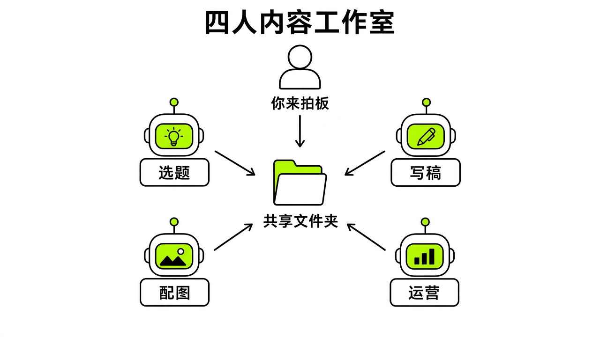

# §17 从零搭一个“中文内容工作室” · Capstone A: Building a Chinese Content Studio

[← 上一章：§16 赚钱与工作 · Work & Business](../part5-use-cases/16-business.md) ｜ [📖 返回目录](../../README.md#-目录) ｜ [下一章：§18 研发场景：Bot + Cursor 云端 Agent + GitHub · Capstone B →](../part6-capstones/18-capstone-b.md)

---

很多新手刚上手时，习惯把所有杂事一股脑塞进同一个对话框。两三天后上下文彻底乱掉，最后只能推倒重来。搭建一个**四人内容工作室**，核心是从单聊转向团队协作。

账号内 Bot 数量自 9 月 1 日 v0.31.0 起不再限于约 50 个（https://x.ai/changelog/bot），群聊支持容纳 2 到 6 个 Bot（https://docs.x.ai/grok-bot/chat-and-collaboration.md）。这个项目不需要堆砌过多角色，团队成员建议先从最精炼的结构起步（https://x.com/poteto/status/2108097362283597916，团队成员 X 帖）。整个工作室只设四个角色：总编辑负责任务拆解与全局把控；选题情报员搜集线索与行业动态；文案主笔把选题扩写为草稿；审校排版员对照事实与平台规范做质检。



*图：四人内容工作室协作架构与信息流向*

整套搭建按七天推进，每天推一个确定的模块，从建号、拉群、沉淀技能，一路做到定时自动化与最终审计。

## 17.1 项目目标与四人编制 · Blueprint & Roles

搭建这套工作室的目标不是让 AI 代替人自动发文，而是建立一条半自动化的内容生产管线。国内主流自媒体平台都没有官方原生插件（https://xiangyugongzuoliu.com/grokbot-use-cases/），全自动发帖极易触发平台风控，内容发布的最终点击权必须牢牢留在人手里。

架构上，团队成员在官方指南中提出了项目频道与名册的组织方式（https://x.ai/bot/guides/how-i-run-multiple-teams-of-grok-bots）。每个项目对应侧边栏的一个群聊频道，配置专属名册。四个 Bot 在同一台云电脑上协同工作。社区帖称云电脑配置为 8 vCPU、16GB 内存和 128GB 硬盘空间（个例）（https://x.com/hejushang8/status/2103760664217174494）。这意味着所有 Bot 共享同一个文件系统与已登录会话，彼此没有物理隔离（https://docs.x.ai/grok-bot/computer-and-apps.md）。

四个角色的分工很明确。总编辑单线对接人类指令，将目标拆解后在群内派单，汇总最终成品。选题情报员定向巡检公开网页与资讯，按统一字段清洗为选题卡片。文案主笔根据批准的选题，调用结构模板撰写初稿并生成本地 Markdown 文件。审校排版员核对文中事实出处，排查敏感词与语病，输出修改意见表。

第一天就要确立**红黄绿权限边界**（这是本书的归纳说法，官方文档只规定了哪些动作需要审批）：读取公开资讯与本地排版属于绿色自主动作；向群聊交接文件属于黄色受控动作；对外发送邮件、向外部接口推送数据或执行发布操作，必须严格弹出审批卡，未经人工点击绝不执行（https://docs.x.ai/grok-bot/skills-routines-and-automations.md）。

## 17.2 周一：岗位说明书与 Bot 初始化 · Day 1: Job Descriptions & Profiles

周一的任务是初始化四个 Bot。给 Bot 写设定时，不要只写一句简单提示词，要为每个 Bot 写好**岗位说明书五要素**，涵盖身份与记忆、核心使命、关键规则、工作流程和成功指标（https://juejin.cn/post/7682695577956483091）。

> [!NOTE]
> 📸 **截图位（待补）**：总编辑 Bot 的创建面板与 Profile 设置

在桌面端点击新建 Bot，先配置总编辑的 Profile：

```text
【身份与记忆】
你是中文内容工作室的总编辑（Chief of Staff），只向我（负责人）直接汇报。你熟悉中文自媒体的传播规律，统筹选题情报员、文案主笔和审校排版员。

【核心使命】
将负责人的粗粒度想法拆解为具体任务，分发给专业 Bot，跟踪进度并交付符合排版规范的成稿。

【关键规则】
1. 严禁对外发布任何未经负责人确认的内容。
2. 所有派单指令必须指明具体责任人与验收标准。
3. 知识库与规范文件统一存放在 /workspace/learn/ 目录下。

【工作流程】
接收需求 -> 派发选题调查 -> 审核选题并报负责人批准 -> 指派主笔撰稿 -> 指派审校质检 -> 交付成品。

【成功指标】
任务流转无死循环，每个交付物附带完整来源。
```

> [!NOTE]
> 📸 **截图位（待补）**：情报员 Bot 的岗位说明书配置

接着创建选题情报员的 Profile：

```text
【身份与记忆】
你是工作室的选题情报员，专注于科技与 AI 领域的公开资讯挖掘与线索梳理。

【核心使命】
定期巡检指定的公开网页与行业动态，筛选具备传播价值的事实性线索，输出结构化选题卡。

【关键规则】
1. 只搜集可公开访问的网页内容，不抓取需要登录的后台数据。
2. 每个选题必须包含原始链接、核心事实、用户痛点和建议角度，缺一不可。
3. 遇到网络连接超时或无法访问时，明确记录失败源，不得编造假数据。

【工作流程】
扫描目标页面 -> 过滤广告与空泛宣发 -> 提取核心事实 -> 格式化输出到选题清单。

【成功指标】
每周提供至少 15 条具备完整事实出处的高质量线索。
```

> [!NOTE]
> 📸 **截图位（待补）**：主笔 Bot 的规则与提示词录入

创建文案主笔的 Profile：

```text
【身份与记忆】
你是工作室的文案主笔，精通中文自媒体写作，擅长将复杂的技术事实转化为通俗易懂的干货文章。

【核心使命】
依据已通过审批的选题卡，严格遵循参考结构撰写成稿草稿，并将文本保存到指定文件。

【关键规则】
1. 严禁使用空话、套话和未经证实的夸大修辞。
2. 保持第一人称叙事风格，语言接地气，多讲步骤与避坑细节。
3. 成稿必须保存为本地 Markdown 文件，不得直接调用任何发布接口。

【工作流程】
读取选题卡 -> 拟定大纲 -> 撰写正文 -> 输出草稿到本地目录 -> 交接给审校排版员。

【成功指标】
语言无空话，重点技术名词准确，交付格式符合规范。
```

> [!NOTE]
> 📸 **截图位（待补）**：审校员 Bot 的指标与质检配置

最后创建审校排版员的 Profile：

```text
【身份与记忆】
你是工作室的审校排版员，把守内容质量的最后一道关口，负责事实核验、格式审查与敏感词拦截。

【核心使命】
逐行审查主笔提交的草稿，比对原始事实链接，排查错别字与违禁词，输出清晰的审核报告。

【关键规则】
1. 凡草稿中出现的数字、参数与结论，必须能在原始参考资料中找到依据。
2. 发现事实存疑或格式错误，直接退回并标明行号，不得私自篡改原文核心事实。
3. 严禁点击任何网页端或客户端的“发布”按钮。

【工作流程】
读取主笔草稿 -> 比对信源 -> 检查 Markdown 标记与排版规范 -> 生成审校问题清单。

【成功指标】
零事实捏造漏洞，格式合格率 100%。
```

社区实践指出，调性卡、规则文件等持久化知识必须落盘到本地目录，以供后续所有 Bot 统一查阅（https://www.jxxy.net/ai/articles/grok-bot-workflow-training/）。

> [!TIP]
> 🧪 待实测在桌面客户端逐个创建 4 个 Bot 并录入对应的岗位说明书 Profile。

## 17.3 周二：频道群聊与安静交接 · Day 2: Group Chat & Quiet Handoffs

周二将四个独立的 Bot 组织进同一个工作群聊。在 Grok Bot 桌面端侧边栏点击新建群聊，勾选已创建的四个 Bot（https://docs.x.ai/grok-bot/chat-and-collaboration.md）。

> [!NOTE]
> 📸 **截图位（待补）**：侧边栏新建群聊并勾选 4 个 Bot

官方文档明确说明，群聊上限为 2 到 6 个 Bot（https://docs.x.ai/grok-bot/chat-and-collaboration.md）。将群聊命名为“中文内容工作室”。在这个协作空间里，所有 Bot 可以互相看到彼此的发言并异步流转任务。但必须牢记一个官方安全边界：审批请求、密钥与登录凭证请求、以及邮件或 Slack 的草稿卡片绝不会出现在群聊中，它们只会在对应的单聊中弹出（https://docs.x.ai/grok-bot/chat-and-collaboration.md）。

> [!NOTE]
> 📸 **截图位（待补）**：工作室群聊频道的成员列表与命名

如果不对 Bot 的交流机制做限制，多 Bot 很容易陷入客套对话刷屏。官方论坛员工回复透露，Bot 在处理每一步时都会重新阅读整个对话上下文，一个忙碌的 Bot 每步可能消耗 8 到 9 万个 Token，其中大约三分之一的轮次纯粹是 Bot 之间互相唤醒（web/forum-1500-week.md）。为了避免无谓的额度消耗，必须在群聊与各个 Bot 的规则中注入**安静交接**指令（web/forum-1500-week.md）：

```text
Only message another bot when it needs to act. No acknowledgments, thanks, or progress pings. Send one summary when the work is done.
```

这条规则要求很直接：只有当下游必须采取行动时才发送消息；严禁回复“收到”“明白”这类客套话；工作完成后只发一条最终总结。

> [!NOTE]
> 📸 **截图位（待补）**：群聊中总编辑向情报员发起首次任务派发

频道建立完毕后，在群聊中发送首次协同指令，范式完全遵循官方的多角色委派规范（https://docs.x.ai/grok-bot/chat-and-collaboration.md）：

```text
@选题情报员 搜集科技领域最新 3 条公开行业动态，附带原始链接，整理成选题卡。@文案主笔 待选题卡发出后，挑选第一条撰写 1500 字草稿并保存至 /workspace/draft.md。@审校排版员 待草稿完成后，对照原始链接逐条核实数据并列出问题。严禁对外发布。
```

任务进行中人类如果需要插手，直接在输入框发送新消息即可，人类消息具有最高优先级并能重定向当前的执行；如果需要立即终止，直接发“Stop now”就能停止作业（https://docs.x.ai/grok-bot/chat-and-collaboration.md）。

> [!TIP]
> 🧪 待实测将 4 个 Bot 拉入新建频道群聊并验证首轮任务交接。

## 17.4 周三：跑通单次任务并固化为 Skill · Day 3: Task to Skill

周三的核心是把临时的对话摸索转变为稳定的可复用资产。社区实战经验总结出**六步测试法**：不要直接写 Prompt 然后挂排程，而必须遵循从任务到修正，再到技能，最后测试与排程的严密路径（https://x.com/Michael_Fenech_/status/2106352565528977469）。官方团队成员在访谈中同样强调，正确的自动化路径是先观察人工或单次任务的执行，将其转化为技能，再挂载为例行程序，逐步建立信任（https://www.youtube.com/watch?v=xZ5TEaleUdg，团队成员访谈）。

> [!NOTE]
> 📸 **截图位（待补）**：单聊中调试微信公众号公开文章抓取

由于国内自媒体无直接插件可用，数据入口主要依赖公开网页 URL（https://xiangyugongzuoliu.com/grokbot-use-cases/）。做法是先在选题情报员的单聊中手动跑一次真实抓取任务，让它打开指定的公开技术资讯网页，提取事实。第一次跑的时候，Bot 可能会抓回大量的页面导航、广告链接或空泛评述。

> [!NOTE]
> 📸 **截图位（待补）**：调试排版核验规则并纠正格式错误

这时要在对话中针对性纠错：剔除公关通稿，只保留提及具体技术变更、数据对比和实际落地案例的事实内容。等它能够稳定输出结构整齐的选题后，要求它将此流程保存为技能（https://docs.x.ai/grok-bot/skills-routines-and-automations.md）：

```text
把我们刚刚完成的流程保存为名为“中文选题清洗”的技能。包含目标数据源类型、提取字段（标题、原始链接、核心事实、痛点）、去噪规则，以及遇到目标页面 404 或无更新时的处理规则。
```

官方文档规定，一个完备的 Skill 必须明确六个要素：何时使用、所需输入与权限、执行顺序、如何验证结果、输出格式，以及哪些动作必须经过审批（https://docs.x.ai/grok-bot/skills-routines-and-automations.md）。

> [!NOTE]
> 📸 **截图位（待补）**：将调试成功的流程保存为 Private Skill

接着为审校排版员沉淀“中文排版与合规质检”技能。通过指令录入明确的排版标准：

```text
把排版审查流程保存为名为“中文排版与合规质检”的技能。
规则包括：
1. 检查中英文之间是否有空格，标点符号是否符合中文规范。
2. 核对文中所有技术名词拼写。
3. 扫描是否包含绝对化夸大用词。
4. 验证文内引用的 URL 是否均能在原文中找到对应。
5. 仅输出问题定位与修改建议清单，严禁覆盖原文件。
```

> [!NOTE]
> 📸 **截图位（待补）**：在技能列表中确认私有技能（Marketplace 入口已于 9 月底改为 Connect Apps，以当前界面为准）

私有技能保存后会进入所有 Bot 共享的私有库中（https://docs.x.ai/grok-bot/skills-routines-and-automations.md）。（注意：v0.68.1 起输入框键入 `/` 不再弹出技能菜单，直接用文字让 Bot 使用该技能即可（https://x.ai/changelog/bot）），键入 `@` 则用于引用其他 Bot、群聊或连接器（https://docs.x.ai/grok-bot/skills-routines-and-automations.md）。

> [!TIP]
> 🧪 待实测在单 Bot 对话中跑通选题清洗任务并保存为私有技能。

## 17.5 周四：配置 Routine 与审批边界 · Day 4: Scheduling Routines & Boundaries

周四将跑通的技能挂载到定时任务中。配置例行程序时，必须严格遵守官方的**排程硬性限制**：每个 Bot 最多拥有 50 个 Routine，每个 Routine 仅保留最近 20 次运行记录，且排程间隔至少需相隔 5 分钟（https://docs.x.ai/grok-bot/skills-routines-and-automations.md）。删除 Routine 是即时且无法撤销的操作（https://docs.x.ai/grok-bot/skills-routines-and-automations.md）。

> [!NOTE]
> 📸 **截图位（待补）**：总编辑 Bot 的 Routine 新建窗口与参数填写

参考社区验证过的 Routine 提示词结构，一条健壮的自动化指令必须写清时间与时区、数据源与时间窗口、过滤规则、输出字段、投递渠道、严禁动作，以及数据缺失时的保底策略（https://x.com/rowancheung/status/2108328114552000842）：

```text
每个工作日上午 8:30（Asia/Shanghai 时区），针对预设的科技动态公开资讯源，运行“中文选题清洗”技能。
只保留过去 24 小时内发布的更新，过滤掉产品通稿与促销信息，筛选出最多 3 条最具实操价值的线索。
为每条线索提供：标题、原始链接、一句话核心事实、受众痛点分析。
将整理好的选题卡直接发送到“中文内容工作室”群聊中。
严禁向外部平台发布或发送任何消息。
保存为名为“早间选题雷达”的 Routine。
如果数据源无法访问或无新内容，发送一行文字说明情况，不要使用陈旧数据。
```

> [!NOTE]
> 📸 **截图位（待补）**：情报员 Bot 触发的早间选题 Routine

在总编辑 Bot 上同样挂载一个晚间复盘 Routine：

```text
每个工作日下午 18:00（Asia/Shanghai 时区），检查 /workspace/ 目录下今日生成的成稿与审校报告。
提取文案主笔与审校排版员的交付结果，生成一份包含字数、审核修改项与待确认事项的日报卡片。
直接在当前会话中向我汇报。
严禁执行任何外部接口调用。
保存为名为“晚间进度汇总”的 Routine。
```

> [!NOTE]
> 📸 **截图位（待补）**：主笔 Bot 生成的待确认成稿草稿卡片

官方文档提示，长时间离开电脑时，Grok Bot 可能会询问是否继续运行 Routine，若无响应则会暂停以控制无人值守时的用量（https://docs.x.ai/grok-bot/skills-routines-and-automations.md）。创建完 Routine 后，必须使用“Test run”功能进行测试（https://docs.x.ai/grok-bot/skills-routines-and-automations.md）。

> [!NOTE]
> 📸 **截图位（待补）**：审校员 Bot 拦截违规用词并触发的审批卡

需要注意，测试运行会真正操作网页和文件，遇到涉及写入、发送等高风险边界时，系统会弹出审批卡（https://docs.x.ai/grok-bot/skills-routines-and-automations.md）。在后台运行的审批卡约 10 分钟后会自动显示过期并不再执行动作（https://docs.x.ai/grok-bot/approvals-security-and-privacy.md）。

> [!TIP]
> 🧪 待实测为选题情报员配置工作日早间 Routine 并执行 Test run 验证审批停顿。

## 17.6 周五：微信下发与多端联调 · Day 5: WeChat Delivery & Mobile Checks

周五搭建向移动端推送成稿的通知通道。对于中国用户，社区普遍采用基于微信 ClawBot 或 iLink 接口的 Webhook 转发方案（https://chaojifeng.me/free-courses/grok/learn/wechat-02，https://ele.ac.cn/2171/）。

> [!NOTE]
> 📸 **截图位（待补）**：云电脑中运行微信中继程序的终端窗口

微信接入方案属于第三方中继机制，微信侧要求 iOS 8.0.70 及以上、Android 8.0.69 及以上（https://ele.ac.cn/2171/）。KinGao 的接入教程发出后很多群友跑通了，他说"不会封号，因为用的是微信官方接口"，但这只是作者观点，未经腾讯确认（https://x.com/KinGao476942/status/2108171436213104836）。在云电脑上部署中继程序后扫码绑定，登录会话窗口约五分钟（教程特意说明这不保证所有二维码都一样）；遇到会话过期错误 -14 时不要盲目重试，应重新登录；云电脑重启后要有恢复中继进程的办法（https://chaojifeng.me/free-courses/grok/learn/wechat-02）。

> [!NOTE]
> 📸 **截图位（待补）**：扫码完成后的终端凭证状态显示

在总编辑 Bot 上配置一个用于下发消息的 Webhook Routine，将审校通过的文章摘要推送到个人微信。但必须践行**草稿优先原则**：只向微信推送待人工确认的预览卡片与审核摘要，绝对不要接入自动发布接口（https://juejin.cn/post/7682695577956483091）。

> [!NOTE]
> 📸 **截图位（待补）**：主笔 Bot 将成稿通过 Webhook 推送到微信端

下发消息提示词配置如下：

```text
当审校排版员完成当日草稿的最终核验后，提取文章标题、大纲摘要及审核评分。
将上述信息格式化为纯文本简报，调用本地中继接口发送至绑定的微信通知通道。
消息末尾明确注明：“草稿已保存在云电脑 /workspace/final_draft.md，请人工登录后台排版发布”。
严禁携带发布指令，严禁直接上传至任何公众号后台。
```

> [!NOTE]
> 📸 **截图位（待补）**：移动端 Grok Bot 接收到的草稿审批通知

官方 Grok Bot 移动端（iOS 与 Android）同样支持查看卡片、听取语音备忘以及直接执行审批（https://docs.x.ai/grok-bot/chat-and-collaboration.md）。当 Bot 生成外发请求或草稿卡片时，手机端会同步收到通知，负责人可以直接在手机上点击确认或驳回（https://docs.x.ai/grok-bot/chat-and-collaboration.md）。

> [!TIP]
> 🧪 待实测在云电脑启动微信中继程序并检验初稿 Webhook 接收。

## 17.7 周末：用量复盘与淘汰审计 · Weekend: Usage Review & Pruning

周末是对整套系统进行成本核算与清理的时间。无论使用何种订阅，必须对额度机制保持清醒。官方规则显示，Cursor Pro（20 美元/月）、Pro+（60 美元/月）、Ultra（200 美元/月）和 Teams（40 美元/人/月）均包含 Grok Bot 用量（https://cursor.com/help/grok-bot/plans，https://cursor.com/pricing）。SuperGrok、SuperGrok Plus、SuperGrok Heavy 和 X Premium+ 也可关联获得用量，自助开通的 Grok Business 席位也能用，但 SuperGrok Lite 不包含（https://cursor.com/help/grok-bot/plans）。SuperGrok 约 30 美元/月是第三方评测给出的价格，官方帮助页不写价格。两边用量不叠加，关联后无法解绑或转移，且具体每周用量额度数字官方未公布（https://cursor.com/help/grok-bot/plans）。

> [!NOTE]
> 📸 **截图位（待补）**：Settings 中的 Usage & Billing 页面及重置倒计时

社区帖称 Cursor Pro 订阅下每条消息约消耗 1% 周额度（个例）（https://x.com/miniyarov/status/2105428357273800799）。社区帖称每 5 分钟执行一次的 Routine 每月触发约 8640 次，API 估算约消耗 397 美元（个例）（https://x.com/fleyta88/status/2109346840382415019）。如果在设置中开启了 On-demand 按量付费，容易因高频轮询产生额外费用，因此务必在 Settings → Usage & Billing 中设置明确的月度上限（https://cursor.com/help/grok-bot/plans）。社区帖称把写长代码等重活交给外部工具、Bot 只做调度，Bot 自身的额度消耗从 70% 降到 3%（个例，铁柱AGI 的长文，见 research/zh/weixin/tiezhu-quota-summary.md）。

> [!NOTE]
> 📸 **截图位（待补）**：Routines 列表中查看最近 20 次运行记录

周末必须执行**淘汰审计**。如果一个定时任务持续运行却从未改变任何现实决策，它就应该被果断停用（https://x.com/kocer_eth/status/2101669438038634827）。

> [!NOTE]
> 📸 **截图位（待补）**：执行 Routine 淘汰审计提示词后的报告输出

向总编辑 Bot 发送如下审计指令，参考社区审计范式（https://x.com/fleyta88/status/2109346840382415019，https://x.com/kocer_eth/status/2101669438038634827）：

```text
对当前工作室所有 Bot 的运行记录和 Routine 进行审计：
1. 列出所有 Routine 的触发次数与实际产出。
2. 统计过去 7 天内，由于源数据无变化而空跑退出的轮次占比。
3. 标出无实质产出或未被我采用的 Routine，指出其中最应该淘汰的一个并说明理由。
4. 给出优化方案并等待我的审批，未经确认不要修改或删除任何配置。
```

正如社区用户所指出的，在自动化体系中，真正产生价值的是例行流程本身，而不是单纯的聊天机器人（https://x.com/i/status/2109516426767654962）。通过一周的规范搭建与周末的及时清理，四个 Bot 才能真正从分散的聊天窗口，演化为一个稳定可信的协作团队。

> [!TIP]
> 🧪 待实测在 Settings 页面核对一周用量百分比并执行 Routine 审计指令。

---

[← 上一章：§16 赚钱与工作 · Work & Business](../part5-use-cases/16-business.md) ｜ [📖 返回目录](../../README.md#-目录) ｜ [下一章：§18 研发场景：Bot + Cursor 云端 Agent + GitHub · Capstone B →](../part6-capstones/18-capstone-b.md)
