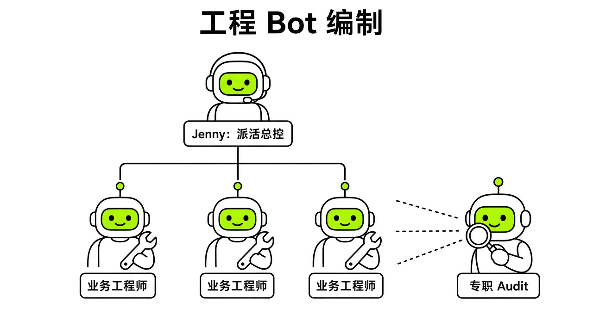
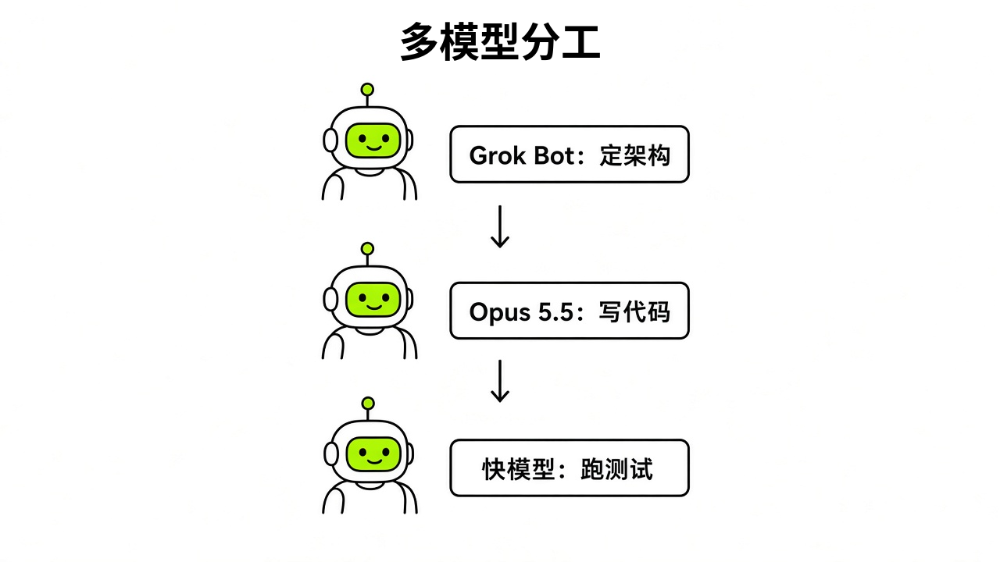
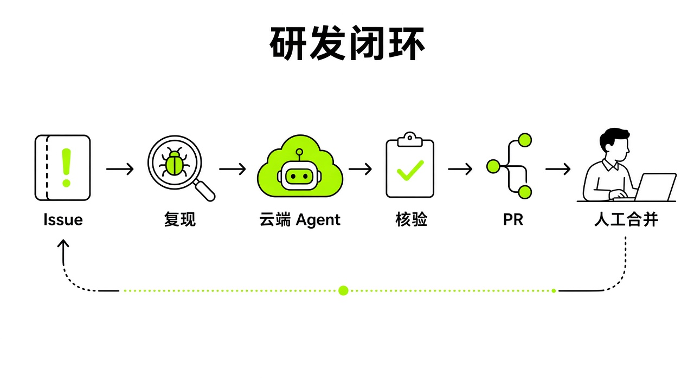

# §18 研发场景：Bot + Cursor 云端 Agent + GitHub · Capstone B

[← 上一章：§17 从零搭一个“中文内容工作室” · Capstone A: Building a Chinese Content Studio](../part6-capstones/17-capstone-a.md) ｜ [📖 返回目录](../../README.md#-目录) ｜ [下一章：§19 额度去哪了 · Where Usage Goes →](../part7-saving/19-usage.md)

---

> **适合谁**：有代码仓库、会用 GitHub 的开发者或技术负责人。**前提条件**：Cursor 账户可用云端 Agent（Cloud Agents）、GitHub 仓库已连接；Notion 看板和 Private Worker 是可选项。不写代码的读者可以跳过本章，或者只看 18.7 的"人工终审"原则。

## 18.1 研发舰队编制：五位专职 Bot 与一位运维管家 · Engineering Fleet Roster

我翻看官方工程指南时发现，如果试图让一个万能 Bot 既读前端需求、又调后端接口、还顺便修部署脚本，轮次稍微一长，上下文就会被琐碎日志挤爆，前脚定好的架构规范后脚就忘得一干二净。SpaceXSI 工程师 Lingxi Li 给出的解法是**拆分为专职工程师舰队**【官方】（https://x.ai/bot/guides/grok-bot-for-engineering ）。Grok Bot 的本质是一台带独立电脑的工程实习生，能替你管编码智能体，还会慢慢学你的工作习惯。Lingxi Li 的团队常驻了五位专职工程 Bot：Baltata 管移动端共享层与 iOS、Shaoruru 管桌面端与 CI 流水线、Hogan 管底层基建与权责不明的问题、Craig 管 Android 端、Quill 管测试套件与安全框架【官方】（https://x.ai/bot/guides/grok-bot-for-engineering ）。

每个专职 Bot 都有独立记忆和有限的上下文窗口，只盯单一领域时，规范抓得最准【官方】（https://x.ai/bot/guides/grok-bot-for-engineering ）。官方团队公布的数据显示，用这套工作流，Lauren 一个月交付了超过 2000 个 Pull Request；Balta 和 Shaoru 四周内用 Grok Bot 搭出了 Grok Bot 自己的骨架；Lingxi Li 也在三周内单凭 Grok Bot 做完了 iOS 初版【官方】（https://x.ai/bot/guides/grok-bot-for-engineering ）。官方市场上已经沉淀出可直接导入的模板，包括 Lingxi 的 Engineer Bot、Nightly Audit Engineer，Eric Zakariasson 的 Projects Manager，以及 Cursor 官方的 SWE【官方】（https://x.ai/bot/guides/engineering ）。

除了写代码的 Bot，编制里最关键的角色是不写业务代码的运维管家 Jenny【官方】（https://x.ai/bot/guides/grok-bot-for-engineering ）。Jenny 每天清晨 5 点找每位工程 Bot 一对一沟通，对操作手册，排查卡点。哪个 Bot 犯了错，Jenny 就介入做根因复盘，更新规则手册并广播给全员，防止同一个错误犯两次【官方】（https://x.ai/bot/guides/grok-bot-for-engineering ）。为了防止多 Bot 互相唤醒空耗上下文，工程群聊必须遵守安静交接规范。Cursor 团队员工建议在配置里写死约束：只有需要对方采取行动时才发消息，不许回收到、感谢或琐碎进度报备，任务完成后只发一份最终摘要【官方·Cursor 员工论坛回复】（https://forum.cursor.com/t/1-500-in-one-week-running-a-grok-bot-fleet-expected-or-a-bug/172705 ）。



*图：工程 Bot 编制分工与运维架构（Jenny + 业务工程师 + 专职 Audit）*

> [!NOTE]
> 📸 **截图位（待补）**：五位专职工程 Bot 与运维 Bot Jenny 的协作群聊与配置文件

## 18.2 从 Issue 到复现包：把 Bug 关进沙箱 · Bug Triage & Reproduction

GitHub 仓库收到新缺陷报告时，直接让大模型进源码库翻找修补，很容易引发代码幻觉。官方用例给出的标准解法是让专门的排查角色先接手，把不可靠的用户反馈转成一份**规范化复现包**【官方】（https://docs.x.ai/grok-bot/use-cases.md ）。排查角色需要连上工单系统、预发沙箱、受控浏览器和抓包工具，在受控的临时测试账号下复现问题，严禁碰线上真实客户数据；测试凭据必须走安全审批交接，不能直接贴在聊天框里【官方】（https://docs.x.ai/grok-bot/use-cases.md ）。此前社区就发生过在全员群聊里误发密码导致密钥暴露的事故【社区】（https://x.com/i/status/2107339523038331338 ）。

收到缺陷 Issue 后，直接向 Bot 派发官方定义的初始任务提示词：

```text
Read this bug report and reproduce it in staging using a fresh test account. Return exact steps, expected and actual behavior, screenshots, browser and OS details, relevant console or network notes, and a minimal test case if possible. Do not use production customer data.
```

Bot 在沙箱内跑完后，会输出一份包含完整操作步骤、预期与实际表现对比、系统环境参数、控制台报错堆栈和最小复现用例的交付包【官方】（https://docs.x.ai/grok-bot/use-cases.md ）。这份材料既是后续编码智能体的输入依据，也是衡量修复是否成功的基准线。

> [!TIP]
> 🧪 【实测·TODO待实测】待在实际工程代码库中验证从 GitHub Issue 抓取到生成复现包的完整用时与准确率。

> [!NOTE]
> 📸 **截图位（待补）**：GitHub Issue 详情页与被打上 bug 标签的初始待办

> [!NOTE]
> 📸 **截图位（待补）**：复现专职 Bot 在云电脑沙箱中抓取的报错日志与浏览器控制台

> [!NOTE]
> 📸 **截图位（待补）**：Bot 生成的规范化 Bug 复现包与前后表现对照

## 18.3 调度 Cursor 云端 Agent：提示词与本地 Worker · Cloud Agent Dispatch

工程 Bot 拿到复现包后，自身不用在桌面开编辑器一行行敲代码，而是作为调度者去唤起 Cursor 云端 Agent【官方】（https://x.ai/bot/guides/grok-bot-for-engineering ）。Lingxi Li 介绍，每个工程 Bot 都能创建 Cursor 云端 Agent、实时读运行转录、审查 PR 附带的测试证据，遇到卡点就排队追加消息或打断重跑，不用工程师在多个 Agent 之间反复切屏盯梢【官方】（https://x.ai/bot/guides/grok-bot-for-engineering ）。借助这种调度机制，团队能将过去手工管 15 个云端 Agent 的上限拓展到**同时并行管理超过 200 个云端 Agent**【官方】（https://x.ai/bot/guides/grok-bot-for-engineering ）。

派发编码任务时，工程 Bot 会按具体场景挂载专属技能，比如用于视觉优化的 `/lingxi-design`、用于代码规范审计的 `/react-native-best-practices`、用于架构评审的 `/lingxi-review`，或者用于产品决策的 `/lingxi-product`【官方】（https://x.ai/bot/guides/grok-bot-for-engineering ）。如果开发环境需要特定内网访问、企业 VPN 或特殊机器配置，官方支持将闲置的 Mac mini 接入为 Cursor Cloud Private Worker。由 Grok Bot 直接调度该本地节点运行云端 Agent，调动本地 iOS 模拟器并回传实时运行截图【官方】（https://x.ai/bot/guides/grok-bot-for-engineering ）。官方提到，这省掉了过去为了保持环境常驻而在家里专门配置主机跑开源工具的麻烦【官方】（https://x.ai/bot/guides/grok-bot-for-engineering ）。

工程 Bot 发起云端编码调度的参考提示词结构如下：

```text
Create a Cursor cloud agent for this reproduction pack. Invoke /react-native-best-practices for code standards. Require proof showing before vs. after screenshots and passing test logs. If the agent hits environment flakiness, send a follow-up to unblock it immediately.
```

> [!TIP]
> 🧪 【实测·TODO待实测】待验证本地 Mac mini 配置为 Private Worker 后的 iOS 模拟器截图回传延迟。

> [!NOTE]
> 📸 **截图位（待补）**：Grok Bot 对话流中调用 Cursor Cloud Agent 的派发指令与参数卡片

> [!NOTE]
> 📸 **截图位（待补）**：Cursor Cloud Agent 实时运行转录（Transcript）与命令执行输出

> [!NOTE]
> 📸 **截图位（待补）**：云电脑 Private Worker（本地 Mac mini）运行 iOS Simulator 的实时画面

## 18.4 Opus 5.5 路由与多模型分工栈 · Opus 5.5 Routing & Model Stack

研发流程中若让高单价模型全程跑格式化或编译报错轮询，额度很快就会耗尽。2026 年 10 月 7 日，Elon Musk 在 X 上公开宣布，Grok Bot 正在接入竞争对手的顶尖模型作为后端，包括 Anthropic 的 Claude Opus 5.5、Midjourney 与 Suno 等接口，根据具体任务的达成概率动态选择最适配的模型【官方】（https://x.com/elonmusk/status/2107724314451878104 ；报道见 https://thenextweb.com/news/grok-bot-claude-opus-midjourney-suno-musk ）。Musk 当时并未公开各类任务具体如何分发到外部模型的规则【社区】（https://thenextweb.com/news/grok-bot-claude-opus-midjourney-suno-musk ）。

在实际研发分工上，社区开发者摸索出一套**多模型分层协作栈**【社区】（https://x.com/i/status/2101944767412129920 ）。在日本开发者的工作流中，先由 Grok Bot 负责网络调研与架构规划，再交由 Claude Code 进行编排，核心开发由 Cursor Projects 承接，日常杂务继续交由 Grok Bot 推进【社区】（https://x.com/i/status/2101944767412129920 ；另见 https://x.com/i/status/2103438409553604976 ）。在 Opus 5.5 支持接入后，社区帖称（个例，https://x.com/i/status/2109300337203183940 ）分工模式可细化为：Grok Bot 充当工作助理与架构拆解者，Opus 5.5 负责攻克算法难点与前端交互实现，Sonnet 5.5 负责编写单元测试与集成测试；另一社区帖称（个例，https://x.com/i/status/2108990316644847920 ）由 Bot 拆分工单后让 Opus 解决重难点，轻量模型处理常规修补，没有人工审批绝不自动合入。发起任务时，社区帖称（个例，https://x.com/i/status/2109265867859177552 ）可直接通过指令呼叫：

```text
Use Cursor cloud agent with Opus 5.5 to implement the core logic for this issue. Keep auxiliary tests and style checks on standard models. Do not merge until human review is complete.
```

> [!TIP]
> 🧪 【实测·TODO待实测】待实际调用 Cursor 云端 Agent 并观测是否成功路由至 Opus 5.5 及其单次 PR 额度消耗。



*图：Opus 5.5 与多模型分工栈拓扑（Grok Bot 架构 → Opus 5.5 编码 → Sonnet/快模型 测试）*

> [!NOTE]
> 📸 **截图位（待补）**：后台模型路由面板中调用 Claude Opus 5.5 的请求记录

## 18.5 自动化闭环：视觉比对、Notion 看板与代码审查 · Feedback Loop & Review

编码智能体把代码写完只是流水线的前半程，没有严格反馈闭环的自动化只会带来大量垃圾变更。Lingxi Li 强调，维系工程 Bot 团队运转的核心是**给予完整的反馈闭环**【官方】（https://x.ai/bot/guides/grok-bot-for-engineering ）。云端 Agent 可以截取屏幕图像，Grok Bot 则利用其多模态能力核验界面改动是否符合要求。视觉呈现与预期不符时，Bot 会直接驳回并督促 Agent 重新修改【官方】（https://x.ai/bot/guides/grok-bot-for-engineering ）。官方团队甚至将 SpaceXSI 的语音 API 接入云端 Agent 的系统音频输入输出，利用语音信号与转录文本自动化测试端到端语音交互能力【官方】（https://x.ai/bot/guides/grok-bot-for-engineering ）。环境偶发波动导致 Agent 停滞时，工程 Bot 会主动介入纠偏【官方】（https://x.ai/bot/guides/grok-bot-for-engineering ）。

为了突破单次上下文窗口的限制，也让人无需翻阅漫长聊天记录即可掌握全局进展，团队设置所有工程 Bot 共同维护一个共享 Notion 数据库看板【官方】（https://x.ai/bot/guides/grok-bot-for-engineering ）。每隔 30 分钟，工程 Bot 会轮巡一次数据库，对其中的每个 Pull Request 执行三项硬性检查：验证 Bugbot 评论与安全扫描结果是否属实、检查 CI 流水线是否报错、排查合并冲突【官方】（https://x.ai/bot/guides/grok-bot-for-engineering ）。一旦发现异常，Bot 立即向云端 Agent 发送纠错指令，并将 Notion 看板上的状态重置回进行中；三项检查全部通过后，任务状态切为待评审，并自动触发代码审查【官方】（https://x.ai/bot/guides/grok-bot-for-engineering ）。审查评估置信度极高且影响范围很小的 PR 会被自动合并；一旦涉及关键变动，则等待工程师人工复核【官方】（https://x.ai/bot/guides/grok-bot-for-engineering ）。

> [!TIP]
> 🧪 【实测·TODO待实测】待验证 Notion 数据库 30 分钟轮询脚本触发自动合并低风险 PR 的稳定性。



*图：研发场景端到端闭环流水线（Issue → 复现 → 云端 Agent → 核验 → PR → 人工合并）*

> [!NOTE]
> 📸 **截图位（待补）**：主工程 Bot 根据排查结果创建工作项并指派到 Notion 看板

> [!NOTE]
> 📸 **截图位（待补）**：Cursor Cloud Agent 提交的 Pull Request 页面及附加测试证据

> [!NOTE]
> 📸 **截图位（待补）**：Grok Bot 多模态比对前后 UI 截图并自动驳回样式偏差的评注

> [!NOTE]
> 📸 **截图位（待补）**：共享 Notion 数据库看板中各 PR 状态在 30 分钟轮巡下的变迁

## 18.6 凌晨三点代码巡检与 P0 应急通道 · Nightly Audits & P0 Process

工程师离线休息时，云端常驻算力正好转去常规治理。官方工程团队设立了**凌晨三点的夜间代码巡检例程**【官方】（https://x.ai/bot/guides/grok-bot-for-engineering ）。每天凌晨 3 点，工程 Bot 会自动启动，清理代码库中的无用死逻辑、优化代码结构、加速客户端加载速度并压缩产物体积。清晨工程师会收到一批清洗干净的 Pull Request，代码重构变成了日常例行机制【官方】（https://x.ai/bot/guides/grok-bot-for-engineering ）。除常规清理外，这套机制还衍生出多种巡检模式：排查遗留漏洞的安全巡检、防止构建时间膨胀的 CI/CD 耗时巡检、填补单语言发布漏洞的国际化巡检、消除 iOS 与桌面端功能差异的双端对齐巡检，以及汇总过去 24 小时已合并 PR 的进度追赶巡检【官方】（https://x.ai/bot/guides/grok-bot-for-engineering ）。

日常巡检之外，面对严重线上故障，团队配置了专门的 P0 紧急干预流程【官方】（https://x.ai/bot/guides/grok-bot-for-engineering ）。云端 Agent 在启动开发实例、安装环境与运行测试套件时往往较耗时，一旦某个任务被打上 P0 标签，工程 Bot 就会启动高频临时 Routine，每隔 5 分钟检查一次 Agent 的运行转录，分析其推演逻辑，并在 Agent 出现卡顿或无谓消耗时间时主动纠偏引导【官方】（https://x.ai/bot/guides/grok-bot-for-engineering ）。Lingxi Li 特别提醒，这种高频主动干预机制消耗 Token 的速度远超常规操作，必须严格限定在真正的紧急场景下启用【官方】（https://x.ai/bot/guides/grok-bot-for-engineering ）。

Lingxi Li 最喜欢的夜间提示词原文只有一句："You have six hours tonight. Build whatever you want. Have fun!"【官方】（https://x.ai/bot/guides/grok-bot-for-engineering ）。下面是本书在这句话基础上加了清理范围和 PR 要求的改写版【推测】：

```text
You have six hours tonight. Clean up dead logic, optimize bundle size, and improve startup latency across our active components. Package each distinct improvement into a clean PR with passing tests. Do not merge anything.
```

> [!TIP]
> 🧪 【实测·TODO待实测】待在私有代码库中运行 3:00 a.m. 巡检 Routine 并记录无效死代码清理 PR 的采纳率。

> [!NOTE]
> 📸 **截图位（待补）**：凌晨 3 点 Nightly Audit 专职 Bot 发起的无用代码清理 PR

> [!NOTE]
> 📸 **截图位（待补）**：P0 紧急任务触发时 5 分钟转录监控的实时干预卡片

## 18.7 人工终审、合并红线与真实额度核算 · Human Gate & Usage Economics

无论自动化链路多么完善，涉及核心业务边界时绝不能交出最终控制权。官方安全规范明确规定，不可逆操作必须保留人工确认，后台由 Bot 触发的操作审批卡约在 10 分钟后自动过期失效【官方】（https://docs.x.ai/grok-bot/approvals-security-and-privacy.md ）。大影响范围的代码合并、生产数据库变更以及关键凭证权限，都必须留在**人工审查关卡**前【官方】（https://x.ai/bot/guides/grok-bot-for-engineering ）。

研发流水线落地的另一大硬约束是成本核算。根据官方最新定价，Cursor 付费个人方案分为 Pro（20 美元/月）、Pro+（60 美元/月）与 Ultra（200 美元/月），团队方案为 Teams（40 美元/人/月）【官方】（https://cursor.com/pricing ）。社区整理的对应档位显示，SuperGrok 为 30 美元/月、SuperGrok Plus 为 100 美元/月、SuperGrok Heavy 为 300 美元/月【社区】（https://penchan.co/ai/grok/grok-bot/ ）。Grok Bot 自带独立的每周用量池，官方未公布具体额度数字【官方】（https://cursor.com/help/grok-bot/plans ）。第三方文档记录指出，Bot 触发的 Cursor 云端 Agent 会计入 Cursor 套餐自身的用量【社区】（https://learngrokbot.com ）。每周额度耗尽后，若开启按需付费（On-demand），可在系统设置中将月度封顶上限设为无、固定金额或无限制【官方】（https://x.ai/changelog/bot ）。

在真实额度消耗方面，官方论坛中员工曾披露，高负荷运转的 Bot 每一轮对话都需要重新读取完整上下文，每步约消耗 8 万至 9 万 Token，且多 Bot 协作中约有三分之一的交互属于 Bot 之间的相互唤醒空转【官方·Cursor 员工论坛回复】（https://forum.cursor.com/t/1-500-in-one-week-running-a-grok-bot-fleet-expected-or-a-bug/172705 ）。社区帖称（个例，https://x.com/miniyarov/status/2105428357273800799 ）在 Cursor Pro 档位下，每条交互消息大约消耗 1% 的周额度；如果配置了无休止的 5 分钟轮询 Routine，单月空转消耗可达数百美元【社区】（https://x.com/fleyta88/status/2109346840382415019 ）。工程落地的省额原则非常明确：每个独立缺陷修复任务必须开启全新对话以切断臃肿上下文、多 Bot 间严禁无意义的客套回复、以窄范围事件驱动替代高频轮询，高危合并动作始终收口在人工最终确认。

> [!TIP]
> 🧪 【实测·TODO待实测】待记录一个标准 Issue-to-PR 全流程在 Cursor Pro 与 Pro+ 方案下的周额度百分比消耗。

> [!NOTE]
> 📸 **截图位（待补）**：人工审查高风险代码变更并最终确认合并的审批卡片

> [!NOTE]
> 📸 **截图位（待补）**：Dashboard/usage 界面展示的周额度与 Cursor Cloud Agent 消耗曲线

## 本章来源

- https://x.ai/bot/guides/grok-bot-for-engineering
- https://x.ai/bot/guides/engineering
- https://docs.x.ai/grok-bot/use-cases.md
- https://docs.x.ai/grok-bot/approvals-security-and-privacy.md
- https://x.ai/news/designing-grok-bot
- https://x.ai/changelog/bot
- https://cursor.com/pricing
- https://cursor.com/help/grok-bot/plans
- https://thenextweb.com/news/grok-bot-claude-opus-midjourney-suno-musk
- https://x.com/elonmusk/status/2107724314451878104
- https://x.com/i/status/2101944767412129920
- https://x.com/i/status/2103438409553604976
- https://x.com/i/status/2107339523038331338
- https://x.com/i/status/2109265867859177552
- https://x.com/i/status/2109300337203183940
- https://x.com/i/status/2108990316644847920
- https://x.com/miniyarov/status/2105428357273800799
- https://x.com/fleyta88/status/2109346840382415019
- https://penchan.co/ai/grok/grok-bot/

---

[← 上一章：§17 从零搭一个“中文内容工作室” · Capstone A: Building a Chinese Content Studio](../part6-capstones/17-capstone-a.md) ｜ [📖 返回目录](../../README.md#-目录) ｜ [下一章：§19 额度去哪了 · Where Usage Goes →](../part7-saving/19-usage.md)
