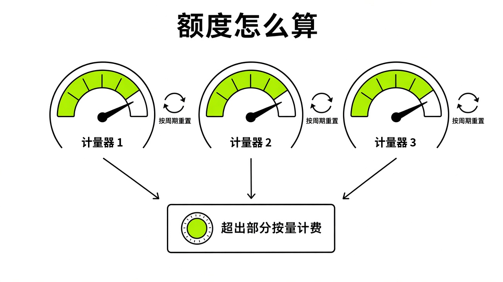
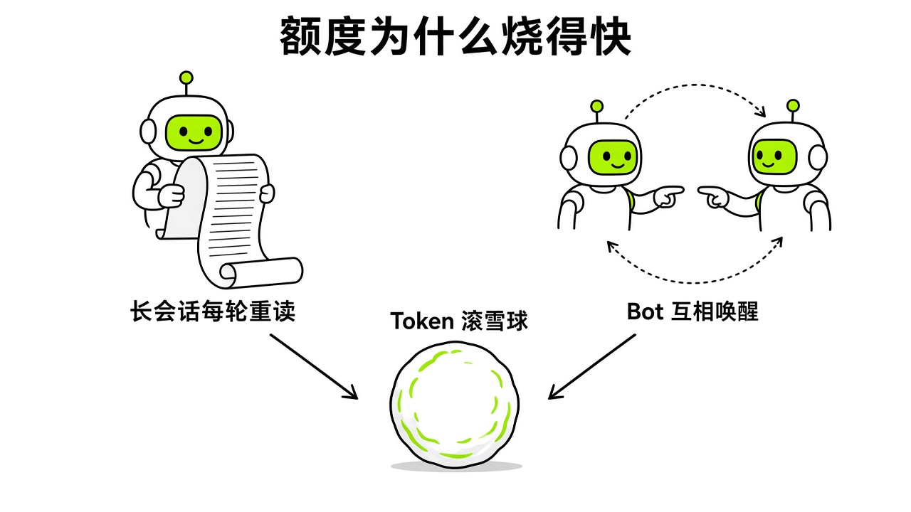

# §19 额度去哪了 · Where Usage Goes

[← 上一章：§18 研发场景：Bot + Cursor 云端 Agent + GitHub · Capstone B](../part6-capstones/18-capstone-b.md) ｜ [📖 返回目录](../../README.md#-目录) ｜ [下一章：§20 省钱心法 · Saving →](../part7-saving/20-saving.md)

---

> **适合谁**：所有用户，尤其是刚收到"额度用尽"提示、或者担心被意外扣费的新手。本章不需要任何技术背景。

## 19.1 周额度、按需消费、月上限是三套机制 · Three Meters

假设你在调研社区讨论时发现，新手最常碰到的问题就是额度突然见底。周三晚上派了两个整理网页的任务，周四早上一开客户端，输入框上方就挂着一条深色横幅，提示周额度已达到上限，还要再等四天才会重置。很多人看到这里的反应就是慌：是不是月付订阅失效了？还是系统出了扣费 Bug？要不要赶紧再去买个号？

**每周包含用量、额外/按需消费和月度限额是三套完全独立的控制逻辑**（https://ofox.ai/zh/blog/grok-bot-weekly-usage-on-demand-limit/）。不把这三套计量机制拆开，后面排查账单或者调自动化任务就会到处踩坑。自 2026 年 10 月 18 日官方正式将 Grok Bot 并入 **The X Subscription** 三合一统一订阅体系起（https://x.com/bot/status/2110063783796572496，https://cursor.com/help/the-x-subscription/overview），当前生态内并存着**新旧两套计量与结账体系**（https://cursor.com/help/grok-bot/plans，https://cursor.com/cn/help/grok-bot/plans）。理解你自己的账号究竟处在哪一套体系下，是排查额度去向的第一步。

### 一、全新主推体系：The X Subscription 三合一共享周池与 Prepaid Credits 预付机制

在 2026 年 10 月中旬上线的 **The X Subscription** 下，一套订阅同时整合了 **Grok**、**Cursor** 与 **X Premium** 三大产品线（https://cursor.com/help/the-x-subscription/overview，https://cursor.com/help/grok-bot/plans）：

1. **档位准入与单向切换规则**：
   - **包含 Grok Bot 的档位**：**Premium（$30/月）**、**Super（$100/月）** 与 **Ultra（$200/月）** 均直接包含 Grok Bot 使用权限；而 **Free（$0）** 与 **Plus（$8/月）** 档位不包含 Grok Bot（https://cursor.com/help/grok-bot/plans，https://cursor.com/cn/help/grok-bot/plans）。
   - **不可逆的单向升级**：既有独立 Cursor 订户可以随时通过 `cursor.com/unify` 或 `accounts.x.ai/unify` 主动升级合并至 The X Subscription，但官方明确规定，**一旦切换至 The X Subscription，将无法退回旧版独立订阅计划**（https://cursor.com/help/the-x-subscription/overview，https://cursor.com/help/grok-bot/plans）。
   - **合并时的退费与移动端渠道双扣预警**：通过 `cursor.com/unify` 合并升级时，网页端直接扣款的旧计划会自动取消并按剩余天数退还折算费用（prorated refunds）；但通过 **Apple App Store 或 Google Play** 订阅的旧账单无法被系统自动取消，用户必须手动前往手机系统订阅管理页取消，否则会产生双份扣费（https://cursor.com/help/the-x-subscription/overview）。

2. **第一套计量器：三端共用的同一个周额度池（One Weekly Usage Pool）**：
   - 与旧版独立套餐“各管各账”完全不同，在 The X Subscription 体系下，**Grok Bot、Grok 与 Cursor 共用同一个周额度池（one weekly usage pool）**（https://cursor.com/help/grok-bot/plans，https://cursor.com/help/the-x-subscription/overview）。
   - 该周额度池每周固定重置，未用完的周额度不会结转至下一周（https://cursor.com/help/grok-bot/plans）。由于三大产品天然共用同一个底层账号与额度池，在该体系下不再需要手动操作 SuperGrok 或 X 账号关联。

3. **第二与第三套计量器：Prepaid Credits（预付充值额度）与月度额外消费封顶**：
   - **超额消费改走预付充值而非后付费账单**：在 The X Subscription 下，当每周包含的共享周额度池耗尽后，系统**不会**产生传统的后付费月度账单，而是直接从 **Prepaid Credits（`Additional usage credits` 预付充值额度）** 中实时扣减（https://cursor.com/help/grok-bot/plans，https://cursor.com/cn/help/grok-bot/plans）。
   - **充值路径与自动续充**：用户需前往 `grok.com/dashboard/billing` 下的 `Additional usage credits` 模块预先充值，支持开启 **Auto Top-up（自动充值）**，并可配置独立的 **Monthly additional usage limit（月度额外消费封顶上限）**（https://cursor.com/help/grok-bot/plans）。如果不充值 Prepaid Credits，周额度池跑到 100% 后 Bot 就会安全停工，绝不会倒欠扣费。
   - **第三方模型扣费边界**：官方计费文档特别说明，在 The X Subscription 体系下，当你在 Cursor IDE 中调用非 Grok 系列的第三方模型（third-party models）时，费用**直接从 Prepaid Credits（预付额度）中扣除**，而不会消耗包含在套餐内的 Grok 共享周额度池（https://cursor.com/help/grok-bot/plans，https://cursor.com/help/the-x-subscription/overview）。

| 对比维度 | The X Subscription（2026-10-18 起主推） | Legacy 独立 Cursor 计划（未迁移老订户） |
| :--- | :--- | :--- |
| **适用档位与月费** | Premium $30 / Super $100 / Ultra $200（Free $0 与 Plus $8 不含 Bot） | Cursor Pro $20 / Pro+ $60 / Ultra $200 / 自助 Teams $40 |
| **周额度池隔离性** | **三端共享同一个周额度池**（Grok Bot + Grok + Cursor 共用） | **Grok Bot 独立周池**（仅移交 Cloud Agent 写代码时扣 Cursor 额度） |
| **账号关联规则** | 天然三合一，无需手动绑定 | 可通过 `cursor.com/bot/onboarding` 绑定 SuperGrok / X Premium+，不叠加取高档 |
| **周池耗尽后的溢出机制** | 扣减 **Prepaid Credits（预付充值额度）**，无预付余额即停工 | 走 **Post-paid On-demand（后付费按需计费）**，个人默认关闭、Teams 默认开启 |
| **Cursor 调用非 Grok 第三方模型** | 直接扣减 **Prepaid Credits（预付额度）** | 计入原 Cursor 套餐模型额度或后付费按需账单 |
| **账单与限额管理后台** | `Settings > Usage & Billing` 及 `grok.com/dashboard/billing` | `Settings > Usage & Billing` 及 `cursor.com/dashboard > Spending` |

### 二、既有保留体系：Legacy 独立 Cursor 计划与后付费按需计费

只要老订户不主动在 `cursor.com/unify` 执行单向合并，原有的独立订阅计划与计费规则依然完整保留（https://cursor.com/help/grok-bot/plans）：

第一套机制是订阅自带的每周包含用量。官方叫它 Weekly usage limit，在手机端简称为 Weekly usage（https://cursor.com/help/grok-bot/plans）。所有付费的个人 Cursor 套餐——Pro 每月 20 美元、Pro+ 每月 60 美元、Ultra 每月 200 美元（https://cursor.com/pricing），以及 Cursor Teams 自助套餐每人每月 40 美元（https://cursor.com/pricing），都直接包含 Grok Bot 的使用资格（https://cursor.com/help/grok-bot/plans）。要是没有 Cursor 付费订阅，在旧版独立体系下通过 `Settings > Usage & Billing > Manage Plan > Get Access with Grok`（或 `cursor.com/bot/onboarding`）绑定个人 SuperGrok、SuperGrok Plus、SuperGrok Heavy 或者 X Premium+ 账号也能拿到额度，但官方明确规定 SuperGrok Lite 不包含 Grok Bot（https://cursor.com/help/grok-bot/plans）。档位划分上，官方只给了相对顺序：Pro 低于 Pro+，Pro+ 低于 Ultra；关联档里 SuperGrok 和 X Premium+ 都低于 SuperGrok Plus，Plus 低于 Heavy，Heavy 是"最高关联档"（https://cursor.com/help/grok-bot/plans）。Cursor 档和关联档之间是否一一对应，官方没有写明，社区通常把它们按 Pro≈SuperGrok、Pro+≈Plus、Ultra≈Heavy 来对照。自助开通的 Grok Business 席位也能用，用 Sign in with Grok 登录即可（同上）。

在尚未迁移至 The X Subscription 的旧版独立个人套餐下，这里的周额度拥有完全独立的计量池。Grok Bot 干活绝不扣你在 Cursor 编辑器里写代码的模型额度，你在编辑器里写代码也不会影响 Grok Bot 的周用量，去 Grok 独立网页应用聊天又是另一套限额系统（https://cursor.com/help/grok-bot/plans，https://learngrokbot.com/usage-limits）。在旧版独立套餐中只有一个连通例外：当 Bot 在对话中把写代码任务移交给 Cursor Cloud Agent 时，Bot 自己的轮次消耗 Grok Bot 周用量，Cloud Agent 写代码的部分则直接计入 Cursor 套餐额度（https://cursor.com/help/grok-bot/plans，https://learngrokbot.com/usage-limits）。

多买旧版独立订阅也不会让额度叠加。官方文档写得很清楚，独立 Cursor 套餐和关联的 SuperGrok 或 X Premium+ 额度无法叠加（do NOT stack），系统只取其中周额度更高的那一档（https://cursor.com/help/grok-bot/plans）。而且账号关联是永久的，一旦绑定就不能解绑，也不能转移给其他 Cursor 账号（https://cursor.com/help/grok-bot/plans）。如果你在关联账号上把 SuperGrok 升级到了 Plus 或 Heavy，官方说明周用量刷新到新档位可能需要最多 24 小时（https://cursor.com/help/grok-bot/plans，https://ofox.ai/zh/blog/grok-bot-weekly-usage-on-demand-limit/）。在这 24 小时内不用重复购买，也不用反复折腾解绑。

第二套机制是超额消费（The X Subscription 下为 Prepaid Credits 预付额度扣减，尚未迁移的旧版独立 Cursor 计划下为 Post-paid On-demand usage 后付费按需消费）（https://cursor.com/help/grok-bot/plans）。周额度用完后，系统不会偷偷替你透支扣钱。在 The X Subscription 下，若未在 `grok.com/dashboard/billing` 充值 `Additional usage credits`，周额度用尽即停；而在旧版独立 Cursor 计划下，如果你在客户端设置里把 `Settings > Usage & Billing > On-demand monthly limit` 保持为默认的关闭状态（None），一旦周额度跑到 100%，所有的 Bot 都会就地停工，直到倒计时结束重置，期间不会扣你信用卡一分钱（https://cursor.com/help/grok-bot/plans，https://learngrokbot.com/usage-limits）。注意：这里说的"默认关闭"只适用于个人账户；旧版 Cursor Teams 团队账户的按需用量默认是开启的，团队成员要先问管理员上限是多少（https://cursor.com/help/grok-bot/plans）。在旧版独立计划中，只有当你主动开启按需消费后，Bot 才能在周额度耗尽后继续跑，超额部分的费用全部由 Cursor 统一按实际消耗的模型 Token 后付费计费；哪怕你是靠绑定 SuperGrok 或 X Premium+ 拿到的使用资格，旧版按需账单依然记在 Cursor 头上（https://cursor.com/help/grok-bot/plans，https://ofox.ai/zh/blog/grok-bot-weekly-usage-on-demand-limit/）。另外，如果 Cursor 账户里有推荐或促销赠金，周额度耗尽后系统会优先扣除赠金；即便按需限额设为 0 美元，赠金也会正常消耗，不会产生信用卡扣款（Cursor 员工论坛回复，https://forum.cursor.com/t/grok-bot-draining-cursor-credit-pool/169982）。

第三套机制是额外/按需消费的月度上限（在 The X Subscription 的 `grok.com/dashboard/billing` 中对应 `Monthly additional usage limit`；在旧版独立 Cursor 计划的客户端中对应 `Settings > Usage & Billing > On-demand monthly limit`，网页端对应 `cursor.com/dashboard > Spending > Monthly Limit`）（https://cursor.com/help/grok-bot/plans）。你可以设成固定金额，也可以设成不限额（https://learngrokbot.com/usage-limits）。这里有个很多人都会踩的坑：月度限额并不是任务执行过程中的绝对硬停机线（https://cursor.com/help/grok-bot/plans，https://ofox.ai/zh/blog/grok-bot-weekly-usage-on-demand-limit/）。官方文档写明了，一个正在运行的长任务即使中途超出了月度限额，系统依然允许它跑完并完成交付。只有等这个任务结束后，后续新任务才会被拦截。别以为设了 10 美元限额账单就绝不会变成 12 美元，想在提示词里要求强制停机也没用。

官方提供的免费试用也是同理。它本质是一笔固定的使用额度，附带 7 天有效时间窗口（https://cursor.com/help/grok-bot/plans）。时间和额度是两个独立条件，拿试用额度去跑繁重大任务，几个小时内额度就可能先于 7 天窗口耗尽；官方明确说了，用完的试用额度不会补发（https://cursor.com/help/grok-bot/plans）。7 天试用绝不等于 7 天无限用。



*图：Grok Bot 三套计量器、周期与溢出计费流转关系*

## 19.2 吞额度的常见元凶 · Burners

很多人在客户端里只聊了几句，或者刚建了两个定时任务，就发现周额度缩水了一大截，总怀疑系统在偷跑。其实 Grok Bot 计费看的是背后真实发生的执行步骤和 Token 消耗，绝不是看你在对话框里输入了几个字（https://cursor.com/help/grok-bot/plans，https://learngrokbot.com/usage-running-out）。

要搞清楚额度怎么没的，先得看它的上下文处理机制。**Grok Bot 每次回复前，都会把当前会话的历史记录完整重读一遍**（Cursor 员工论坛回复，https://forum.cursor.com/t/1-500-in-one-week-running-a-grok-bot-fleet-expected-or-a-bug/172705；https://learngrokbot.com/usage-running-out）。系统不会在每次聊完后自动压缩历史，只有当上下文长度逼近模型极限时才会进行总结（Cursor 员工论坛回复，https://forum.cursor.com/t/1-500-in-one-week-running-a-grok-bot-fleet-expected-or-a-bug/172705）。官方技术人员查大额账单时提到，那些重度调用的 Bot 每走一步往往都要重新读取大约 80,000 到 90,000 个 Token（Cursor 员工论坛回复，https://forum.cursor.com/t/1-500-in-one-week-running-a-grok-bot-fleet-expected-or-a-bug/172705）。如果一个会话连续用了好几天，里面堆满了网页抓取结果和长篇输出，哪怕你最后只是追问一句搞定没有，它也必须先吃下前面数万个 Token 的历史上下文，单次回话成本直接滚雪球。

假设你翻看官方文档和社区反馈，可以整理出几个最常见的吞额度元凶。

第一个元凶是会话常年不刷新，还把 Routine 挂在日常聊天的 Bot 身上。新手最容易把一个 Bot 当成日常聊天窗口，所有任务都在同一个对话流里累加（https://learngrokbot.com/usage-running-out）。更隐蔽的坑在定时任务的运行机制：Routine 每次运行，都是在它所属 Bot 的对话流中进行的（https://learngrokbot.com/usage-running-out）。如果你把一个每小时巡检网页的 Routine 挂在白天频繁聊天的 Bot 下，这个 Routine 每次启动时，都得先把白天聊过的几万字背景全盘重读一遍。哪怕它只是抓取单行状态，也会白白消耗巨大的上下文额度。

第二个元凶是高频轮询空转，没设无变化退出机制。有人把 Routine 的触发间隔设得极密，比如每 15 分钟甚至每 5 分钟跑一次（https://cursor.com/help/grok-bot/routines）。社区帖称每 5 分钟触发一次的 Routine，一个月内会执行 8,640 次（个例）（https://x.com/fleyta88/status/2109346840382415019）。每 15 分钟执行一次，一天就会产生将近 100 次运行（https://learngrokbot.com/usage-running-out）。如果在 Routine 提示词里没写明数据无变化立即退出，Bot 每次都会老老实实打开网页、抓取、分析并写长汇报。在公共 Slack 频道挂监听也是同样的道理，活跃频道里每来一条新消息都会触发一次完整的 Bot 回合，一天之内烧光整周额度很常见（https://learngrokbot.com/usage-running-out）。

第三个元凶是长时间操作浏览器、频繁截图，在卡顿页面上死磕。Bot 操作云电脑里的浏览器属于高开销动作（https://learngrokbot.com/usage-limits）。目标网站一旦出现动态加载慢、反爬弹窗或者页面假死，Bot 会自己多次滚动、重试和重新截图分析。第三方 Grok Bot Wiki（非官方站点）写道，让 Bot 在卡顿网页上反复折腾 20 分钟消耗的 Token 和步骤，远比连续回答几十次短文本问答昂贵得多（https://www.grokbotwiki.com/guides/grok-bot-weekly-usage-limit）。

第四个元凶是多 Bot 群聊互相客套，甚至陷入死循环。多 Bot 协作群聊看着省事，但群内每个 Bot 的发言都会被单独计费，Bot 之间互通消息同样消耗额度（https://learngrokbot.com/usage-limits）。官方技术人员指出，在某些大额消耗账户里，大约三分之一的调用纯粹是 Bot 之间互相唤醒造成的（Cursor 员工论坛回复，https://forum.cursor.com/t/1-500-in-one-week-running-a-grok-bot-fleet-expected-or-a-bug/172705）。一个 Bot 汇报完成，另一个回复收到，第三个再补充感谢，这些客套交互在后台极吃 Token。Cursor 员工在论坛里建议，在多 Bot 协作提示词里直接加入安静交接指令（https://forum.cursor.com/t/1-500-in-one-week-running-a-grok-bot-fleet-expected-or-a-bug/172705；整理见 https://learngrokbot.com/usage-running-out）：

```text
From now on, only message another Bot when it needs to act. No acknowledgments, no thanks, no progress updates. Send one summary when the work is done.
```

更极端的情况是 Bot 自己陷入死循环。社区帖称有用户建了一个叫 Elon 的 Bot，刚建完没输任何提示词，Bot 自动在网上搜了马斯克头像换上，随后陷入自言自语并反复尝试生成马斯克真人图的死循环（die loop），客户端停不下来，一口气白白烧掉了 4% 的周额度（个例）（https://linux.do/t/topic/2807876）。服务故障期间也容易踩这种坑。2026 年 10 月 8 日全网 Routine 出现系统级故障，论坛里有用户说排查过程本身就耗掉了额度，有人当天用掉 30%，有人超过 90%。Cursor 员工 @deanrie、@kevinn 说明原因是平台负载过高，暂停、恢复、复制或重建 Routine 都没用，错过的运行也不会补跑（https://forum.cursor.com/t/all-grok-bot-routines-failed-to-run/174125）。

第五个元凶是在云电脑中套娃跑其他外部大模型工具。社区帖称有用户为了省 Token，在 Grok Bot 的云电脑里装了 Codex 和 Claude Code。结果 Codex 的额度消耗极快，一个自动化任务还没跑完，五小时的额度就用光了；那个从没用过的 Claude 免费号后来也收到了封号邮件，原因帖子里没说明，是否与机房 IP 有关属于推测（个例）（https://x.com/i/status/2107100457231651312）。用虚拟机套娃跑高消耗开发工具，往往得不偿失。

除了上述五个经典陷阱外，随着 2026 年 10 月下旬 The X Subscription 的普及以及官方 v0.75.2 版本对自动化配额的放宽，社区博主 Charlie（`@charlie_pmp`）通过实测复盘指出了导致用户感觉“周额度掉电突然变快”的**第六与第七两大新元凶**（https://x.com/charlie_pmp/status/2114214503416271131）：

第六个元凶是**三端共享抽水效应（Cross-Surface Pool Drain）**。在旧版独立 Cursor 套餐下，用户在 Cursor IDE 里通宵写代码，或者在 Grok 网页/手机 App 里高频对话、生成图片，都与 Grok Bot 的周额度池互不相干；但升级到 **The X Subscription** 后，**Grok Bot、Grok App 与 Cursor IDE 三端改从同一个周额度池抽水**（https://cursor.com/help/grok-bot/plans，https://cursor.com/help/the-x-subscription/overview，https://x.com/charlie_pmp/status/2114214503416271131）。很多开发者白天在 Cursor 里用大模型跑了几轮大型代码库重构，晚上回到 Grok Bot 客户端一看，发现哪怕自己的 Bot 一整天没说一句话，剩余周额度也已经掉了十几个百分点。因此，在三合一订阅下排查额度去向时，必须把自己在 Cursor 编码和 Grok 聊天的消耗一并算进总账。

第七个元凶是 **v0.75.2 配额松绑后的冗余 Routine 高频空转**。在 2026 年 10 月 22 日发布的 v0.75.2 更新中，官方将 Routine 的小时级运行频率限制大幅上调至**全账号所有 Bot 合计 300 次/小时（300 runs per hour across all Bots），以及单条 Routine 最高 200 次/小时（200 runs per hour for a single Routine）**（虽然定时触发的最小间隔仍为 5 分钟，但邮件、消息与 Webhook 等事件触发型 Routine 可以跑到极高并发）（https://x.ai/changelog/bot，https://cursor.com/help/grok-bot/routines）。`@charlie_pmp` 提醒（https://x.com/charlie_pmp/status/2114214503416271131），如果用户没有利用 v0.71.2 新增的 `@mail.grokbot.com` 专属邮箱 `+alias` 加号别名（https://x.com/SamSokolin/status/2110496237241667621，https://cursor.com/help/grok-bot/agent-email）来精准过滤触发源，或者保留了多条未加精简改写的冗余定时 Routine 在后台静默空转，放宽后的 300 次/小时上限反而会让未加约束的触发器在几小时内加速烧穿整个共享周额度池。



*图：长会话重读机制与多 Bot 互相唤醒引发的 Token 滚雪球效应*

## 19.3 怎么看用量 · Reading Usage

要守住额度，先得学会看面板。

桌面客户端点左下角头像，或者进 Settings 选择 Usage & Billing 页面（https://learngrokbot.com/usage-limits）。v0.63.0 起，Settings → Usage & Billing 会显示包含用量和下次重置时间，不再误显示"套餐不含用量"（https://x.ai/changelog/bot，https://learngrokbot.com/usage-limits）。在最新的 v0.75.5 客户端中，进入 `Settings > Usage & Billing` 面板，你可以一站式查看当前周期的**周额度进度条（Weekly usage progress bar）**、**Prepaid Credits（预付额度）实时余额**，并通过面板上的 **`Manage Plan`** 与 **`Manage Billing`** 快捷入口直接管理订阅档位与账单设置（https://cursor.com/help/grok-bot/plans，https://cursor.com/docs/grok-bot/settings）。

在网页端，根据你所处的订阅体系不同，有两个对应的核账入口：
1. **The X Subscription 统一账单后台（`grok.com/dashboard/billing`）**：如果你已经加入或升级至 The X Subscription，直接访问 `grok.com/dashboard/billing` 即可查看三合一共享周额度状态、在 `Additional usage credits` 模块充值 **Prepaid Credits**、开关 **Auto Top-up（自动充值）**，以及调整 **Monthly additional usage limit（月度额外消费封顶上限）**（https://cursor.com/help/grok-bot/plans，https://cursor.com/help/the-x-subscription/overview）。
2. **Legacy 独立 Cursor 账单与调用明细后台（`cursor.com/dashboard`）**：在网页端，可以直接访问 cursor.com/dashboard，在 Spending 页面核对 Grok Bot 卡片的明细与按需消费上限（https://learngrokbot.com/usage-limits）。如果想了解任务背后实际调用的模型，可以登录 cursor.com/dashboard/usage 查看后台记录，确认任务是路由到了 opus 5.5 还是使用了默认的 grok-bot-default（https://linux.do/t/topic/2990677）。

看面板时别想当然：**面板上的百分比是相对消耗比例，不是固定的美元金额或消息条数**（https://ofox.ai/zh/blog/grok-bot-weekly-usage-on-demand-limit/）。很多人看到剩余额度从 80% 掉到 74%，就以为自己花掉了 6 美元，或者觉得 1% 就是固定的一条对话。社区帖称 Cursor Pro 的 Bot 额度相当于 250 美元或 450 美元（个例）（https://linux.do/t/topic/2848179），也有社区帖称 Pro 账号每发一条消息大约消耗 1% 的周额度（个例）（https://x.com/miniyarov/status/2105428357273800799）。

官方从未公布过任何档位对应的具体 Token 数量或折算金额（https://cursor.com/help/grok-bot/plans）。面板上的百分比只是你当前在一周动态额度池中的使用进度。一条简单的单行文字回答，在独立会话中可能只让周额度波动 0.01%；而一个包含翻长网页、抓数据、跑脚本的任务，消耗可能是前者的数十倍（https://learngrokbot.com/usage-running-out）。脱离了步骤复杂度与会话上下文长度，把百分比生搬硬套成单条消息成本没有任何意义。

目前客户端没法按单个 Bot 或单个 Routine 拆分显示用量明细（https://learngrokbot.com/usage-running-out）。面板给出的永远是整个账户的统揽百分比。想弄清楚具体哪项任务最吃额度，不能靠猜，可以在没有其他定时任务跑的时间段（如果是 The X Subscription 订户，测试期间还应暂停在 Cursor IDE 和 Grok App 中的操作），单独运行某一个受控任务，记录执行前后的百分比净变化（https://ofox.ai/zh/blog/grok-bot-weekly-usage-on-demand-limit/）。

测试独立受控环境下单次网页浏览任务与纯文本问答前后的周用量百分比变化。

> [!NOTE]
> 📸 **截图位（待补）**：Settings > Usage & Billing 面板中的周用量百分比与重置倒计时
> [!NOTE]
> 📸 **截图位（待补）**：cursor.com/dashboard/usage 面板中的后台模型调用记录

---

[← 上一章：§18 研发场景：Bot + Cursor 云端 Agent + GitHub · Capstone B](../part6-capstones/18-capstone-b.md) ｜ [📖 返回目录](../../README.md#-目录) ｜ [下一章：§20 省钱心法 · Saving →](../part7-saving/20-saving.md)
