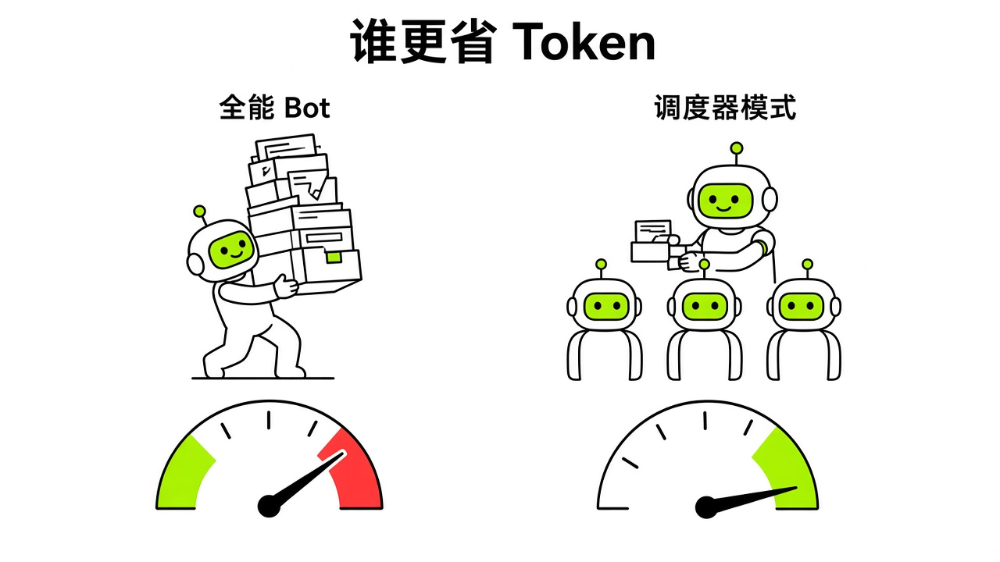
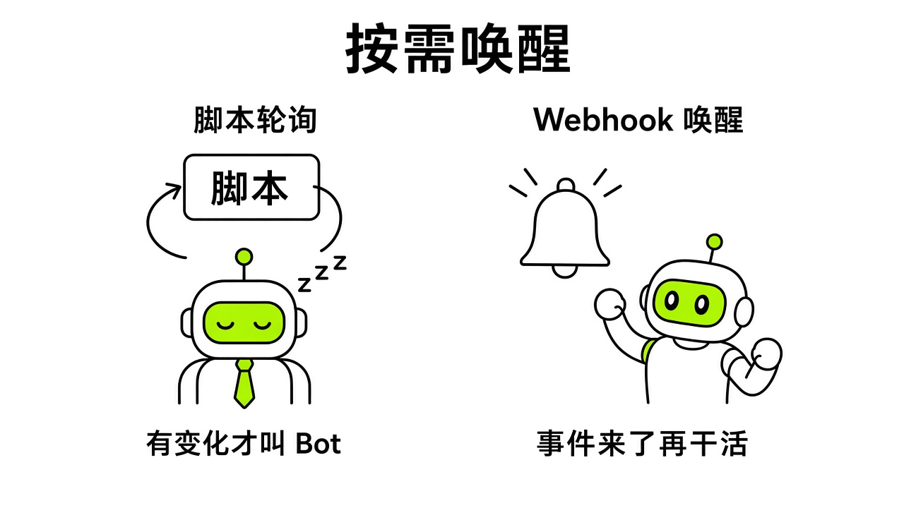
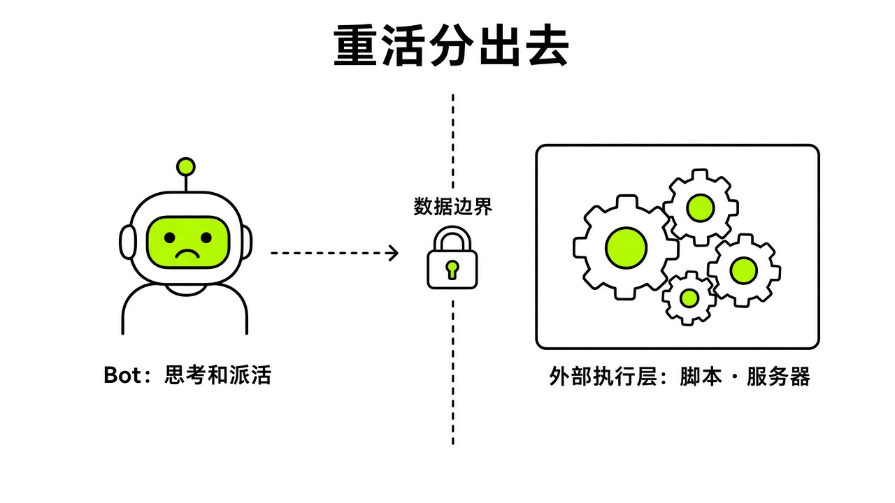
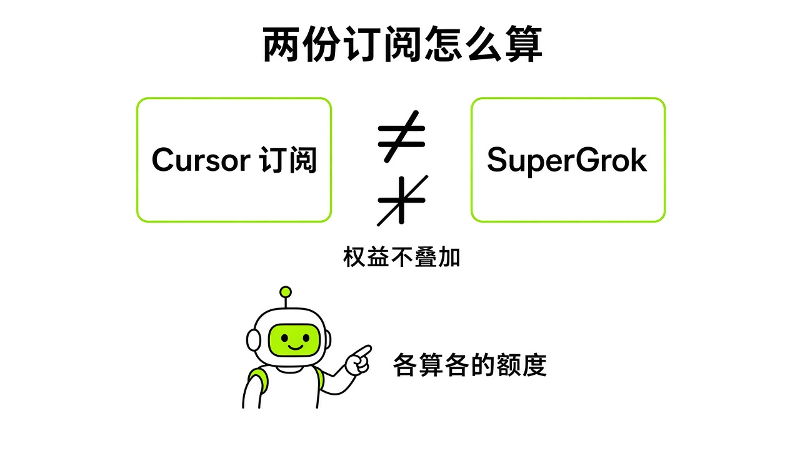

# §20 省钱心法 · Saving

[← 上一章：§19 额度去哪了 · Where Usage Goes](../part7-saving/19-usage.md) ｜ [📖 返回目录](../../README.md#-目录) ｜ [下一章：§21 事故档案 · Incident Files →](../part8-pitfalls/21-incidents.md)

---

> **适合谁**：所有用户都该读 20.1 和 20.4。20.2、20.3 要写脚本、配 Webhook 和 API Key，零代码读者可以先跳过，或者把相关段落整段交给 Bot 让它代劳。

我翻看社区讨论，发现新手踩得最多的坑就是额度焦虑。很多人周一刚开通，周三晚上额度就见底了，代码甚至没写出几万行。大家很容易以为是官方给的额度太少，或者以为 Bot 每次聊天都在扣大钱。其实 Grok Bot 的消耗逻辑和网页里的大模型对话完全不同。照搬传统聊天机器人的用法，周额度撑不过三天；一旦开了按需付费，月底账单更吓人。我翻完官方文档和社区踩坑案例，把理出来的四套省钱架构整理在这一章。每一步都有明确的计费机制和出处，把边界讲清楚。

## 20.1 Bot 只调度、不执行 · Dispatcher Pattern

很多人刚接触 Grok Bot，习惯把它当全能苦力：把几万行项目源码一股脑拖进会话，或者让它在主聊天窗口写完整的自动化脚本。额度就是这么被烧光的。在系统底层，每个 Bot 只有一条长对话时间线。你向 Bot 发送新消息时，系统并不是只处理你刚发的那几十个字，而是在后台把前面上万字的历史记录从头到尾重读一遍。

比利时电商 Angelo.be 的技术负责人（@dotstijn）在 Cursor 官方论坛发帖反映，团队跑 Grok Bot 一周超额用量产生了大额账单【社区】（来源：https://forum.cursor.com/t/1-500-in-one-week-running-a-grok-bot-fleet-expected-or-a-bug/172705 ）。Cursor 官方员工 @kevinn 在论坛排查后台后确认账户没问题，计费高昂的根本原因在于系统每轮都会重读该 Bot 的整段对话历史【官方】（Cursor 员工论坛回复，来源：https://forum.cursor.com/t/1-500-in-one-week-running-a-grok-bot-fleet-expected-or-a-bug/172705 ）。最忙的几个 Bot 每执行一个小动作，都要重读约 8 万到 9 万个 token 的历史记录，而且团队内部大约三分之一的轮次纯粹是 Bot 之间互相唤醒。Cursor 官方论坛的技术回复也指出【官方】（Cursor 员工论坛回复，来源：https://forum.cursor.com/t/grok-bot-context-window-size-and-token-accumulation-logic-in-pro/171540 ），对话历史会被系统持续重读，虽然其中包含缓存 token，但直到接近上下文上限时系统才会自动进行压缩摘要，同时复制 Bot 也不会带走原有的记忆。

推特用户铁柱AGI（@cgnot996）在 2026 年 10 月 9 日的实操总结中，把这种现象概括为默默交的“上下文重读税”与“多模态空转税”【社区】（来源：https://readcopilot.ionichina.com/articles/53772 ；原帖：https://x.com/cgnot996/status/2108504325609984233 ）。他提出的首要解法就是调度器模式：**Bot 只做调度器，绝不当执行苦力**。

调度器模式的核心是分工。主 Bot 负责规划步骤、下达指令、回收结论，绝不亲自承载成百上千行的脏活代码或海量素材。需要分析视频抽帧或大量图片时，先在外部用轻量工具提取几百字的文本摘要再喂给 Bot；需要处理长代码时，让它把生成与修改任务派发给后台已有的代码工具或本地环境。社区帖称把长代码外包给外部工具后，Bot 本身的额度消耗从 70% 降到了 3%（个例，来源：https://readcopilot.ionichina.com/articles/53772 ）。

配套的第二个习惯，是把云电脑的文件系统当成档案柜，别把大段原文回贴到主聊天框。很多人用 Bot 自带能力搜索 X 平台内容，搜出几十条推文就让 Bot 全文贴在会话里。当时看着省事，后续只要你让它改一个排版或错别字，系统后台就会为了这几千字推文反复计费。正确做法是让 Bot 把抓取到的长文本、原始网页或日志直接保存为云电脑上的文件，主对话里只保留文件路径、状态标记和核心要点。

多 Bot 协作时的客套话也是吞额度的大坑。官方员工建议在 Bot 的 Edit Profile 预设中焊死安静交接规则，避免多 Bot 在群聊中互相道谢、确认收到或做无意义的进度汇报。可以直接把下面这段提示词配置进 Bot 的 Profile 中：

```text
Only message another bot when it needs to act. No acknowledgments, thanks, or progress pings. Send one summary when the work is done.
```

技术分析文章也提醒【社区】（来源：https://carlstack.gravito.dev/blog/grok-bot-budget-wake-delegation-guardrails/ ），交接摘要必须保留原始证据与未决状态，不能为了省字数把待验证项直接标成已完成。核心交付物留在文件系统里，主对话保持干净，重读历史的开销才能真正压下来。

> [!TIP]
> 🧪 【实测·TODO待实测】对比同一批多步任务在聊天框贴完整代码与写入本地文件引用的周用量消耗差异。



*图：调度器模式与全能 Bot 的 Token 消耗对比*
> [!NOTE]
> 📸 **截图位（待补）**：Settings > Usage & Billing 页面中的用量明细与重置周期

## 20.2 脚本轮询 + webhook 唤醒 · Poll Cheap, Wake Rarely

除了长对话的历史重读，另一个让新手几天烧光周额度的地方是定时任务（Routine）。很多人刚学会配置 Routine，立刻给 Bot 加满各种监控：每隔 5 分钟抓一次网页，每隔 10 分钟查一次数据。大家以为只要网页没变化、Bot 没在界面上说话，就不会扣费。

这个理解是错的。官方文档写得很明确【官方】（来源：https://cursor.com/help/grok-bot/routines ），每次 Routine 执行都会产生实际用量，就连界面上的测试运行（Test run）也会真实消耗额度。排程太密集或触发太频繁，可能在极短时间内用尽整周额度。官方文档规定，每个 Bot 最多创建 50 个 Routine，执行间隔不少于 5 分钟。即使目标网页没有更新、Bot 最终决定不发通知，系统只要启动了这轮 Routine，就已经加载了上下文，调用了云电脑的浏览器和模型跑了一圈，这笔开销就省不掉了。

铁柱AGI 在总结中指出【社区】（来源：https://readcopilot.ionichina.com/articles/53772 ；原帖：https://x.com/cgnot996/status/2108504325609984233 ），很多人的额度全死在无意义的定时空转上，每 5 分钟巡检一次，没变化也让模型跑一圈，一天就能烧光整周额度。他的解决思路是改用底层轻量脚本去盯盘，零 Token 消耗，只有监测到数据真实异动时，才触发 Webhook 叫醒 Bot 介入处理。

这里的工程核心在于拦截层的位置：**把确定性的轮询交给轻量脚本，只在出现数据异动时才唤醒模型**。相关系统设计分析指出【社区】（来源：https://carlstack.gravito.dev/blog/grok-bot-budget-wake-delegation-guardrails/ ），过滤机制必须建立在模型执行之前；如果每一个事件都先触发了 Routine，再由 Bot 去读取并判断要不要忽略，唤醒成本就已经发生了。在自己控制的脚本层，应该依据数据源的稳定 ID 或核心内容哈希去重；只有确认产生有效增量时，才向工作队列分发。

调用 Webhook 时还有一个容易踩的坑。官方 Webhook 返回 HTTP 200 只代表系统成功接收了请求并开始排队执行，绝对不能等同于任务交付完成【官方】（来源：https://cursor.com/help/grok-bot/routines ）。如果接收端缺少幂等键设计，一旦网络抖动导致上游重发，系统就会并发启动多个相同的昂贵任务。

跑自动化流程时，重试上限和按量付费必须卡死。铁柱AGI 建议把失败重试上限锁为 2 次，并且务必在后台关闭按量付费【社区】（来源：https://readcopilot.ionichina.com/articles/53772 ）。Bot 在执行网络抓取或工具交互时，一旦遇到目标网站反爬拦截或报错，极易陷入反复重试的死循环。官方计费方案说明明确指出【官方】（来源：https://cursor.com/help/grok-bot/plans ），按需用量月度限额（On-demand Monthly Limit）不会在中途强行中断已经开始执行的工作，已在执行的 Bot 超出月度限额后会继续跑完本次任务。一旦死循环任务在后台不断重试，即便设置了预算上限，也可能在任务结束前超额扣费。因此在任务指令中明确写入遇到错误重试不得超过 2 次，是防止自动化任务失控的必要防护。

日常巡检可以写一个简单的本地或云端 Python 脚本，用本地算力计算网页内容哈希，只有哈希变动时才向 Bot 发起调用：

```text
检查目标数据源哈希值是否与上次记录一致。
若哈希未发生变化，直接退出并记录日志，禁止触发下游调用；
若哈希存在差异，更新本地记录文件，并通过 Webhook 仅发送差异摘要与目标 URL。
重试次数上限严格限制为 2 次，失败即终止并记录错误码。
```

> [!TIP]
> 🧪 【实测·TODO待实测】测试轻量 Python 脚本监测网页内容哈希并在变更时触发 Webhook 的端到端延迟。



*图：脚本轮询与 Webhook 按需唤醒架构*
> [!NOTE]
> 📸 **截图位（待补）**：Routine 配置面板中的触发器与间隔设置

## 20.3 免费或外部模型做执行层 · External Models

掌握了前两招之后，很多人会想：既然 Grok Bot 这么贵，能不能直接把底层模型换成便宜的轻量模型？

在官方界面里根本做不到。官方模型说明文档明确指出【官方】（来源：https://cursor.com/help/grok-bot/models ），Grok Bot 既没有模型下拉选单，也不会在界面上显示每次请求具体用了哪个底层模型。官方走的是全托管路由逻辑，普通用户无法在客户端内直接指定由哪一个轻量模型来应答。想要在执行层面大幅降低算力成本，唯一的路径就是在云电脑中搭建外部执行层，把机械脏活分流出去。

中文社区探索出的一条路径，是利用云电脑环境接入 OpenRouter 的免费模型。推特用户 @NFT_Chen 分享过一套基于 Pi Agent 的执行层方案【社区】（来源：https://x.com/i/status/2108414543978533341 ）。方案把 OpenRouter 上标价为 0 的免费模型接到 Pi Agent，作为 Grok Bot 的下层执行器。未充值状态下每天有 50 次请求额度，若累计充值 10 美元则提升至每天 1000 次。具体操作上，可以让 Grok Bot 在云电脑中安装对应的 CLI 工具并配置环境变量，让 Pi Agent 运行本地脚本跑扫描任务，Bot 自身只负责接收最终产物。

另一批研发用户选择在云电脑中部署 Cursor 自身的命令行工具。推特用户 @xiangxiang103 分享过在云电脑中安装 Cursor CLI 的操作【社区】（来源：https://x.com/i/status/2109088800903483616 ）。先在 Cursor 后台「API Keys」新建一个 Key，再让 Bot 在云电脑里安装 Cursor CLI 并填入这个 Key，底层的代码修改直接交给命令行工具执行，Grok Bot 专心当协调员。

搭建外部执行层时，边界意识非常关键：**外部执行池不是免费午餐，必须划清数据权限和失败边界**。

第一是可用性与限流问题。OpenRouter 官方限制文档明确规定【官方】（来源：https://openrouter.ai/docs/api_reference/limits ；免费模型说明：https://openrouter.ai/docs/guides/routing/model-variants/free ），免费模型会根据账户级别施加严格的并发和每日速率限制，绝不能视为有稳定 SLA 保证的生产通道。ModelScope 的 API 限制文档同样指出【官方】（来源：https://modelscope.cn/docs/model-service/API-Inference/limits ），其推理服务面向单并发正常使用设计，遇到突发流量会进行动态限流。把工作流全押在免费通道上，随时可能遭遇 429 报错或服务暂停。

第二是极易被忽视的数据隐私隐患。系统架构分析指出【社区】（来源：https://carlstack.gravito.dev/blog/grok-bot-budget-wake-delegation-guardrails/ ），社区开源的 ModelScope 命令行项目（来源：https://github.com/RongleCat/tiezhu-modelscope-api-inference ）在公开说明中披露，传入的图片、视频和音频数据会被上传至 Uguu 等临时文件托管平台生成公网 URL。你的多模态资产除了流向模型供应商，还经过了未受控的第三方临时存储服务。包含个人凭据、商业机密或未公开业务数据的素材，绝不能图便宜走这类未经审查的外部脚本。

第三是云电脑内的共享安全与封号风险。官方团队文档强调【官方】（来源：https://cursor.com/docs/grok-bot/teams ），同一个用户下的所有 Bot 共享同一台云电脑、文件系统和浏览器登录态；即便在系统层面对密钥文件设置严格的读写权限，也挡不住共处同一环境的其他 Bot 读取该数据。社区帖称在云电脑中装 Codex 跑自动化，Codex 自己的五小时额度很快就用光了；作者那个没用过的 Claude 免费号后来也被封，原因帖子没说明（个例，来源：https://x.com/i/status/2107100457231651312 ）。搭建外部执行层必须在受控目录下运行，严格限定访问权限和网络请求。

> [!TIP]
> 🧪 【实测·TODO待实测】验证云电脑中 Pi Agent 调用外部模型时的退出码捕获与错误传递。



*图：外部执行层分流与数据边界*
> [!NOTE]
> 📸 **截图位（待补）**：在云电脑终端配置外部 CLI 的交互过程

## 20.4 选档建议 · Which Plan

选档除了看每月花多少钱，更要搞清官方公布的真实计费档位、套餐对应关系和防坑规则。

先看官方公布的套餐标价与档位分布【官方】（来源：https://cursor.com/pricing 与 https://cursor.com/cn/help/grok-bot/plans ）。在 Cursor 个人套餐中，Cursor Pro 标价为每月 20 美元，包含 Grok Bot 每周用量，是个人入门门槛；Cursor Pro+ 标价为每月 60 美元，提供充足的每周用量，供主力用户日常使用；Cursor Ultra 标价为每月 200 美元，包含最高的每周用量，专供重度自动化用户。在团队方案中，Cursor Teams 自助版为每人每月 40 美元，团队成员均可使用 Grok Bot，用量计入团队席位额度；社区整理的档位表记录 Teams Premium 席位约为每人每月 120 美元【社区】（来源：https://penchan.co/ai/grok/grok-bot/ ）。

跨平台账号关联的档位，官方只给了相对顺序：SuperGrok 和 X Premium+ 低于 SuperGrok Plus，Plus 低于 Heavy，Heavy 是最高关联档【官方】（来源：https://cursor.com/cn/help/grok-bot/plans ）。社区通常按 Pro≈SuperGrok（第三方记录每月 30 美元，来源：https://didreset.com/limits/grok ）、Pro+≈SuperGrok Plus（社区整理表记录每月 100 美元）、Ultra≈SuperGrok Heavy（社区整理表记录每月 300 美元）来对照，但官方没有写明它们一一对应【社区】（来源：https://penchan.co/ai/grok/grok-bot/ ）。另外，SuperGrok Lite 不包含 Grok Bot 访问权限，无法关联使用【官方】（来源：https://cursor.com/cn/help/grok-bot/plans ）。

新手最容易踩的一个大坑，是以为买多个会员额度会累加。官方文档写得很清楚：**订阅权益绝不叠加，永远以单侧最高档位为准**。比如你订阅了 Cursor Pro+，再去关联 SuperGrok 基础版，系统只取两者中周用量更高的那一个，不会把两边加起来。而且 SuperGrok 或 X Premium+ 与 Cursor 账号的关联一旦建立就是永久的，官方不支持解绑，也无法转移给其他账号【官方】（来源：https://cursor.com/cn/help/grok-bot/plans ）。关联前必须确认登录的是正确的 Cursor 账号。

关于具体额度数字，官方目前并未公开确切的 Token 数量或调用次数限制（第三方记录亦证实 xAI 未公布具体数字，来源：https://didreset.com/limits/grok ）。社区帖称在 Cursor Pro 档位下，每条交互消息大约消耗 1% 的周额度（个例，来源：https://x.com/miniyarov/status/2105428357273800799 ）。所有包含的额度均按周重置。至于免费试用，官方明确声明试用给的是一笔固定用量额度，设有 7 天有效期；长任务可能一次性将试用额度耗尽，消耗后系统不会补充或恢复【官方】（来源：https://cursor.com/cn/help/grok-bot/plans ）。

国内用户目前门槛最低的开通路径，是通过支付宝订阅 Cursor Pro【社区】（来源：https://x.com/i/status/2109157438226403420 ；https://www.amz123.com/t/lZiL8LFi ）。在结账页面将币种切换为人民币（CNY），就能通过支付宝完成每月 20 美元的等值扣费，顺利解锁 Grok Bot。

我调研文档和社区后的建议很明确：新手入门第一天，不要跟风去买 200 美元的 Ultra，也别急着买 60 美元的 Pro+。直接用支付宝订阅 20 美元的 Cursor Pro 就够了。先在 Pro 档位把调度器模式、上下文精简和本地轮询脚本跑顺。要是架构习惯没养好，200 美元的 Ultra 额度同样会在三四天内被死循环烧光。

确实有全天候多 Bot 协同工作需求、且外部脚本分流后周额度依然不够用时，再平滑升级到每月 60 美元的 Pro+。不管在哪个档位，设置里的 Usage & Billing 页面都要盯紧。官方版本更新记录显示（官方 v0.25.0，来源：https://x.ai/changelog/bot ），用户可以在设置中把按需用量月度上限设为关闭、固定金额或无限制。新手必须把按需付费（On-demand）保持关闭，或者在后台设一个较低的固定每月限额（Monthly Limit），确保任务意外卡死时损失在可控范围内。

> [!TIP]
> 🧪 【实测·TODO待实测】比对 Cursor Pro 档位在运行标准 10 轮文本任务时的周额度百分比衰减曲线。



*图：Cursor 订阅与 SuperGrok 档位对应及权益不叠加判定图*
> [!NOTE]
> 📸 **截图位（待补）**：Cursor Dashboard 中的 Monthly Limit 支出上限设置界面

---

[← 上一章：§19 额度去哪了 · Where Usage Goes](../part7-saving/19-usage.md) ｜ [📖 返回目录](../../README.md#-目录) ｜ [下一章：§21 事故档案 · Incident Files →](../part8-pitfalls/21-incidents.md)
