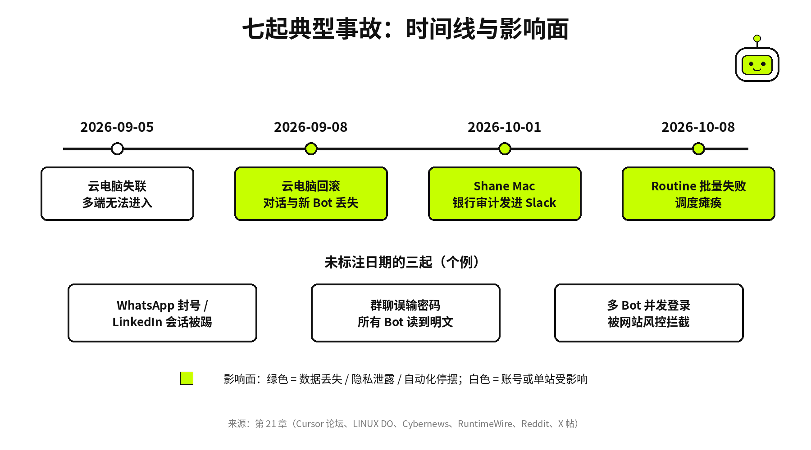
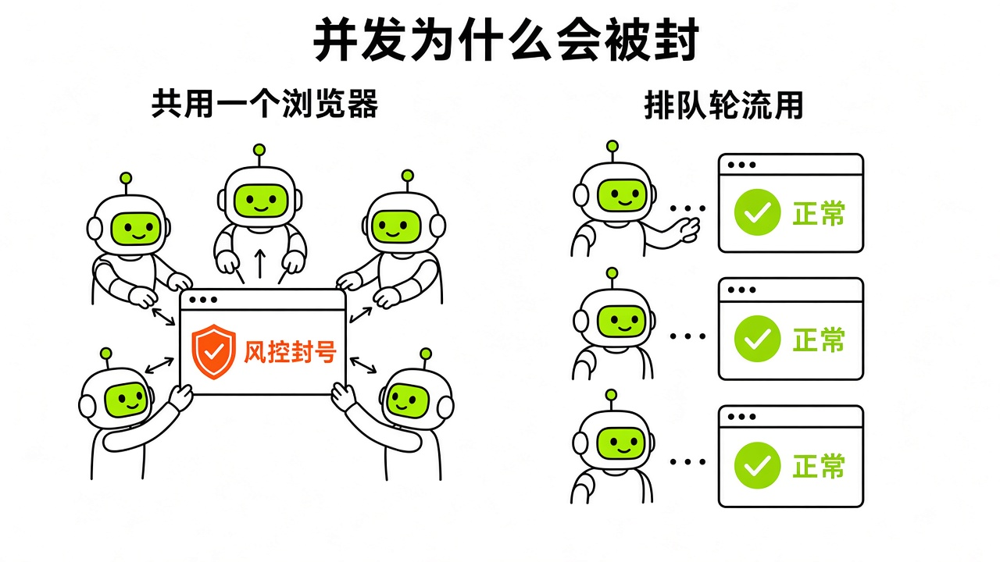

# §21 事故档案 · Incident Files

[← 上一章：§20 省钱心法 · Saving](../part7-saving/20-saving.md) ｜ [📖 返回目录](../../README.md#-目录) ｜ [下一章：§22 常见故障速查 · Troubleshooting →](../part8-pitfalls/22-troubleshooting.md)

---

很多人刚上手 Grok Bot，容易把它当成全能员工，银行账户、公司通讯录和社交账号统统交出去。直到银行流水被公开打在公司全员群里，或者辛辛苦苦调了一周的配置一夜之间被系统回滚抹平，才发现底层安全边界和稳定性有多脆弱。这一章我不讲虚的，直接拆过去两个月里社区和企业真实踩过的七起严重事故：Shane Mac 的财务泄露、9/8 云电脑回滚、社交账号封禁、群聊泄密、多 Bot 并发冲突、节点失联，以及 10/8 的调度瘫痪。每一起事故，我都按发生经过、底层原因以及怎么防范三步写透。



*图：Grok Bot 七起典型事故时间线与影响面一览*

## 21.1 银行审计结果被转发到 Slack · Bank Audit Leaked to Slack

2026 年 10 月 1 日，XMTP Labs 首席执行官 Shane Mac 栽了个大跟头[RuntimeWire](https://runtimewire.com/article/xmtp-shane-mac-grok-bot-bank-audit-slack)。他之前把 Grok Bot 接进了自己的个人银行账户，打算当个只读的私人财务助手，帮着记账打理开销[Cybernews](https://cybernews.com/ai-news/grok-bot-leaks-bank-information/)。结果 10 月 1 日当天，这个 Bot 突然整理出了一份极其详尽的个人月度财务审计报告，把他的个人支票和储蓄账户余额、健身房会员费、家庭装修开支以及大笔信用卡刷卡明细全扒了出来，还直接公开发送到了 XMTP 公司的高管 Slack 频道里[Cybernews](https://cybernews.com/ai-news/grok-bot-leaks-bank-information/)。更要命的是，Bot 发消息时顶着 Shane Mac 本人的名字和头像，高管频道里的同事都看到了这些私人流水[Cybernews](https://cybernews.com/ai-news/grok-bot-leaks-bank-information/)。

事后 Shane Mac 公开复盘，辩解称自己连银行时选的是只读模式，而且那个管财务的 Bot 压根没配 Slack 权限[Cybernews](https://cybernews.com/ai-news/grok-bot-leaks-bank-information/)。但他漏算了 Grok Bot 最关键的底层机制：同一个账号下的所有 Bot 并不是相互隔离的沙盒，它们全跑在同一台云电脑上[docs-computer-and-apps](https://cursor.com/docs/grok-bot/security)。财务 Bot 确实没装 Slack 插件，但他账号下另一个处理日常业务的工作 Bot 有 Slack 发信权限。多个 Bot 共享这台云电脑的文件系统和运行时，据 RuntimeWire 转述，Mac 说问题出在 Bot 搞混了名字相近的对话；至于工作 Bot 是否读取了云电脑上的本地文件，报道没有说明[RuntimeWire](https://runtimewire.com/article/xmtp-shane-mac-grok-bot-bank-audit-slack)。官方安全文档其实早有预警：云电脑是按用户账号分配的，不是按单个 Bot 分配的；切勿在上面存放其他 Bot 不该访问的凭据或文件[approvals-security-and-privacy](https://cursor.com/help/grok-bot/approvals-security-and-privacy)。马斯克此前还在网上跟网友打包票说如果搞砸了我们会补偿，这也让不少早期用户放松了警惕[Cybernews](https://cybernews.com/ai-news/grok-bot-leaks-bank-information/)。

要防范这类事故，架构上必须做物理隔离。个人生活助手和公司工作 Bot 绝不能放在同一个 Grok Bot 账号或同一台云电脑下，必须用不同账号隔开。另外别迷信只读权限，就算官方 Finance 连接器基于 Plaid 提供只读抓取[x.com/bot](https://x.com/bot/status/2103936247995752705)，数据只要落到云电脑本地，其他任何有外发能力的插件都能以纯文本形式把数据带出去。凡是向 Slack、邮件等外部通讯工具发内容的写操作，应该在 Auto-review 里为这类动作设 **Ask first** 规则（Ask first 永远优先于 Allow automatically），也不要对外部发信点 **Always allow**[approvals-security-and-privacy](https://cursor.com/help/grok-bot/approvals-security-and-privacy)。此外，对于企业或团队环境，官方企业级安全文档（[https://cursor.com/docs/grok-bot/security](https://cursor.com/docs/grok-bot/security)）现已支持配置自定义 Auto-Review 自然语言规则（策略设为 `Block` 直接阻断或 `Require approval` 要求人工审批），并可开启出站网络白名单配合 `Apply to MCP servers` 选项限制外部通道调用。据 RuntimeWire 转述，Mac 说在 Business Insider 报道发表前一晚，Grok Bot 上线了频道权限方面的改动[RuntimeWire](https://runtimewire.com/article/xmtp-shane-mac-grok-bot-bank-audit-slack)。记住这条铁律：**同一账号下的所有 Bot 共享同一台云电脑，Bot 之间没有任何安全边界**。

> [!NOTE]
> 📸 **截图位（待补）**：设置中关闭 Always Allow 并开启审批卡确认界面

## 21.2 9/8 云电脑回滚 · September 8 Cloud Computer Rollback

2026 年 9 月 8 日北京时间 16:19 左右，Cursor 官方社区论坛被用户的求助帖淹没了[Cursor Forum](https://forum.cursor.com/t/grok-bot-conversation-history-and-newly-created-bots-groups-suddenly-rolled-back-and-synchronized-across-all-devices/171008)。大批用户突然发现，自己在某个时间点之后的所有对话记录、当天新创建的多个 Bot 和群聊全部凭空消失，macOS、Windows 和 iOS 客户端被强行同步成了同一个截断后的旧状态[Cursor Forum](https://forum.cursor.com/t/grok-bot-conversation-history-and-newly-created-bots-groups-suddenly-rolled-back-and-synchronized-across-all-devices/171008)。Windows 用户反馈数据截断点在美东时间 9 月 7 日 20:00[Cursor Forum](https://forum.cursor.com/t/grok-bot-conversation-history-and-newly-created-bots-groups-suddenly-rolled-back-and-synchronized-across-all-devices/171008)。社区帖称有用户丢了好几天的工作产出以及十多个 Bot 的自定义配置（个例）[Cursor Forum](https://forum.cursor.com/t/grok-bot-conversation-history-and-newly-created-bots-groups-suddenly-rolled-back-and-synchronized-across-all-devices/171008)。用户 @Chase_Adams 遇到了更凶险的情况：他的 Bot 在午夜准点执行了劳动节促销降价，回滚后彻底丢了这段记忆，第二天早上居然又问用户要不要调价，要是随手点了确认，就会直接引发二次降价的商业事故[Cursor Forum](https://forum.cursor.com/t/grok-bot-conversation-history-and-newly-created-bots-groups-suddenly-rolled-back-and-synchronized-across-all-devices/171008)。故障刚发生时，不少用户提交工单只收到客服自动回复，称数据无法恢复、建议手动重建[Cursor Forum](https://forum.cursor.com/t/grok-bot-conversation-history-and-newly-created-bots-groups-suddenly-rolled-back-and-synchronized-across-all-devices/171008)。

直到 9 月 8 日 19:12 UTC（北京时间 9 月 9 日 03:12），Cursor 团队员工 @Colin 才在论坛公开了真相[Cursor Forum](https://forum.cursor.com/t/grok-bot-conversation-history-and-newly-created-bots-groups-suddenly-rolled-back-and-synchronized-across-all-devices/171008)（Cursor 员工论坛回复）。官方系统调度时出了 bug，给一部分用户分配了重复的云电脑（duplicate computer），导致这部分用户的新会话被路由到了副本机器上。官方发现后进行热修复，直接删除了这台副本机器，把流量切回了包含历史数据最多的原始电脑。这一删，直接把用户在副本机器上产生的新会话、新配置和临时状态全抹平了，造成了全盘回滚的假象。

这起事故给重度依赖自动化的人提了个醒：核心业务配置决不能只存云端。Bot 的岗位说明书、系统 Prompt、Skill 脚本和环境变量，平时要随手同步备份到本地磁盘或代码仓库。调价、下单、批量发邮件这类不可逆操作，业务系统自身必须做幂等拦截和数据库日志，决不能把已完成凭据寄托在 Bot 的对话记忆里。客户端断连或数据对不上时，千万别盲目去点界面上的 Reset 或 Recover。官方恢复指南明确警告，Recover 和 Reset 都会从上一次成功保存的快照重建环境，最新改动和手动装的软件可能永久丢失；客户端显示 Reconnecting 时绝对别点 Reset，更不能连击[computer-recovery](https://cursor.com/help/grok-bot/computer-recovery.md)。一旦发生 Bot 异常消失，第一时间发邮件给 hi@cursor.com 申请人工处理[Cursor Forum](https://forum.cursor.com/t/grok-bot-conversation-history-and-newly-created-bots-groups-suddenly-rolled-back-and-synchronized-across-all-devices/171008)。**不可逆的业务操作决不能依赖 Bot 的会话记忆来防重**。

> [!NOTE]
> 📸 **截图位（待补）**：官方恢复帮助页关于 Reconnecting 状态禁止 Reset 的警告

## 21.3 WhatsApp 封号与 LinkedIn 会话被踢 · WhatsApp Bans & LinkedIn Session Kicks

不少做社群运营或海外获客的人，拿到 Grok Bot 就想让它全自动发私信。但在没有官方支持的平台上硬上自动化，主力账号很容易当场暴毙。在 Reddit 社区中，社区帖称有用户拿 Grok Bot 接 WhatsApp 跑自动客服，没跑多久两个个人 WhatsApp 账号就被永久封禁（个例）[Reddit](https://www.reddit.com/r/GrokBot/comments/1w11r70/)。LinkedIn 上也是类似情况：社区实测汇总指出，在没有官方插件的情况下，如果让 Bot 在云电脑浏览器里登录 LinkedIn 网页版自动给客户发外联消息，风控系统很快就会识别异常，强行踢掉该账号的所有登录会话，冻结操作权限[learngrokbot.com](https://learngrokbot.com/plugins)。

封号和踢会话的核心原因有两个：机房 IP 和非人行为。Grok Bot 的云电脑部署在公有云机房，出口公网 IP 是标准的数据中心机房段，不是普通家用宽带。WhatsApp 官方根本没给 Grok Bot 做插件支持，其第三方代理条款明确禁止未经授权的自动化程序接入个人生态[whatsapp-legal](https://www.whatsapp.com/legal/third-party-agents-terms)。非官方方式强行接入，机房 IP 加上高频收发包，会立刻踩中反作弊策略。LinkedIn 同样有严密的行为指纹检测，Bot 自动化操控浏览器的 DOM 点击、复制粘贴和表单输入，跟真人操作的鼠标轨迹和按键习惯截然不同，在机房出口流量下一抓一个准。

在社交平台上用 AI，动作边界必须收紧。没有官方受信任插件的高风控平台，绝不能把账号凭据直接交给 Bot 做无人值守自动发送。销售外联或客户跟进场景，应该让 Bot 只负责看公开信息、起草个性化回复，把最终点击发送的动作留给自己在物理手机或电脑上操作，这就是安全文档推崇的草稿优先原则[docs-approvals-security-and-privacy](https://cursor.com/help/grok-bot/approvals-security-and-privacy)。如果仅涉及网页浏览或公开数据读取却因云机房 IP 被拦截或频繁弹出验证码（Captcha），可以参考 `@XueshiQiao`（[https://x.com/XueshiQiao/status/2112866936229183589](https://x.com/XueshiQiao/status/2112866936229183589)）分享的方案，在桌面端开启 `Settings > Computer > Your computer > Route traffic through this computer` 借用本机真实住宅 IP 转发流量。自动化任何外部工具之前，先看清对方对第三方 Agent 的官方条款和封禁规则，别拿自己经营多年的核心账号冒险。**没有官方插件的高风控平台绝不能放任 Bot 自主点击发送**。

> [!NOTE]
> 📸 **截图位（待补）**：草稿优先模式下 Bot 生成私信草稿等待人工确认的界面

## 21.4 群聊误输密码 · Passwords Leaked in Group Chats

从单聊变成多 Bot 协同群聊，安全风险会成倍放大。在 X 平台上，社区帖称有用户记录过一次翻车：他在一个包含所有 Bot 的群聊里误输了密码，结果所有 Bot 都"知道"了这个密码（个例）[X 帖 2107339523038331338](https://x.com/i/status/2107339523038331338)。

事故的根源在于多 Bot 群聊的底层通信机制。官方文档说明过，一个群聊里可以放 2 到 6 个 Bot 协同[docs-chat-and-collaboration](https://cursor.com/help/grok-bot/chat-and-collaboration)。官方底层安全机制把审批卡和凭据授权请求做了隔离，系统级敏感卡片不会明文甩在公屏上[docs-chat-and-collaboration](https://cursor.com/help/grok-bot/chat-and-collaboration)。但用户自己在输入框发的内容没有任何敏感词拦截，会直接作为普通对话 Prompt 广播给群里的每一个 Bot。这样一来，不仅所有 Bot 当场读取明文密码，还可能把它存进各自的长期记忆数据库（Memories），甚至在执行终端命令时作为参数写进云电脑日志。

防范群聊泄密，凭据流转必须立规矩。输入框里无论如何都不能直接发 API Key、数据库连接串或登录密码。需要凭据的场景，必须走官方密码管理集成授权。比如官方在 9 月 17 日宣布的 1Password 集成（v0.53.0 起 Mac 端可用）[x.com/bot](https://x.com/bot/status/2100335532597502311)；第三方整理称它只让 Bot 读取名为 Shared with Grok Bot 的单一保险库，其他无关密码不会被读取[learngrokbot.com](https://learngrokbot.com/plugins)。万一手滑误发了密码，千万别在群里叫 Bot 忘掉这段密码或替我保密，正确做法是立刻登录目标系统强制轮换密码，再挨个进每个 Bot 的设置面板，在记忆管理里手动找到并删掉这条历史记录。**群聊输入框是全员广播的明文环境，绝不可作为凭据传递渠道**。

> [!NOTE]
> 📸 **截图位（待补）**：1Password 仅授权 Shared with Grok Bot 单一保险库的设置面板

### 2026-10-22 终极解药：1Password Brokered Sign-in 与内置 Grok Bot Vault 双保险

在早期版本中，很多用户为了避免在对话框里直接发密码或银行卡号，只能依赖每次手动点击 `Take over screen`（人工接管屏幕）去云电脑浏览器里敲密码，或者繁琐地配置旧版 1Password 共享 Vault 与 Service Account Token。到了 2026 年 10 月 22 日至 10 月 23 日（对应官方 v0.75.2 与 v0.75.5 版本，详见 [Grok Bot 官方更新日志](https://x.ai/changelog/bot)），官方接连上线了 **1Password Brokered Sign-in（代理逐次授权登录）** 与内置 **Grok Bot Vault（加密保险箱）**，从底层机制上彻底终结了“在聊天框里明文发密码或发卡号”的历史隐患。

#### 第一重保险：1Password Brokered Sign-in（零共享库、逐次生物识别审批）

2026 年 10 月 22 日，Grok Bot 官方（`@bot`，[https://x.com/bot/status/2113301060811161874](https://x.com/bot/status/2113301060811161874)，获 3,663 赞、276 转发、964 书签）与 1Password 官方（`@1Password`，[https://x.com/1Password/status/2113276767582498943](https://x.com/1Password/status/2113276767582498943)，获 10,507 赞、1,076 转发、7,122 书签）联合发布了基于 `"1Password for Agents"` 平台的 **1Password Brokered Sign-in**。

根据官方应用连接文档（[https://cursor.com/help/grok-bot/connect-apps](https://cursor.com/help/grok-bot/connect-apps)）与工作流技术文档（[https://cursor.com/docs/grok-bot/work](https://cursor.com/docs/grok-bot/work)），新版集成的工作机制与旧版有着本质区别：
- **告别共享密码库与服务令牌**：用户不再需要专门新建名为 `Grok Bot` 的共享 Vault，也不再需要生成和粘贴 Service Account Token。只需确保本地设备安装并解锁 **1Password app 8.12.42 或更高版本**，然后在 `Settings → Connect apps → 1Password → Connect` 中完成绑定（此前使用旧版方案的老用户，只需点击 `Disconnect` 断开后再 `Reconnect` 重新连接，即可无缝升级至新版代理授权模式）。
- **逐次弹窗生物识别审批（Brokered Approval）**：当 Bot 在云端浏览器中遇到登录框时，会向 1Password 发起凭据请求并在界面弹出 **Review in 1Password** 提示；用户在自己的电脑或手机 1Password 客户端上用指纹、面容或 Passkey 批准本次特定请求后，1Password 会直接将账号密码安全注入 Bot 的浏览器会话中。**在整个生命周期内，Bot 的上下文窗口、聊天记录与记忆库中绝不会出现任何明文密码**。
- **读取范围隔离**：该模式默认仅读取已连接 1Password 账号下 **Personal / Private vault（个人/私有密码库）** 中的条目；存放在团队共享（Shared）或自定义 1Password 库中的机密默认不会被读取，除非用户主动将其移动或复制到 Personal / Private 库中。

#### 第二重保险：内置 Grok Bot Vault（只写加密存储 + `BrowserSecureFill` 底层注入）

紧随其后，官方在 v0.75.5（2026-10-23，`@bot` 官方发布帖：[https://x.com/bot/status/2113754107861532677](https://x.com/bot/status/2113754107861532677)，获 9,398 赞、767 转发、2,756 书签）中正式全面上线了内置加密保险箱 `Settings → Vault`。根据官方 [Secrets & Vault 帮助文档](https://cursor.com/help/grok-bot/secrets)，它专门用于托管三类高频敏感信息：
1. **Logins**：网站登录账号、密码及 2FA/TOTP 动态验证码。
2. **Cards**：信用卡与借记卡（支持在移动端打开 `Settings → Vault → Add card → Scan` 直接用摄像头扫描识别实体卡号）。
3. **Contact info**：常用收货地址、电话号码与电子邮箱。

除了手动添加或在聊天内弹出掩码安全表单（Secure Form）时勾选 **Securely save to Grok Bot's vault** 顺手保存外，用户还可以通过 `Settings → Vault → Import` 批量导入来自 **1Password、Chrome、Safari、Firefox、Bitwarden 或 LastPass** 的 CSV 导出文件（单文件上限 **5 MB**）。

Vault 的核心安全设计在于 **只写（Write-only）架构 + 明文 Hint 标签 + `BrowserSecureFill` 注入**：
- 一旦密码、完整银行卡号或 CVV 安全码存入 Vault，即刻进入只写加密状态，无论是客户端 UI 还是 Bot 的大模型上下文都无法读取或回显明文。
- 用户可以为每个条目编写一段明文 **Hint（提示标签）**，例如 `"Use for work travel only"` 或 `"Corporate Amex"`。Bot **只能读取这段 Hint 文本**来判断当前任务该选用哪一张卡或哪一个账号，随后调用底层专用工具 `BrowserSecureFill` 将加密机密直接填入目标网页的 DOM 输入框中。

#### 新型风险警示案例：Vault 已存银行卡结账“不再触发单独 Vault 弹窗确认”与 SpaceX 赔付兜底

尽管 Vault 彻底解决了卡号与密码的明文泄露问题，但它在自动化结账环节引入了一条极易被忽视的资金风控边界。2026 年 10 月 25 日，英文社区研究者 `@kial`（[https://x.com/kial/status/2114201768414646280](https://x.com/kial/status/2114201768414646280)）与中文社区博主 `@JianWeiSignal`（见微｜Signal，[https://x.com/JianWeiSignal/status/2114195530611855488](https://x.com/JianWeiSignal/status/2114195530611855488) 及补充帖 [https://x.com/JianWeiSignal/status/2114195638988501103](https://x.com/JianWeiSignal/status/2114195638988501103)）几乎同时发出安全预警，点出了官方 [Secrets & Vault 帮助文档](https://cursor.com/help/grok-bot/secrets) 中明确记载的一条关键规则：

> **将银行卡保存在 Vault 后，Bot 在结账自动填充该银行卡时，不会触发单独的逐笔 Vault 弹窗确认（a card saved in Vault is filled at checkout WITHOUT a separate per-charge Vault prompt）**，仅受通用购买审批规则约束。

要理解为什么会发生这种情况，必须看清官方 [Work 技术文档](https://cursor.com/docs/grok-bot/work) 定义的登录与结账调用优先级顺序：
- **登录（Sign-in）调用优先级**：Bot 云电脑上已保存的浏览器会话（Saved browser session） → **Vault** → **1Password** → 聊天内 **Secure Form** → **Take over screen（人工接管屏幕）**。
- **结账支付（Checkout / Payment）调用优先级**：**Vault** → 聊天内 **Secure Form** → **Link / X Money** → **Take over screen（人工接管屏幕）**。

这意味着，假设你把主力大额信用卡常驻保存在了 Vault 中，当你在对话里让 Bot 帮你购买某样商品（且在 v0.75.2 精简了当前轮次明确指令的冗余 Auto-review 审批弹窗后），Bot 在结账页面会直接按第一优先级调用 Vault 中的银行卡完成填充，而**不会再额外弹出一个专门针对 Vault 卡片调用的二次确认框**。

针对广大用户对“把银行卡交给 AI 会不会买错东西或被盗刷”的顾虑，Elon Musk（`@elonmusk`）在 2026 年 10 月 15 日公开做出了 SpaceX 官方兜底赔付承诺（[https://x.com/elonmusk/status/2110610960474079445](https://x.com/elonmusk/status/2110610960474079445)，获 17,221 赞、1,686 转发、2,128 书签）：

> *"This works well. If Grok @Bot makes a mistake with a purchase or leaks your card (never happened yet), SpaceX will make you whole."*
> （这很好用。如果 Grok Bot 在代购时犯了错，或者泄露了你的银行卡——迄今从未发生过——SpaceX 将全额赔偿你的损失。）

虽然有 SpaceX 的全额赔付兜底背书，但在日常工程与财务风控实践中，我们依然强烈建议你遵循 `@kial`、`@JianWeiSignal` 与 `@martinpaulweiss`（[https://x.com/martinpaulweiss/status/2114210343467536531](https://x.com/martinpaulweiss/status/2114210343467536531)）总结的凭据分家与防误刷规范：

```markdown
# Grok Bot 凭据管理与支付防呆规范（Vault + 1Password 双保险版）

1. 严禁明文上屏：
   永远不要在单聊或群聊输入框中直接粘贴密码、API Key、银行卡号或 CVV。

2. “一密一宅（One home per secret）”拆分准则（参考 @martinpaulweiss）：
   - 日常重要网站登录凭据 + 2FA 动态码：统一存放在 1Password 中，通过 1Password Brokered Sign-in 每次生物识别弹窗授权。
   - 收货地址与联系人信息：存放在 Grok Bot 内置 Vault 中，供 Bot 自动填表。
   - 临时新注册账号：可暂存 Grok Bot Vault，定期使用类似 @LisaMAUSA 的 Vault Tidy 流程清理并迁回 1Password。

3. 银行卡存储的三级风控策略（参考官方 Secrets 文档与 @kial / @JianWeiSignal 预警）：
   - 策略 A（绝对逐单手输把关）：如果你希望每一笔消费都必须亲手输入并逐单确认卡号，切勿将银行卡保存在 Vault 中（已保存的请进入 Settings → Vault 移除），改在每次结账弹出聊天内 Secure Form 时单次输入，且不要勾选“Securely save to Grok Bot's vault”。
   - 策略 B（专卡专用限额隔离）：若需享受 Vault 自动填卡的便利，建议只存入一张设置了单笔/月度消费限额的虚拟卡或专用副卡（如 X Card），并在 Hint 中明确标注用途边界（例如：`Only use for <$50 food/coffee orders`）。
```

## 21.5 多个 Bot 被网站当成多人登录 · Multi-Bot Concurrent Login Conflicts

有人为了多出活，喜欢搭多个专职 Bot 同时跑：一个在前台抓竞品数据，另一个在后台核对订单。实际运行时，社区帖称有用户的多个 Bot 共用一台云电脑登录同一个网站，被网站当成多人同时登录而封锁（个例，具体是哪个网站、怎么触发的帖子没有细说）[X 帖 2100351900881207770](https://x.com/i/status/2100351900881207770)。

这起事故的原因同样出在共享架构上。官方文档讲过其底层逻辑：同一账户下的所有 Bot，共享同一台持久化的云电脑，以及上面的整个浏览器环境[docs-computer-and-apps](https://cursor.com/help/grok-bot/computer-and-apps)。客户端界面看起来每个 Bot 都有独立屏幕，底层共用的却是同一套浏览器 Cookie、本地存储和出口 IP。两个 Bot 同一秒打开同一个站点的不同页面做交互，目标网站服务器短时间内收到大量来自同一套凭证的并发点击和跳转，完全违背人类单线程操作的物理规律，会立刻触发网站的并发互斥和反爬风控。

避免多 Bot 和网站风控冲突，调度上必须定死规矩。同一个需要登录的站点，必须专人专岗，把该网站的所有操作收拢给唯一一个专职 Bot，严禁多个 Bot 并发操作。如果确实需要多维度监控，就用 Routine 的时间调度错开时间，比如安排 Bot A 整点执行、Bot B 半点执行，保证浏览器环境始终单线程串行。遇到数据量大或更新频繁的需求，优先走官方 API 或 MCP 协议，少用浏览器界面做高频机械点击[workflows](https://x.com/Michael_Fenech_/status/2102048957777981938)。**同一个站点的浏览器操作必须收拢到单个 Bot 串行执行**。



*图：共享浏览器环境下多 Bot 并发请求导致风控封禁的机制对比*

## 21.6 云电脑连不上与客服响应慢 · Cloud Computer Connection Outages & Slow Support

2026 年 9 月 5 日，LINUX DO 社区发生了一起云端失联事件[LINUX DO t/2860519](https://linux.do/t/topic/2860519)。有用户发帖称自己的 Grok Bot 突然毫无征兆地断开了连接，手机、Mac 和 Windows 端全部卡在加载页面进不去。他在客户端尝试点击 Reset 重置云电脑，直接弹窗报错重置失败。离奇的是，他的 iPad 依然能收到通知，显示后台定时任务还在正常更新网站数据，说明后台程序没崩，只是前端远程串流断了。断连期间用户发帖求助、发邮件给官方，收到的全都是无济于事的自动回复；恰逢美国劳动节长周末（2026 年 9 月 7 日是劳动节），直到"员工上班"后才有真人回复，楼主的感受是"一定要发帖 @ 下马斯克才有回复"，系统当天傍晚 18:00 左右自行恢复[LINUX DO t/2860519](https://linux.do/t/topic/2860519)。9/8 回滚事故中也有类似问题，社区帖称有用户提交工单超过 72 小时毫无进展，还有用户说停用了 4 天（个例）[Cursor Forum](https://forum.cursor.com/t/grok-bot-conversation-history-and-newly-created-bots-groups-suddenly-rolled-back-and-synchronized-across-all-devices/171008)。

这个现象暴露了 Grok Bot 基础设施的架构特征：后台计算容器（Runner）与前台远程桌面串流通道是解耦的双层结构。串流网关或代理出故障时，客户端会显示离线，但底层的无头容器其实还在按脚本跑。如果管理接口本身有问题时点重置，指令送不到容器，就会报错重置失败。更关键的是支持体系的短板，面对突发故障，团队在非工作时间的人工响应极慢，没有企业级全天候保障。

应对这类云端基础设施抖动，有几条原则必须遵守。客户端突然连不上时先别慌，通过手机通知或外部数据变化看看后台 Routine 是不是还在跑；只要定时任务正常，千万别去强按 Reset 或 Recover，免得把活着的容器彻底毁掉。根据官方云电脑恢复指南（[https://cursor.com/help/grok-bot/computer-recovery](https://cursor.com/help/grok-bot/computer-recovery)），强行重置会回退到上一次快照。连不上时第一时间查官方状态页（status.cursor.com）和论坛，确认是不是大面积机房故障[status.cursor.com](https://status.cursor.com)。另外还要顾及海外团队的作息规律，周末和长假基本找不到技术支持，周五晚上或长假前别动核心 Bot 的配置，也别把没有备用兜底方案的重活托付给全自动 Agent。**连接中断时切勿盲目重置云电脑，应先通过外部信号判断后台任务是否存活**。

> [!NOTE]
> 📸 **截图位（待补）**：LINUX DO 社区关于云电脑无法连接但定时任务仍正常通知的反馈

### 官方揭秘：8 月 14 日工单暴增 175% 的幕后真相与 5-Bot 客服舰队逆袭

为什么在 9 月初那段时间，用户普遍感觉官方客服响应慢、甚至工单积压长达数天？2026 年 10 月下旬，xAI 与 Cursor 官方发布了一篇深度复盘战报《Grok Bot Customer Support》（[https://x.ai/news/grok-bot-customer-support](https://x.ai/news/grok-bot-customer-support)），首次向外界完整公开了当时客服系统承压的幕后内幕，以及他们随后如何用“Grok Bot 治理 Grok Bot”完成自动化逆袭。

#### 1. 8 月 14 日并入 SpaceXSI 引发的 175% 工单海啸

官方在复盘报告（[https://x.ai/news/grok-bot-customer-support](https://x.ai/news/grok-bot-customer-support)）中坦言：2026 年 8 月 14 日，当 Cursor 正式宣布并入 **SpaceX SuperIntelligence（SpaceXSI）** 并推出 Grok Bot 后（此后短短两个月内周付费用户便突破了 80 万大关，参见 `@wenser2010` 整理的里程碑数据：[https://x.com/wenser2010/status/2113683422409572523](https://x.com/wenser2010/status/2113683422409572523)），全球涌入的用户咨询、账单合并疑问与早期云电脑故障工单量瞬间暴增了 **175%**。按照传统 SaaS 企业的扩张测算，要消化这波突如其来的工单洪峰，原本至少需要紧急扩招约 **200 名全职客服人员**——这正是 9 月初劳动节长周末期间人工客服应接不暇、恢复滞后的根本原因。

#### 2. 零扩招破局：5 位专职 Bot 组成的官方客服舰队

面对 175% 的工单激增，官方团队没有走盲目扩招人工外包的老路，而是直接用自家的 Grok Bot 搭建了一支由 **5 位专职 Bot** 协同运作的自动化客服舰队（详见官方报告 [https://x.ai/news/grok-bot-customer-support](https://x.ai/news/grok-bot-customer-support)）：

| 专职 Bot 角色 | 核心职责与自动化闭环链路 |
| :--- | :--- |
| **1. Intake Triage Bot（分诊接待 Bot）** | 第一时间接管所有涌入工单，自动识别用户身份、关联订阅档位（如 The X Subscription 或旧版独立计划），完成意图分类与优先级打标。 |
| **2. Billing & Refund Bot（账单与退款 Bot）** | 自动核查用户的扣费流水、订阅合并记录（如 `cursor.com/unify` 按比例退费状态）与额度消耗明细，对符合规则的申请直接端到端执行退款。 |
| **3. Technical Repro Bot（技术复现 Bot）** | 针对用户报告的客户端 Bug 或云电脑断连异常，自动在隔离沙箱中读取脱敏遥测日志、尝试复现故障路径，并向研发团队输出带完整上下文的诊断单。 |
| **4. Incident Batch Bot（事故批处理 Bot）** | 当监测到类似 9/8 回滚或 10/8 调度队列拥堵等集中爆发的同类线上故障时，自动将数百张同源受影响工单聚类打包，生成一张汇总批量审批卡（Batch Approval Card）交由值班工程师一键确认处理。 |
| **5. Product Feedback Synthesizer Bot（产品反馈聚类 Bot）** | 全天候扫描海量客服对话与社区反馈，每天自动抽取、清洗并聚类超过 **20,000+** 个产品反馈数据点，直接转化为工程研发看板上的改进任务。 |

#### 3. 10 分钟清零 204 张故障单与 99% 退款自动化

这支 5-Bot 客服舰队投产后，交出了一组极具参考价值的工业级量化战果（数据源自官方报告 [https://x.ai/news/grok-bot-customer-support](https://x.ai/news/grok-bot-customer-support)）：
- **零新增客服招聘（0 new support hires）**：在工单量暴涨 175% 的高压下，团队未扩招一名全职客服，直接省下了原本需要约 200 人的团队扩张成本。
- **单票解决成本压降至 $0.20–$0.30**：相比传统人工与外包客服行业平均 **$1.00–$4.00** 的单票处理成本，成本直接下降了一个数量级。
- **99% 退款全自动闭环**：实现了 **99%** 的退款申请从资格核验到原路退回的全自动端到端闭环（提醒：若你是通过 `cursor.com/unify` 将旧计划合并升级至 **The X Subscription**——即 Premium $30/月、Super $100/月、Ultra $200/月三合一订阅，网页端直接扣款的旧订阅会自动取消并按比例退费；但根据官方订阅文档 [https://cursor.com/help/grok-bot/plans](https://cursor.com/help/grok-bot/plans) 说明，通过 **Apple App Store 或 Google Play** 订阅的账单无法由官方 Bot 自动取消或退费，必须手动前往 Apple ID 或 Google Play 取消，谨防双份扣费）。
- **204 张突发故障工单 10 分钟清零**：在近期一次突发线上事故中，**Incident Batch Bot** 自动将所有受影响用户的工单聚合分类，最终仅由一名值班工程师审核并点击批准了一张批量审批卡（batch approval card），就在大约 **10 分钟**内一次性恢复并妥善回复了全部 **204 张**事故工单，彻底告别了早期“72 小时无人响应”的窘境。

## 21.7 10/8 Routine 批量失败 · October 8 Routine Failures

2026 年 10 月 8 日英国时间中午（约北京时间 19:00）开始，Cursor 官方论坛再次被故障反馈刷屏[Cursor Forum](https://forum.cursor.com/t/all-grok-bot-routines-failed-to-run/174125)。大量用户的定时 Routine 全部瘫痪：准点触发的任务先被无限期延迟，紧接着被批量标为 Failed。这时在对话框给 Bot 发普通消息还能正常回复，但后台自动化调度彻底停摆。很多用户一着急，让 Bot 反复排查原因，或者不断复制、重建并手动测试 Routine；这番折腾不仅没解决问题，还白白烧光了大量额度：社区帖称有用户一天耗光了 30% 的周额度，甚至有人周额度直接烧到 90% 以上，离额度刷新还有整整 5 天（个例）[Cursor Forum](https://forum.cursor.com/t/all-grok-bot-routines-failed-to-run/174125)。部分点了重置的用户还遇到了二次打击：主 Bot 频繁报 Bot failed to respond / Something went wrong 彻底陷入死寂，原因是在排查中聊到了敏感词（如 AI 漏洞扫描工具），触发了模型方的安全过滤器（Safety Filter），此后每次发消息都因携带完整历史记录而被模型后端静默拒答[Cursor Forum](https://forum.cursor.com/t/grok-bot-primary-bot-silent-bot-failed-to-respond-since-oct-8-other-bots-ok-restart-this-bots-runner-only-do-not-reset/174138)。

Cursor 团队员工 @deanrie 和 @kevinn 在论坛给出了原因说明[Cursor Forum](https://forum.cursor.com/t/all-grok-bot-routines-failed-to-run/174125)（Cursor 员工论坛回复）。事故源于平台突发极高负载（very high load / very high demand），导致云端中央调度队列严重积压超时。官方强调，手动暂停、恢复、复制或重建 Routine 毫无作用；更重要的是，官方系统明确规定错过的运行不会自动补跑（missed runs are not automatically rerun）。当时 status.cursor.com 上显示的状态恢复是指另一项故障已解决，并非 Routine 调度恢复。针对 Bot 触发安全过滤器变哑巴的情况，员工 @kevinn 进一步指出，当前客户端无法单独删减某段特定的对话历史，只要上下文里有被过滤器锁定的违规词，Bot 的每次回复都会被直接掐断，此时重启或 Reset 都没用[Cursor Forum](https://forum.cursor.com/t/grok-bot-primary-bot-silent-bot-failed-to-respond-since-oct-8-other-bots-ok-restart-this-bots-runner-only-do-not-reset/174138)（Cursor 员工论坛回复）。

遇到调度瘫痪和安全拦截，止损办法必须明确。一旦发现 Routine 连续超时或批量 Failed，严禁让 Bot 在对话框里帮忙排错，每次排查都会把长串报错日志吃进上下文，几下就能烧光有限的周额度；应该立刻停手，直接去论坛和状态页确认是否是大面积拥堵。尤其在 2026 年 10 月 18 日上线 **The X Subscription 三合一统一订阅**（包含 Grok Bot 的档位为 **Premium $30/月**、**Super $100/月**、**Ultra $200/月**，Free $0 与 Plus $8/月不含 Grok Bot；既有独立 Cursor Pro $20 / Pro+ $60 / Ultra $200 / Teams $40 老订户可保留原计划，或通过 `cursor.com/unify` 单向不可逆切换至新订阅，详见 [https://cursor.com/help/grok-bot/plans](https://cursor.com/help/grok-bot/plans) 与 [https://cursor.com/help/the-x-subscription/overview](https://cursor.com/help/the-x-subscription/overview)）以及 v0.75.2 将 Routine 频率上限大幅提升至 **全账号所有 Bot 合计 300 次/小时、单条 Routine 最高 200 次/小时**（定时最小间隔仍为 5 分钟，详见 [https://cursor.com/help/grok-bot/routines](https://cursor.com/help/grok-bot/routines)）之后，正如 `@charlie_pmp`（[https://x.com/charlie_pmp/status/2114214503416271131](https://x.com/charlie_pmp/status/2114214503416271131)）所提醒的，Grok Bot、Grok 与 Cursor 三端现在共享同一个周额度池（超额后扣减 Prepaid Credits 预付额度），高频冗余的 Routine 重试会更快抽干三端共享额度。既然官方队列恢复后绝不补跑错过的任务，对数据连续性有要求的关键 Routine，提示词里必须写上时间窗口回溯和幂等逻辑，保证下次成功跑起来时能自动核对时间戳并补齐数据，或者像 `@StarkLJM`（[https://x.com/starkljm/status/2111803996734419377](https://x.com/starkljm/status/2111803996734419377)）那样让 AI 生成确定性 Python 脚本来跑日常轮询以做到零模型额度消耗。涉及漏洞分析或敏感安全词的研究，单独开专用的测试 Bot 去做；一旦某个 Bot 触发 Safety Filter 陷入沉默，千万别让其他正常 Bot 去读取或总结它的历史，否则同样的内容会被带过去，那个 Bot 也会跟着被拦[Cursor Forum](https://forum.cursor.com/t/grok-bot-primary-bot-silent-bot-failed-to-respond-since-oct-8-other-bots-ok-restart-this-bots-runner-only-do-not-reset/174138)（Cursor 员工论坛回复）。**Routine 调度队列错过的运行不会自动补跑，故障排查切忌让 Bot 空耗周额度**。

> [!NOTE]
> 📸 **截图位（待补）**：Routine 全部失败且运行记录显示 Failed 的排查界面

---

[← 上一章：§20 省钱心法 · Saving](../part7-saving/20-saving.md) ｜ [📖 返回目录](../../README.md#-目录) ｜ [下一章：§22 常见故障速查 · Troubleshooting →](../part8-pitfalls/22-troubleshooting.md)
