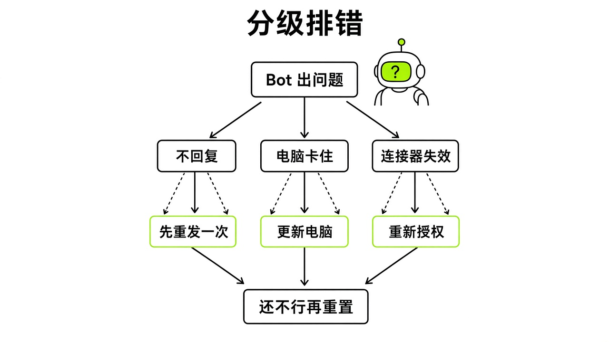

# §22 常见故障速查 · Troubleshooting

[← 上一章：§21 事故档案 · Incident Files](../part8-pitfalls/21-incidents.md) ｜ [📖 返回目录](../../README.md#-目录) ｜ [下一章：§23 别这么用 · Anti-Patterns →](../part8-pitfalls/23-antipatterns.md)

---

> **用法**：遇到问题先看 22.7 速查表，再跳到对应小节。**原则**：先做破坏性最小的操作，Reset 永远放在最后。

## 22.1 登录与授权异常：浏览器未聚焦、Legacy Privacy Mode 与手机号拦截 · Sign-in & Authentication

翻阅官方排错文档可以发现，新手最容易被卡住的第一关就是登录中断。很多人在浏览器里点完登录就切去做别的事，结果回到桌面客户端，发现它一直卡在欢迎页。官方排错指南给出的硬性要求是：浏览器认证的全过程中，Grok Bot 桌面客户端必须保持打开（[https://cursor.com/help/grok-bot/troubleshooting](https://cursor.com/help/grok-bot/troubleshooting)）。要是浏览器已经提示 Cursor 登录成功，客户端却没有自动拉回前台，别去反复刷网页。直接手动切回桌面应用，在欢迎界面重新点 Sign in；若是已经在客户端里，就进 Settings 点 **Sign In with Cursor** 重新拉起绑定（[https://cursor.com/help/grok-bot/troubleshooting](https://cursor.com/help/grok-bot/troubleshooting)）。开通企业 SSO 的团队，必须走组织统一通道登录，不能混用个人账号（[https://cursor.com/help/grok-bot/troubleshooting](https://cursor.com/help/grok-bot/troubleshooting)）。

> [!NOTE]
> 📸 **截图位（待补）**：浏览器授权完成但客户端未响应及手机号拦截报错界面

客户端弹出 Legacy Privacy Mode 报错，不用慌，不是安装包坏了。这是因为当前登录的 Cursor 账号开了旧版隐私模式，把 Grok Bot 需要的云端持久化存储挡住了（[https://cursor.com/help/grok-bot/troubleshooting](https://cursor.com/help/grok-bot/troubleshooting)）。遇到这种情况，进 Cursor 账号设置调整数据隐私模式，或者联系企业管理员放行即可（[https://cursor.com/help/grok-bot/troubleshooting](https://cursor.com/help/grok-bot/troubleshooting)）。

针对国内用户常遇到的手机号拦截，V2EX 社区有案例记录：用 SuperGrok 凭据登录 Grok Bot 时，系统强制弹手机号验证，输入国内手机号甚至接码平台号码都会报错“无法验证此电话号码。请尝试其他号码。”（https://www.v2ex.com/t/1241829 社区帖称，个例）。帖子下只有一条回复给出解法："美国 ip +86"，即切到美国网络环境后再提交 +86 号码，是否有效未经证实（https://www.v2ex.com/t/1241829 社区帖称，个例）。

除了客户端本身的授权流程外，当 Bot 在云端浏览器中执行登录或调用第三方连接器时，还有三类高频拦截与认证异常需要重点排查：

1. **网站封禁云服务器机房 IP 或狂弹 Captcha 验证码**：因为 Grok Bot 默认运行在云端沙箱（cloud box）中，部分防爬策略严格的电商、金融或内容平台会直接拦截数据中心机房 IP，导致页面返回 403 Forbidden 或陷入无休止的 Cloudflare / Captcha 人机验证死循环。针对这一痛点，社区用户 `@XueshiQiao`（Xueshi，[https://x.com/XueshiQiao/status/2112866936229183589](https://x.com/XueshiQiao/status/2112866936229183589)）给出了经过验证的一键排错解法：在保持本地桌面端在线的前提下，进入 `Settings > Computer > Your computer`，开启 **`Route traffic through this computer`**（通过本机路由流量）。开启后，云端浏览器的出站请求会借用你家里或办公室桌面的真实住宅 IP（Residential IP）出站，瞬间绕过机房 IP 封锁。此外，官方在 v0.75.5 版本更新中（[https://x.ai/changelog/bot](https://x.ai/changelog/bot)）专门修复并加固了本地电脑流量转发的底层连接稳定性。
2. **1Password 找不到登录条目或无法拉起授权弹窗**：官方在 v0.75.2（[https://x.ai/changelog/bot](https://x.ai/changelog/bot)）与 [Connect Apps 指南](https://cursor.com/help/grok-bot/connect-apps)中上线了 1Password Brokered Sign-in（代理逐次授权登录）。如果你明明在 1Password 里存了账号，Bot 却提示找不到对应登录项，请按三步排查：
   - 第一，确认本机安装的 **1Password 桌面客户端已升级至 8.12.42 或更高版本**，且当前处于已解锁（Unlocked）状态（[https://cursor.com/help/grok-bot/connect-apps](https://cursor.com/help/grok-bot/connect-apps)）。
   - 第二，核查密码库（Vault）归属位置。根据官方 [Work 技术文档](https://cursor.com/docs/grok-bot/work) 与 [Connect Apps 指南](https://cursor.com/help/grok-bot/connect-apps)规定，Brokered Sign-in 模式默认**仅读取已连接账号下的默认 Personal / Private vault（个人/私有密码库）**；存放在其他共享库（Shared vaults）或自定义密码库中的条目不会被读取，需将目标条目移动或复制到 Personal / Private 库中。
   - 第三，如果你此前配置过旧版的“新建 `Grok Bot` 共享 Vault + 粘贴 Service Account Token”方案，只需进入 `Settings → Connect apps → 1Password`，点击断开（Disconnect）并重新连接（Reconnect），即可无缝迁移至新版逐次生物识别审批模式（[https://cursor.com/help/grok-bot/connect-apps](https://cursor.com/help/grok-bot/connect-apps)）。同时注意官方登录调用的严格优先级顺序：云电脑已保存的浏览器会话（Saved browser session） → **Grok Bot Vault** → **1Password** → 聊天内 **Secure Form** → **Take over screen（人工接管屏幕）**（[https://cursor.com/docs/grok-bot/work](https://cursor.com/docs/grok-bot/work)）。
3. **X 插件缺少 X Chat / Calls / Livestreams / Spaces / Lists 工具或报 `tools=0`**：当你在对话中让 Bot 帮自己分拣 `@chat` 私信、管理陌生人消息请求（`@pjvann`，[https://x.com/pjvann/status/2111104660773687646](https://x.com/pjvann/status/2111104660773687646)）、创建预约通话（`schedule_call`）、管理 RTMP 直播推流或维护列表（Lists）时，若 Bot 报错提示 `user-X-* not found`、`tools=0`，或者只能查公开帖子却找不到私信与直播工具，这属于插件授权未刷新而非付费墙限制。解决方法是打开 `Settings → Connect apps`，找到 **X** 插件执行断开并重新连接（**Reconnect**），即可拉取完整的最新工具集（[https://cursor.com/help/grok-bot/connect-apps](https://cursor.com/help/grok-bot/connect-apps)）。此外，针对 X Chat 端到端加密私信（`xchat_lite`）解密失败的问题，由于 MCP 接口仅下发加密载荷与 Juicebox 配置，需确认 Bot 已在云电脑沙箱内成功克隆官方解密辅助仓库 [https://github.com/xdevplatform/xchat-grokbot-helper](https://github.com/xdevplatform/xchat-grokbot-helper) 运行本地解密脚本 `xchat_tool.py`，并且你向其提供了正确的 **4 位数字 X Chat PIN 码**。

## 22.2 中文复制粘贴变乱码：v1.14.0 的编码陷阱 · Chinese Clipboard Encoding Bug

中文环境下的文本复制踩过一个特定版本的坑。V2EX 社区反馈，客户端英文回复复制粘贴完全正常，但复制中文回复粘到外部输入框或编辑器时，文字全变成了乱码（https://www.v2ex.com/t/1247756 社区帖称，个例）。

> [!NOTE]
> 📸 **截图位（待补）**：v1.14.0 中文回复复制粘贴后乱码与无格式粘贴对比

该问题被定位在 **Grok Bot 1.14.0** (17267) 构建版本，运行环境为 runtime e9651e08edc0248a43ce2d13839fa55c7d2e1425，安装包是 embedded bundle，发布通道是 production（https://www.v2ex.com/t/1247756 社区帖称，个例），X 上也有公开的操作录屏（https://x.com/liuxu_qingdao/status/2108527380570816747 社区帖称，个例）。原帖没有给出原因，官方也没有说明。遇到这种乱码，应急办法是用无格式纯文本粘贴快捷键：Mac 按 Command-Shift-V，Windows 按 Ctrl-Shift-V，该快捷键从 v0.30.0 开始在客户端内支持（[https://x.ai/changelog/bot](https://x.ai/changelog/bot)）。也可以直接让 Bot 把大段中文输出为云电脑 `/workspace` 下的文件再打开。

在 macOS 与 Windows 客户端分别测试 v1.14.0 以后版本的中文剪贴板编码行为。

## 22.3 云电脑卡死与无法连接：Update、Recover 与 Reset 的严格处置阶梯 · Computer Recovery

云电脑一直停在 Starting your computer、Updating your computer、Reconnecting 或 Couldn't Reach Grok Bot's Computer 时，很多人第一反应是点 Reset，这是非常危险的误操作。官方文档明确指出：对话历史独立于云电脑存储在外部，云电脑临时断连甚至终端里误敲了 `rm -rf`，聊天记录都不会丢（[https://cursor.com/help/grok-bot/computer-recovery](https://cursor.com/help/grok-bot/computer-recovery)）。排查必须严格遵守破坏性由低到高的处置阶梯（[https://cursor.com/help/grok-bot/troubleshooting](https://cursor.com/help/grok-bot/troubleshooting)、[https://cursor.com/help/grok-bot/computer-recovery](https://cursor.com/help/grok-bot/computer-recovery)）：

1. 等待与重试。系统提示重连时，Bot、文件和登录态都处于受保护状态，切勿在此期间执行重置（[https://cursor.com/help/grok-bot/computer-recovery](https://cursor.com/help/grok-bot/computer-recovery)）。
2. 彻底退出客户端并重启。Mac 用户必须从顶部菜单栏选 Quit，不能只关主窗口（[https://cursor.com/help/grok-bot/computer-recovery](https://cursor.com/help/grok-bot/computer-recovery)）。

> [!NOTE]
> 📸 **截图位（待补）**：Settings > Computer 中 Update、Recover 与 Reset 操作面板

3. 检查云电脑镜像更新。在 Settings > Computer（或 Settings > Updates，手机端路径为 Settings > Bot > Bot Computer）看是否有更新提示（[https://cursor.com/help/grok-bot/troubleshooting](https://cursor.com/help/grok-bot/troubleshooting), [https://cursor.com/help/grok-bot/computer-recovery](https://cursor.com/help/grok-bot/computer-recovery)）。官方把更新分两类：软件更新只刷 Grok Bot 程序本身，保留包括自行安装应用在内的所有数据；整机更新会重建整台云电脑，保留 Bot、持久化文件和登录态，但会清掉自行安装的软件包（[https://cursor.com/help/grok-bot/computer-recovery](https://cursor.com/help/grok-bot/computer-recovery)）。如果提示文件未完成备份，Update 会自动停止，此时应继续等待备份完成，绝不能强行用 Reset 覆盖（[https://cursor.com/help/grok-bot/computer-recovery](https://cursor.com/help/grok-bot/computer-recovery)）。如果提示有智能体无法及时暂停，等当前任务结束再点更新（[https://cursor.com/help/grok-bot/computer-recovery](https://cursor.com/help/grok-bot/computer-recovery)）。
4. 使用 **Recover computer**。重连彻底没反应，或者更新卡死并出现该按钮时，才选 Recover（[https://cursor.com/help/grok-bot/computer-recovery](https://cursor.com/help/grok-bot/computer-recovery)）。Recover 会尽量保存已有数据并在最新镜像上拉起新机器，这会中断正在运行的任务，并清理自行安装的软件包和未及时同步的极近期修改（[https://cursor.com/help/grok-bot/computer-recovery](https://cursor.com/help/grok-bot/computer-recovery)）。
5. 最后保底才用 Reset。只有 Recover 和 Update 都失效，且你确认能接受丢失最近未同步数据时才能执行（[https://cursor.com/help/grok-bot/troubleshooting](https://cursor.com/help/grok-bot/troubleshooting)）。Reset 会基于上一次成功保存的快照强制重置机器，未同步内容和自行安装的软件包都会被清除（[https://cursor.com/help/grok-bot/computer-recovery](https://cursor.com/help/grok-bot/computer-recovery)）。更新或重置还在跑时，绝对不要点第二次。如果 Recover 或 Reset 失败，最多点一次 Retry，再次失败必须立刻停止并提工单（[https://cursor.com/help/grok-bot/computer-recovery](https://cursor.com/help/grok-bot/computer-recovery)）。

另外，磁盘空间不足警告（Computer is low on disk space）并不是丢数据，侧栏 Disk Saver 会给出清理建议，只有经你确认后才会清理指定的电脑文件，绝不会碰对话记录（[https://cursor.com/help/grok-bot/computer-recovery](https://cursor.com/help/grok-bot/computer-recovery)）。社区里有用户提到 9/8 重复电脑事故后周额度"确实重置了"，但没有收到邮件，这次重置是不是补偿无法确认（https://www.v2ex.com/t/1241225 社区帖称，个例）。

## 22.4 Routine 不执行与 50 分钟后台任务超时 · Routines & Background Hangs

定时任务挂上去后毫无反应，先对照官方给出的六项清单自检：Routine 开关是否启用、排程时间规则与时区是否吻合、所属 Bot 是否存在且未被删除、依赖的插件是否仍有效认证、云电脑网络能否联通目标外部服务、账号额度或按需消费上限是否耗尽（[https://cursor.com/help/grok-bot/troubleshooting](https://cursor.com/help/grok-bot/troubleshooting)）。如果是 Slack 或 GitHub 触发的事件型 Routine，还要核对对应的频道、仓库和事件规则是否仍然有效（[https://cursor.com/help/grok-bot/troubleshooting](https://cursor.com/help/grok-bot/troubleshooting)）。如果是基于专属邮箱 `+alias` 加号子别名（例如 `mybot+newsletters@mail.grokbot.com`，由官方工程师 `@SamSokolin` 发布，[https://x.com/SamSokolin/status/2110496237241667621](https://x.com/SamSokolin/status/2110496237241667621)）定向触发的邮件型 Routine，还需检查发件方的收件地址后缀与 Routine 过滤条件中的 `+alias` 字符串是否完全匹配（[https://cursor.com/help/grok-bot/agent-email](https://cursor.com/help/grok-bot/agent-email)）。

此外，排查高频触发的 Routine 被系统限流拦截时，需对齐 v0.75.2 最新上调后的官方速率限制标准（[https://cursor.com/help/grok-bot/routines](https://cursor.com/help/grok-bot/routines)、[https://x.ai/changelog/bot](https://x.ai/changelog/bot)）：**全账号所有 Bot 合计最高运行 300 次/小时（300 runs per hour across all Bots），单条 Routine 最高运行 200 次/小时（200 runs per hour for a single Routine）**，而定时排程（Schedule）的最小触发间隔仍为 5 分钟。至於额度耗尽导致的停摆，还需区分你当前所处的订阅体系（[https://cursor.com/help/grok-bot/plans](https://cursor.com/help/grok-bot/plans)）：如果你已升级至 **The X Subscription 三合一统一订阅**（包含 Grok Bot 的档位为 Premium $30/月、Super $100/月、Ultra $200/月，Free $0 与 Plus $8/月不含 Grok Bot），Grok Bot 与 Grok、Cursor 共享同一个周额度池（weekly usage pool）；正如 `@charlie_pmp`（[https://x.com/charlie_pmp/status/2114214503416271131](https://x.com/charlie_pmp/status/2114214503416271131)）所拆解，三端共用周池叠加后台未精简的高频 Routine 是周额度提早见底的两大主因。在 The X Subscription 下，周额度耗尽后不再走旧版后付费账单，而是从 `grok.com/dashboard/billing` 充值的 **Prepaid Credits（预付额度）** 中扣除，若未充值预付额度或触及月度额外消费封顶上限（Monthly additional usage limit），Routine 便会因额度不足停止执行；而尚未通过 `cursor.com/unify` 单向切换（注意：一旦切换至 The X Subscription 即不可逆退回旧版计划）的既有独立 Cursor Pro（$20/月）、Pro+（$60/月）、Ultra（$200/月）及 Teams（$40/人/月）老订户，则仍受原有的 `On-demand monthly limit` 控制（[https://cursor.com/help/the-x-subscription/overview](https://cursor.com/help/the-x-subscription/overview)）。

> [!NOTE]
> 📸 **截图位（待补）**：Routine 运行历史报错与 50 分钟后台超时提示

检查历史运行记录时，如果想手动触发测试，官方明确强调 **Test run** 会真实执行外部操作并产生实质动作，必须使用安全参数，严禁用危险输入试跑（[https://cursor.com/help/grok-bot/troubleshooting](https://cursor.com/help/grok-bot/troubleshooting)）。

后台任务悄无声息死掉，关键机制在于后台硬超时。Cursor 论坛里有用户贴出过系统提示"A background task was stopped after 50 minutes so it would not hang"，说明后台任务跑满 50 分钟会被强制终止（https://forum.cursor.com/t/grok-bot-primary-bot-silent-bot-failed-to-respond-since-oct-8-other-bots-ok-restart-this-bots-runner-only-do-not-reset/174138）。长流程的批量扫描或数据处理如果没有拆分子任务，就会被强制切断。另外客户端从 v0.21.0 开始支持通过 Webhook URL 与 Webhook key 外部调用 Routine（[https://x.ai/changelog/bot](https://x.ai/changelog/bot)），v0.52.0 支持暂停与恢复（[https://x.ai/changelog/bot](https://x.ai/changelog/bot)），排查偶发故障时可以先置为暂停逐步调试。

在实际搭建跨端自动化与后台 Shell 任务时，社区还攻克了两项极具代表性的死锁与报错难题：

1. **在 Agent Shell 中调用 `pi -p "..."` 等非交互式 CLI 工具无限挂起卡死**：不少用户效仿 `@hppzyy`（[https://x.com/hppzyy/status/2111573227881529454](https://x.com/hppzyy/status/2111573227881529454)）的做法，在 Grok Bot 云电脑里安装轻量级 Pi Agent（`pi`）或各类 CLI Worker 来省额度处理长文本，但在 Agent 的非交互式 Shell 中执行 `pi -p "..."` 时，命令却会永远卡住不返回，直到拖满超时。社区开发者 `@37FlowAI`（[https://x.com/37FlowAI/status/2111334386339823687](https://x.com/37FlowAI/status/2111334386339823687)）分享了 Grok Bot 自主定位出的底层根因与一行修复方案：许多 CLI 工具在非 TTY 环境下启动时，会默认阻塞等待标准输入（`stdin`）的 `EOF` 结束信号。只需在命令末尾显式追加 **`< /dev/null`** 立即闭合标准输入，就能从无限挂起变为毫秒级瞬间返回：

```bash
# ❌ 错误写法：在 Agent 非交互式 Shell 中等待 stdin EOF 导致无限挂起
pi -p "只回复OK"

# ✅ 正确写法（@37FlowAI 验证）：追加 < /dev/null 闭合标准输入，瞬间返回结果
pi -p "只回复OK" < /dev/null
```

2. **向 Grok Bot Webhook 推送任务返回 HTTP 400 报错**：当你从本地 Claude Code、Codex 或外部自动化脚本向 Grok Bot 的 Routine Webhook 推送包含多行提示词、特殊转义字符或复杂嵌套结构的 JSON 载荷时，有时会遭遇 Webhook 端点严格的 Schema 校验拦截并返回 **HTTP 400 Bad Request**。针对这一痛点，社区开发者 `@mikan77_aoi`（橘子🍊，[https://x.com/mikan77_aoi/status/2111043148088816045](https://x.com/mikan77_aoi/status/2111043148088816045)）设计了一套零外部依赖、零守护进程（zero-daemon）的纯 Python 标准库（`urllib.request` + `json`）桥接脚本：彻底绕开脆弱的静态 Webhook 载荷限制，仅用 **4 次标准会话 API 调用**（1. 校验身份与目标 Bot 状态 → 2. 创建或定位目标会话 Thread → 3. 直接向会话注入结构化任务消息 → 4. 触发异步执行并回收状态回执），即可让本地 Claude Code 100% 稳定地将长篇上下文任务交接给云端 Grok Bot：

```python
#!/usr/bin/env python3
"""
绕过 Webhook HTTP 400 限制的 4-API-Call 纯标准库派单桥接器
参考实战范式：@mikan77_aoi (https://x.com/mikan77_aoi/status/2111043148088816045)
"""
import json
import os
import sys
import urllib.request

API_BASE = os.environ.get("GROKBOT_API_BASE", "https://cursor.com/api/bot/v1")
API_TOKEN = os.environ["GROKBOT_API_TOKEN"]
BOT_ID = os.environ["GROKBOT_ID"]

def api_call(method: str, path: str, payload: dict | None = None) -> dict:
    data = json.dumps(payload).encode("utf-8") if payload is not None else None
    req = urllib.request.Request(
        f"{API_BASE}{path}",
        data=data,
        method=method,
        headers={
            "Authorization": f"Bearer {API_TOKEN}",
            "Content-Type": "application/json",
            "Accept": "application/json",
        },
    )
    with urllib.request.urlopen(req, timeout=30) as resp:
        return json.loads(resp.read().decode("utf-8"))

def dispatch_task_in_4_calls(prompt_text: str) -> str:
    # Call 1: 获取并校验目标 Bot 在线状态
    bot_info = api_call("GET", f"/agents/{BOT_ID}")
    # Call 2: 为本次跨端交接创建或获取活跃会话上下文
    thread = api_call("POST", f"/agents/{BOT_ID}/threads", {"title": "CLI Bridge Handoff"})
    thread_id = thread["id"]
    # Call 3: 直接写入完整的多行 Markdown 任务指令（避免 Webhook JSON 400 报错）
    msg = api_call(
        "POST",
        f"/agents/{BOT_ID}/threads/{thread_id}/messages",
        {"role": "user", "content": prompt_text},
    )
    # Call 4: 触发云端 Runner 异步执行并返回 Run ID
    run = api_call(
        "POST",
        f"/agents/{BOT_ID}/threads/{thread_id}/runs",
        {"message_id": msg["id"], "wake_on_done": True},
    )
    return f"Dispatched to {bot_info.get('name', BOT_ID)}: thread={thread_id}, run={run['id']}"

if __name__ == "__main__":
    task = sys.stdin.read().strip() or "请汇总今日 X 平台核心动态并更新 Page 看板"
    print(dispatch_task_in_4_calls(task))
```

## 22.5 邮件与消息发不出：草稿卡片、虚拟机假死与发送报错 · Email & Message Delivery Issues

Bot 答应发邮件或 Slack 消息后迟迟没有动静，往往不是网络断了，而是卡在审批环节。从 v0.45.0 开始，系统引入了草稿卡片机制，Bot 起草的内容会先以卡片形式呈现在对话里，必须由人工点击 Send 或 Discard 才会发出去（[https://x.ai/changelog/bot](https://x.ai/changelog/bot)）。虽然 v0.64.0 增加了 Disable drafts for this Bot 选项允许跳过卡片直接发送（[https://x.ai/changelog/bot](https://x.ai/changelog/bot)），且 v0.75.2 进一步精简了用户在当前对话轮次已明确授权指令时的冗余 Auto-review 审批弹窗（[https://x.ai/changelog/bot](https://x.ai/changelog/bot)），但在开启团队策略的环境下，管理员配置的全局 Auto-review 规则优先级最高：系统中的 **Ask first**（或企业自定义规则中的 `Block` / `Require approval`，[https://cursor.com/docs/grok-bot/security](https://cursor.com/docs/grok-bot/security)）规则永远优先于 Allow automatically 规则（[https://cursor.com/help/grok-bot/troubleshooting](https://cursor.com/help/grok-bot/troubleshooting)）。动作只要命中审批规则就会生成等待批准的卡片，卡片放着约 10 分钟不处理就会自动过期失效（[https://cursor.com/help/grok-bot/troubleshooting](https://cursor.com/help/grok-bot/troubleshooting)）。

> [!NOTE]
> 📸 **截图位（待补）**：邮件草稿确认卡片与 Ask first 审批拦截界面

附件不合规也会直接导致发送失败。官方文档有硬性指标：单个普通文件不得超过 25 MB，视频文件不得超过 200 MB，桌面端单次最多上传 6 个附件，且文件不能带密码保护或加密措施（[https://cursor.com/help/grok-bot/troubleshooting](https://cursor.com/help/grok-bot/troubleshooting)）。罕见格式应提前在本地转成 PDF、CSV、纯文本或常见图片格式后再上传（[https://cursor.com/help/grok-bot/troubleshooting](https://cursor.com/help/grok-bot/troubleshooting)）。此外，如果你此前遇到过让 Bot 转发邮件时丢失排版格式、正文图片裂开或原邮件附件漏发的问题，只需将客户端升级至 **v0.75.2 或更高版本**——根据官方更新日志（[https://x.ai/changelog/bot](https://x.ai/changelog/bot)）与 [Agent Email 官方文档](https://cursor.com/help/grok-bot/agent-email)，v0.75.2 已原生支持在转发邮件（含 `@mail.grokbot.com` 专属邮箱及已连接的外部邮箱）时**完整保留原邮件的 HTML 富文本排版、正文内嵌图片（inline images）以及全部文件附件**。

论坛还出现过客户端输入框被锁定发不出消息、但右侧虚拟机画面依然完全正常的界面假死情况（https://forum.cursor.com/t/grokbot-can-not-send-msgs-agents-virtual-machine-is-still-visible/170843 社区帖称，个例）。如果当前正有未完成的 computer-use 任务占用操作锁，先在输入框发送“Stop now”强制终止，或者接管云电脑画面手动关闭卡死页面，释放控制权后再发指令（[https://cursor.com/help/grok-bot/troubleshooting](https://cursor.com/help/grok-bot/troubleshooting)）。

## 22.6 安全过滤静默拦截：被“毒化”的 Bot 与不可逆的会话死锁 · Safety Filter Silent Failure

2026 年 10 月 8 日至 9 日，Cursor 官方论坛曝光了一起典型故障：v0.68.1 客户端中，用户的主 Bot 突然瘫痪，发任何内容都会弹通用报错，但同账号下的其他 Bot 却完全正常（https://forum.cursor.com/t/grok-bot-primary-bot-silent-bot-failed-to-respond-since-oct-8-other-bots-ok-restart-this-bots-runner-only-do-not-reset/174138）。

> [!NOTE]
> 📸 **截图位（待补）**：Bot failed to respond 通用报错与已被毒化的会话状态

Cursor 官方工程师 @kevinn 于 10 月 9 日 07:36 CST 公布了排查结论：Bot 后台 runner 并没有卡死，原因是底层大模型服务商的安全过滤器把该 Bot 历史对话中的某段内容判定为违规（https://forum.cursor.com/t/grok-bot-primary-bot-silent-bot-failed-to-respond-since-oct-8-other-bots-ok-restart-this-bots-runner-only-do-not-reset/174138 （Cursor 员工 @kevinn 回复））。Grok Bot 每次生成回复都必须把完整上下文历史打包发给模型，哪怕用户只发一句问候，请求中携带的历史违规内容也会立刻触发安全拦截，导致模型拒绝返回结果（https://forum.cursor.com/t/grok-bot-primary-bot-silent-bot-failed-to-respond-since-oct-8-other-bots-ok-restart-this-bots-runner-only-do-not-reset/174138 （Cursor 员工 @kevinn 回复））。当时客户端前端没区分这种安全拦截，只能直接显示一行通用提示 **Bot failed to respond / Something went wrong**（https://forum.cursor.com/t/grok-bot-primary-bot-silent-bot-failed-to-respond-since-oct-8-other-bots-ok-restart-this-bots-runner-only-do-not-reset/174138 （Cursor 员工 @kevinn 回复））。

这一事故暴露了不可逆的设计痛点：重启应用和 Reset 云电脑对该故障完全无效。会话数据存放在云电脑外部，Reset 不会清空历史，且客户端当时没有单独删除单条历史记录的功能（https://forum.cursor.com/t/grok-bot-primary-bot-silent-bot-failed-to-respond-since-oct-8-other-bots-ok-restart-this-bots-runner-only-do-not-reset/174138 （Cursor 员工 @kevinn 回复））。官方工程师给出了处置规矩：不要尝试 Reset 电脑，也不要删除这个 Bot，把它的已有记忆和 Routine 留在原地；日常任务立即切到其他正常 Bot 或新建 Bot；绝对不要让新 Bot 去读取、总结或续写这个中毒 Bot 的历史对话，否则会把违规内容搬到新会话里，导致新 Bot 被连带封锁（https://forum.cursor.com/t/grok-bot-primary-bot-silent-bot-failed-to-respond-since-oct-8-other-bots-ok-restart-this-bots-runner-only-do-not-reset/174138 （Cursor 员工 @kevinn 回复））。根据发帖用户自述，诱因是曾让该 Bot 探讨过 AI 安全漏洞扫描工具（基于论坛用户自述背景推测，https://forum.cursor.com/t/grok-bot-primary-bot-silent-bot-failed-to-respond-since-oct-8-other-bots-ok-restart-this-bots-runner-only-do-not-reset/174138）。因此，涉及安全测试、逆向工程等边缘领域的内容，必须严格放在一次性隔离 Bot 中运行。

## 22.7 常见故障与排错动作速查 · Quick Troubleshooting Matrix

下表与分级说明把高频异常的症状与官方处置决策梳理成了速查阶梯。



*图：Grok Bot 故障症状与分级排错动作决策流*

登录与授权环节：认证无法完成时，先确认浏览器登录成功后手动切回客户端，在 Settings 中点 Sign In with Cursor 重新拉起；遇到 Legacy Privacy Mode 报错，调整 Cursor 账户数据设置或联系管理员解除限制（[https://cursor.com/help/grok-bot/troubleshooting](https://cursor.com/help/grok-bot/troubleshooting)）；境内账号绑定遇手机号无法验证，可尝试切到美国 IP 后重新提交 +86 号码（仅一条社区回复，未证实）（https://www.v2ex.com/t/1241829 社区帖称，个例）。当目标网站封禁云服务器机房 IP 或频繁弹 Captcha 验证码时，开启 `Settings > Computer > Your computer > Route traffic through this computer` 借用本机住宅 IP 出站（`@XueshiQiao`，[https://x.com/XueshiQiao/status/2112866936229183589](https://x.com/XueshiQiao/status/2112866936229183589)；v0.75.5 已修复转发稳定性，[https://x.ai/changelog/bot](https://x.ai/changelog/bot)）。当 1Password 找不到登录条目时，确认本机 1Password 已升级至 **8.12.42+** 且处于解锁状态，并确保账号存放在默认的 **Personal / Private vault** 中；旧版 Service Account 用户可在 `Settings → Connect apps` 中断开并重连 1Password 完成迁移（[https://cursor.com/help/grok-bot/connect-apps](https://cursor.com/help/grok-bot/connect-apps)）。当 X 插件缺少 X Chat、Calls、Livestreams、Spaces 或 Lists 工具或报 `tools=0` 时，在 `Settings → Connect apps` 中重新连接（Reconnect）X 插件；解密 X Chat 私信需在沙箱克隆 [https://github.com/xdevplatform/xchat-grokbot-helper](https://github.com/xdevplatform/xchat-grokbot-helper) 并提供 4 位 X Chat PIN。

文本复制与输入环节：v1.14.0 中文回复复制粘贴乱码，按 Command-Shift-V（Windows 为 Ctrl-Shift-V）无格式粘贴，或直接从云电脑 `/workspace` 下载导出文件查看（[https://x.ai/changelog/bot](https://x.ai/changelog/bot), https://www.v2ex.com/t/1247756 社区帖称，个例）。

云电脑与环境恢复环节：连接中断或更新停滞时，严格遵循 Retry → 菜单栏 Quit 彻底重启 → Update → Recover → Reset 的顺序操作；未同步前严禁盲目 Reset，一次恢复尚未结束绝不启动第二次（[https://cursor.com/help/grok-bot/computer-recovery](https://cursor.com/help/grok-bot/computer-recovery)）。单个 Bot 突发持续静默并抛出通用报错时，切勿重置电脑，判定为安全过滤器毒化死锁后，直接换新 Bot 承接任务，严禁让新 Bot 读取中毒历史（https://forum.cursor.com/t/grok-bot-primary-bot-silent-bot-failed-to-respond-since-oct-8-other-bots-ok-restart-this-bots-runner-only-do-not-reset/174138 （Cursor 员工 @kevinn 回复））。

自动化与消息交互环节：Routine 停摆需逐项核查排程时区、Bot 存续状态、插件认证、v0.75.2 频率上限（**全账号合计 300 次/小时、单条 Routine 200 次/小时**，[https://cursor.com/help/grok-bot/routines](https://cursor.com/help/grok-bot/routines)）与 50 分钟超时（社区报告），手动验证仅能使用安全输入跑 Test run（[https://cursor.com/help/grok-bot/troubleshooting](https://cursor.com/help/grok-bot/troubleshooting), https://forum.cursor.com/t/grok-bot-primary-bot-silent-bot-failed-to-respond-since-oct-8-other-bots-ok-restart-this-bots-runner-only-do-not-reset/174138）；若在 Agent Shell 中调用 `pi -p "..."` 等非交互式 CLI 挂起卡死，在命令末尾追加 **`< /dev/null`** 闭合标准输入（`@37FlowAI`，[https://x.com/37FlowAI/status/2111334386339823687](https://x.com/37FlowAI/status/2111334386339823687)）；若向 Webhook 推送任务返回 HTTP 400 报错，改用 `@mikan77_aoi`（[https://x.com/mikan77_aoi/status/2111043148088816045](https://x.com/mikan77_aoi/status/2111043148088816045)）的 4 次 API 调用纯标准库 Python 脚本直接通过会话 API 派单。邮件与消息未发出优先排查 Auto-review 的 Ask first 规则及卡片状态，附件严格控制在 25 MB（视频 200 MB）和 6 个文件上限内，转发邮件丢失 HTML/内嵌图片/附件则需升级至 v0.75.2+（[https://cursor.com/help/grok-bot/agent-email](https://cursor.com/help/grok-bot/agent-email)）；界面锁死可随时发送 **Stop now** 终止当前阻塞动作（[https://cursor.com/help/grok-bot/troubleshooting](https://cursor.com/help/grok-bot/troubleshooting)）。

计费、移动端与客户端高频问题环节（涵盖官方 [FAQs](https://cursor.com/help/grok-bot/faqs) 与 Cursor / Grok Bot VP of DX `@leerob` 发起的 $100 X Money 真实反馈悬赏汇总帖 [https://x.com/leerob/status/2113792409448714468](https://x.com/leerob/status/2113792409448714468)）：

| 故障类别 | 典型症状与报错表现 | 根因定位 | 标准排错动作与权威信源 |
| :--- | :--- | :--- | :--- |
| **登录与反爬拦截** | 云端浏览器访问站点弹 403 或无限 Captcha 验证码 | 目标网站封禁了云服务器机房 IP | 开启 `Settings > Computer > Your computer > Route traffic through this computer` 借用本机住宅 IP 出站（`@XueshiQiao`，[https://x.com/XueshiQiao/status/2112866936229183589](https://x.com/XueshiQiao/status/2112866936229183589)；v0.75.5 已修复，[https://x.ai/changelog/bot](https://x.ai/changelog/bot)） |
| **1Password 授权** | Bot 提示找不到 1Password 中的网站账号或无法弹窗审批 | 1Password 版本过低、未解锁，或条目不在默认 Personal/Private 库中 | 升级本机 1Password 至 **8.12.42+** 并保持解锁；将条目移入默认 **Personal / Private vault**；旧版 Service Account 用户在 `Settings → Connect apps` 中断开重连（[https://cursor.com/help/grok-bot/connect-apps](https://cursor.com/help/grok-bot/connect-apps)） |
| **X 插件工具缺失** | 找不到 X Chat / Calls / Livestreams / Spaces / Lists 工具或报 `tools=0` | X 插件授权未同步最新工具表，或沙箱缺少本地解密辅助工具 | 在 `Settings → Connect apps` 中 **Reconnect** X 插件（[https://cursor.com/help/grok-bot/connect-apps](https://cursor.com/help/grok-bot/connect-apps)）；X Chat 解密需克隆 [https://github.com/xdevplatform/xchat-grokbot-helper](https://github.com/xdevplatform/xchat-grokbot-helper) 并输入 4 位 PIN |
| **Shell 进程挂起** | Agent Shell 中运行 `pi -p "..."` 等非交互式 CLI 无限卡死 | 子进程在非 TTY 环境下一直阻塞等待 `stdin` 的 `EOF` 信号 | 在命令末尾追加 **`< /dev/null`**（如 `pi -p "只回复OK" < /dev/null`，`@37FlowAI`，[https://x.com/37FlowAI/status/2111334386339823687](https://x.com/37FlowAI/status/2111334386339823687)） |
| **Webhook 400** | 外部或本地脚本向 Routine Webhook 推送复杂 JSON 返回 HTTP 400 | Webhook 端点对复杂嵌套或特殊转义载荷校验失败 | 改用 `@mikan77_aoi` 的 4 次 API 调用纯标准库 Python 脚本直接通过会话 API 派单（[https://x.com/mikan77_aoi/status/2111043148088816045](https://x.com/mikan77_aoi/status/2111043148088816045)） |
| **邮件转发丢格式** | Bot 转发邮件后丢失 HTML 样式、内嵌图片或附件 | 旧版客户端邮件转发未做富文本与 MIME 附件穿透 | 升级至 **v0.75.2+**，原生保留完整 HTML、内嵌图片与附件（[https://cursor.com/help/grok-bot/agent-email](https://cursor.com/help/grok-bot/agent-email)） |
| **合并订阅双份扣费** | 在 `cursor.com/unify` 合并升级 The X Subscription 后仍被旧账单扣款 | 网页端直连账单会自动按比例退费，但 **Apple App Store / Google Play 渠道账单无法被官方自动退订** | 合并至 The X Subscription（Premium $30 / Super $100 / Ultra $200）后，必须立即前往 iPhone **Apple ID 订阅管理**或 **Google Play 订阅页**手动取消旧订阅（[https://cursor.com/help/grok-bot/plans](https://cursor.com/help/grok-bot/plans)、[https://cursor.com/help/grok-bot/faqs](https://cursor.com/help/grok-bot/faqs)） |
| **Action Button 找不到指令** | iPhone 设置操作按钮（Action Button）或快捷指令时看不到 Grok Bot 选项 | iOS 客户端版本低于 v1.16，或更新后尚未冷启动注册系统 Shortcuts | 在 iPhone 15 Pro 及后续机型上将 Grok Bot App 升级至 **v1.16+**，并在更新后**至少打开一次 App** 以向 iOS 注册 `Start Voice Chat` 快捷指令（[https://cursor.com/help/grok-bot/voice-chat](https://cursor.com/help/grok-bot/voice-chat)、[https://cursor.com/help/grok-bot/mobile](https://cursor.com/help/grok-bot/mobile)） |
| **Vault 绑卡无单独弹窗** | 存入 `Settings → Vault` 的银行卡在结账时自动填入，未弹出单独的 Vault 确认框 | 官方设计机制：已存 Vault 的卡通过 `BrowserSecureFill` 注入时不触发单独的逐笔 Vault 弹窗 | 若希望每笔消费都手动把关输入卡号，**切勿将主力信用卡常驻保存在 Vault 中**，应从 Vault 移除并改用每次结账在聊天 Secure Form 中单次输入（[https://cursor.com/help/grok-bot/secrets](https://cursor.com/help/grok-bot/secrets)、`@kial` [https://x.com/kial/status/2114201768414646280](https://x.com/kial/status/2114201768414646280)、`@JianWeiSignal` [https://x.com/JianWeiSignal/status/2114195530611855488](https://x.com/JianWeiSignal/status/2114195530611855488)） |
| **客户端交互与外设痛点** | iPad 外接物理键盘按回车键（Enter）偶发无法发送或换行异常、Vault 条目重复冗余 | `@leerob` 反馈悬赏帖中收录的移动端外接键盘事件绑定问题与多次导入留存冗余 | 临时使用屏幕发送按钮或快捷键组合并更新最新移动端版本；针对 Vault 冗余条目可使用 `@LisaMAUSA` 分享的 **Vault Tidy** 模板扫描去重（[https://x.com/leerob/status/2113792409448714468](https://x.com/leerob/status/2113792409448714468)、[https://x.com/LisaMAUSA/status/2114208018388643852](https://x.com/LisaMAUSA/status/2114208018388643852)） |

如果按照阶梯排查依然无法解决，联系官方技术支持（[https://cursor.com/help/grok-bot/get-help](https://cursor.com/help/grok-bot/get-help)、[https://cursor.com/help/grok-bot/faqs](https://cursor.com/help/grok-bot/faqs)）前，提前收集完整信息：Grok Bot 版本号、操作系统与版本、精确报错文本、涉及的 Bot 或 Routine 名称、故障发生的具体时间与时区、界面显示的完整 Request ID 或会话 ID，以及重启或更新后的对比结果；工单中绝不能附带明文密码、一次性验证码或私钥信息（[https://cursor.com/help/grok-bot/troubleshooting](https://cursor.com/help/grok-bot/troubleshooting)）。

---

[← 上一章：§21 事故档案 · Incident Files](../part8-pitfalls/21-incidents.md) ｜ [📖 返回目录](../../README.md#-目录) ｜ [下一章：§23 别这么用 · Anti-Patterns →](../part8-pitfalls/23-antipatterns.md)
