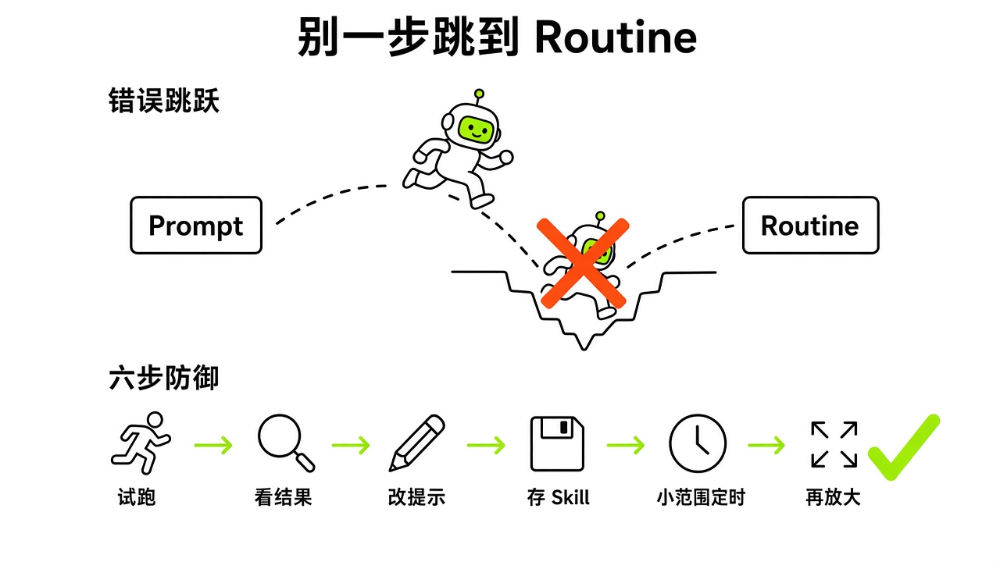
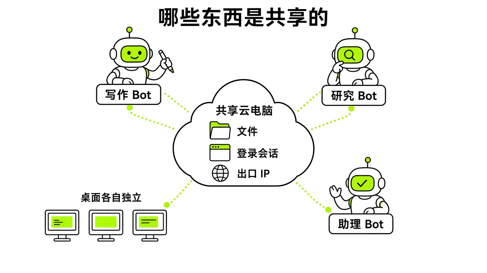
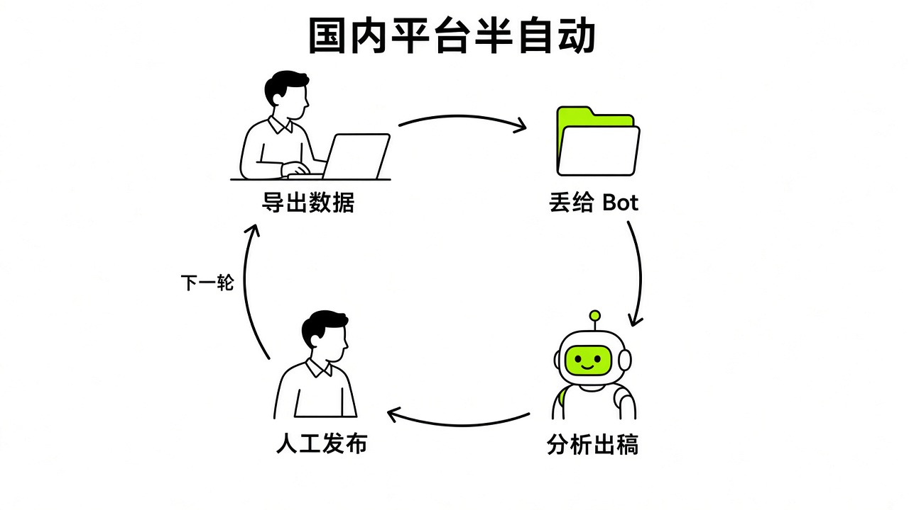
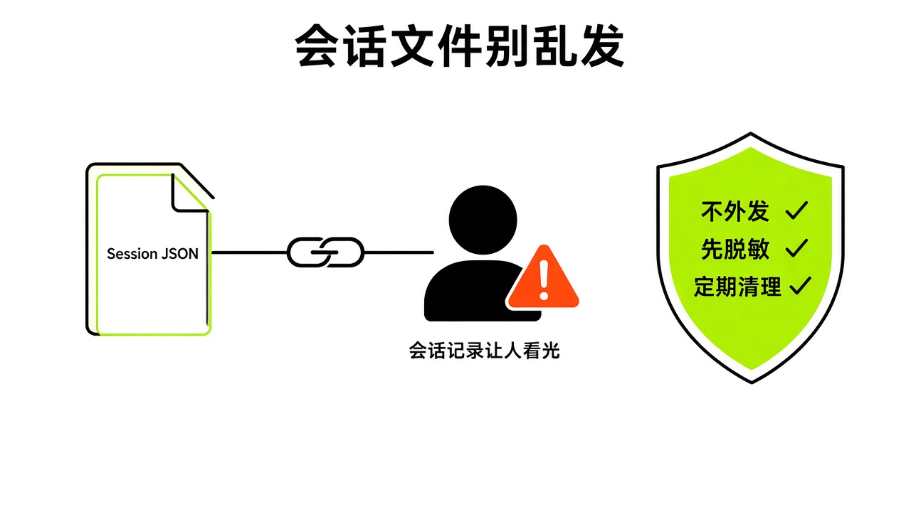

# §23 别这么用 · Anti-Patterns

[← 上一章：§22 常见故障速查 · Troubleshooting](../part8-pitfalls/22-troubleshooting.md) ｜ [📖 返回目录](../../README.md#-目录) ｜ [下一章：§24 从 "聊天" 到 "管理" · Managing, Not Chatting →](../part9-mental-models/24-mental-models.md)

---

> **适合谁**：已经跑通第一个任务、准备设 Routine 或多 Bot 的读者。**前提**：读过 §07 Skill 与 Routine、§08 审批与安全。

用 Grok Bot 最容易犯的毛病，就是把聊天框里的爽快感直接搬到自动化系统里。平时对话模型漏个字段，顺手回一句就能纠正。但在自动化工作流里，任何未经检验的假设都会在云电脑后台被放大，最后变成失控的账单、平台风控警告，或者数据泄露。这一章我不讲怎么把功能跑起来，专门整理我调研发现的、以及社区用户踩出来的典型反模式。

## 23.1 只在一个例子上跑通就排程 · Schedule Too Soon

很多新手刚上手时，在聊天框随手给一句提示词，看到 Bot 顺畅打开网页抓下了数据，一兴奋就随手点排程设成了定时 Routine。不少人以为只要模型跑通了一次，就能从此在云端替自己值班。这种从 Prompt 直接跨到 Routine 的冲动，是整个自动化链路里最危险的习惯。

开发者 @Michael_Fenech_ 总结过这个误区【社区】（https://x.com/Michael_Fenech_/status/2106352565528977469）。跑通一次提示词，只能证明目标网页当时的 DOM 结构刚好符合模型理解，没弹验证码，网络没丢包，也没缺字段。在单一用例上成功就匆忙排程，本质上只是把一次偶然正确的聊天记录硬存成了定时器。目标网站一旦改版，或者输入参数变为空值，Bot 在后台就没了判断基准，轻则静默退出，重则死循环乱点。

比单次崩溃更费钱的是无节制的高频轮询。社区开发者 @fleyta88 做过 Routine 成本审计【社区】（https://x.com/fleyta88/status/2109346840382415019）：一个每 5 分钟跑一次的 Routine，一个月会触发 8,640 次。作者按 API 价格估算，他的示例任务这样跑约 $397/月，改成每小时一次约 $33；如果先做廉价的变更检查、只在有变化时完整运行（例子中 180 次），约 $45。作者也说明这是 API 估算，不是 Grok Bot 订阅的实际扣费。另外官方安全文档规定，由后台 Routine、外部触发器或跨 Bot 消息触发的审批卡，无人干预大约 10 分钟就会标记为 Expired【官方】（https://docs.x.ai/grok-bot/approvals-security-and-privacy.md），操作直接不会执行。如果你没守在屏幕前点确认，写操作不仅白耗运行资源，关键步骤实际上全都被系统静默废弃了。

盲目排程还容易让人把流程运转当成价值产生。Nate B Jones 在视频《Grok Bot Is The First AI Agent You Just Install. Is It Worth $200?》里也提醒过类似问题（本书转述，未核对视频原话）【社区】（https://www.youtube.com/watch?v=LM7Ft7g8qJw）。每天推到终端的监控晨报如果从不影响你的实际决策，它就只是信息噪音。任务要是缺了终止条件，甚至会彻底失控。社区帖称有人只建了一个叫 Elon 的 Bot 且没分配明确工作，Bot 却在后台自发反复尝试生成真人图片替换头像，陷入死循环停不下来，一次性消耗了 4% 的周额度【社区】（https://linux.do/t/topic/2807876）（社区帖称此为个例）。

避免这个坑的办法，是按 @Michael_Fenech_ 的六步测试来（他把顺序概括为一句话）：**Task → Fix → Skill → Test → Routine**【社区】（https://x.com/Michael_Fenech_/status/2106352565528977469）。先人工协同带着跑一次真实任务；在交互中不断修正提示词，限制决策边界和数据来源，直到输出稳定；再把成熟步骤固化为独立 Skill；换一套全新数据盲测一轮；写清楚数据源失效、页面改版或触发审批时的降级规则；最后用 Test run 做完整校验。



*图：从 Prompt 到 Routine 的错误跳跃与六步防御链路对比*

排程前建议用这套提示词重构执行计划，强制要求 Bot 发现变化才干活：

```text
Audit my existing routines and rebuild the execution plan around actual changes.
1. List every routine, its schedule and expected output.
2. Replace polling with narrow event triggers where supported.
3. For frequent schedules, check only a hash, count or timestamp before doing full work.
4. Stop immediately when nothing changed.
5. Leave irreversible actions as drafts for human review.
6. Log every run with time, result, changed status and approval state.
7. Flag routines with over 95% no-change runs.
Show me the proposed changes and estimated savings first. Don't modify or delete anything without approval.
```

> [!TIP]
> 🧪 【实测·TODO待实测】高频 Routine 在无变更状态下的资源消耗与拦截表现。

> [!NOTE]
> 📸 **截图位（待补）**：后台触发的审批卡在 10 分钟后显示为 Expired 的状态提示

## 23.2 把会话当权限边界 · The Shared Boundary Fallacy

很多人用多 Bot 协作时，容易有个想当然的假设：既然管理面板能建好几个 Bot，换头像、起名字、填岗位说明，那它们是不是像独立的虚拟机一样互相隔离？建一个抓公开网页的，建一个管私人邮箱的，彼此各管一摊互不相干？这个假设非常危险。

官方安全文档明确警告：**不要把不同的 Bot 当作安全边界**【官方】（https://docs.x.ai/grok-bot/approvals-security-and-privacy.md）。在你个人账户底层，所有 Bot 实际上共用同一台云电脑。文件系统、持久化工作目录 `/workspace`、底层命令行凭据以及系统级浏览器，对你名下所有 Bot 完全敞开。你在 Bot A 的浏览器里登录了某个站点后台，Cookie 和登录态就会留在机器里；转头让 Bot B 打开浏览器，它照样能直接拿到登录态去操作对应数据。

忽视这个机制极易引发安全事故。社区里已有前车之鉴，有用户在拉了所有 Bot 的协作群里误发了敏感密码，群里所有 Bot 都在上下文记忆里读到了这个凭据【社区】（https://x.com/i/status/2107339523038331338）。另一个常见问题是多 Bot 并发撞风控。有用户为了提速，同时指挥多个 Bot 去同一个网站干活。因为所有 Bot 共用同一台云电脑的出口 IP 和浏览器，目标网站判定同一个账号异常并发登录，随即触发安全封锁【社区】（https://x.com/i/status/2100351900881207770）。

审批机制和分享功能同样有严格边界。官方安全文档明确规定，审批功能只能拦截模型还没执行的提议操作，根本没法撤销或回滚已经执行完毕的历史动作【官方】（https://docs.x.ai/grok-bot/approvals-security-and-privacy.md）。要是为了省事配置了允许浏览器内一切操作这种宽泛规则，Bot 在不可预期的页面遭遇诱导注入，后果根本无法挽回。向社区分享 Bot 模板时，虽然官方只复制配置，不带本地数据和凭据，但要是你在提示词、系统设定或代码里写死了个人 API Key、内网地址或敏感客户信息，这些私密数据依然会跟着公开链接全漏给别人【官方】（https://docs.x.ai/grok-bot/approvals-security-and-privacy.md）。

基础安全底线是把这台共享云电脑当成没隔断的开放工位。千万别在云电脑上直接登录网银、核心财务系统或主力私人邮箱【社区】（https://ytget.cc/ ，该站称引自官方文档，官方原文未见此条）。遇到密码、双重验证码、短信验证码或支付确认，绝对不能在聊天框发明文，必须按官方规范交接控制权：在 Agent Computer 界面点 Take control 按钮，人在屏幕上输完，再交还控制权让 Bot 继续跑【官方】（https://docs.x.ai/grok-bot/approvals-security-and-privacy.md）。特定项目结束后，主动退出相关站点，及时清理云电脑工作目录下的敏感临时文件。



*图：共享云电脑架构下多 Bot 共享文件、会话与出口 IP 的真实范围*

> [!NOTE]
> 📸 **截图位（待补）**：通过 Agent Computer 界面接管控制权进行敏感信息输入的步骤

## 23.3 国内平台高频点击 · High-Frequency Botting

很多国内用户刚上手，就想把公众号、小红书、抖音、知乎等账号交给 Grok Bot 代管。但这些平台在 Grok Bot 官方生态里目前完全没有官方连接器或原生集成【社区】（https://xiangyugongzuoliu.com/grokbot-use-cases/）。面对这种断层，新手最常走的下策，就是让 Bot 打开云电脑浏览器登录网页后台，用模拟点击和滚动去高频刷数据、批量点赞、定时群发私信甚至自动发推文。

用无头浏览器高频模拟人工点击，在国内平台就是踩雷。象鱼工作流在复盘实战用例时强调，国内主流内容平台风控极度敏感【社区】（https://xiangyugongzuoliu.com/grokbot-use-cases/）。以微信公众号为例，深度阅读转化率和完读率等核心业务数据根本不渲染在公开页面前端，盲目挂定时任务频繁刷后台，极易触发异常风控导致限流封号。鼠标移动轨迹、请求频率加上境外服务器 IP，多重审查一旦发现非人类点击，系统立刻弹出滑块拼图或短信二次验证。没人干预的 Bot 会瞬间卡死，持续重试甚至会直接招致账号永封。

海外平台的自动化同样有极高风控代价。社区有公开记录显示，有用户尝试把 Grok Bot 接入 WhatsApp 托管日常沟通，结果两个个人账号被封（帖子没有说明是否永久）【社区】（https://www.reddit.com/r/GrokBot/comments/1w11r70/ ；官方条款见 https://www.whatsapp.com/legal/third-party-agents-terms ）。国内生态虽然有开发者基于腾讯的 ClawBot 或 iLink 接口搭建了中转程序，通过 webhook routine 把指令桥接到 Grok Bot【社区】（https://x.com/KinGao476942/status/2108171436213104836 ；https://ele.ac.cn/2171/ ），但这套民间方案落地硬伤不少。除了微信客户端必须满足特定版本（iOS ≥8.0.70、Android ≥8.0.69），登录二维码有效时间只有 5 分钟左右，错误码 -14 会反复提示登录凭据失效，云电脑一重启就得重新扫码重启中继。虽然教程分享者声称走对应接口不封号，但这并未获得微信官方承诺，把个人社交号交给非官方自动化始终存在被风控识别的高额风险。

针对缺少原生插件的国内主流平台，行之有效的操作标准是建立**半自动化流水线模式**。取数据阶段，别让 Bot 挂着账号在后台实时抓，由人把后台报表导出为表格文件或截取数据大屏，把离线文件给 Bot 拆解分析；做内容阶段，把 Bot 的职能严格限定在选题策划、素材聚合与文案撰写，产出作为草稿归档到文档；最后分发阶段，文章发布、评论回复、私信发送以及资金往来等高风险动作，牢牢留在自己的客户端由人手动完成，严禁让 Bot 在未经授权的网页后台自主点击发送。



*图：国内无插件平台下离线数据导入与人工闭环发布的半自动化协作流*

> [!NOTE]
> 📸 **截图位（待补）**：尝试在无头浏览器中自动登录时触发的滑块验证阻断页面

> [!TIP]
> 🧪 【实测·TODO待实测】国内平台网页端在云电脑无头浏览器下的滑块验证码触发频率。

## 23.4 跨区、代充与违规套利 · Grey Market & Terms Risks

Grok Bot 热度起来之后，中文互联网上迅速滋生出大量的灰色套利渠道、违规教程和诈骗陷阱。官方订阅有一定门槛，不少新手想找便宜捷径，结果直接掉进了灰产卖家的圈套。

各类黑灰产里危害最深的是要会话凭据的代充。有第三方渠道卖 SuperGrok 代充（标价 ¥299/月，该店页面同时列出官方价 $30/月），操作指南里明确要求买家交出浏览器中的 Session JSON 凭据【社区】（https://claudemax.shop/blog/grok-bot-guide-supergrok ）。很多新手完全不理解这有多严重。该店自称 Session JSON 只做格式检查、不含登录令牌，但把账号信息交给第三方本身就有被滥用和违反服务条款的风险【推测】。市面上还有打着「国内体验版」旗号的第三方产品，它们不是官方【社区】（https://claudemax.shop/blog/grok-bot-guide-supergrok ）。

第二类常见违规是低价区跨区订阅和用云电脑套利。LINUX DO 社区里常有人讨论通过印度等低价区以每月约 50 元人民币开通 SuperGrok 会员【社区】（https://linux.do/t/topic/2848179 ）（社区帖称此为个例）。伪造账单地址和网络归属地跨区套利公然违背了用户协议，官方随时可能批量清退，一旦被判定为作弊，账号会被即刻封停，里面的数据也会彻底丢失。类似的高危操作还包括把海外云电脑当成跳板网络，有自媒体发教程引导用户借用 Grok Bot 的美国云电脑去注册或订阅 Claude Code【社区】（KinGao 公众号 10/5《如何用 Grok Bot 进行 Claude Code 注册及订阅》；https://x.com/KinGao476942 ；同类帖 https://x.com/Mileson07/status/2102404899158020312 ）。这种绕过区域准入限制的行为严重触碰了 Anthropic 的合规政策，极易引发大面积关联封号。

云电脑使用方式也存在被滥用的违规现象。社区帖称有人在云电脑中部署开源工具 sub2api，把个人 Grok 账号的授权凭据直接包装成标准 API 接口对外提供服务，甚至号称单日消耗了 3000 万 token【社区】（https://x.com/onlyforapp/status/2105878555015950421 ）（社区帖称此为个例）。这种用法很可能违反服务条款，有封号风险【推测】。金融领域借 Grok Bot 概念的虚假宣传也屡见不鲜，比如链上凭空发行的同名虚假代币 $GROKBOT，以及网上广泛传播的宣称 Bot 自主量化几天翻几十倍的暴富截图【社区】（https://x.com/i/status/2102291280965640690 ），全都是虚假营销和杀猪盘。

面对这些信息，底线其实就几条：走官方公布的正规渠道开通服务；死守密码和 Session JSON 会话凭证，绝不透露给第三方；不把云电脑当成绕过其他平台风控的代理跳板；对任何吹嘘 Bot 全自动投机暴富的营销话术保持警惕。



*图：把 Session JSON 等账号信息交给第三方代充的风险路径（该店称其不含登录令牌，但账号信息外泄仍有滥用与违反条款的风险）*

> [!NOTE]
> 📸 **截图位（待补）**：社区中典型的交出会话凭证代充教程与诈骗信息示例

---

[← 上一章：§22 常见故障速查 · Troubleshooting](../part8-pitfalls/22-troubleshooting.md) ｜ [📖 返回目录](../../README.md#-目录) ｜ [下一章：§24 从 "聊天" 到 "管理" · Managing, Not Chatting →](../part9-mental-models/24-mental-models.md)
