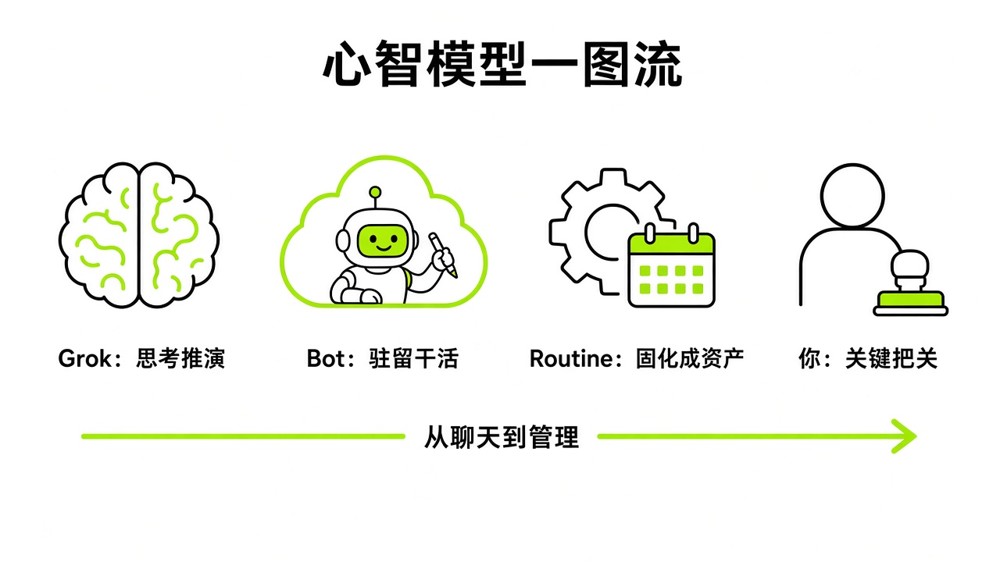

# §24 从 "聊天" 到 "管理" · Managing, Not Chatting

[← 上一章：§23 别这么用 · Anti-Patterns](../part8-pitfalls/23-antipatterns.md) ｜ [📖 返回目录](../../README.md#-目录) ｜ [下一章：附录 A–E · 速查、价格、模板、连接器、更新日志 →](../appendix/A1-appendix.md)

---

> **适合谁**：已经用过几次 Bot、想让它长期稳定干活的读者。本章讲心态和方法，不涉及具体操作；24.5 是作者个人判断，以【推测】为主。



*图：心智模型一图流。从聊天到管理的认知跃迁：Grok 负责思考与推演，Bot 负责驻留云电脑并操作工具，Routine 将验证过的步骤固化为资产，人在关键节点把关审批。*

我翻看社区讨论时发现，新手最容易犯的一个错，是把 Grok Bot 当成另一个更聪明的聊天框。跑去敲一段长篇大论问行业趋势，等它吐出一篇分析。这完全用错了地方。如果你只要一段文字、一个点子或一份方案，普通 Grok 几秒钟就能搞定，根本不用占着一台全天候开机的云电脑。Grok Bot 的底层逻辑不是陪你聊，而是接手具体工序的虚拟员工。从向模型提问变成给团队派活，核心就不是提示词工程，而是组织与流程管理了。

## 24.1 Grok 想、Bot 做 · Grok Thinks, Bot Does

很多新手分不清 Grok 和 Grok Bot 的边界。官方把 Grok Bot 定义为“能把事情做完的 AI 队友（AI teammates that finish the work）”，自带独立云电脑，能登录工具并在后台持续跑【官方】（来源：https://x.ai/bot 与 https://x.ai/news/introducing-grok-bot ）。社区高赞帖把这两者的分工说得很透：Grok 负责调研、对比、想明白，再发明确指令；Grok Bot 负责开软件、改内容、发消息，真正把事情做完【社区】（来源：https://x.com/i/status/2106883332432945519 ）。

这直接决定了你的日常工作流。构思项目、对比方案，去 Grok 对话框里推演。有了清晰结论、需要执行具体动作了，才轮到 Grok Bot。比如让它抓取五个竞品的公开更新、整理成表、交到团队工作区并起草通知邮件。社区常说“Dots 像 AI 秘书，而 Grok Bot 像 AI 组织”【社区】（来源：https://x.com/i/status/2105404819745718679 ）。有韩国用户记录过在特斯拉车里用 Grok 语音理顺思路，再直接给后台的 Grok Bot 派单【社区】（来源：https://x.com/i/status/2104229085509788008 ）。官方在 X 上的联动也是这个逻辑：在 X 上回复特定内容并呼叫官方账号，系统会提示已将任务转给你的 Grok Bot 处理【官方】（来源：https://x.com/i/status/2108586705695449318 ）。记住这个核心心智：**Grok 负责想清楚，Grok Bot 负责把事做完**。别在 Bot 控制台里问开放式的哲学问题，纯属浪费云电脑资源。

## 24.2 "Routine 才是产品" · Routines Are the Product

社区里有句话直戳本质：“这里的 Routine 才是真正的产品，Bot 本身并不是（The routines are the product here, not the bot）”【社区】（来源：https://x.com/i/status/2109516426767654962 ）。如果你建了个 Bot，每天全凭心血来潮去打字派活，它就是一台昂贵的手动打字机。Bot 只是个承载环境和凭据的工位，真正为你持续产出价值的资产，是你配置并排期的 Routine。

新手最容易踩的坑，是直接从提示词跳到定时任务。输入框里敲一句话，Bot 侥幸跑通一次，就随手点保存为 Routine，后面肯定崩溃。社区实践者 Michael Fenech 提出过一套严密的演化法则：Task → Fix → Skill → Test → Routine【社区】（来源：https://x.com/Michael_Fenech_/status/2106352565528977469 ）。这套流程分几步走：先手动跑一次真实任务，确认能做完；接着修正步骤、决策逻辑和输出格式，调到流程稳定；第三步把跑通的流程沉淀为 Skill，省得模型每次从头摸索；第四步换一份新输入做二次测试，只在一个样例上跑通不叫能力，那叫存了条聊天记录；第五步明确定义各类失败情形，包括数据源失效、信息过期、遇到审批或突发意外时的退避策略；最后用系统的 Test run 跑通输入、输出和审批断点，确认无误再正式上线。社区成员 kocer_eth 也提出过类似的晋升流程：先验任务，再抓取方法固化为带明确权限的 Skill，做二次输入测试，最后排期为 Routine【社区】（来源：https://x.com/kocer_eth/status/2105008655770788250 ）。

这跟官方团队的方法论一致。官方指南明确强调“做一次任务，固化为技能，排期为例程”，每个 Bot 最多 50 个 Routine，应用保留最近 20 次运行记录【官方】（来源：https://docs.x.ai/grok-bot/skills-routines-and-automations.md ；转述见 https://x.com/cyrilXBT/status/2100094833671254070 ）。官方工程师 Peng Zheng 和 Lauren Tan 在访谈中也指出，建立自动化体系的正确路径是“观察工作 → 沉淀技能 → 排期为 Routine”，核心是逐步建立人对机器的信任【官方】（来源：https://www.youtube.com/watch?v=xZ5TEaleUdg （团队成员访谈））。官方 101 直播演示里，团队用 Teach a task 录制屏幕，教名为 Maya 的助理 Bot 建 Google 表单并生成二维码，系统随即自动生成了专属技能【官方】（来源：https://www.youtube.com/watch?v=8xXhE25vJZY ）。工程师在直播中直言，固化为 Skill 的核心动机是“Token 经济学（tokenomics）”，能大幅减少试错和解析页面的推理轮次，不用每次对着生疏的网页代码漫无目的地乱撞。

官方的 Teach a task 最长录制 10 分钟的电脑可见操作【官方】（来源：https://docs.x.ai/grok-bot/skills-routines-and-automations.md ）；社区帖补充说录制不含麦克风声音【社区】（来源：https://x.com/B_doong2daddy/status/2100573792569303402 ）。同一作者在试"同一任务录 3 次让它取平均"，效果未验证【社区】。【实测·TODO待实测】连续录制三次相同任务检验 Bot 生成技能脚本的稳定性。

一条能稳定上线的 Routine，提示词结构都很严谨。Rowan Cheung 归纳的 X 监控 Routine 模板是个标准参考：必须写明明确时区、数据来源、时间窗口、过滤规则、输出字段、投递渠道、禁止动作，以及查无数据或失败时的降级方案【社区】（来源：https://x.com/rowancheung/status/2108328114552000842 ）。

```text
Every weekday at 9:15am in my time zone, search X and the web for new AI workflows people are actually running. Keep only cases that name the old task, the tool, and the result: time saved, a step removed, or a handoff that used to need a person. Drop product announcements, "10 prompts" threads, and anything the author has not used more than once. Return at most 3. For each, give the link, the job it replaces, what I would need connected, and whether it fits my work. Send it to me on Slack. Do not post or reply anywhere else. Save this as a routine. If nothing qualifies, send one line saying so.
```

**千万不要从 Prompt 直接跳到 Routine，必须走完 Task → Fix → Skill → Test → Routine 的完整链条**。底座打稳了，任务才能经得起真实业务环境的长期考验。

## 24.3 流程不等于价值 · Process Is Not Value

很多人刚接触自动化，很容易沉迷“忙碌感”。给 Bot 排满定时任务：早八点推行业资讯，中午抓社媒讨论，下午发竞品报告。后台日志刷得飞起，看着像有整支团队在拼命干活，其实多半在自我感动。

科技分析师 Nate B Jones 在视频里谈过这个误区，大意是很多人把流程运转当成了价值（本书转述，英文原话未能核对字幕）【社区】（来源：https://www.youtube.com/watch?v=LM7Ft7g8qJw ）。每天准时送达的早报，如果不看直接划掉，或者看了也不改变任何经营决策，那除了空耗算力毫无意义。社区帖称，fleyta88 测算过（个例，为作者基于 API 的估算，非订阅实际扣费），一个每 5 分钟轮询一次的 Routine 每月空跑 8,640 次，折合算力成本近 400 美元；改成只比对哈希值或时间戳的轻量检查、有真实数据变动才唤醒执行，作者估算约 $45/月，降低约 89%【社区】（来源：https://x.com/fleyta88/status/2109346840382415019 ）。另外官方文档标明，后台触发的审批卡大约 10 分钟就会显示过期，过期的操作不会执行【官方】（来源：https://docs.x.ai/grok-bot/approvals-security-and-privacy.md ）。脱离人工监管的高频定时任务不仅容易空转，还会因为审批卡超时频繁卡死。

任务膨胀了就必须做审计。社区实践者 kocer_eth 分享过一套每月淘汰机制：列出所有激活的 Routine，逐项清点真正采纳的产出，标出常报错或长期忽略的，每月至少挑一条无用任务删掉【社区】（来源：https://x.com/kocer_eth/status/2101669438038634827 ）。官方团队成员 Lauren Tan（@poteto）在访谈中提到，她用自己做的 Dr. Eggbot（Marketplace 上一个帮你设计 Bot 的模板）配合 Routine 审计所有 Bot 与 Routine 的活跃度与开销【官方】（来源：https://www.youtube.com/watch?v=xZ5TEaleUdg （团队成员访谈））。《华尔街日报》也有一篇关于 AI 智能体在购物和聊天中"跑偏"出错的报道（付费墙，本书只依据标题，未读全文）【社区】（来源：https://www.wsj.com/tech/ai/ai-agents-assistants-shopping-chat-errors-a316d3f9 ）。

为了避免陷入流程虚荣，Alex Finn 给的晨间提示词很实用。睡前让项目 Bot 连夜跑构件，早晨醒来别问“总结昨晚新闻”，而是给明确行动指令：“我刚醒来，立刻列出我们现在可以做出的决策清单，以推动业务向前迈进”【社区】（来源：https://x.com/AlexFinn/status/2108319537116725426 ）。

```text
I just woke up. Give me a list of decisions we can make right now to push the ball forward
```

检验每一条自动化的黄金标准只有一个：**如果一条 Routine 连续运行了一周却没有改变过你的任何一项实际决策，请果断关停它**。

## 24.4 Bot 是同事，不是工具，所以要有岗位、交接、考核 · Coworkers, Not Tools

官方宣传产品理念时反复强调：“像对待队友一样向 Bot 派活（Message Bots like teammates）”【官方】（来源：https://x.ai/bot ）。从工具思维转到团队思维，你就得按管理真人的方式来：界定清晰岗位职责、划好权限红线、规范交接协议，并建立定期纠错复盘机制。

搭团队第一步，官方团队成员 poteto 建议：新手一开始只建一个 Bot，等管理复杂度真正上去了再拆，别一上来建一堆专职空壳【官方】（来源：https://x.com/poteto/status/2108097362283597916 （团队成员个人帖））。poteto 还建议上手先接常用日常工具，包括日历、Slack、工单系统、CRM 和网盘，让 Bot 拿到上下文和操作钥匙【官方】（来源：https://x.com/poteto/status/2107830403549831186 （团队成员个人帖））。社区认可的开箱指令也是这套：先接邮箱、日历和文档，让 Bot 挑出三件今天就能交接的事【社区】（来源：https://x.com/sidejob_AJ/status/2108592848300056956 ；Grok Bot 团队的 Roman Ugarte 在 Lenny's Podcast 访谈中同样建议直接问 Bot 能从你的盘子里拿走什么任务，来源：https://www.youtube.com/watch?v=maSdsTLaMuU ）。

划权限红线是管理中最关键的一环。官方采购助理 Haggle Bot 的系统提示词展示了标准分级：动作清晰划分为“始终允许（Always allowed）”、“必须显式批准（Needs explicit go）”以及“绝对禁止（Never）”三档【官方】（来源：https://x.ai/news/grok-bot-procurement ）。Michael Fenech 也强调，发外部邮件、付款下单、删数据或合并分支等高危动作，必须默认以草稿形式提交人审，绝不能全自主跑【社区】（来源：https://x.com/Michael_Fenech_/status/2105697750645977298 ）。

建了多个 Bot 后，协作模式需要严谨设计。Grok Bot 团队的 Roman Ugarte（具体职务未核实）在访谈中说，内测第二周用户群就自发形成了 Chief of Staff（幕僚长/总助）模式【官方】（来源：https://www.youtube.com/watch?v=maSdsTLaMuU （团队成员访谈））。人只跟一个核心总助对话，由总助去调度垂直领域的子 Bot。一个群聊可以放 2 到 6 个 Bot【官方】（来源：https://docs.x.ai/grok-bot/chat-and-collaboration.md ）；早期每个账号最多 50 个 Bot，后来更新日志写明已可创建超过 50 个【官方】（来源：https://x.ai/changelog/bot ）。如果不加限制，几个 Bot 在群里互相客套确认，几下就把上下文烧光了。社区实践者 Michael Fenech 建议在设定里加入“安静交接”规则【社区】（来源：https://x.com/Michael_Fenech_/status/2105697750645977298 ）：

```text
Only message another bot when it needs to act. No acknowledgments, thanks, or progress pings. Send one summary when the work is done.
```

几个管理细节：Peter Yang 建议给总助 Bot 取独立名字，别用自己的名字注册它的工作邮箱，免得邮件抄送时一片混乱【社区】（来源：https://x.com/petergyang/status/2108624122339287335 ）。汇报方面，社区流行让协同 Bot 每晚发语音备忘录，总结当天推进的事项【社区】（来源：https://x.com/i/status/2101851806330712339 ）。

还有真实事故踩出的坑。官方明确说明，账号下的所有 Bot 共享同一台常驻云电脑、浏览器和登录态，隔离级别是用户而不是 Bot【官方】（来源：https://docs.x.ai/grok-bot/approvals-security-and-privacy.md ，"Do not use separate Bots as a security boundary"）。社区发生过用户在群聊输密码导致所有 Bot 全盘知晓的事故【社区】（来源：https://x.com/i/status/2107339523038331338 ）；还有多个 Bot 在同一台机器并发访问同一网站被封禁的情况【社区】（来源：https://x.com/i/status/2100351900881207770 ）。Bot 出现事实错误时，别逼它重猜，要强制执行“纠错 → 回查来源 → 输出答案”，让它重新读取日历、收件箱或后台记录再答【社区】（来源：https://x.com/Michael_Fenech_/status/2106729045878514147 ）。管理 AI 团队的心态要平实：**把 Bot 当作领薪水的初级员工，给出明确的岗位说明书、权限红线与安静交接规范**。

## 24.5 我对 Grok Bot 的判断 · My Take

从 2026 年 8 月官方首次推出 Grok Bot，到 8 月底扩大资格覆盖 Cursor Pro 与 Teams，再到 9 月底发布 Team Bots 支持多人团队协同【官方】（来源：https://x.ai/news ），两个月迭代得非常快。官方采购案例里，Haggle Bot 把一笔超 14,000 美元的采购单压降了 58%【官方】（来源：https://x.ai/news/grok-bot-procurement ）；客服场景下，官方团队用 Bot 每天汇总超过两万条来自工单的产品反馈；按明确的退款说明，99% 的退款请求无需人工介入；稍加优化后，单个工单成本最低可到 0.2 至 0.3 美元【官方】（来源：https://x.ai/news/grok-bot-customer-support ）。结合这些官方动作与社区反馈，我对 Grok Bot 的演化路径有几点判断：

【推测】一人公司的形态在一两年内会演变为“一人加若干专职 Bot”的工业化标准。社区里已经有 Alex Finn 用一个 Bot（他叫它 Milo）运营 AI 用例目录站的雏形案例，作者自述其全天盯回复、提 PR、自主加功能并提交搜索引擎收录（个例，来源：https://x.com/i/status/2109152147325796381 ）。【推测】未来的商业壁垒不在于提示词写得多花哨，而在于谁能先为业务理出稳定跑通的 Routine 流水线并建立严格质检。

【推测】共享云电脑的单沙盒架构会走向多容器细粒度隔离。目前官方为了方便交接上下文，让所有 Bot 共用一台云电脑、同一个浏览器环境和同一套登录态【官方】（来源：https://x.ai/bot ）。虽然协同方便，但多个 Bot 同时访问同一第三方业务极易触发风控封号【社区】（来源：https://x.com/i/status/2100351900881207770 ）。【推测】后续企业级演进中，官方大概率会在单账户下引入轻量容器隔离，把高风险执行环境与总助管理环境解耦。

【推测】基于轮询的 Routine 会全面向事件驱动架构迁移。社区测算出的高频定时轮询成本居高不下【社区】（来源：https://x.com/fleyta88/status/2109346840382415019 ），官方设置的每个 Bot 50 个 Routine 上限【官方】（来源：https://docs.x.ai/grok-bot/skills-routines-and-automations.md ）也限制了暴力时间驱动排期。【推测】未来的工作流标准是“外部 Webhook 监听 + 轻量哈希比对 + 差量唤醒”，只有数据真发生改变才激活大模型，这也是规模化普及的必然选择。

【推测】多模型分工协同会彻底取代单模型全包。社区开发者已经在实践中搭建出多模型协作栈：Grok Bot 担任架构师调度日常，调 Cursor 云端 Agent 和 Opus 5.5 攻坚核心代码，用轻量快模型执行测试巡检【社区】（来源：https://x.com/i/status/2109300337203183940 与 https://x.com/i/status/2108990316644847920 ）。【推测】未来的 Bot 不会局限在单一基础模型上，而是作为通用编排中枢，按需动态调度不同算力。

【推测】完全无人干预的自主智能体在严肃商业场景中无法立足。《华尔街日报》关于智能体跑偏出错的报道（未读全文）【社区】（来源：https://www.wsj.com/tech/ai/ai-agents-assistants-shopping-chat-errors-a316d3f9 ），以及官方审批卡约 10 分钟自动过期的设计【官方】（来源：https://docs.x.ai/grok-bot/approvals-security-and-privacy.md ），证明了安全防线必须由人工把守。【推测】“草稿优先”与“权限三档”在未来数年依然是企业级部署的底层基石。**未来真正拉开差距的，不是向 AI 提问的辞藻，而是把复杂业务拆解为自动化工序的组织管理能力**。

## 本章来源

- https://x.ai/bot
- https://x.ai/news/introducing-grok-bot
- https://x.ai/news/designing-grok-bot
- https://x.ai/news/grok-bot-procurement
- https://x.ai/news/grok-bot-customer-support
- https://x.ai/news/team-bots
- https://x.ai/news
- https://docs.x.ai
- https://www.wsj.com/tech/ai/ai-agents-assistants-shopping-chat-errors-a316d3f9
- https://www.youtube.com/watch?v=xZ5TEaleUdg
- https://www.youtube.com/watch?v=8xXhE25vJZY
- https://www.youtube.com/watch?v=maSdsTLaMuU
- https://www.youtube.com/watch?v=LM7Ft7g8qJw
- https://x.com/Michael_Fenech_/status/2106352565528977469
- https://x.com/Michael_Fenech_/status/2105697750645977298
- https://x.com/Michael_Fenech_/status/2106729045878514147
- https://x.com/kocer_eth/status/2105008655770788250
- https://x.com/kocer_eth/status/2101669438038634827
- https://x.com/cyrilXBT/status/2100094833671254070
- https://x.com/B_doong2daddy/status/2100573792569303402
- https://x.com/rowancheung/status/2108328114552000842
- https://x.com/AlexFinn/status/2108319537116725426
- https://x.com/sidejob_AJ/status/2108592848300056956
- https://x.com/fleyta88/status/2109346840382415019
- https://x.com/poteto/status/2108097362283597916
- https://x.com/poteto/status/2107830403549831186
- https://x.com/petergyang/status/2108624122339287335
- https://x.com/i/status/2106883332432945519
- https://x.com/i/status/2105404819745718679
- https://x.com/i/status/2104229085509788008
- https://x.com/i/status/2108586705695449318
- https://x.com/i/status/2109516426767654962
- https://x.com/i/status/2101851806330712339
- https://x.com/i/status/2107339523038331338
- https://x.com/i/status/2100351900881207770
- https://x.com/i/status/2109152147325796381
- https://x.com/i/status/2109300337203183940
- https://x.com/i/status/2108990316644847920

---

[← 上一章：§23 别这么用 · Anti-Patterns](../part8-pitfalls/23-antipatterns.md) ｜ [📖 返回目录](../../README.md#-目录) ｜ [下一章：附录 A–E · 速查、价格、模板、连接器、更新日志 →](../appendix/A1-appendix.md)
